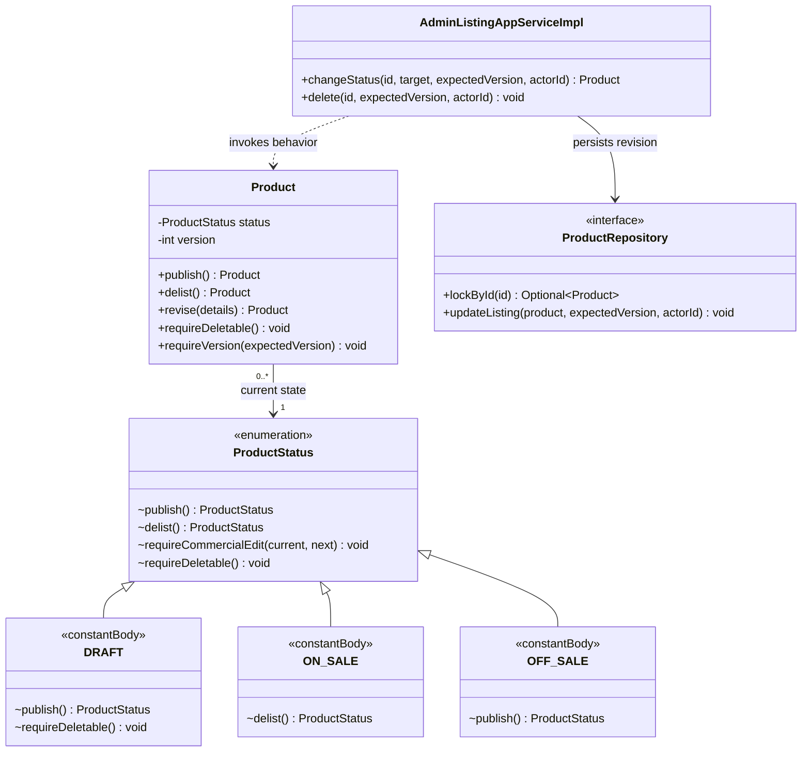
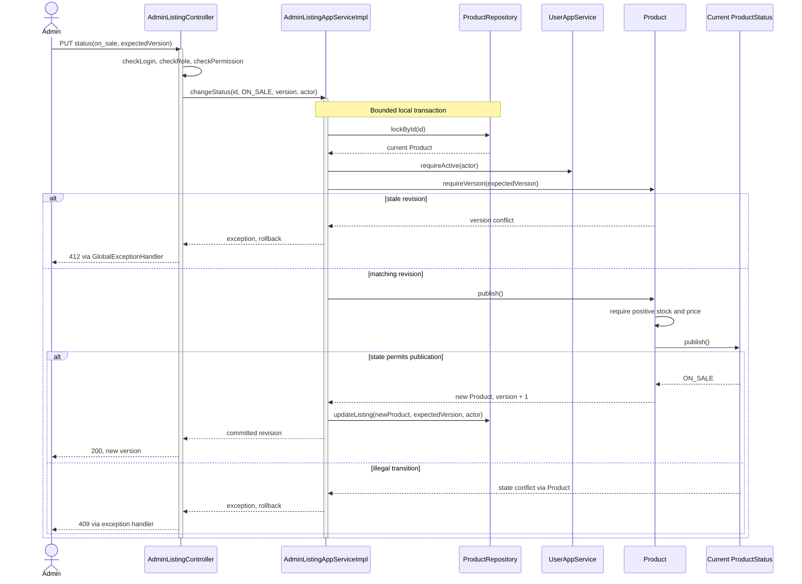

# UC9 — administrator listing management (#32)

## Analysis and contribution

Member: Wang Ziang (Eric), implementation; Liu Jin, review role, per issue #32. The implementation
is published at `8fe3d14` on `codex/uc9-admin-listings`, not merged. Review ownership is not a claim
that a teammate has completed review. See the original [design plan's contribution map](backend-skeleton-plan.md#13-course-report-analysis-and-design-map).

### Analysis

An administrator needs to prepare, publish, correct and withdraw catalog listings without exposing
drafts, overwriting concurrent edits or deleting commercial history. The hard design problem spans
UC1 visibility, quotation consistency and UC3/UC4 retained team references, not just CRUD fields.
Two admins can edit the same revision; a listing with old quotes or closed teams still has history.
Google authentication alone is insufficient: the local account must have the role and permission.

### Design

`AdminListingController` validates transport and session → `AdminListingAppServiceImpl` bounds the
transaction and locks the product → `Product` delegates lifecycle rules to `ProductStatus` →
`ProductRepository` performs version-guarded persistence. Cross-domain history is queried through
`GroupDealQueryService.hasProductReferences`; policy/quote history stays catalog-owned. Responses
use explicit DTO mapping and the generated OpenAPI contract. No separate admin aggregate is created.

Creation returns draft/version 0; successful updates increment once; stale revisions return 412.
Published listings may be delisted but not returned to draft. Soft deletion is limited to
unreferenced never-published drafts; it is not a physical purge or deletion of related business rows.

### Design Pattern and alternative

**State** participants are Product (context) and ProductStatus's per-state implementations; behavioral
methods delegate transitions and edit/delete rules. This differs from UC5's current code-only
DealStatus enum. **Repository** isolates persistence. Existing **PricingStrategy** is reused by the
catalog consumers, not newly implemented by UC9. Static `Product.draft` and DTO conversion are not
GoF Factory Method/Abstract Factory claims despite the earlier sprint's broad pattern directions.

Reject controller status setters, unversioned last-write-wins updates and deletion that checks only
active teams. New lifecycle states must define allowed operations and tests; future order persistence
must add its owning reference facade before claiming safe product deletion. Detailed mechanics and
tests follow below; manual acceptance remains pending as recorded in issue #68.

## Course analysis and UML

| Analysis item | UC9 contract |
| --- | --- |
| Primary actor | Active administrator with both admin role and catalog:product:write permission |
| Trigger | Prepare, revise, publish/delist a product or delete an unused draft |
| Preconditions | For existing products: identity exists and current version is supplied; authorization belongs to this environment |
| Main flow | Authorize → validate → lock product → check actor/version → apply aggregate behavior → persist → return revision |
| Success postcondition | Exactly one revision committed; public visibility follows lifecycle; audit/history retained |
| Alternatives | 400 invalid input; 401 no session; 403 forbidden; 404 absent; 409 state/reference conflict; 412 stale version |
| Failure guarantee | Rejected mutations do not change the stored revision; technical errors roll back the local transaction |

### State selection using the course five elements

| Element | Applied explanation |
| --- | --- |
| Name / category | State — behavioral GoF pattern |
| Problem / intent | Publish, delist and edit have different legal behavior in different lifecycle states |
| Context | One Product aggregate shared by admin management, public browsing and commercial-history consumers |
| Forces / constraints | No published → draft transition; published price/stock frozen; no public status setter; pure domain; stable stored codes |
| Solution | Product delegates rules to its current ProductStatus constant's behavior; the application persists the resulting immutable revision |

The **aspect to vary is lifecycle behavior**, not calculation. State fits better than Strategy here:
legal behavior follows current state, not a client's selection of interchangeable algorithms.
Command could package requests but would not replace state rules. Memento is not used: restoring
old published content could contradict accepted deals/quotes. Repeated status switches in every
caller were rejected because they distribute the same transition rules across use cases.

Participants: Product is Context; ProductStatus defines state behavior; DRAFT, ON_SALE and OFF_SALE
constant-specific class bodies provide concrete behavior. They are not three separately named Java
classes. A Product references a shared immutable enum value, not an exclusively owned state object.
Default methods reject unsupported operations. The application's target switch selects the command;
the current-state object still decides whether that command is legal.

SRP separates transport, transaction, rules and SQL. DIP keeps persistence behind ports. OCP reduces
changes to callers, but a new enum state still requires mapping/command-target/test updates: do not
claim zero-change extension. State does not solve concurrency; row locks and expectedVersion do.

### UML class diagram — implemented State

`+` public, `-` private, `~` package visibility. Constant-body nodes represent actual enum behaviors,
not invented named classes. Unrelated getters/DTO fields are omitted; association is not composition.



### UML sequence diagram — publish and stale retry



UC1 reads visibility from stored state, not an Observer-updated cache. Deletion additionally queries
history-owning ports under the product lock; State alone cannot know cross-aggregate references.
ProductLifecycleTest, AdminListingAppServiceImplTest and AdminListingFlowIT verify these boundaries;
manual acceptance remains separate. The stock/price rejection also maps to 409 before state dispatch.

## Scope and compatibility

API-only catalog CRUD, not a management UI, inventory adjustment, checkout or Stripe implementation.
The accepted deletion rule is: only never-published drafts with no business references can be
soft-deleted. Published listings can be delisted, never returned to draft or physically purged.

This increment builds on the merged Boot 4.1.1 / Java 21 baseline. The older pinned versions in
`.claude/skills/backend-constraints-skill` predate the merged Boot upgrade; this feature introduces
no framework/dependency upgrade. COLA layers, MyBatis, PostgreSQL 18, Sa-Token and the existing
HTTP 200 success `Result` convention remain unchanged. Failures retain their real HTTP status.
Existing buyer browse and first-team quote endpoints and response shapes remain unchanged.
The OpenAPI contract is generated from the application, never hand-edited.

## Design problems and actual patterns

- **State:** `ProductStatus` has concrete per-state behavior; `Product.publish`, `delist`, `revise`
  and `requireDeletable` delegate rules to that state. Persisted codes remain `draft`, `on_sale`,
  `off_sale`. There is no public status setter and no route back to draft. This is not merely an
  enum labelled as a pattern. A new state must define its behavior and transition tests.
- **Repository:** extend the existing `ProductRepository`, not a duplicate listing aggregate or
  persistence layer. Infrastructure owns DO/JSON conversion and versioned SQL; application owns
  transactions. Product reconstitution gains an additive version overload, retaining existing
  callers. Product and team-price-policy versions are separate concurrency tokens.
- **Strategy:** the existing `PricingStrategyResolver` / `PricingStrategy` remains authoritative
  for browsing and first-team quotes. UC9 does not duplicate the pricing formula, introduce a
  second strategy registry, or call a factory method a GoF Factory Method.
- **Cross-use-case boundary:** deletion consults catalog price-history persistence and groupbuy's
  public `GroupDealQueryService` boolean reference query, never another domain's mapper. The
  existing open-deal browse query is unsuitable because closed/deleted history still counts.

## HTTP contract

All routes are under `/api/v1/admin/products`. Every operation requires the existing `admin` role
AND `catalog:product:write` permission, currently granted only to administrators by V6. Reads are
also protected. The actor comes from Sa-Token, and application services recheck account activity.
No new auth framework, token domain or permission migration is introduced.
Generated OpenAPI declares the `blocbuyToken` cookie apiKey scheme (cookie `blocbuy-token`) on these seven operations only;
it does not add a global security requirement or change anonymous buyer browsing. UC9 schema
patterns enforce complete strings (including rejecting trailing newlines) and positive money,
so JSON Schema substring matching does not weaken the documented request constraints.

| Method/path | Semantics |
| --- | --- |
| POST `/` | Create a draft with server UUIDv7, optional productNo (omitted/null generates a `BB-` number), version 0, soldCount 0 and existing `dual` pricing mode. |
| GET `/` | Page all non-deleted listings; optional `status`; page >= 1, size 1–100; newest first with UUID tie-breaker. |
| GET `/counts` | Read `{draft, onSale, offSale, openDeals, withActivePolicy}` totals in the Result envelope; same login, role, permission and active-account checks as the page. |
| GET `/{id}` | Read draft/on-sale/off-sale listing including its version; deleted/absent returns 404. |
| PUT `/{id}` | Replace `listing` content with required `expectedVersion`; do not accept productNo/status/counters/pricingMode. |
| PUT `/{id}/status` | Required `status` (`on_sale` or `off_sale`) and `expectedVersion`. |
| PUT `/{id}/team-terms` | US25 (#221). Required `expectedVersion`, `targetSize` (>= 2) and `lifetimeSeconds` (2400-86400); optional `teamPrice` (`amount`, `currency`, `validFrom`, `validUntil`, `expectedVersion` = latest policy version). See below. |
| DELETE `/{id}?expectedVersion=N` | Conditional soft deletion of an unreferenced draft only; row remains for audit. |

Team terms (US25): `PUT /{id}/team-terms` sets how many paid members a team needs and how long it stays open, and optionally appends a first-team price policy revision in the same transaction. It is a full replacement, allowed in every lifecycle state; `teamPrice` needs an on-sale listing and a value below the original price. `expectedVersion` is the product version (412 `CATALOG_412_002`), `teamPrice.expectedVersion` the latest policy version (412 `CATALOG_412_001`); a rejected price rolls the terms back.

Errors: a missing or out-of-range `expectedVersion`, `targetSize` or `lifetimeSeconds` is 400 `COMMON_400_002` with a list of field errors, because the request repeats the domain bounds as Bean Validation. The domain's own check (`CATALOG_400_003`, a map naming each bad term field) stays as the backstop for non-HTTP callers and is not reached through this endpoint. A bad `teamPrice` is 400 `CATALOG_400_001` with no field errors, exactly as on the standalone policy endpoint: a price not below the original price, `validFrom` not before `validUntil`, or `validUntil` already past. A `teamPrice` for a listing that is not on sale is 409 `CATALOG_409_001`. Term errors are reported before the price is checked.

The response returns the new product `version`, the `teamTerms` and the `teamPrice` appended, if any; the admin `GET` responses gain `teamTerms` (members null and `configured` false when never configured; the schema marks both members nullable). `teamPrice` is omitted, not null, when the command set no price. `configured` only means both terms are set and in bounds: START can still fail on a configured listing that is not on sale, has no stock, or has no price policy in force for at least the next 2400 seconds. Each write appends a `log_product_team_terms` row. Decisions: [backend ADR 0001](../adr/0001-payment-business-integration.md), addendum 2026-09-29.

Creation example:

`productNo` may be omitted or null to use server generation; a supplied value such as the example below is retained and must meet the existing format and live-row uniqueness rules.

```json
{
  "productNo": "TEA-001",
  "listing": {
    "title": "Green tea",
    "description": "Leaf tea",
    "images": [],
    "originalPrice": "12.00",
    "currency": "sgd",
    "stock": 5
  }
}
```

Optional content fields: subtitle, description, coverImage, images, category. Omission clears an
optional field on PUT; this is replacement, not PATCH. Images are display data, never fetched by
the server. Money is an exact positive decimal string, at most 16 integer and 2 fractional digits;
v1 creation/editing supports SGD consistently with first-team quotes. Unknown input fields are
rejected by the existing global Jackson policy.

Before publication price and initial stock may change. After first publication, editorial content
may change, but originalPrice/currency/stock must match current values: generic catalog editing
must not become stock replenishment or silently invalidate configured prices. soldCount,
productNo and pricingMode are never writable here. Future stock or commercial-term changes need
their owning business command and explicit quote/deal compatibility rules, not relaxed setters.
Publication requires positive price and stock. Policy configuration remains a separate existing API.

POST is not replay-idempotent: duplicate live productNo returns `CATALOG_409_003`; database
uniqueness settles concurrent duplicates. Mutations require the current product version and
increment once. A stale retry returns `CATALOG_412_002` without mutation; clients must re-read,
not automatically overwrite. DELETE is effect-idempotent: repeating it returns 404, not another
mutation. Illegal lifecycle/term edits return `CATALOG_409_002`; business references return
`CATALOG_409_004`; invalid listing fields return `CATALOG_400_002` or existing protocol validation
codes. Omitting DELETE's required version returns HTTP 400 / `COMMON_400_001`, never 500.
No business exception is converted to a success envelope.

## Transactions, history and extension obligations

### Dashboard counts decision — 2026-09-30 (#248 / BA-3)

The catalog application owns the composed admin dashboard read model (`AdminListingAppService.ListingCounts`), exposed as `GET /api/v1/admin/products/counts`. Reuse the existing public `GroupDealQueryService.countOpenDeals` boundary rather than joining groupbuy tables from catalog or requiring a second HTTP endpoint. Infrastructure keeps the listing and deal aggregate SQL in their owning domains, returning only counts across the boundary. The controller exposes an explicit response DTO inside `Result` and uses the established administrator guard; the application rechecks account activity.

One catalog query uses PostgreSQL filtered counts for `draft`, `on_sale` and `off_sale` with `deleted = false`, matching the paged admin read's predicates. One groupbuy query counts every non-deleted deal whose stored status is `open`, `current_size < target_size` and `expire_time > CURRENT_TIMESTAMP`, across all products regardless of listing publication status. Multiple eligible deals on one listing each count; a stale open flag on a full or expired deal is insufficient. Empty populations return numeric zeros. No aggregate rows are loaded or queries executed per listing.

The application read uses a read-only `REPEATABLE READ` transaction: account validation and both aggregate queries share a database snapshot, and expiry uses its transaction-time database clock. This is a point-in-time dashboard, not a reservation or a guarantee that separate later page requests see identical totals during concurrent writes. Existing pagination is unchanged. Exact global totals necessarily scan qualifying rows; no speculative index or cache is added without volume and latency evidence. `AdminListingFlowIT` verifies status/page agreement, empty results, full/overfull/expired/exact-expiry/closed/deleted exclusions, multiple deals per product and administrator authorization, including independently missing role or permission and disabled accounts.

### Latest policy read decision — 2026-09-30 (#249 / BA-4)

`AdminListingResponse.latestPolicy` contains `{amount, currency, validFrom, validUntil, version}` from the highest non-deleted policy revision, matching `getPolicy` even when the revision is expired or future-dated. An absent revision is explicit JSON null; OpenAPI expresses the object-or-null union and generated frontend types preserve it. The application returns a catalog-owned `ManagedListing` view, keeping policy history out of the Product aggregate. Create returns null; revise/status responses also return the current summary so their shared response shape remains accurate.

Admin detail and page reads now use read-only REPEATABLE READ. Choose one batched latest-policy lookup over a joined product projection: it reuses the policy converter and latest-revision semantics while preserving existing pagination and aggregate persistence. A non-empty page makes three catalog statements (rows, total, policies), independent of its size; an empty page skips policy SQL. `SqlStatementCapture` counts actual MyBatis prepared statements in `AdminListingFlowIT`, comparing 1-row and 20-row pages and requiring one policy statement in the larger page. The batch is bounded by the existing 100-row page limit and uses the policy table's existing product/version index.

Counts gain `withActivePolicy`: one aggregate statement selects the latest non-deleted revision for each non-deleted listing before applying `valid_from <= CURRENT_TIMESTAMP < valid_until`. Draft and off-sale listings can count; this measures configured valid rules, not checkout eligibility. Future or expired latest revisions suppress older valid ones; multiple revisions count a listing once, and deleted revisions/listings are excluded. This adds a third aggregate read to #248's snapshot transaction. The buyer policy endpoint is unchanged. PostgreSQL integration tests cover matching read values, explicit nulls, replacement rules, deleted history and exact start/end boundaries; query-count evidence is not a latency benchmark.

### Product number decision — 2026-09-30 (#247 / BA-2)

Accepted option (a) with compatibility: create without a product number generates `BB-100001`-style numbers; existing clients may continue to supply their own valid numbers. Empty, whitespace, malformed and overlong supplied values still return 400; a duplicate live supplied number still returns `CATALOG_409_003`. The number remains immutable after creation. This matches the admin artboard without removing the request field or changing existing clients' supplied identifiers; A3-08 can omit the field once this contract lands.

V21 adds `domain.seq_biz_product_product_no` (bigint, starts at 100001, no cycle). The application checks the active actor, then resolves the number and inserts the draft in its existing 10-second transaction. Both supplied and generated paths acquire the same PostgreSQL transaction-scoped advisory lock before insertion. Generated allocation uses a separate statement after lock acquisition, so READ COMMITTED observes the preceding creator's committed insert. It selects the first unused candidate starting at `nextval`, checks exact strings against all `BB-` history including deleted rows, and advances the sequence only to that candidate. Supplied suffixes are never parsed or used as a high-water mark.

The short creation lock deliberately serializes admin creates to avoid supplied/generated namespace races; revising existing listings retains its product-row lock protocol. Allocation materializes the `BB-` history once and considers at most N+1 consecutive candidates for N historical rows; at most N can be occupied. Candidate arithmetic uses numeric and filters to bigint range before casting the selected number. This bounds work by catalog history rather than supplied suffix magnitude, accepts the capstone catalog size, and makes no query/retry loop. All supported creators must use the application service and its transaction. Direct SQL imports must coordinate with the same lock; the existing partial unique index remains the final live-row conflict guard. Sequence advances survive rollback, so gaps are expected; generated numbers are not promised to be consecutive. Keep V21 and the sequence state during application rollback, and apply the migration before deploying the new creator.

Review correction (2026-09-30): replaced the original highest-supplied-suffix allocation because a supplied `BB-9223372036854775806` or `BB-9223372036854775807` could exhaust generation. `AdminListingFlowIT` now verifies omitted/null creates remain available with both supplied boundary values before and after soft deletion, and that adjacent occupied candidates are skipped across live and deleted history.

Commands use a 10-second bounded application transaction, locking `biz_product` first with the
same `FOR UPDATE` used by quotation configuration/issuance, then checking actor and version.
SQL also compares expectedVersion and deleted=false and checks affected rows. No provider call,
network call or retry loop occurs within the transaction. Stock edits on drafts are guarded by
the same row lock/version. create_by/update_by and update_time are maintained; no cascade exists.

Deletion checks zero soldCount plus ALL policy, quote and group-deal references, including expired,
closed and logically deleted rows. Nothing deletes or rewrites these snapshots. V8 adds historical
product lookup indexes for group deals and quotes; policies already have the required index prefix.
Two partial indexes support active admin pagination with and without status filtering. Pagination
retains the existing offset contract; these indexes do not eliminate the cost of very deep offsets.
V4–V7 remain untouched. V8 is transactional with bounded lock/statement timeouts and must be
scheduled appropriately on populated tables; large live tables require a reviewed concurrent
index rollout. No foreign keys or CHECK constraints are introduced, per the team DDL agreement.

Current order persistence is a placeholder: `backend/docs/db/order.sql` is design DDL, not a
migrated table. Payment references orders, not products. Before order persistence is enabled,
the order owner must expose its product-reference facade, wire that check into deletion, and
add integration tests. Do not add a fake always-false order check and claim order safety.

Quotation writers require on_sale under the product lock, so legitimate quote creation cannot
race with deletion of a never-published draft. `PaidGroupDealService.startConfirmed` remains a
trusted internal collaborator that accepts an already validated catalog/inventory snapshot.
Its future checkout caller must validate the on-sale product under the product-first transaction
protocol before creating a reference. This patch does NOT retrofit that unfinished payment/checkout
orchestration. Arbitrary SQL/imports that ignore the protocol can violate invariants; they are not
supported writers. Orphan repair and physical retention/purge remain owner-coordinated work.

## Verification contract

Pure domain tests cover lifecycle behavior, publication stock guards, frozen commercial terms
and money validation. Application tests cover product-first lock order, trusted actor validation,
references, stale preconditions and bounded pagination. `AdminListingFlowIT` uses MockMvc's servlet
request chain, real Sa-Token RBAC, Flyway, application services and PostgreSQL 18; sessions use the
existing test-only memory store. This is not a network/browser end-to-end test. It exercises CRUD,
authorization (including role-only and permission-only denials), input validation, retained
histories, omitted-field replacement, number reuse, generated contract metadata and competing
edits. Existing browse, quotation and paid-group tests remain regression gates.

Run `mvnw.cmd verify` and regenerate with `verify -Popenapi-export`; run the repository's API
compatibility check before a PR. Passing new tests alone is not proof of a green full build or
live Stripe/Google integration. Runtime verification results are reported separately.

## Manual local acceptance checklist

This checklist is prepared for the maintainer; automated MockMvc coverage does not mark it complete.
Use the normal local application profile, an isolated local database and an existing administrator
session with `catalog:product:write`. Do not add a login bypass or grant production permissions
just to test this API. The local Swagger entry is `/api/swagger-ui.html`; send the normal
`blocbuy-token` header with management requests.

1. Create a uniquely numbered draft using the example above; record its id and version 0.
2. Read/edit it as administrator, then retry with the old version: expect 412 and no overwrite.
3. Confirm buyers cannot read the draft. Publish with the latest version; buyer detail becomes 200.
4. Delist it; buyer detail becomes 404. The admin read and unchanged historical data remain.
5. Attempt to delete the delisted item: expect 409. Create a second, unreferenced draft and delete
   that instead; verify it disappears from admin reads while its database audit row remains.
6. Repeat management calls with no session and a buyer session: expect 401 and 403 respectively.

## Operational handoff for a future PR

No deployment is performed by this local increment. Before release, the backend deploy owner must
check migration-number collisions against the current target branch and assess table size/write
load before V8: the bounded transactional index build is not a zero-downtime promise.
Confirm Flyway reaches version 8, then verify `/api/actuator/health` and the manual create/read/
edit/publish/delist cycle in the deployment's test environment using its normal authentication.

During that smoke cycle, inspect the existing traceId-correlated application logs for unexpected
500s or database lock timeouts. Expected 409 lifecycle rejections and 412 stale writes are not by
themselves rollback triggers. Unexpected buyer visibility, lost revisions, or deleted historical
rows are stop-release conditions. Traffic thresholds and a longer monitoring window are not
defined by this repository and must be agreed with the deploy owner rather than invented here.

An application rollback must not purge listing/history rows or rewrite applied Flyway migrations.
V8 adds only indexes, so leave it applied during an application rollback; any later index removal
needs a separate reviewed migration. Keep writes paused if invariant violations are suspected.

## Local verification record — 2026-09-11

Baseline: `origin/dev` at `e163558d886812f6ea3fbc61d0e662447042a1a9`, refreshed before isolated
verification. Java 21 on Windows with Docker Desktop / PostgreSQL 18; no WSL shell required.

- Full working-tree `mvnw.cmd -B -ntp verify`: **203 tests**, zero failures/errors/skips. This includes
  eight pre-existing local Stripe tests outside the UC9 change; that payment WIP was not modified.
- Independent `origin/dev` worktree with only the 29 UC9 changed/new files copied verbatim:
  **195 tests**, zero failures/errors/skips; full `verify` succeeded without payment WIP or QA files.
  The temporary worktree was removed after checking every copied file still matched the main tree.
- UC9 adds **32 tests**: 3 domain, 6 application and 23 PostgreSQL-backed acceptance tests. The
  missing-delete-version test first reproduced 500 instead of 400, then passed after the fix.
- Spotless, Checkstyle, SpotBugs, ArchUnit and migration/integration gates passed. Existing
  non-failing Checkstyle warnings remain; no thresholds or CI configuration were relaxed.
- OpenAPI regenerated twice from final source with identical SHA-256:
  `B5D47DA967264E9DDD4EEBBCDC907588FD78A650535F7927A73A8E045059B180`.
  The CI-pinned `openapi-diff` 2.1.7 reported backward compatibility. Deep comparison confirmed
  every old path and component schema unchanged; ECMAScript checks also verified all five new
  pattern constraints and the six scoped admin authentication declarations.
- Nine independent review lenses completed. Three validated findings were applied in two
  file-scoped fix batches: missing query error mapping, schema pattern fidelity and auth metadata.
  Both additional RBAC denial scenarios were tested; no accepted review findings remain unresolved.

This is local verification, not a remote CI/CD, deployed-service, browser/manual or real
Google/Stripe-provider acceptance result. At the time of this verification record, no commit,
push, PR, issue or kanban update had been made. Subsequent handoff published commit `8fe3d14`
and issue #68; it did not complete manual acceptance or merge the branch.
