# Backend Skeleton Implementation Plan

Status: LOCKED — all 20 questions answered 2026-08-30. Ready to implement.
Style: terse. Substance complete.

Historical note added 2026-09-11: sections 1–12 retain the original skeleton decisions, not a
current feature-completion checklist. Later merged code uses Boot 4.1.1, Spotless and Result JSON
envelopes, superseding D18, D14 and D10 respectively. Sections 13–20 add course-oriented analysis
and design evidence without reopening the stack or authorizing implementation of proposed features.

## 1. Goal

Init `backend/` skeleton. Spring Boot 3.5.15 + JDK 21 + Maven COLA multi-module + MyBatis.
5 domains × 4 layers, skeleton only — no business impl.
`mvnw verify` green from day one: compile + checkstyle + ArchUnit + unit tests + one PG smoke test.

## 2. Locked Decisions (from Q&A)

| # | Decision |
|---|---|
| D1 | COLA multi-module: client / adapter / application / domain / infrastructure / bootstrap |
| D2 | groupId `com.blocbuy`, artifact prefix `blocbuy-` |
| D3 | Backend self-contained under `backend/`; no repo-root pom |
| D4 | Domains: `identity`, `groupbuy`, `order`, `catalog`, `notification`; amended 2026-08-31: + `payment` (Stripe) |
| D5 | Middleware: PostgreSQL 18 + Redis 8.10.0 only. No MQ, no ES |
| D6 | Sa-Token session Redis-backed (`sa-token-redis-jackson`) |
| D7 | One token domain; RBAC roles/permissions loaded from user SQL tables via `StpInterface` |
| D8 | JDBC `jdbc:postgresql://localhost:5432/Blocbuy`; PG schema = `domain` |
| D9 | Hand-written converters (no MapStruct) |
| D10 | Errors = RFC 9457 ProblemDetail + `code` + `traceId`; success = bare DTO; no envelope |
| D11 | API base path `/api/v1` |
| D12 | springdoc-openapi + springdoc-openapi-maven-plugin for `contracts/openapi.json` |
| D13 | Checkstyle Google Checks, line length relaxed to 120 |
| D14 | No formatter plugin now — Checkstyle only |
| D15 | English messages first; i18n seam in `ErrorCode` (message keys) |
| D16 | Dockerfile/compose — later, separate task |
| D17 | Rotate leaked dev passwords (docs/deploy/dev/db-access.md) — urgent, separate action |
| D18 | Boot pinned 3.5.15 exactly |
| D19 | Commit empty-baseline `contracts/openapi.json` |
| D20 | One Testcontainers PG smoke test in skeleton |

⚠ D8 caution: `Blocbuy` capital-B. PostgreSQL folds unquoted identifiers to lowercase. If DB was created quoted as `"Blocbuy"`, JDBC URL must keep exact case; if created unquoted, real name is `blocbuy`. Verify at first connection; doc the finding.

## 3. Stack — Versions Verified vs Maven Central 2026-08-30

| Component | Version | Source |
|---|---|---|
| JDK | 21 | toolchain pinned |
| Spring Boot | 3.5.15 | parent BOM |
| mybatis-spring-boot-starter | 3.0.5 | explicit |
| sa-token-spring-boot3-starter | 1.46.0 | explicit |
| sa-token-redis-jackson | 1.46.0 | explicit |
| springdoc-openapi-starter-webmvc-ui | 2.9.0 | explicit; 3.x targets Boot 4 — forbidden |
| springdoc-openapi-maven-plugin | 1.5 | verify at impl |
| PostgreSQL driver, Flyway core + `flyway-database-postgresql` | Boot BOM | managed |
| spring-boot-starter-data-redis | Boot BOM | managed |
| Lombok | Boot BOM | `@RequiredArgsConstructor`/`@Slf4j` only |
| ArchUnit JUnit5 | 1.4.2 | explicit |
| stripe-java | 33.4.0 | explicit; payment domain only, confined to infrastructure (added 2026-08-31) |
| Testcontainers (postgresql) | Boot BOM | managed |
| maven-checkstyle-plugin | 3.6.0 | explicit |
| maven-enforcer-plugin | Boot BOM | Java 21, Maven ≥3.9, dependencyConvergence |

All versions in parent `<properties>` + `<dependencyManagement>`. Children never declare versions.

## 4. Module Tree

```text
backend/
├── pom.xml                       # blocbuy-parent (pom packaging)
├── .mvn/wrapper/ + mvnw          # wrapper committed
├── checkstyle.xml                # Google checks, 120 col
├── blocbuy-client/               # external DTOs, contracts; zero business code
├── blocbuy-domain/               # aggregates, VOs, domain services, ports, events
├── blocbuy-application/          # command/query, use-case services, assemblers
├── blocbuy-adapter/              # controllers; protocol adaptation only
├── blocbuy-infrastructure/       # Mapper+DO+RepositoryImpl+Converter, Redis, Sa-Token RBAC impl
├── blocbuy-bootstrap/            # BlocBuyApplication, application*.yml, config, assembly
└── docs/design/                  # this plan
```

Dependency edges (Maven + ArchUnit enforced):

```text
adapter → application → domain
infrastructure → domain (+ application not allowed)
bootstrap → adapter + application + infrastructure + client
client ← adapter, application
domain → JDK + Lombok only
```

## 5. Package Map

Root: `com.blocbuy`

```text
per module × per domain (identity | groupbuy | order | catalog | notification | payment):

blocbuy-domain/com/blocbuy/{domain}/model/        # aggregate root, entity, VO — skeleton
blocbuy-domain/com/blocbuy/{domain}/repository/   # port interface per aggregate root
blocbuy-domain/com/blocbuy/{domain}/gateway/      # external-capability ports (e.g. payment
                                                  # PaymentGateway) — domain-side because
                                                  # infrastructure must not depend on application
blocbuy-domain/com/blocbuy/{domain}/event/        # past-tense events (placeholder)
blocbuy-domain/com/blocbuy/{domain}/exception/    # {Domain}ErrorCode enum
blocbuy-application/com/blocbuy/{domain}/command/ # intent commands
blocbuy-application/com/blocbuy/{domain}/query/   # view queries
blocbuy-application/com/blocbuy/{domain}/service/ # use-case services (tx boundary)
blocbuy-application/com/blocbuy/{domain}/assembler/
blocbuy-adapter/com/blocbuy/{domain}/web/         # {X}Controller, request/response DTOs
blocbuy-infrastructure/com/blocbuy/{domain}/persistence/
                                                  # {X}Mapper, {X}DO, {X}RepositoryImpl, {X}Converter
```

Shared kernel (minimal, per module):

```text
blocbuy-domain .../common/exception/   ErrorCode (interface, messageKey seam), BizException
blocbuy-domain .../common/model/       PageQuery (max size guard), PageResult
blocbuy-client .../common/constant/    ApiConstants (/api/v1, Idempotency-Key header)
blocbuy-application .../common/gateway/ # port placeholders (IdempotencyGateway etc.)
blocbuy-adapter .../common/web/        GlobalExceptionHandler (@RestControllerAdvice)
blocbuy-infrastructure .../common/config/ MyBatis, Redis, Sa-Token (StpInterface impl), Flyway marker
```

## 6. Baseline Components (skill hard gates — delivered as skeleton)

1. **ErrorCode system** — `ErrorCode` interface {`code()`, `httpStatus()`, `messageKey()`}; `BizException(ErrorCode, details)` final, unchecked; per-domain enum skeleton + `CommonErrorCode` (400/401/403/404/409/412/429/500).
2. **GlobalExceptionHandler** — single advice: BizException→enum status; `MethodArgumentNotValidException`/`ConstraintViolationException`→400 safe field errors; Sa-Token `NotLoginException`/`NotPermissionException`→401/403; unknown→500, logged once w/ traceId. Body: ProblemDetail + `code` + `traceId`.
3. **Sa-Token** — config via `@ConfigurationProperties` (token name, timeout, excluded paths); interceptor; `StpInterfaceImpl` in infrastructure loading roles/perms from identity tables (skeleton queries, RBAC per D7); skeleton login/logout/me endpoints in identity adapter.
4. **MyBatis** — mapper scan = `com.blocbuy.**.persistence`; map-underscore-to-camel on; XML mappers in `src/main/resources/mapper/{domain}/`; `@Param`/explicit columns rules documented.
5. **Redis** — key prefix `blocbuy:{env}:{domain}:{type}:{id}` constant; Jackson serializer; timeouts set; Sa-Token DAO points at Redis (D6).
6. **Flyway** — `db/migration/` + `V1__init.sql` placeholder (comment only); `defaultSchema=domain`, `currentSchema` in JDBC URL.
7. **OpenAPI** — springdoc UI `/swagger-ui`; parent `openapi-export` profile runs springdoc-maven-plugin → writes `contracts/openapi.json` at repo root (feeds `make contract-check`).
8. **Actuator/Micrometer** — liveness/readiness split, `/actuator/prometheus`, traceId MDC servlet filter (generates if absent, echoes header).
9. **Pagination** — `PageQuery` enforces max size 100; `nextCursor` field reserved in `PageResult`.
10. **Idempotency seam** — `Idempotency-Key` header constant + `IdempotencyGateway` port placeholder; impl with first write use case.

## 7. Per-Domain Skeleton Content

Each of 5 domains gets, per layer (payment, added 2026-08-31, additionally carries a domain-side
`PaymentGateway` port, an infrastructure `StripePaymentGateway` impl, a public
`/api/v1/webhooks/stripe` controller, and `V2__payment.sql`):

| Layer | Skeleton artifact |
|---|---|
| domain | one aggregate-root placeholder class + repository port interface + `{Domain}ErrorCode` enum |
| application | command/ + query/ dirs (`package-info.java`), one use-case service interface placeholder |
| adapter | one controller skeleton (`/api/v1/{resource}`, `@Tag` OpenAPI annotations, no business logic) |
| infrastructure | persistence dir (`package-info.java`) + RepositoryImpl placeholder |

Resource mapping (D11): `/api/v1/users`, `/api/v1/group-deals`, `/api/v1/orders`, `/api/v1/products`, `/api/v1/notifications`.

## 8. Build & Gates

- `mvnw` wrapper committed (Maven 3.9.x).
- Parent pom: modules, properties, dependencyManagement, pluginManagement (compiler release 21, surefire, failsafe, enforcer, checkstyle, springdoc plugin in profile).
- Enforcer: requireJavaVersion [21,22), requireMavenVersion [3.9,), dependencyConvergence.
- Checkstyle `checkstyle.xml` (Google, 120 col) bound to `verify` — Makefile `lint` calls same.
- ArchUnit suite `blocbuy-bootstrap/src/test/.../architecture/`:
  - 4-layer dependency direction
  - domain imports only JDK/Lombok (no spring/mybatis/redis)
  - no `*Controller` → `*Mapper`
  - no cross-domain `..persistence..` access
  - no field injection (no `@Autowired` on fields)
- Tests: per-module JUnit5 skeleton; `bootstrap` context test; infrastructure `PgSmokeIT` via Testcontainers PostgreSQL 18 (D20).
- Profiles: `local` → `localhost:5432/Blocbuy?currentSchema=domain`, Redis localhost:6379; `docker` → host `postgres`, `redis`. Secrets via env vars (`DB_USERNAME`, `DB_PASSWORD`, `REDIS_PASSWORD`) — never committed (D17).

## 9. Config Files

```text
blocbuy-bootstrap/src/main/resources/
├── application.yml            # common: server, jackson ISO-8601, actuator, springdoc, flyway enabled
├── application-local.yml      # localhost PG/Redis, env-var secrets
├── application-docker.yml     # compose-network hosts
├── db/migration/V1__init.sql  # placeholder
└── logback-spring.xml         # JSON-ish console + traceId pattern
```

## 10. Execution Order

1. Parent pom + 6 module poms + wrapper + enforcer + checkstyle.xml.
2. Domain common kernel: ErrorCode, BizException, PageQuery/PageResult.
3. Client constants (base path, headers).
4. Adapter common: GlobalExceptionHandler.
5. Bootstrap: `BlocBuyApplication`, application*.yml, actuator, traceId filter, logback.
6. Infrastructure common: MyBatis config, Redis config, Sa-Token config + StpInterfaceImpl, Flyway dir.
7. 5 domains × per §7 skeleton.
8. ArchUnit rules + context test + PgSmokeIT.
9. `openapi-export` profile → `contracts/openapi.json` baseline commit.
10. `mvnw verify` green → report: module/layer map, gate output, D8 case finding, risks.

## 11. Definition of Done

- `cd backend && ./mvnw verify` passes clean env.
- `make lint` path works (`checkstyle:check`).
- ArchUnit suite green — boundaries machine-enforced.
- ProblemDetail error body live (trigger 404/validation in smoke test).
- Sa-Token interceptor active; login skeleton returns 401 unauthenticated.
- No secrets in repo; env placeholders only.
- `contracts/openapi.json` baseline committed.
- No business logic, no empty MQ/ES abstractions (D5).

## 12. Risks / Follow-ups

- D8 `Blocbuy` case — verify at first connect; if mismatch, rename DB or fix URL.
- D17 password rotation — separate urgent action, owner: user.
- springdoc-maven-plugin 1.5 vs Boot 3.5.15 — smoke at step 9.
- Sa-Token 1.46.0 config keys — verify vs official docs at impl.
- `repository-structure.md` shows single-module backend — update doc after impl (multi-module won).

## 13. Course report analysis and design map

Evidence snapshot: code `8fe3d14`, 2026-09-11. Names follow the existing Sprint 1 report; assignments
follow [#49](https://github.com/PPsyrius/iss-groupbuy-team8/issues/49) and the UC issues. An assigned
member is not necessarily the author of every class. No other remote branch is audited here.
The user confirms State is an appropriate course pattern. Each selected pattern is explained by
Name, Problem/Intent, Context, Forces/Constraints and Solution, plus participants and UML.

| UC | Named member and scope | Original document / section | Implemented versus proposed |
| --- | --- | --- | --- |
| UC1 | Liu Jin: backend; Lim Jiechao: frontend | [§14](#14-uc1-browse-and-search), [pricing Strategy](team-price-quotes.md#course-analysis-and-uml) | Browse backend and Strategy exist; tracked frontend has only README |
| UC1-ext | Yu Qianshuo (Yorik): search; Lim Jiechao: paired UI | [§14](#14-uc1-browse-and-search) | Keyword search proposed, category filter exists |
| UC2 | Liu Jin: backend; Lim Jiechao: frontend | [§15](#15-uc2-google-authentication) | OAuth backend exists; real local login acceptance blocked by config |
| UC3 | Wang Ziang (Eric): groupbuy-side slice | [Paid participation](paid-group-participation.md#uc3-analysis-and-design) | Factory Method and local atomic creation exist; checkout/invite integration pending |
| UC4 | Wang Ziang (Eric): groupbuy-side slice | [Paid participation](paid-group-participation.md#uc4-analysis-and-design) | Locked admission/replay exist; full paid buyer flow pending |
| UC5 | Liu Jin | [§16](#16-uc5-lifecycle-and-observer-integration) | Last-member success exists; full State/Observer and expiry scheduler proposed |
| UC6 | Yu Qianshuo (Yorik) | [§17](#17-uc6-expiry-refunds) | Payment Adapter foundation exists; refund port/worker proposed |
| UC7 | Lim Jiechao | [§18](#18-uc7-share-attribution) | Observer subscriber proposed |
| UC8 | Lim Jiechao | [§19](#19-uc8-my-orders-and-teams) | Placeholder services/controllers; owner-scoped query proposed |
| UC9 | Wang Ziang (Eric); Liu Jin: review role | [Admin listings](admin-listings.md#course-analysis-and-uml) | State implemented on published branch; manual acceptance/merge pending |
| Production readiness | Panpakorn Siripanich (Pan) | [Existing handover appendix](../../../docs/deploy/prod/backend-prod-handover.md#course-analysis-and-contribution) | Repository design exists; external release evidence not verified here |

Eric's UC3/UC4 slice is evidenced by `b6f7faf`/`f104abb`, quotation by `cb02ad5`, and UC9 by `8fe3d14`.
Full accountable fields in #26/#27 still say TBD: reconcile them with the team before report
submission rather than silently assigning payment/order work. A complete Section 3 must contain at
least one member-confirmed UC per person, not just this mapping. The existing Word report is not
edited by this Markdown-only update. Pan's operational patterns do not automatically establish a
GoF case; confirm the course's acceptance of his selected non-functional UC or select an evidenced
functional case with the team. Do not invent implementation or reassign a teammate's work.

UML notation below: `+` public, `-` private, `#` protected, `~` package; `<|--` generalization,
`<|..` realization, `-->` association and `..>` dependency. Multiplicity describes logical instances;
no aggregation/composition diamond is added without a real ownership/lifetime relationship.
Diagrams marked **proposed** use conceptual participant names, not claims of existing Java classes.

## 14. UC1 browse and search

Members: Liu Jin (browse backend), Lim Jiechao (frontend), Yu Qianshuo (Yorik, keyword extension).
Sources: #24/#43/#44/#47. Detailed implemented Strategy class diagram and five-element analysis
are in [team-price-quotes.md](team-price-quotes.md#course-analysis-and-uml), avoiding a second registry.

### Analysis

An anonymous buyer wants on-sale products and individual/group prices. Preconditions: valid query
or ID. Main flow: select visible products, batch-enrich offers, compute display prices, return DTOs.
Postcondition: no write/payment/stock effect. Missing or off-sale detail returns 404; no compatible
active deal means absent group price, not zero or an invented discount. Category/pagination must
not bypass visibility. Repeated deal lookup per product is the N+1 design problem.

### Design and pattern selection

ProductController delegates to ProductAppServiceImpl.pageListings/getListingDetail. ProductRepository
filters non-deleted/on-sale rows; GroupDealQueryService supplies a single batch of best open deals.
PricingStrategyResolver selects PricingStrategy by product mode, and DualPricingStrategy resolves
the displayed pair. The variation is algorithm, so **Strategy**, not State or Factory Method, is
the core GoF choice. Repository and batch enrichment support DIP/SRP but are not extra GoF claims.
Existing tests: ProductControllerTest, ProductAppServiceImplTest, PricingStrategyResolverTest,
DualPricingStrategyTest and GroupDealQueryServiceImplTest; no new execution is claimed by this edit.

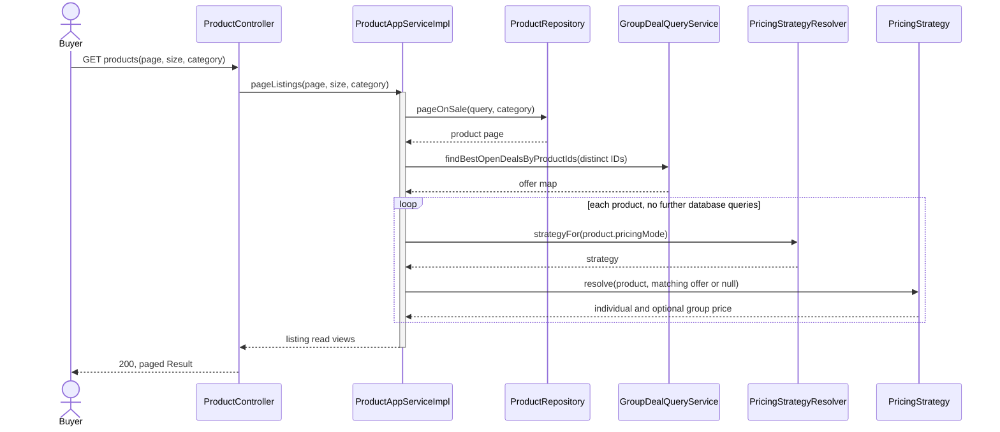

Frontend design remains proposed in this checkout: React SPA with generated TypeScript/OpenAPI
client, same-origin `/api`, separated request-state and presentation components, and loading/empty/
error/unavailable states. Do not recalculate prices in JavaScript. Component composition is not
automatically GoF Composite; a reverse-proxy route is not a Facade class; no such claims are made.

### Keyword extension analysis and design — backend implemented 2026-09-17

Problem: combine keyword/category/page criteria without duplicating browse visibility or unsafe SQL.
Actor: buyer; precondition: normalized bounded input; success: paginated visible matches with a
consistent total; alternate: empty result, not failure. The implemented rules are: trim and collapse
whitespace; blank keyword retains the browse path; reject keywords over 64 characters; match title,
subtitle, and description case-insensitively; combine whitespace-separated tokens with AND and
fields with OR; treat `%`, `_`, and `\` as literal data; combine category and keyword with AND.

The change point is query criteria. The application-layer `ListingQuery` is the implemented non-GoF
**Query Object** and exposes neutral tokens. PostgreSQL-specific case-insensitive `ILIKE`, wildcard
wrapping, and escaping stay in infrastructure; MyBatis binds every pattern with `#{}`. Explicit
Specification composition may later be useful but is not claimed as a taught GoF implementation.
Do not force Builder for a few fields or Chain of Responsibility where all criteria must combine
with AND rather than stop at the first handler. Do not introduce Elasticsearch. If the assessed
submission needs a GoF case, Yorik's UC6 Observer/Adapter design is the separate candidate, not a
reason to relabel a WHERE clause Strategy.

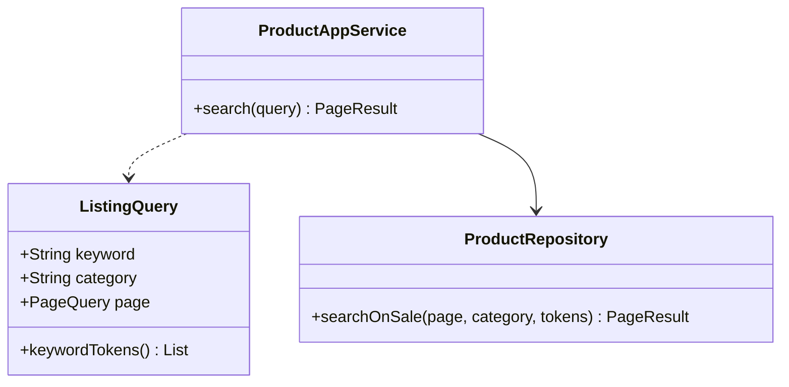

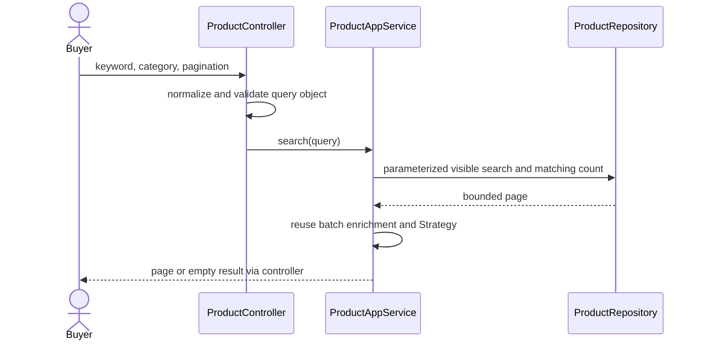

Verification includes controller/application unit tests and `ProductSearchRepositoryIT` against
PostgreSQL 18 for combined filters, wildcard-as-data behavior, empty results, consistent count/page,
stable ordering, public visibility, and AND-token behavior. The additive OpenAPI contract contains
the optional `keyword` query parameter. The frontend search box remains deferred until the frontend
scaffold exists; its generated client must consume that committed contract rather than a hand-written
shape.

An optional `ai=true` query parameter applies TypeSafe Jev semantic re-ranking after PostgreSQL has
selected the requested page. The catalog-domain `ListingSearchReranker` port carries only public
listing text and provider-neutral UUIDs; the infrastructure adapter asks one typed Choice question
and uses its probability distribution as the stable sort key. At most the first 20 products on the
page and 500 description characters per product leave the service. Disabled configuration, timeout,
provider rejection, or malformed output preserves SQL order, total, and availability. Re-ranking is
page-local and cannot move a product between pages. `TYPESAFE_API_KEY` remains server-side; ordinary
CI uses stubs, while the separate manually dispatched smoke workflow verifies the live credential.
The capstone intentionally accepts unindexed substring scans at its expected catalog size; page and
count use identical filters but may observe normal `READ COMMITTED` drift during concurrent edits.

## 15. UC2 Google authentication

Members: Liu Jin (backend), Lim Jiechao (frontend), #25/#41/#42. #41's Google-only implementation
supersedes #25's older password-registration checklist; no second auth channel is proposed here.

### Analysis

Actor: Google user seeking a local session. Preconditions: valid provider client/callback settings,
DB/Redis available, browser-bound one-time state. Success: verified provider subject maps to an
active local account and application session. First registration creates **buyer**, not admin.
Alternate paths: replay/binding mismatch, provider failure, invalid token, disabled account, or
conflicting email. None should produce an unauthorized session or silently merge different accounts.

### Design and five pattern elements

| Element | Applied explanation |
| --- | --- |
| Name / category | Adapter — structural GoF; provider isolation, not OAuth itself as a pattern |
| Problem / intent | Prevent Google SDK/protocol details from coupling every business use case to a provider |
| Context | OAuthLoginAppServiceImpl needs verified provider-free identity and one-time state consumption |
| Forces | Signature/issuer/audience/expiry checks; no provider tokens in business layers; race-safe local registration |
| Solution | OAuthIdentityGateway target port; GoogleOAuthGateway adapter; provider API/SDK adaptee; application client |

OAuthStateStore similarly abstracts Redis. The variable is external representation/protocol, so
Adapter is a better description than Bridge: there are not two independently varying class
hierarchies here. Command and Observer do not solve verification. DIP isolates SDK dependencies;
SRP separates provider operations from short account transactions. Security checks remain mandatory
under any adapter and cannot be swapped for a permissive test implementation in production.

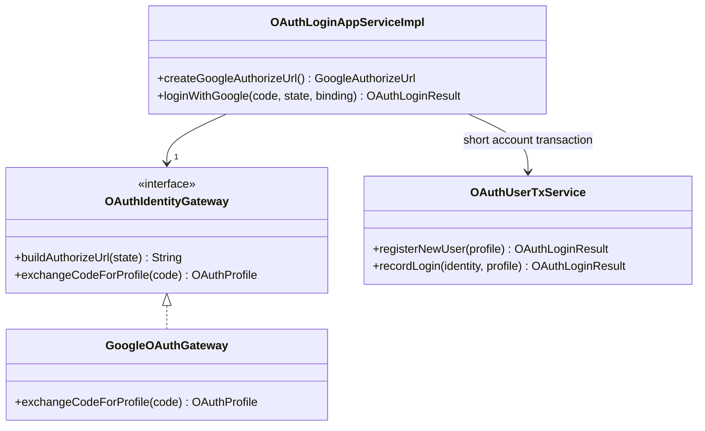

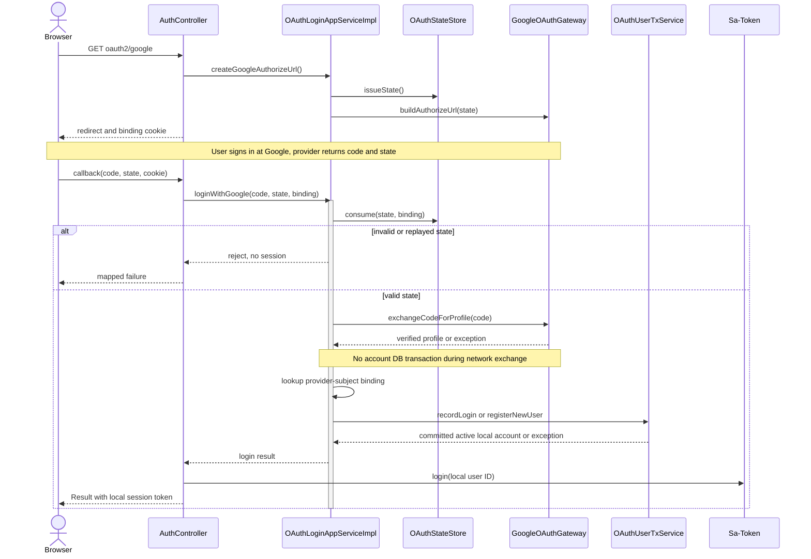

Provider/account failures stop before session creation. Concurrent registration losers reread a
binding after rollback; unrelated email collisions are rejected. OAuthLoginAppServiceImplTest,
OAuthUserTxServiceTest, GoogleOAuthGatewayTest and RedisOAuthStateStoreTest are evidence entry points,
not proof of real provider login. Frontend handling remains proposed; current callback returns JSON.

UC9's [#68 handoff](https://github.com/PPsyrius/iss-groupbuy-team8/issues/68) records local services
running but missing OAuth credentials and a 502 login response. Admin grants in a teammate's DB do
not transfer with Git. Real local acceptance requires matching OAuth config and local permissions;
fixture sessions may test business authorization but cannot be called successful Google login.

## 16. UC5 lifecycle and Observer integration

Member: Liu Jin, #28. **Implemented:** GroupDeal.joinPaid reaches SUCCEEDED on the final accepted
member under the UC4 lock. **Proposed:** full State behavior, scheduled expiry and event publishing.
DealStatus currently stores codes; it is not the implemented State shown for UC9.

### Analysis

Actors: resolving system timer and accepted last-member admission. Preconditions: existing team and
authoritative time/current state. Success: exactly one terminal outcome and durable consequence
handoff; alternatives: already resolved, deadline not reached, competing final join or DB failure.
Joining exactly at expiry must not win by using a timestamp captured before a long lock wait.

### State and Observer five elements — proposed

| Element | State | Observer |
| --- | --- | --- |
| Name / category | State, behavioral | Observer, behavioral |
| Problem / intent | Legal behavior changes with team state | Refund/credit consequences must not couple back into resolution |
| Context | Same aggregate handles last-member success and timeout | Committed domain facts have multiple independently failing consumers |
| Forces | One terminal outcome, no reopening, shared lock ordering | No lost event, idempotent retries, no provider calls under team lock |
| Solution | Existing GroupDeal delegates to state-specific transition policy | Publisher emits committed fact; subscribers own consequences through durable handoff |

State varies legal behavior; Observer varies consumers. A Command for the timer cannot replace
either. Calling refunds directly is rejected because network failure would hold locks or obscure
the committed outcome. SRP/DIP isolate consequences; OCP allows new consumers without editing
resolution. A transient Observer callback is insufficient for reliable delivery: proposed durable
DB event/outbox state and idempotent jobs remain to be designed and implemented under the no-MQ rule.

### UML class diagram — proposed State and shared Observer

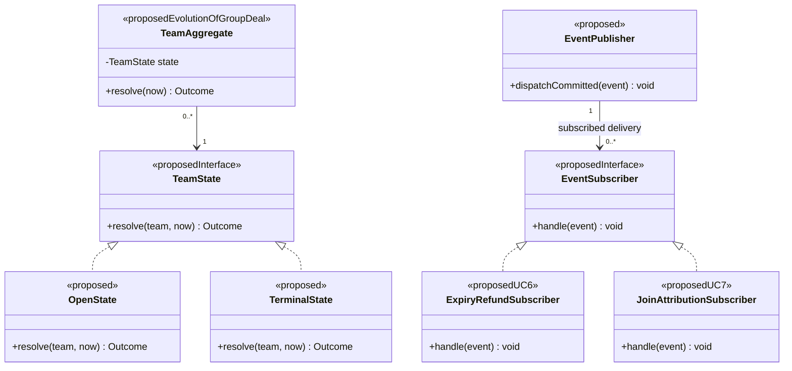

This is not new code or an approved class naming scheme. Application orchestration persists the
outcome and durable event together; the aggregate does not invoke a publisher inside its rule method.
Subscribers receive only relevant event types, not every event shown in the shared abstraction.

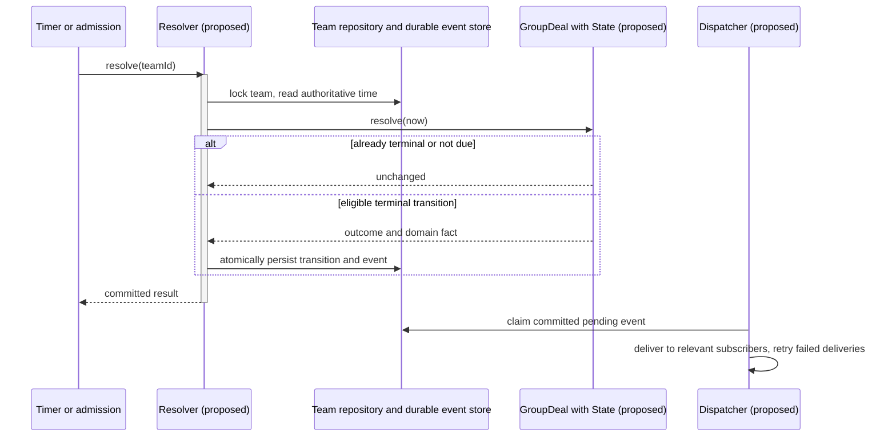

Required tests: timeout versus final join, exact deadline, repeat resolution, one transition/event,
transaction rollback, dispatcher restart and duplicate delivery. #28 uses informal `success`; stored
code is `succeeded`. Preserve codes rather than silently renaming them from a report diagram.

## 17. UC6 expiry refunds

Member: Yu Qianshuo (Yorik), #29. PaymentGateway/StripePaymentGateway provide an **existing Adapter
foundation**, but PaymentGateway has no refund operation. PaymentAppServiceImpl still has TODOs for
payment event deduplication and order confirmation. This section does not count unrelated local
Stripe WIP as merged work. An admission compensation receipt is not a refund processor.

### Analysis

Trigger: committed expiry (or separately agreed paid-admission rejection). Actor: refund processor.
Preconditions: an eligible persisted payment and stable refund identity. Success: confirmed provider
refund and audit linkage; alternatives: duplicate trigger, ambiguous network timeout, permanent
rejection or partial team refund. Unknown outcome must remain pending/reconcilable, not refunded.

### Pattern choice and design — proposed refund extension

| Element | Observer consumer plus Adapter |
| --- | --- |
| Name / category | Observer (behavioral) for expiry subscription; Adapter (structural) for Stripe boundary |
| Problem / intent | Decouple trigger delivery and external refund protocol from team state |
| Context | UC5 publishes committed expiry; payment-owned subscriber processes eligible payment records |
| Forces | Exact accepted amounts; durable audit; stable idempotency keys; external calls outside locks |
| Solution | ExpiryRefundSubscriber → refund application → provider-free refund port → Stripe adapter |

Observer changes which consequences subscribe; Adapter isolates the provider. Bridge would require
two independent abstraction hierarchies that do not exist here. Memento cannot undo a remote charge.
SRP separates dispatch, intent persistence, provider calls and reconciliation; DIP forbids Stripe
SDK types in groupbuy. Do not imply exactly-once delivery merely by naming Observer.

The shared Observer class diagram is in §16. Additional proposed Adapter participants:

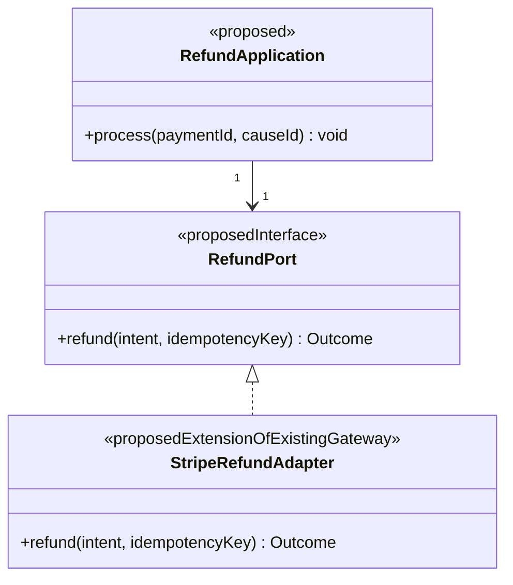

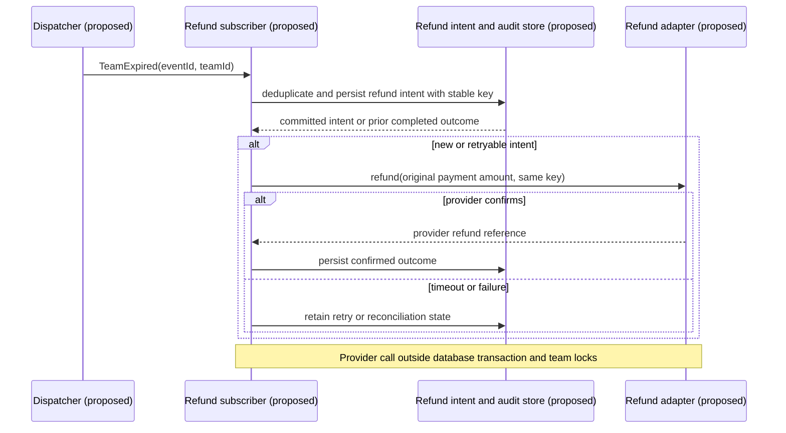

Test duplicate expiry, same-key retry after provider-success/local-timeout, partial failure, restart,
audit trail and provider sandbox completion. Keep payment/event ownership and refund schema review
with the payment owner; no real refund is requested by this document.

## 18. UC7 share attribution

Member: Lim Jiechao, #30. **Proposed only:** no invitation/attribution subscriber exists in this
checkout. A receipt or event package-info placeholder is not an Observer implementation.

### Analysis

Actor: sharer and referred joining buyer. Preconditions: valid invitation reference and accepted
paid membership. Main flow: retain validated referral context with accepted intent, then credit on
committed join. Postcondition: at most one agreed credit per accepted participation. Alternatives:
unattributed join, forged/expired invitation, rejected admission or duplicate event.

### Observer five elements and design

| Element | Applied proposal |
| --- | --- |
| Name / category | Observer — behavioral, subscriber side |
| Problem / intent | Keep referral crediting independent of capacity/payment admission |
| Context | UC4 accepted membership emits a durable fact consumed by attribution |
| Forces | No credit for attempts/rejections; validated sharer identity; deduplication and recoverable delivery |
| Solution | JoinAttributionSubscriber handles accepted-join facts and records credit idempotently |

Publisher, EventSubscriber and JoinAttributionSubscriber participants are in §16's proposed class
diagram. The event must describe the **accepted join**, not just TeamSucceeded: the latter cannot
identify each referral. Self-referral, attribution precedence, link validity and reversal rules
remain owner decisions before freezing schema. Observer decouples consumers (SRP/OCP); it does not
authenticate a browser-supplied sharer ID. Direct crediting inside the locked join flow is rejected.
Command might encapsulate a later credit operation but does not replace the subscription problem.

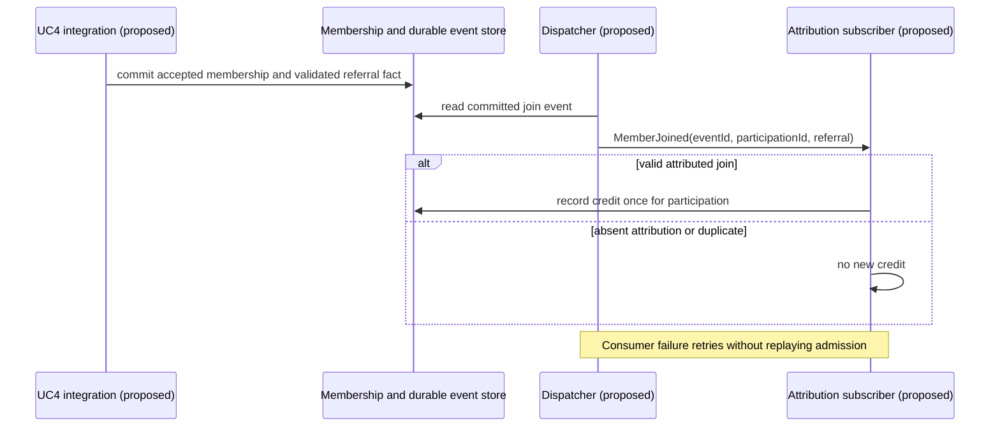

Verify tampered invitations, unattributed acceptance, rejected admission, duplicate delivery and
restart. UC3 invite generation, UC4 accepted-join publishing and any UC5 settlement consequences
must agree on IDs and event semantics; no new broker or public API is authorized here.

## 19. UC8 my orders and teams

Member: Lim Jiechao, #31. OrderController/OrderAppService are placeholders. GroupDealQueryService
currently supports catalog enrichment/reference checks, not a my-teams API. Order design DDL is
not a migrated order implementation. This entire query extension is **proposed**.

### Analysis

Actor: authenticated buyer. Goal: own initiated/joined teams and order statuses. Preconditions:
valid session and implemented owner-domain persistence. Success: bounded owner-scoped read view;
alternatives: empty list, anonymous denial, missing optional enrichment. Foreign-owned records must
not be fetched and filtered only in the browser. Stable pagination and N+1 prevention are required.

### Design and candidate patterns

Proposed application query gets owner from session, passes validated criteria to owning-domain read
facades and batch-enriches response DTOs. Decide separate lists versus a combined ordered feed before
OpenAPI. React SPA uses generated TypeScript, presents stored states and handles loading/empty/error;
it does not infer payment success from a redirect. Historical snapshots survive product delisting.

Query Object/Repository/application facade are appropriate supporting patterns, but no core GoF
pattern is claimed for this CRUD use case. Composite needs an actual part-whole hierarchy with
uniform operations; two lists are not sufficient. Iterator needs a traversal abstraction, not merely
a Java loop or pagination. Reject artificial patterns added solely for assessment. Lim Jiechao's
Observer design in UC7 provides a separate relevant GoF case, subject to actual contribution evidence.

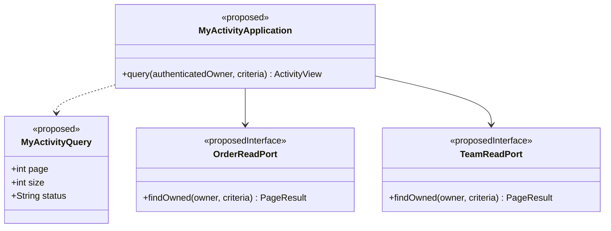

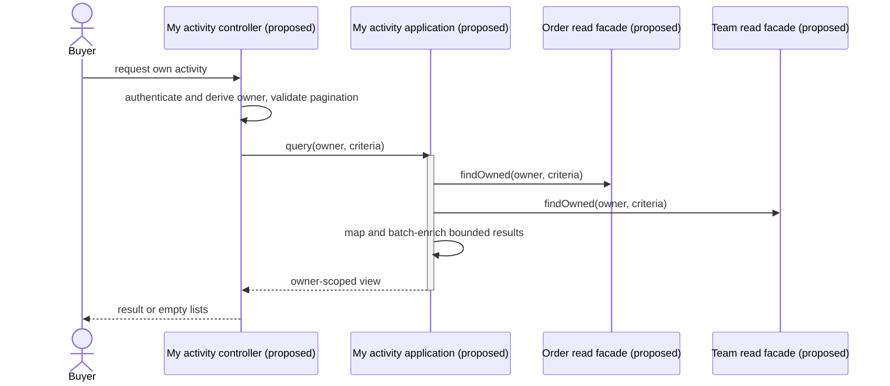

This is a conceptual two-list sequence, not an approved combined-feed contract. Required tests:
anonymous denial, other-user isolation, stable pagination/count, owned initiated/joined membership,
bounded lookup count and retained history. Fix the order persistence prerequisite before claiming
full UC8 implementation. SRP/DIP apply without a new GoF class hierarchy.

## 20. Multi use case design and assessment checks

| Boundary | Design problem | Governing solution / pattern | Evidence still required |
| --- | --- | --- | --- |
| UC2 → UC3/4/9 | Identity and permission differ; roles are DB-specific | Adapter for provider; local RBAC and active-account checks | Real target-environment login and authorization |
| UC1 → quote → UC3 | No existing team for first price; mutable pricing | Shared Strategy and immutable accepted snapshots | Checkout owner/expiry/availability/consumption validation |
| UC9 ↔ quotes/teams | Concurrent changes and deletion of historical references | State + product-first lock and owning reference ports | Future order/reference writers must join retention protocol |
| Payment → UC3/4 | Replayed payment and losing final slot | Factory Method for creation; receipts/locks for atomic application | Payment/order/inventory integration and compensation worker |
| UC4 ↔ UC5 | Timeout and final member race | Shared deal lock; planned State resolution | Exactly one terminal transition/event |
| UC5/UC4 → UC6/7 | Multiple consumers and independent failure | Proposed Observer + durable event delivery | Deduplication/retry/restart and reconciliation tests |
| UC8 → owning domains | Cross-user disclosure and N+1 | Owner-scoped query ports and batch enrichment | Real persisted order/team query and UI tests |

Patterns solve different variation axes; they do not replace authorization, transaction boundaries
or provider recovery. Keep domain ports free of SDK types, no cross-domain mappers, PostgreSQL/Redis
only, React SPA + TypeScript/OpenAPI for UI, and generated contracts for implemented APIs. No new
architecture or scheduling priority is approved by this descriptive supplement.

Before Section 3 submission, each member confirms their selected UC and authorship, describes the
analysis model separately from the design model, supplies class/sequence diagrams and actual commit/
test evidence, and distinguishes implementation from proposals. The existing automated tests were
not rerun for this prose-only edit. UC9's local test record is in its original document; remote CI,
provider acceptance and completed personal contributions cannot be inferred from a diagram.
