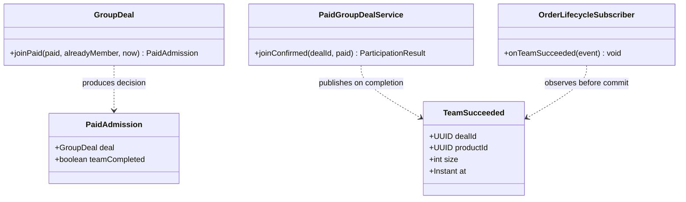
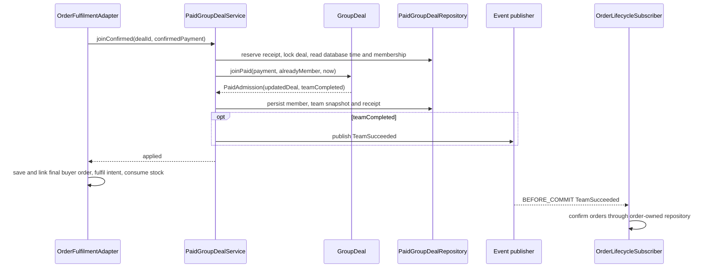
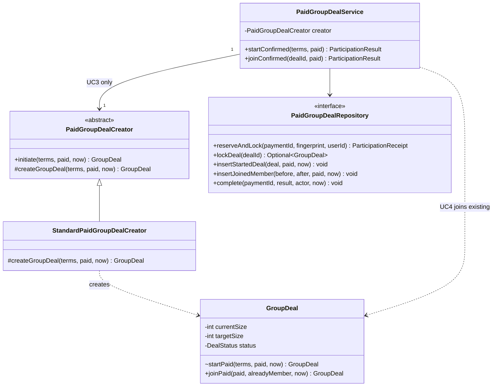
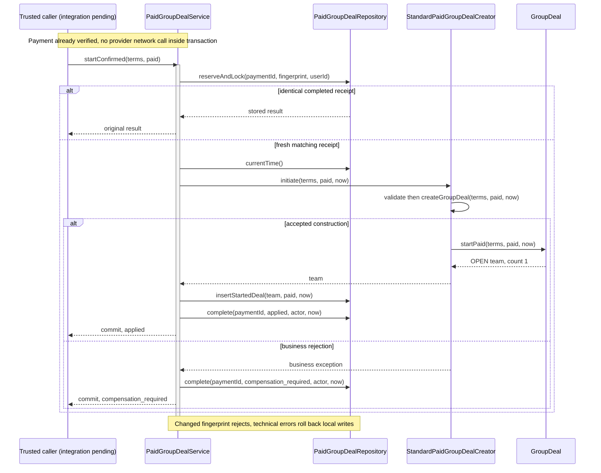
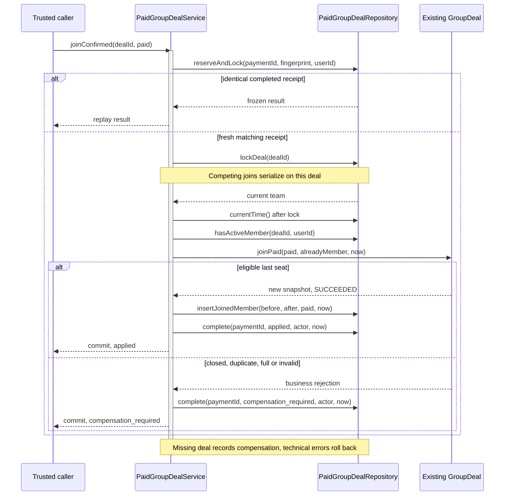

# UC3 / UC4: groupbuy-side paid participation

## Analysis and contribution scope

Wang Ziang (Eric) implemented the groupbuy-side slice evidenced by commits `b6f7faf` and `f104abb`.
The full-use-case accountable fields in issues #26/#27 still say TBD; this is not a reassignment
of payment, inventory, order or invitation work. See the original [design plan's contribution map](backend-skeleton-plan.md#13-course-report-analysis-and-design-map)
and [UC5–UC8 analysis](backend-skeleton-plan.md#16-uc5-lifecycle-and-observer-integration).
Snapshot: 2026-09-11, code at `8fe3d14`; real payment end-to-end completion is not claimed.

## Reuse and receipt compatibility amendment (2026-10-07)

This local change builds on `dev` at `4cc1f6f`; the integrated purchase-intent and refund paths described below already exist and are not reimplemented. UC3's existing Factory Method is constructor-injected, with `StandardPaidGroupDealCreator` wired in application configuration. The service depends on the creator abstraction, while the domain remains free of Spring.

`GroupDeal` now supplies reusable admission guards for the lifecycle/time window, capacity and duplicate membership. Quote validation calls window, capacity and membership guards; paid admission calls price validation, membership, window and capacity guards. This intentionally preserves existing rejection priorities and the leader membership-query short circuit. Quotes reject reconstructed counts below one, matching paid admission. Both paths still read current database time after locking; a quote reserves neither a seat nor payment, so paid admission must recheck.

`ParticipationFingerprint.start` and `.join` encode explicit operation-specific terms while sharing payment fields. Historical `start-v1` and `join-v1` tags, field order, `BigDecimal.toPlainString()` scale, UTF-16 `String.length()` prefixes, UTF-8 bytes and SHA-256 hex output are unchanged. Sharer attribution remains outside the fingerprint because it is frozen in the purchase intent. Golden tests captured before extraction include delimiter characters and a supplementary Unicode character to protect receipt replay compatibility.

These changes reuse Factory Method, the aggregate's lifecycle policy and existing receipt persistence; shared guards and the fingerprint helper are not additional GoF patterns. Observer event ordering, transaction deadlines, lock order, schema and public API remain unchanged. [October 7 evidence](../../../docs/agile/sprint-03/log/2026-10-07.md) records local verification; it does not claim merge, deployment or Stripe end-to-end verification.

## Current bounded-context design (2026-09-25)

The sections below preserve the original Eric-owned UC3/UC4 design and its course-pattern evidence, but their 2026-09-11 integration caveats are superseded by this current-state section and [ADR 0001](../adr/0001-payment-business-integration.md) / [ADR 0002](../adr/0002-team-lifecycle-events.md). The groupbuy domain still owns team admission and lifecycle, while catalog owns product terms and pricing, order owns the purchase intent and order, and payment owns Stripe settlement and refunds.

The preserved UML diagrams below are dated 2026-09-11 snapshots of that slice. Where a preserved diagram disagrees with the current contract — for UC4, `joinPaid` now returns `PaidAdmission` and `TeamSucceeded` is published only for the completing admission — the current-state diagrams above are authoritative.

| Boundary | Current responsibility and collaborating contract |
| --- | --- |
| Catalog | `CatalogPurchaseSupport` supplies accepted product terms, validates purchasability and consumes stock; the existing pricing Strategy remains catalog-owned. |
| Order | `PurchaseIntent` freezes the buyer, operation, product, price, team target and deadline; `OrderFulfilmentAdapter` implements payment's business port and coordinates the paid transaction. |
| Groupbuy | `GroupDeal` guards membership, deadline, capacity and lifecycle; `PaidGroupDealService` persists the payment receipt and transition, then publishes the completion fact. |
| Payment | Stripe checkout verifies provider success and invokes the business port; a refused paid admission becomes a refund obligation, not an inline provider refund. |

**UC3 analysis and design:** a confirmed START payment must create exactly one OPEN team with its payer as leader, one matching membership and one terminal receipt. `OrderFulfilmentAdapter` constructs `NewDealTerms` from the locked purchase intent, invokes `startConfirmed`, then creates the order, links it to membership, fulfils the intent and consumes stock in the same local transaction. `PaidGroupDealCreator` and `StandardPaidGroupDealCreator` remain the implemented Factory Method participants; this pattern controls creation, not payment verification or distributed atomicity.

**UC4 analysis and design:** a confirmed JOIN payment must admit at most one buyer while another buyer may race for the last seat. The application locks the receipt and deal, reads database time after the deal lock and supplies membership evidence to `GroupDeal.joinPaid`. The aggregate now returns `PaidAdmission(deal, teamCompleted)`: the new immutable snapshot and the fact that this particular admission completed the team. The application persists membership and the receipt first, then publishes `TeamSucceeded` only for that completion fact. This keeps the transition decision in the aggregate and publication in the application; `PaidAdmission` is a DDD domain result, **not** an extra GoF pattern. Row locking, unique constraints and receipt replay remain the concurrency controls; they are not replaced by a pattern name.

**Cross-use-case sequence:** payment confirms the frozen intent → order's business adapter acquires team then intent locks → UC3 creates a team or UC4 admits into one → order, membership, intent, stock and receipt are written together → on the last UC4 seat, `TeamSucceeded` is published inside that transaction → order's `BEFORE_COMMIT` subscriber confirms all team orders after the last buyer's order has been inserted. Technical failure rolls back; a business refusal records the compensation outcome for payment to handle. The global lock order and event phase are fixed by the two ADRs; this refactor changes neither schema, provider calls, public API nor frontend contract.

**Pattern boundary:** Factory Method is implemented for UC3 creation. For the current integrated UC4, Observer is the primary cross-use-case pattern: groupbuy publishes `TeamSucceeded` and order subscribes without a direct repository call across contexts. The `PaidAdmission` result is the domain decision feeding that collaboration, not itself a GoF pattern. `DealStatus.canTransitionTo` centralizes the lifecycle matrix, but an enum or result record alone does not prove GoF State. Full provider refund execution and invite attribution have separate owners and should not be claimed as Eric's UC3/UC4 implementation.

### UC4 Observer: course pattern and contribution boundary

| Element | Current implementation |
| --- | --- |
| Name / category | Observer — behavioral |
| Problem / intent | The last paid join must update the team and cause its orders to become confirmed without groupbuy calling order persistence directly. |
| Context | The final buyer's order is inserted after `joinConfirmed` returns, so an immediate synchronous order sweep would miss that buyer. |
| Forces | Domain-module ownership, local atomicity, transaction ordering, receipt replay and a final-seat race. |
| Solution | `PaidGroupDealService` publishes immutable `TeamSucceeded` only when `PaidAdmission.teamCompleted` is true; `OrderLifecycleSubscriber.onTeamSucceeded` observes it at `BEFORE_COMMIT` and confirms orders through its own repository. |

Eric's change in this branch is the groupbuy decision/result and its publication gate, while `OrderLifecycleSubscriber`, the order repository sweep and the accepted ADR 0002 are pre-existing team integration. This is an integrated UC4 design pattern with shared participants, not a claim that Eric authored every participant or that every intermediate join publishes an event.

## UC3 analysis and design

### Analysis

The initiating buyer must become the first paid member of a valid team. Invalid price, currency,
identity or expired terms must not leave a partial team. Repeated delivery of one confirmed payment
must return the same outcome rather than create another team. A constructor alone cannot guarantee
database atomicity, and a local transaction cannot undo money already committed at Stripe.

### Design

Trusted caller → `PaidGroupDealService.startConfirmed` → reserve/lock payment receipt and validate
fingerprint → `PaidGroupDealCreator.initiate` → concrete `createGroupDeal` → repository inserts
team and leader → complete receipt in the same local transaction. The caller supplies already
accepted `NewDealTerms` and verified `PaidParticipation`; these value objects do not verify Stripe.
Business rejection retains a compensation-required outcome; technical failure rolls back writes.

### Design Pattern

**Implemented Factory Method:** PaidGroupDealCreator is the creator, its protected abstract
createGroupDeal is the factory method, StandardPaidGroupDealCreator is the concrete creator, and
GroupDeal is the product. The final initiation workflow validates before dispatching creation.
The application currently chooses the standard creator; runtime-pluggable creation policies are
not claimed. `GroupDeal.reconstitute` and `startPaid` alone are not the GoF evidence. Repository
and the transaction provide atomic persistence, not the factory method itself.

Reject creation directly in a controller or accepting a browser's claim that payment succeeded.
Quote acceptance, inventory/order, invite generation and provider recovery remain integration work,
so #26's full payment + team + invite acceptance criterion is not yet satisfied by this slice.
(2026-09-28: quote acceptance landed with #183. A START intent may carry a `quoteId` and is then
charged that quote; see backend ADR 0001 addendum.)

### Course five elements and alternatives for UC3

Actor: initiating buyer, through a trusted application collaborator. Preconditions: verified payment
bound to this user/intent and unexpired accepted terms. Success: one OPEN team, one paid leader and
one applied receipt committed together. Identical retries replay; business rejection retains a
compensation-required fact; technical failure rolls back. No public endpoint is implied here.

| Element | Applied explanation |
| --- | --- |
| Name / category | Factory Method — creational |
| Problem / intent | Delegate concrete team construction while preserving common initiation validation |
| Context | PaidGroupDealCreator.initiate validates terms then calls its protected creation hook |
| Forces | Exactly one paid leader; valid price/identity/deadline; pure construction; transaction owned by application |
| Solution | Abstract creator and overridden createGroupDeal in StandardPaidGroupDealCreator produce GroupDeal |

The **aspect to vary is creation policy**. Strategy calculates price; it does not assemble the
initial aggregate. Builder would fit optional stepwise assembly, but these accepted terms are already
complete. A static factory lacks the creator-method override evidenced here. The final workflow
resembles a template, but the selected/report pattern is the actual Factory Method.

SRP separates creation and persistence; DIP uses repository ports. OCP is bounded: the service
currently constructs StandardPaidGroupDealCreator itself, so choosing a new policy requires wiring
changes. Do not claim runtime-configurable creation. Any alternative creator must preserve the same
accepted-payment, first-member and lifecycle contract (LSP), not skip initiation validation.

### UML class diagram — implemented UC3 and UC4 collaborators (2026-09-11 snapshot)

Preserved as implemented at `8fe3d14`: the UC3 collaborators still match the code, but UC4's `joinPaid` now returns `PaidAdmission` instead of `GroupDeal` — see the current-state class diagram above.

`#` is protected, `~` package visibility. PaidGroupDealCreator is Creator, its protected method is
Factory Method, StandardPaidGroupDealCreator is ConcreteCreator, GroupDeal is Product. The domain
product is concrete here; no fictitious product-interface hierarchy is drawn. Persisted membership
is one-to-many, but GroupDeal has no Java member collection; a composition field would be misleading.

### UML sequence diagram — UC3 local transaction (2026-09-11 snapshot)

The flow still matches `startConfirmed`; the "integration pending" caller label is historical — `OrderFulfilmentAdapter` is the wired trusted caller now (current-state section above).

Factory Method does not create distributed atomicity. Payment commitment, quote consumption,
inventory/order and invite generation require an explicit recoverable integration protocol; a
local SQL rollback cannot undo a completed Stripe call.

## UC4 analysis and design

### Analysis

Two paid buyers may compete for one slot; one buyer may submit two different payments; the same
payment may be replayed after team state changes. Capacity, duplicate membership and deadline must
be checked against locked current state, without charging or admitting twice. A paid loser needs
durable compensation handling rather than a generic rejection that forgets the payment.

### Design

Trusted caller → `joinConfirmed` → reserve/lock receipt → replay or fingerprint check → lock deal →
read DB time and active membership → `GroupDeal.joinPaid` → insert member and persist new team
snapshot → complete receipt. The final admitted member transitions the snapshot to SUCCEEDED.
Identical receipt replays return the original result even if the team later changes; changed intent
with the same payment ID is rejected. Caller locks must precede receipt → deal ordering.

### Design Pattern

**No new GoF pattern is claimed for concurrency.** Repository, durable idempotency receipts, row
locking and database uniqueness enforce admission. UC4 reuses the existing aggregate and does not
call the UC3 Factory Method to create a replacement team. `DealStatus` currently stores codes;
the complete UC5 State/Observer design remains pending. A plain enum or SQL lock is not GoF State.

Reject read-then-write without locking, retrying with a new payment identity, or issuing Stripe
refunds inside the locked transaction. The local aggregate operation is atomic; the public
payment-to-order-to-team flow is not implemented by this slice.

### Analysis contract and candidate selection for UC4

Actor: joining buyer, through a trusted collaborator. Preconditions: payment verified and bound to
user/intent and accepted amount/currency. Success: one membership increment, optionally SUCCEEDED,
and applied receipt. Rejected paid admission records compensation-required, not refunded. Technical
errors roll back all local writes. The failure categories and replay behavior are externally
observable at this internal boundary even though no buyer HTTP endpoint exists yet.

The change-sensitive concern is admission against **current shared state**. State is relevant to
UC5's planned lifecycle, but current joinPaid uses aggregate guards and a code-only DealStatus enum.
Command could encapsulate an executable request; PaidParticipation is only data, with no execute/
receiver contract, so it is not Command. Chain of Responsibility could organize independently
variable checks, but neither it nor Command prevents races. Do not replace locking with a GoF label.
SRP keeps verification and compensation outside admission; DIP uses the repository abstraction.

### UML sequence diagram — UC4 last-seat race boundary (2026-09-11 snapshot)

The class diagram above also applies to UC4; the creation factory is not called during a join. In this snapshot the aggregate returns the new snapshot directly and no event is published; the current aggregate returns `PaidAdmission(after, teamCompleted)` and the service publishes `TeamSucceeded` only for the completing admission — see the current-state sequence diagram above.

A non-final accepted member follows the same sequence and remains OPEN. The second contender reads
the first contender's committed state only after acquiring the lock and cannot take another seat.
UC5 timeout must use this same serialization boundary. Receipt retention supports future recovery;
it is not an implemented Observer event dispatch to UC6/UC7.

### Verification evidence for UC3 and UC4

Read `PaidGroupDealTest`, `PaidGroupDealServiceTest`, `PaidGroupDealRepositoryIT` and
`PaidGroupDealServiceIT` for construction invariants, replay, rollback, same-buyer concurrency and
last-seat races. These are code/test evidence entry points, not a new test run for this prose edit.
Keep real Stripe test-mode evidence separate, and include the remaining integration boundaries in
the assessed contribution rather than marking both full use cases complete.

## Scope and ownership

This slice implements groupbuy behavior behind an internal application collaborator. It does not
implement checkout, call Stripe, change the payment webhook, create orders, reserve inventory,
execute refunds, or expose a public payment-confirmation endpoint. Existing catalog Strategy
pricing remains the authority for accepted prices. No frontend or OpenAPI surface changes here.

`PaidParticipation` validates the shape of already-verified payment facts; constructing it does
not prove payment. Only a trusted application collaborator may call `PaidGroupDealService` after
binding the payment to the buyer and intended operation and verifying the amount/currency against
persisted checkout terms. Browser redirects, request bodies and raw provider events are not this
collaborator. The current payment module is not wired to these methods.

The caller owns active-user/product validation, an authoritative accepted catalog price snapshot,
and the order/inventory transaction. Target size and deadline are explicit accepted terms, not
invented default business policy. `TeamPriceAppService.getQuote` is a historical read, not a
checkout-consumption or stock-reservation API. Do not wire it directly to this write path.

## Domain behavior

- UC3 uses the `PaidGroupDealCreator` initiation workflow and its overridden factory method in
  `StandardPaidGroupDealCreator`. It creates an OPEN deal with exactly one paid leader. The static
  reconstruction method is only persistence reconstruction, not the Factory Method evidence.
- UC4 joins the existing immutable aggregate; it never uses the creation factory or creates a
  replacement deal. It validates frozen amount/currency, duplicate membership, OPEN status,
  exclusive deadline and capacity. The last paid member changes status to SUCCEEDED.
- Transitions return a new snapshot; there is no public status/count setter. This is guarded
  domain behavior, not a claim that the full UC5 GoF State implementation is complete.
- SGD amounts must be positive, exactly representable in cents and fit numeric(18,2). No floating
  point, rounding or inferred discounts. Currency restriction matches the current quote scope.

## Persistence and replay

The application uses a short local database transaction. A receipt keyed by local payment ID
serializes duplicate applications and stores the immutable request fingerprint and outcome.
Identical retries return the stored outcome even after the deal changes; changed content with the
same payment ID is rejected. Provider event-ID deduplication still belongs to the payment module.

For a join, lock the receipt then the deal, read `clock_timestamp()` after acquiring the deal lock,
check active membership, and persist the member/count/status and receipt together. Existing active
deal/user uniqueness and new member/payment uniqueness backstop concurrent requests. Creation
persists the deal and leader together. Technical failures roll back; they are not translated into
successful processing. Enclosing caller transactions must use compatible lock order: acquire any
catalog/payment locks before entering this receipt -> deal protocol, never in the reverse order.
No network call belongs inside these transactions.

New transactions have a 10-second deadline, matching catalog write services. Receipt/deal lock
timeouts propagate as technical failures and roll back; they never produce compensation or success.
When joining an existing caller transaction, Spring REQUIRED inherits that transaction's deadline:
the caller must set an equally bounded timeout and retain the documented lock ordering.

A paid business rejection records `compensation_required` and a stable reason, not `refunded`.
The receipt is a durable handoff fact, not a working refund processor. Payment/refund collaborators
must consume it idempotently and track actual provider completion. A receipt alone also does not
implement notification/attribution Observer dispatch; those integrations remain separately owned.

V7 is additive. Existing memberships have no historical payment ID backfill. Do not rewrite applied
V5; its paid-count semantics remain authoritative. Receipt retention must cover provider replay
and financial reconciliation, not a short HTTP cache TTL. Production admission stays unwired until
the payment, catalog/order and recovery contracts are integrated and tested together.

## Verification and release boundary

Domain tests cover first member, exact cents, invalid identity/terms, middle/last member, terminal
states, capacity, duplicate membership and deadline equality. Application tests cover replay and
ordering. PostgreSQL integration tests exercise constraints, rollback and lock behavior; bootstrap
tests exercise the real Spring transaction proxy and concurrent last-seat race. These are local
groupbuy-side tests, not Stripe test-mode end-to-end evidence.

The real database tests also race two payments from one buyer with spare capacity and verify
database cancellation (SQLSTATE 57014), rollback and successful retry for stalled receipt/deal locks.

Before exposing a buyer API, require tests for verified payment -> inventory/order -> group/member
atomicity, quote consumption, failed/late payment recovery, durable refund processing and actual
Stripe test-mode replay. Generate OpenAPI and TypeScript only when that API is implemented.

## Post-Deploy Monitoring & Validation

No payment or buyer route is enabled by this slice. On a test environment, the integrator should
inspect receipt outcome counts, pending compensation age, duplicate-key errors and deal/member
count mismatches after each controlled admission batch and before enabling traffic. Healthy signal:
one terminal receipt per applied payment and paid member count equal to `current_size`. Any
orphaned receipt, duplicate application or mismatch blocks rollout; disable the new caller and
preserve receipt/member rows for reconciliation. Roll back application code without dropping
receipt history or member payment IDs. Deployment and enabling a caller require separate approval.
For an already-populated deployment, assess the existing member table size and bound migration
lock/statement waits before running V7. Its transactional ALTER and ordinary unique-index build
are not an online, zero-downtime migration; a live high-volume rollout needs a separately tested
expand/index sequence. Empty-container migration success does not verify that release scenario.
