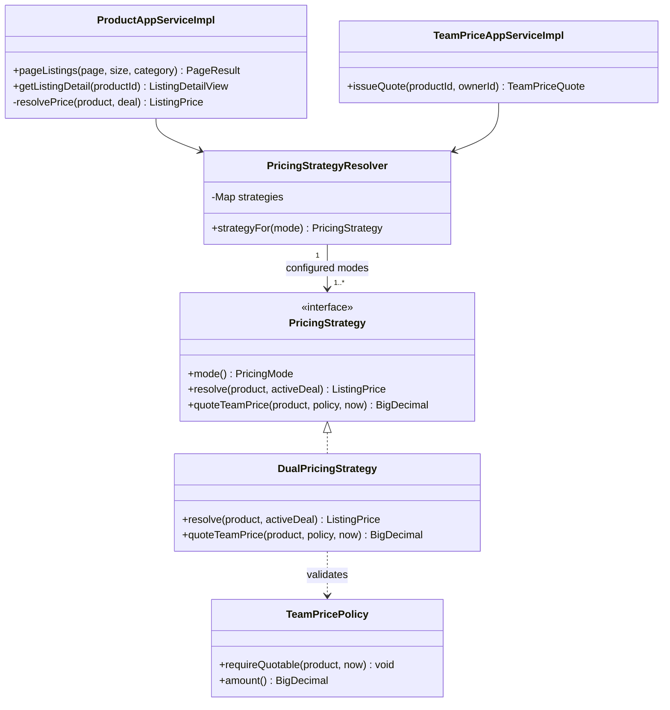
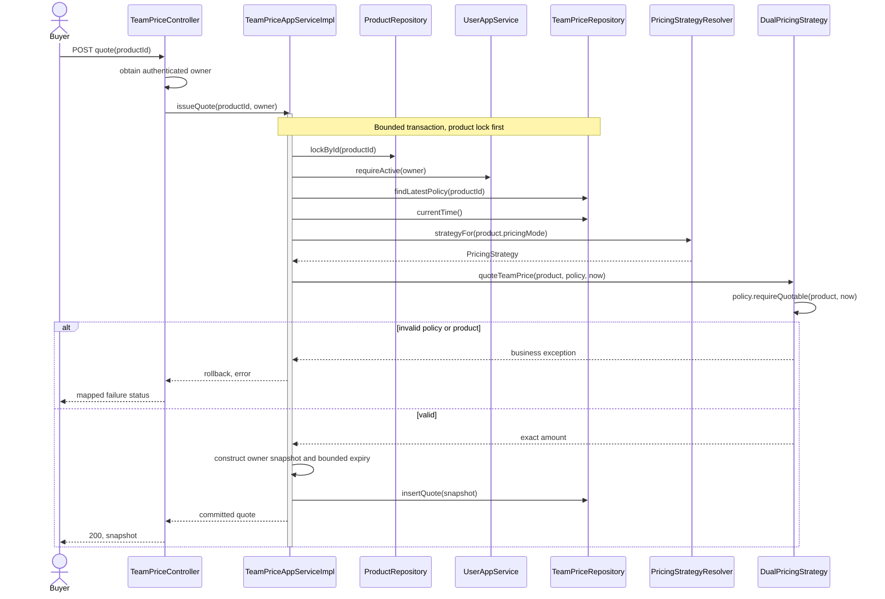

# First-team price quotation foundation — issue #50

## Analysis design and contribution linkage

This is a catalog foundation for UC1/UC3, not an extra numbered UC or completion of checkout.
Wang Ziang (Eric) implemented the foundation in commit `cb02ad5`; the existing browse Strategy
is reused, not claimed as newly authored here. See the [contribution map](backend-skeleton-plan.md#13-course-report-analysis-and-design-map)
and [UC3/UC4 design](paid-group-participation.md) for the acceptance boundary.

**Analysis:** deriving a first-team price from existing teams creates a circular dependency: no
team means no price, but starting a team needs an accepted price. Also, mutable catalog settings
must not retroactively reprice a previously issued quote. Display pricing and accepted quotation
therefore have different input sources and lifetimes.

**Design:** an administrator appends a TeamPricePolicy revision under the product lock. An
authenticated buyer requests a quote; TeamPriceAppServiceImpl validates account/product/policy at
authoritative DB time and invokes the existing strategy's quoteTeamPrice behavior. It persists an
immutable, owner-scoped TeamPriceQuote, with expiry bounded by both 15 minutes and policy validity.
Reading the snapshot is not consumption, stock reservation or a payment authorization.

**Design Pattern:** PricingStrategy is the abstraction; DualPricingStrategy validates the policy
and supplies its amount; PricingStrategyResolver selects by mode; the application service is the
client. Repository isolates append-only snapshots. An immutable record is not Factory Method and
a database lock is not Strategy. Reject copying active-deal display price or introducing another
pricing registry. Additional modes need concrete implementations and exact-money tests; checkout
must still revalidate and consume accepted terms in its own agreed protocol.

This increment makes the first team quotable without an existing group deal. It does not implement UC9 CRUD, checkout, payment, stock reservation, team creation, joining, or refunds.

## Course analysis and UML

UC1's browse backend is Liu Jin's scope; Eric's quotation foundation extends the shared pricing seam
for UC3. Lim Jiechao owns the frontend slice. Reusing a class is not authorship of every participant.

| Analysis item | UC1 display | First-team quote supporting UC3 |
| --- | --- | --- |
| Actor / goal | Anonymous buyer compares products | Active buyer obtains server-priced terms |
| Preconditions | Valid page/category or product ID | Product, valid latest policy, authenticated owner |
| Main flow | Read products, batch offers, resolve prices | Lock product, check user, read policy/time, calculate, persist |
| Postcondition | Read-only view; optional group price | Immutable owner-bound snapshot; no payment or stock effect |
| Alternatives | Unavailable detail → 404; incompatible offer → no group price | Invalid product/policy/account → rejection; technical failure → rollback |

### Strategy five elements and selection

| Element | Applied explanation |
| --- | --- |
| Name / category | Strategy — behavioral |
| Problem / intent | Avoid hard-coded pricing algorithms in browse and quotation orchestration |
| Context | pricingMode selects the algorithm; display uses active offers, first-team quotes use catalog policy |
| Forces | Exact money; no client price; no existing team required for quotation; no I/O in domain strategy |
| Solution | PricingStrategy contract, DualPricingStrategy, resolver registry and application clients |

The **aspect to vary is calculation**. Factory Method varies construction, State varies lifecycle,
and neither replaces pricing Strategy. Decorator might suit independently stackable adjustments,
but no such discount requirement is approved. There is one concrete strategy today, not multiple
completed algorithms. Duplicate mode bindings and unsupported modes fail rather than silently price.

SRP separates calculation from queries; DIP makes clients use PricingStrategy; OCP protects the
browse/issuance workflow, although new modes require enum/registration/test changes. LSP requires
exact-money and supported-input contracts. Both operations share an interface now; split only if
future implementations genuinely cannot support both. Immutable snapshots are not Memento: no
caretaker, saved-originator state or restoration/undo protocol exists.

### UML class diagram — implemented Strategy

Registry multiplicity describes intended configured runtime (currently one dual strategy), not a
constructor check for a nonempty registry. Shared references are associations, not compositions.

### UML sequence diagram — implemented quotation

Missing product/account/policy fails before strategy dispatch. See the original
[design plan](backend-skeleton-plan.md#14-uc1-browse-and-search) for UC1 sequence. UC3 must not call
getQuote and assume checkout eligibility: owner, expiry and availability are rechecked in the START
intent's own transaction (`lockQuotedStart`, #183). UC9 shares the product lock and preserves accepted history. These mechanisms
address multi-use-case consistency beyond the Strategy itself.

## Boundaries and Strategy

Catalog owns append-only `TeamPricePolicy` revisions and immutable `TeamPriceQuote` snapshots. The existing `PricingStrategyResolver` selects the real `PricingStrategy` by product pricing mode. `DualPricingStrategy.quoteTeamPrice` validates the latest catalog policy and returns its configured amount. It never consults existing deals. Existing browse `resolve` behavior remains unchanged: its optional displayed group price still comes from groupbuy.

No additional pattern names are claimed. A snapshot record is not a GoF Factory Method. Row locks and uniqueness enforce consistency; Strategy is only the pricing variation seam.

## Additive HTTP contract

All success responses use the established HTTP 200 `Result` envelope; failures use the global error-code handler. Regenerate `contracts/openapi.json` from the application, never by editing JSON.

2026-10-01 (#253, local implementation; merge pending): the four explicit OpenAPI operation IDs are `configureTeamPricePolicy`, `getTeamPricePolicy`, `issueTeamPriceQuote` and `getTeamPriceQuote`, respectively for policy PUT, policy GET, quote POST and quote GET below. The Java controller/service method names and all HTTP behavior remain unchanged. Frontend consumers migrate alongside contract regeneration; the [integration guide](../../../docs/api/backend-integration-guide.md#generated-operation-names-2026-10-01-253) records the complete rename map and pre-merge coordination.

- `PUT /api/v1/products/{productId}/team-price-policy`: requires `catalog:product:write`. The V6 migration grants this new permission only to the existing administrator role. Body: decimal-string `amount`, literal `currency: "sgd"`, inclusive `validFrom`, exclusive `validUntil`, and required `expectedVersion`. Version 0 creates revision 1; later requests must match the latest revision. A stale retry returns 412 and creates nothing. This is a conditional replacement, not an unconditional last-write-wins PUT.
- `GET /api/v1/products/{productId}/team-price-policy`: same permission and active-account validation, explicitly protected even though other product GET routes are anonymous.
- `POST /api/v1/team-price-quotes`: authenticated body contains only `productId`; owner is taken from the trusted session. Each call creates a new snapshot, so retries are **not idempotent**. Issuing has no financial or inventory effect. The quote id may be passed to a START purchase intent (`POST /api/v1/payments/intents`, `quoteId`), which then charges its amount (#183, backend ADR 0001 addendum 2026-09-28).
- `GET /api/v1/team-price-quotes/{quoteId}`: active authenticated owner only; absent and foreign-owned IDs both return 404. Historical snapshots remain readable after expiry. Reading is not validation or consumption of a quote.

V1 quotes support SGD only, exact positive cents fitting `numeric(18,2)`, strictly below the product original price. No rounding, client-selected amounts on issuance, or guessed currency minor units. Wire amounts are decimal strings. Policy instants normalize to PostgreSQL's microsecond precision before validation, so a valid Java-only nanosecond window cannot collapse when persisted. Latest policy always replaces earlier revisions, including a future or expired latest policy: there is no fallback.

Quote lifetime is an explicit v1 rule: at most **15 minutes**, clipped to policy expiry. Expiry is exclusive. Policy edits never alter old snapshots or extend their deadlines. A START intent accepts a quote only under the product row lock, after rechecking that the product is sellable and startable, that the quote belongs to this buyer and product, and that it is unexpired on the database clock read after the lock (`CatalogPurchaseSupport.lockQuotedStart`). It does not consult the latest policy. Quotes are not single-use: each acceptance issues a new intent, and each intent is consumed by at most one payment.

## Persistence, authorization, and concurrency

PostgreSQL 18 `domain` schema is authoritative; no new middleware or runtime dependencies. V6 adds new tables only. IDs are native UUIDv7, with the repository's existing application generator for quotes and PostgreSQL default for revision row IDs. DOs and mapper XML remain infrastructure-only.

Each configuration/issuance command uses a short, **10-second bounded** application transaction. Lock the active `biz_product` row first; then validate current account state through identity's public application facade, read the latest policy, and read PostgreSQL `clock_timestamp()` **after the product lock**. This avoids using transaction-start time after waiting. No provider/network call and no retry loop occurs in the transaction. Infrastructure inserts check affected-row counts. A database error rolls back the whole command.

`(product_id, version)` is unique across all revisions, including deleted rows. Revisions and quotes have no update/delete repository or API operation. Administrative tools must never soft-delete a revision to restore an older policy: issue a new revision instead. Product status/price/delete writers must use the same product-row lock; this includes future UC9. Stock is not reserved by a quote.

User account state is rechecked when executing a request, rather than trusting a possibly stale session. The identity read is not a durable authorization lease: an account disabled after that read can leave a historical non-financial snapshot. Future payment acceptance must independently revalidate the account. Permission checks use the existing Sa-Token RBAC tables, not role names in catalog code. There is no tenant model in this global catalog.

No foreign-key or check constraints are added, per team DDL agreement. Catalog owns product/policy/quote reference validity. Immutable quote history must be retained if a product or account is later disabled or soft-deleted. There is no physical-purge path in this increment; a future retention/purge job must reconcile product/policy/owner references, preserve snapshots used by payment/order records, and coordinate with catalog and identity owners before deletion. The product-policy index supports those audits. Do not turn an orphan into a new price or silently delete monetary history.

## Verification

Tests cover first-team pricing without an active deal, exact cents and currencies, validity boundaries, stale policy writes, disabled accounts, server-derived ownership, and snapshots independent of later policy reads. PostgreSQL 18 integration tests execute the repository migrations and actual mapper XML, verify UUIDv7 and admin-only grants, round-trip snapshots across revision changes, enforce unique revisions, roll back failed work, and make a competing reader wait for the product lock.

CI must run both unit tests and `*IT` tests, plus formatting, static analysis, ArchUnit (including pricing packages), API regeneration/compatibility, and security gates. Docker absence is a failure, not an accepted integration-test skip. HTTP permission/validation tests and the generated contract are part of the same PR. This document describes the implemented contract; only actual green run results count as verification evidence.

`TeamPriceFlowIT` additionally exercises the MockMvc servlet request chain, Sa-Token RBAC, application transactions, Flyway and PostgreSQL without business-service mocks. It verifies first-team issuance, historical snapshot reads after repricing, ownership rejection, unchanged inventory/payment state, disabled-account rejection and two concurrent configuration attempts committing exactly one revision. Sessions use an isolated test-only memory store; these tests do not claim real network/browser, Redis or Google OAuth integration coverage.
