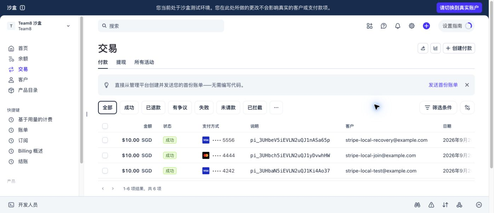

# Stripe Sprint 2：本地 Sandbox 验收

> Historical Sandbox evidence. The local endpoints and commands below have been retired;
> see [release cleanup](stripe-release-cleanup-20260920.md) for the current boundary.

Update: two additional browser-created Sandbox payments now verify the teammate's product-page START/JOIN connection. See [frontend acceptance](stripe-frontend-integration-20260920.md). The original backend scenarios below remain separate evidence.

2026-09-20，核验时间 11:47（UTC+8）。本地服务端支付用例已按授权完成验证：真实 Stripe Sandbox、真实本地 PostgreSQL、组员现有团购服务，以及本地最小购买意图／订单／到期适配。没有修改 GitHub，没有连接共享 AWS 数据库，没有执行实际退款。

## 实际跑通的路径

| 场景 | 操作与结果 |
| --- | --- |
| 付款后开团 | 从本地商品与价格表生成 SGD 10 Checkout；在 Stripe 托管页用官方测试卡支付。Stripe CLI 投递事件后，付款为 `SUCCEEDED`，履约为 `FULFILLED`，数据库有一条成员和一条关联订单 |
| 付款后参团 | 第二位虚构买家支付 SGD 10，加入同一个团。团购最终为 `succeeded`，人数 `2/2`；两笔付款各有且只有一条成员／订单 |
| 创建链接防重 | 相同买家、购买意图、请求键重复调用 Checkout 接口，返回原付款和链接，没有新增付款 |
| 回调防重和验签 | 从 Stripe API 读取第一笔真实事件，在本地用当前签名密钥重放两次，均返回 200，成员／订单／事件数不增加。保留原签名但修改请求体，返回 400。此项是本地重签重放，不是声称 Stripe 主动重投递 |
| 漏收回调后的恢复 | 暂停自己的 CLI 监听后完成第三笔 SGD 10 付款。Stripe 为 `paid`，本地仍是 `CREATED`，没有订单／成员。随后执行 `assign → inspect → recover`，由应用查询 Stripe 事实并补处理；生成一条订单／成员，核查记录为 `RESOLVED`。重复 recover 没有重复履约 |
| 团购到期 | 为第三笔付款建立的未满团加入一个尚未付款的 Checkout，再将这个本地测试团的截止时间移至过去。真实定时协调器处理到期，保留一笔 SGD 10、原因 `TEAM_EXPIRED`、状态 `PENDING` 的唯一退款义务 |
| 关闭未付款链接 | 同一到期流程调用真实 Stripe Session expire；Stripe 返回 `expired/unpaid`，本地付款为 `CANCELED`。没有订单、成员或退款义务，持久化清理任务已完成 |

到期时间的调整是明确的本地测试夹具，不是自然等待两小时，也不是手工把付款或退款状态改成通过。退款记录由应用事务写入。没有在 Stripe 后台点击“退款”。

## 可追溯记录

| 用途 | 本地 payment ID | Stripe PaymentIntent |
| --- | --- | --- |
| 开团 | `01a0bce3-9b2a-734e-9451-b03ef2194f17` | `pi_3UHbaN5iEVLN2uQJ1Ki4Ao37` |
| 参团 | `01a0bce6-8ba6-764f-a16c-223fdbc8b9ac` | `pi_3UHbch5iEVLN2uQJ1yDvwhHW` |
| 恢复、随后到期 | `01a0bce8-1615-7f87-a736-788fbe34a1f3` | `pi_3UHbeV5iEVLN2uQJ1nASa65p` |
| 未付款链接关闭 | `01a0bcea-dec3-71e9-9e43-a981f1bb3b12` | 无，没有扣款 |

三笔成功付款的 Stripe 数据均为 `livemode=false`、`amount_total=1000`、`currency=sgd`。测试卡与虚构买家资料只填在 Stripe 页面，本地业务表不存卡号或 CVC。测试卡来源：[Stripe 官方测试文档](https://docs.stripe.com/testing)。



机器验收结果：[sandbox-acceptance.json](evidence/20260920/sandbox-acceptance.json)。对应的四份 `evidence-*.json` 保存供应商状态、HTTP 状态、订单、成员、退款义务与核查状态；`recovery-before.json` 和 `recovery-after.json` 保留漏收及补处理前后证据。日期同时保留 UTC 与数据库时区值，Stripe 后台截图使用账户显示时区。

## 怎样重新检查

在仓库根目录运行。需要私有本地服务和相同 Sandbox 配置仍可用，命令不包含密钥：

```bash
python3 scripts/verify-stripe-sandbox.py \
  --start 01a0bce3-9b2a-734e-9451-b03ef2194f17 \
  --join 01a0bce6-8ba6-764f-a16c-223fdbc8b9ac \
  --recovered 01a0bce8-1615-7f87-a736-788fbe34a1f3 \
  --expired 01a0bcea-dec3-71e9-9e43-a981f1bb3b12
```

该脚本重新查询 Stripe 和本地数据库，校验关联与唯一记录，并执行防重／坏签名重放。2026-09-20 的结果为 `PASS`。它用于复查这次留存数据；在空数据库上完整重做，需要先运行 fixtures／smoke、在 Checkout 页面用测试卡付款，再用新 payment ID 验证。旧 payment ID 不能用于另一个 Stripe 账户。

日常人工恢复入口（仅私有本地数据库）：

```bash
python3 scripts/stripe-local-ops.py scan
python3 scripts/stripe-local-ops.py cases
python3 scripts/stripe-local-ops.py inspect --payment-id PAYMENT_UUID
python3 scripts/stripe-local-ops.py assign --payment-id PAYMENT_UUID --next-check-at UTC_TIMESTAMP
python3 scripts/stripe-local-ops.py recover --payment-id PAYMENT_UUID --confirm-recovery
```

`inspect` 只读，不允许操作者填写“已付款”事实。`recover` 要求显式确认，再查询 Stripe、经同一幂等业务路径处理并留下操作者记录。本地演示由 Yorik 操作；共享环境的值班人及通知渠道仍由团队安排。人工重查不依赖 Stripe 是否仍在自动重试。这次测试主动漏收后立即恢复，没有声称实际等待了供应商的重试期限。

## 不包含的工作

- Sprint 3 的真实退款 API、退款成功／失败回调：本次只交付 Sprint 2 的 `PENDING` 退款义务。
- 团队完整前端与 Google 登录联调：本地操作入口使用私有令牌和虚构用户，不冒充完整登录链路。
- 共享部署、公开 TLS 入口及团队正式订单接口：这些配置没有变更。应用到 Stripe 是 HTTPS；CLI 到本机回环地址是 HTTP。
- 并发争最后名额、事务回滚等仍由 51 项专项测试验证，其中 Stripe 网络使用替身；本次真实 Sandbox 交易补足外部支付链路证据，不把两类测试混为一谈。

代码来源、分支与运行配置见[本地适配记录](stripe-local-integration-20260920.md)。交付在本地 `feature/yorick-stripe-sprint2`；尚未 commit、push、创建 PR 或合并。
