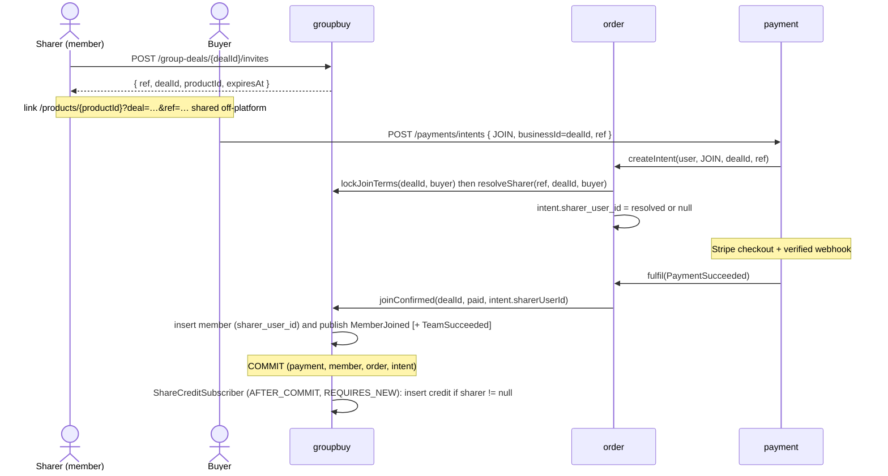

# UC7 share attribution — backend implementation plan

Date: 2026-09-24 · Branch: `feature/shared-attribution-backend-20260924` · Issue: #30 (UC7) · Design: [`backend-skeleton-plan.md` §18](../../../backend/docs/design/backend-skeleton-plan.md#18-uc7-share-attribution) · Frontend consumer: plan task T3-05

Backend owner changed from @limjiechao to los gai by agreement on 2026-09-24; the frontend half stays with T3-05. Target: backend merged to `dev` with the regenerated contract by end of day 2026-09-25.

> **Implementation notes (2026-09-25).** D4 and D5 were confirmed as written. The implementation departs from this plan in the following ways:
>
> - **Migrations.** The schema is split into V18 (groupbuy: invite, credit, member column) and V19 (order: intent column), so that the isolated groupbuy repository ITs can load their own domain's migrations.
> - **Meters.** Micrometer lives only in bootstrap, so `resolveSharer` outcomes are DEBUG logs rather than meters.
> - **Reconciliation.** It is not code. It is the SQL recorded in backend ADR 0003, run by hand until a scheduled job is approved.
> - **Transaction handling.** The subscriber uses an explicit `TransactionTemplate(REQUIRES_NEW)` inside its `try` instead of `@Transactional`, so that a failed commit is caught too.
> - **Exception mapping.** `GlobalExceptionHandler` now maps `MissingRequestHeaderException` to 400. Previously only the Stripe controllers had that mapping, and every other controller answered 500.
> - **Mint concurrency.** Ref collisions are covered by `ON CONFLICT DO NOTHING` across both unique indexes instead of a retry.

## 1. Goal and acceptance criteria

A member of an open team mints an invite reference. A buyer who joins through it is traced to the sharer, and a subscriber records the credit after the join commits.

| #30 criterion | Delivered by |
| --- | --- |
| Invite links carry sharer attribution | `biz_share_invite` + `POST /api/v1/group-deals/{dealId}/invites` (§4.3) |
| A join through an attributed link records the sharer | `ref` on the JOIN intent, which freezes `sharer_user_id` on the intent and then on the member row inside the admission transaction (§4.4) |
| Crediting subscribes to the join event, with no coupling into UC4's transaction | `MemberJoined` event + `ShareCreditSubscriber` at `AFTER_COMMIT` in its own transaction (§4.5) |
| Unit tests: an attributed join credits the sharer, an unattributed join does not | §7 |

## 2. Baseline (measured on `dev` e8b4ade)

| Piece | State | Consequence |
| --- | --- | --- |
| `IntentRequest(operation, businessId)` in `StripeCheckoutController` | no field for a sharer | add optional `ref` |
| `PaymentIntentPort.createIntent(user, operation, businessId)` → `PurchaseIntentAppService` | JOIN locks the team through `GroupDealPurchaseSupport.lockJoinTerms` | resolve `ref` under the same lock |
| `PurchaseIntent.Terms` | immutable, compared against `CheckoutQuote` at settlement | the sharer is **not** a quote term, so it is kept as a separate field |
| `OrderFulfilmentAdapter.fulfil` → `admit` → `PaidGroupDealService.joinConfirmed(dealId, paid)` | the only production JOIN path | pass the frozen sharer through |
| `groupbuy.event` | `TeamSucceeded` and `TeamExpired` only | add `MemberJoined`; `TeamSucceeded` cannot identify each referral (design §18) |
| `biz_group_member.payment_id` | unique (V7) | natural idempotency key for one credit per participation |
| `SaTokenConfig` | every `/api/v1/**` path requires login except the explicit public list | the new endpoint is authenticated by default, with no config change |
| CSRF | the payment controller requires `X-BlocBuy-Request` on POST (cookie session) | the mint endpoint follows the same pattern |
| Flyway | latest migration is V17; open PR #182 adds no migration | this PR takes **V18**; re-check before merge |
| `GroupDealController` | empty on `dev`; #182 (My Teams) fills it | expect a trivial merge conflict, so rebase after #182 lands |

## 3. Decisions

Decisions marked ✅ are made in this plan. Decisions marked ⚠️ need a quick confirmation from the team or frontend before step 2 in §6.

| # | Decision | Choice | Why |
| --- | --- | --- | --- |
| D1 | Domain placement | Everything new lives in **groupbuy** (invite, credit, event, subscriber); order only freezes the sharer on the intent | The domain list is locked (no new `referral` package without approval). The dependency stays order → groupbuy. Placing the subscriber in groupbuy and the publisher in order would create a groupbuy → order cycle. ✅ |
| D2 | `ref` format | 128-bit `SecureRandom`, base64url without padding (22 characters), stored in `varchar(32)` | Unguessable and URL-safe. It is not a user id, so it leaks no identity and cannot be forged. ✅ |
| D3 | Mint semantics | One invite per `(deal, sharer)`. POST is idempotent and returns the existing invite | "Share again" returns the same link, and credit keys stay stable. There is no `Idempotency-Key` header because the operation is naturally idempotent. ✅ |
| D4 | Who builds the URL | ⚠️ Backend returns `{ ref, dealId, productId, expiresAt }`. **Frontend** builds `/products/{productId}?deal={dealId}&ref={ref}` | The frontend owns its routes and origin, so the backend needs no new per-environment `FRONTEND_URL` config. `deal` in the URL means one product with several open teams needs no resolve endpoint. |
| D5 | Resolve endpoint `GET /invites/{ref}` | ⚠️ **Not built** (YAGNI). It can be added later for an "X invited you" banner | With D4 the landing page already knows the team. Omitting it also avoids adding an anonymous endpoint to `PUBLIC_PATHS`. |
| D6 | An invalid `ref` on JOIN | Ignored silently (no attribution), never fails the purchase. `ref` on START is ignored | This follows the frontend proposal. The frontend may still hold a stale ref when the buyer starts their own team. ✅ |
| D7 | Subscriber phase | `@TransactionalEventListener(AFTER_COMMIT)` + `@Transactional(REQUIRES_NEW)` | This is the opposite of backend ADR 0002 on purpose. A credit is not money and must never roll back a settlement (the #30 "no coupling" criterion). This decision is recorded in ADR 0003 (§8). ✅ |
| D8 | Credit status | The credit row is **immutable**. Its status (`pending` / `earned` / `void`) is **derived at read time** from `biz_group_deal.status` | Status-mutating subscribers on `TeamSucceeded`/`TeamExpired` race with the `AFTER_COMMIT` insert: a void written before a delayed insert leaves the credit `pending` forever. A derived status cannot drift. ✅ |
| D9 | Attribution model | Last touch per browser session, one sharer per join | The frontend overwrites `sessionStorage` with the newest ref, and the server freezes what arrives with the intent. ✅ |

## 4. Design

### 4.1 Flow



### 4.2 Schema — `V18__share_attribution.sql`

The migration follows the `pgsql-ddl` conventions: no FK and no CHECK, UUIDv7 keys, audit columns, and partial unique indexes on `deleted = false`. Mirror it into `backend/docs/db/groupbuy.sql` and `order.sql`.

```sql
CREATE TABLE biz_share_invite (
    id             uuid        NOT NULL DEFAULT uuidv7(),
    invite_ref     varchar(32) NOT NULL,
    deal_id        uuid        NOT NULL,
    sharer_user_id uuid        NOT NULL,
    create_time    timestamptz NOT NULL DEFAULT CURRENT_TIMESTAMP,
    create_by      uuid,
    update_time    timestamptz NOT NULL DEFAULT CURRENT_TIMESTAMP,
    update_by      uuid,
    deleted        boolean     NOT NULL DEFAULT false,
    CONSTRAINT pk_biz_share_invite PRIMARY KEY (id)
);
CREATE UNIQUE INDEX uq_biz_share_invite_ref
    ON biz_share_invite (invite_ref) WHERE deleted = false;
CREATE UNIQUE INDEX uq_biz_share_invite_deal_sharer
    ON biz_share_invite (deal_id, sharer_user_id) WHERE deleted = false;

CREATE TABLE biz_share_credit (
    id              uuid        NOT NULL DEFAULT uuidv7(),
    deal_id         uuid        NOT NULL,
    payment_id      uuid        NOT NULL,
    sharer_user_id  uuid        NOT NULL,
    invitee_user_id uuid        NOT NULL,
    credit_time     timestamptz NOT NULL,
    create_time     timestamptz NOT NULL DEFAULT CURRENT_TIMESTAMP,
    create_by       uuid,
    update_time     timestamptz NOT NULL DEFAULT CURRENT_TIMESTAMP,
    update_by       uuid,
    deleted         boolean     NOT NULL DEFAULT false,
    CONSTRAINT pk_biz_share_credit PRIMARY KEY (id)
);
CREATE UNIQUE INDEX uq_biz_share_credit_payment
    ON biz_share_credit (payment_id) WHERE deleted = false;
CREATE INDEX idx_biz_share_credit_sharer
    ON biz_share_credit (sharer_user_id, credit_time DESC) WHERE deleted = false;

-- Nullable, no default: metadata-only in PostgreSQL 18, no table rewrite.
ALTER TABLE biz_group_member    ADD COLUMN sharer_user_id uuid;
ALTER TABLE biz_purchase_intent ADD COLUMN sharer_user_id uuid;
```

Every table and new column gets a `COMMENT ON`.

**Application obligations** (the database does not enforce these):

- `invite_ref` is generated only by the server and never accepted from a client at mint time.
- The sharer was an active member of `deal_id` when the invite was minted.
- `sharer_user_id` on the intent and the member row is null for START, never equal to the buyer, and always resolved from an invite for the same `deal_id`.
- `biz_share_credit` holds at most one row per participation. The key is `payment_id`, which is also unique on `biz_group_member`.
- A credit's status is not stored. It is derived by joining `biz_group_deal.status`.

### 4.3 API (additive only; `openapi-diff` must pass)

**Mint an invite**: `POST /api/v1/group-deals/{dealId}/invites`, `operationId = createShareInvite`

- Headers: session cookie and `X-BlocBuy-Request: invite`. A wrong or missing header value returns 403 `FORBIDDEN`, following the same pattern as `StripeCheckoutController.checkCsrf`.
- No request body.
- `200 Result<ShareInviteView>`, where `ShareInviteView(String ref, UUID dealId, UUID productId, Instant expiresAt)` and `expiresAt` is the team's `expireTime`.
- Errors:

| Status | Code | When |
| --- | --- | --- |
| 401 | — | not logged in (interceptor) |
| 404 | `GROUPBUY_404_001` | the deal does not exist **or the caller is not an active member**. Existence is not leaked, the same rule as `PurchaseIntent.requireOwner`. |
| 409 | `DEAL_CLOSED` | the team is no longer open, or its `expireTime` has passed |

- Response header: `Cache-Control: no-store`.

**Join with a reference**: `POST /api/v1/payments/intents`

- `IntentRequest` gains an optional `@Pattern(regexp = "[A-Za-z0-9_-]{1,64}") String ref`. A malformed value returns 400; a well-formed but unknown value is ignored (D6).
- The response is unchanged.

No new error codes are needed. The mint endpoint reuses `GroupbuyErrorCode.GROUPBUY_PLACEHOLDER` (404) and `DEAL_CLOSED` (409).

### 4.4 Code changes by layer

| Layer / module | Change |
| --- | --- |
| domain `groupbuy.model` | `ShareInvite` (id, ref, dealId, sharerUserId; `mint(dealId, sharer, RandomGenerator)`, format validation). `ShareCredit` record. `MemberJoined` goes in `groupbuy.event`: `(dealId, productId, memberUserId, paymentId, sharerUserId /* nullable */, at)`, following the `TeamSucceeded` style, with non-null checks except for the sharer and a rule that the sharer is not the member. |
| domain `groupbuy.repository` | `ShareInviteRepository`: `findByDealAndSharer`, `insertIfAbsent` (upsert returns the winner), `findByRef`. `ShareCreditRepository`: `recordIfAbsent(credit)`, `reconcileFromMembers()`. `PaidGroupDealRepository.insertJoinedMember` takes an extra `UUID sharerUserId`. |
| domain `order.model` | `PurchaseIntent` gets a nullable `sharerUserId` **outside** `Terms`. Its invariant is START ⇒ null and sharer ≠ `userId`. It is added to `issue` and `reconstitute`. `requireQuoteMatchesIntent` is untouched because the sharer is not a quote term. |
| domain `payment.gateway` | `PaymentIntentPort.createIntent(user, operation, businessId, inviteRef)`. The ref is an opaque pass-through, and payment never interprets it. |
| application `groupbuy.service` | `ShareInviteAppService.mint(user, dealId)` is `@Transactional`: it reads the deal, checks `hasActiveMember` and status/expiry, then upserts. `GroupDealPurchaseSupport.resolveSharer(ref, dealId, buyerId) → Optional<UUID>`, called after `lockJoinTerms`. `PaidGroupDealService.joinConfirmed(dealId, paid, sharerUserId)` persists the sharer on the member and publishes `MemberJoined` **before** `TeamSucceeded`. It publishes nothing on a replay or a compensation. `ShareCreditSubscriber` records the credit (§4.5). |
| application `order.service` | `PurchaseIntentAppService.join` resolves and freezes the sharer; `start` ignores the ref. `OrderFulfilmentAdapter.admit` passes `intent.sharerUserId()` to `joinConfirmed`. |
| application `payment.service` | `PaymentBrowserService.createIntent` passes the ref through. |
| adapter | `GroupDealController.createInvite` (`@Validated` class, `StpUtil` user, CSRF check). `IntentRequest.ref`. |
| infrastructure | `ShareInviteRepositoryImpl` / `ShareCreditRepositoryImpl`, mappers and XML. Mint uses `INSERT … ON CONFLICT (deal_id, sharer_user_id) WHERE deleted = false DO NOTHING`, then a select. The credit insert uses `ON CONFLICT (payment_id) WHERE deleted = false DO NOTHING`. Add a `sharer_user_id` column mapping to `BizPurchaseIntentMapper.xml` and the member insert. The DO↔domain converters are hand-written. |

`resolveSharer` rules. Each case increments a meter tagged with its outcome:

| Input | Result | `outcome` tag |
| --- | --- | --- |
| `ref` is null or blank | `empty` | `absent` |
| no active invite for the ref | `empty` | `unknown` |
| `invite.dealId ≠ dealId` | `empty` | `mismatch` |
| `invite.sharer == buyer` | `empty` | `self` |
| otherwise | the sharer | `resolved` |

An expired or closed team is already rejected by `lockJoinTerms`.

The join fingerprint stays `join-v1` and does **not** include the sharer. The sharer comes from the immutable intent, which is bound to the payment, so a replay cannot change it. Keeping `join-v1` also keeps in-flight receipts valid across the deploy.

### 4.5 Subscriber (Observer, subscriber side)

```java
@Slf4j
@Component
@RequiredArgsConstructor
public class ShareCreditSubscriber {
    private final ShareCreditRepository credits;

    @TransactionalEventListener(phase = TransactionPhase.AFTER_COMMIT)
    @Transactional(propagation = Propagation.REQUIRES_NEW)
    public void on(MemberJoined event) {
        if (event.sharerUserId() == null) return;          // unattributed join: no credit
        try {
            credits.recordIfAbsent(ShareCredit.of(event));   // duplicate delivery → no-op
        } catch (RuntimeException failure) {
            log.warn("Share credit not recorded dealId={} paymentId={}", event.dealId(), event.paymentId(), failure);
            // counter blocbuy.share.credit{result=failed}; reconciliation backfills (below)
        }
    }
}
```

- **`REQUIRES_NEW` is mandatory.** Spring 6.1+ rejects `@Transactional` on an `AFTER_COMMIT` listener unless it is `REQUIRES_NEW` or `NOT_SUPPORTED`. The original transaction has already committed, so a plain write would not be persisted.
- **The subscriber catches its own failure.** An exception thrown from `afterCommit` propagates to the caller after the commit, which would turn a successful webhook into a 500. Stripe would then retry, hit the `replayOf` path, publish nothing, and the credit would still be missing.
- **Loss window and recovery.** A crash between the commit and the subscriber loses the event. The durable fact is `biz_group_member.sharer_user_id`, committed with the admission. `ShareCreditService.reconcile()` runs one set-based `INSERT INTO biz_share_credit … SELECT … FROM biz_group_member WHERE sharer_user_id IS NOT NULL … ON CONFLICT DO NOTHING`, with no loop. It is covered by an IT. Scheduling it is **out of scope**: adding a new scheduled job needs explicit approval under the hard gates. Until then, an operator can run it by hand.
- Observer mapping for the report: the subject is `PaidGroupDealService` through `ApplicationEventPublisher`, the event is `MemberJoined`, and the concrete observer is `ShareCreditSubscriber`. The publisher knows nothing about attribution crediting. This replaces the "proposed only" status in design §18.

## 5. Consistency, concurrency, security

- **Lock order is unchanged**: group deal → purchase intent → payment. `resolveSharer` reads `biz_share_invite` without a lock, which is safe because invites are immutable after insert. Mint does not take the deal lock: it only reads status, and a team that closes right after a mint simply rejects the later JOIN.
- **Concurrent mints** by the same sharer produce one row through the unique `(deal_id, sharer_user_id)` index plus the upsert, and both callers get the same `ref`. A `ref` collision is covered by the unique `invite_ref` index; the upsert retries once with a new ref.
- **Duplicate webhook**: `replayOf` returns early, so no event fires. A duplicate event, if one ever occurred, is absorbed by the unique `payment_id` index.
- **Rejected admission**: `compensate` publishes nothing, so no credit is recorded (design §18: "no credit for attempts/rejections").
- **Authorization**: only an active member can mint (object-level check server-side), and non-members see a 404. The browser can never name a sharer id. It can only present a ref that the server resolves.
- **Abuse**: self-referral is blocked. Farming credits with multiple accounts is out of scope because credit has no monetary value yet. Record it as a risk.
- **Logging**: never log the full `ref`. Log ids only (`dealId`, `paymentId`). `@Slf4j` with parameterized messages.

## 6. Implementation steps (one PR, commits in this order)

The contract is prioritized so that T3-05 can start before the subscriber lands.

1. `feat(groupbuy): mint share invites` — V18 (invite table only, or all of it), `ShareInvite`, repository, `ShareInviteAppService`, controller endpoint, tests, **contract regenerated**. Open the PR as a draft now and post the contract to #30.
2. `feat(order): freeze invite sharer on JOIN intents` — `IntentRequest.ref`, port pass-through, `resolveSharer`, `PurchaseIntent.sharerUserId`, mapper and converter, tests, contract regenerated.
3. `feat(groupbuy): publish MemberJoined and trace sharer on membership` — `joinConfirmed` signature, member column, event record, publisher tests (ordering, replay, compensation).
4. `feat(groupbuy): credit sharers as a MemberJoined subscriber` — `biz_share_credit`, subscriber, reconcile, IT.
5. `docs: UC7 ADR 0003, design §18, NFR, sprint log` (§8).

## 7. Tests (target 100% on touched files; the Sonar floor is 80%)

| Level | Class | Cases |
| --- | --- | --- |
| domain | `ShareInviteTest` | ref is 22 base64url characters; null or blank inputs rejected |
| domain | `MemberJoinedTest` | null ids rejected; sharer is nullable; sharer equal to member rejected |
| domain | `PurchaseIntentTest` (extend) | START with a sharer rejected; self sharer rejected; `reconstitute` round-trip |
| application | `ShareInviteAppServiceTest` | member mints; second call returns the same ref; non-member → 404; closed or expired → 409; unknown deal → 404 |
| application | `GroupDealPurchaseSupportImplTest` (extend) | the five `resolveSharer` outcomes |
| application | `PurchaseIntentAppServiceTest` (extend) | JOIN + valid ref freezes the sharer; JOIN + unknown ref → null; START + ref → null |
| application | `PaidGroupDealServiceTest` (extend) | attributed join publishes `MemberJoined` with the sharer; the filling join publishes `MemberJoined` then `TeamSucceeded`; replay and compensation publish nothing |
| application | `ShareCreditSubscriberTest` | **attributed → credit recorded; unattributed → no repository call** (the #30 criterion); repository failure is swallowed |
| adapter (bootstrap MockMvc) | `GroupDealControllerTest` (extend), `StripeCheckoutController` tests | 401 anonymous; 403 missing or wrong CSRF header; 200 envelope shape; 400 malformed `ref`; `ref` absent is still valid |
| IT (Testcontainers) | `ShareInviteRepositoryIT` | concurrent mint → one row, same ref |
| IT | `ShareAttributionIT` (in the `StripeLocalIntegrationTest` style) | an attributed paid join → a credit row **after commit**, checked by querying rows rather than asserting a listener call (the ADR 0002 lesson); unattributed → none; replayed webhook → still one; reconcile backfills a deleted credit |
| arch | `ArchitectureTest` | unchanged, and must stay green |

## 8. Docs and evidence (same PR)

- **Backend ADR 0003**, "Referral credit is a post-commit subscriber". It states why this is the opposite of ADR 0002 (non-financial, must not roll back money), describes the recovery path (durable member column + reconcile), and rejects the alternatives: `BEFORE_COMMIT`, an outbox with a dispatcher (no broker or new job without approval), and status-mutating lifecycle subscribers (D8 race). Add it to the index.
- Update `backend-skeleton-plan.md` §18 from "Proposed only" to implemented: the real class names, the Observer five elements, and the diagram. Update the §13 row for UC7 with the new owner.
- `docs/quality/nfr-register.md`: add a new NFR row (take the next free id after #182's NFR-34). Consistency: an attributed paid join yields exactly one credit, a rejected or duplicate one yields none, and credit failure never rolls back settlement. Evidence: `ShareAttributionIT`, `ShareCreditSubscriberTest`.
- Mirror the DDL into `backend/docs/db/groupbuy.sql` and `order.sql`.
- `docs/agile/sprint-02/log/2026-09-25.md`: one entry for the PR (template in `agile-evidence-capture`).
- A comment on #30 with the final contract shape and frontend notes (D4, D6, header value).

## 9. Verification before push

```bash
cd backend
export JAVA_HOME=$(/usr/libexec/java_home -v 21)
./mvnw -B verify
./mvnw -B verify -Popenapi-export -DskipTests -Dspotless.check.skip=true -Dcheckstyle.skip=true -Dspotbugs.skip=true
git diff --exit-code -- ../contracts/   # after committing the regenerated contract
```

Then run the JaCoCo aggregate missed-lines script from `backend-constraints-skill` on the touched files.

## 10. Risks and out of scope

| Item | Handling |
| --- | --- |
| Sprint 2 code freeze was 2026-09-24 EOD | Confirm with the team whether this lands as a Sprint 2 exception or opens Sprint 3 |
| #182 touches `GroupDealController` and takes NFR-34 | Rebase after it merges; the conflict is additive |
| Another PR claims V18 first | Renumber before merge; never edit a merged migration |
| Credit loss after commit | Reconcile method + IT; scheduling it later needs approval |
| Credit farming with multiple accounts | Accepted while credit has no value; revisit before any reward |
| Out of scope | reward redemption, a "my credits" endpoint, the resolve endpoint (D5), scheduled reconciliation, frontend T3-05 |
