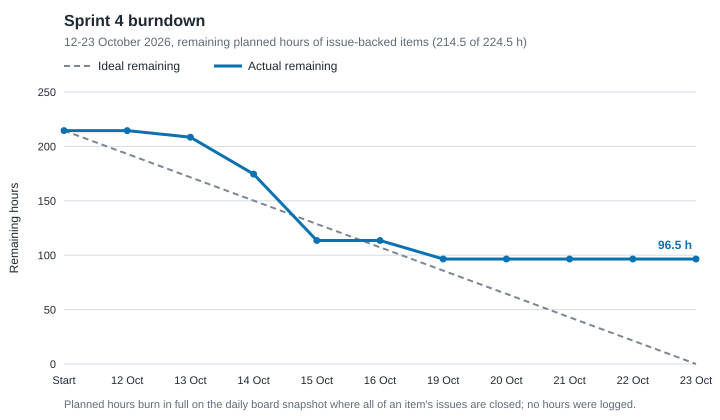

# Sprint 4 review (2026-10-12 to 2026-10-23)

Status: reconstructed on 2026-11-06 from the [plan](plan.md), the daily board snapshots (`docs/agile/metrics/2026-10-12.csv` to `2026-10-27.csv`), the [day logs](log.md), GitHub issue and PR state, and the [Definition of Done](../definition-of-done.md). No Sprint Review meeting was recorded. The final report (Appendix A.5) says that on 24 October the review and retrospective were put off until after the 26 October presentation; the 24 October day log leaves "Sprint 4 tag and retro" open ([log/2026-10-24.md](log/2026-10-24.md)). #619, which tracked them, was closed by accident on 26 October (the body of PR #683 said "Open item 21 closed: #619") and reopened on 6 November. This file is not minutes of a meeting; it records no attendance or discussion. The final report reconstructed the same review as at 29 October (Appendix A.5); this file agrees with it and adds the PR evidence.

## Goal

From [plan.md §2](plan.md) and container issue #465: by 2026-10-23, the **deployed dev environment** runs the complete buyer and admin system for SWE5006 (start or join a bloc on an admin-configured listing, pay the quoted price through Stripe Sandbox, automatic refund on expiry). On **SWE5001 `prod` ECS**, the same code runs as three services (`identity-svc`, `commerce-svc`, `notification-svc`), with a fail-closed identity call and commerce events through the outbox, SNS and SQS; HTTP scaling, queue-driven scaling, self-healing, an identity outage and a DLQ drill are captured as evidence before the 21 October presentation. Every member's SWE5006 use case and design problem is drafted for the 26 October presentation.

**Partly met.**

- Dev: paid START and the automatic expiry refund were shown on deployed dev on 23 October, the last day ([log/2026-10-23.md](log/2026-10-23.md), `backend/docs/payment/stripe-dev-recovery-acceptance-20261023.md`; fix merged as PR #664 on 24 October). A second buyer's paid JOIN was shown on dev on 24 October, in the system demo recording (#657, [log/2026-10-24.md](log/2026-10-24.md)).
- SWE5001: the three-service release was promoted to `prod` on 17, 19 and 20 October (PRs #534, #564, #574; smoke suite green on #574). Of the named evidence, only an HTTP scaling session ran on AWS (19 October, PR #555), and it did not meet its own acceptance check; queue-driven scaling, self-healing, the identity outage and the DLQ drill were not captured on AWS (identity outage and DLQ rehearsed locally, PR #500).
- Report drafts: by 23 October two of the five use-case and design-problem drafts were in the repository (Yorik's, PR #486; Eric's, PR #542). The report was completed after the sprint and frozen on 29 October at `9f3a9cfe` for the 31 October deadline ([log/2026-10-29.md](log/2026-10-29.md)).

## Burndown

Data: [`burndown.csv`](burndown.csv), from [`burndown-items.csv`](burndown-items.csv) and the daily snapshots, produced by `.claude/skills/agile-evidence-capture/scripts/burndown.py` (command in [`docs/agile/metrics/README.md`](../metrics/README.md)).

Method, the same as the Sprint 3 review and Appendix A of the final report: **no member logged hours, and the board Estimate field never decreased**. The 47 cards that carried an estimate on 12 October kept the same value in every snapshot to 27 October, so the sum over the Sprint 4 issues stays at 224.5 h on every day (`board_estimate_h` in the CSV). The burndown is therefore reconstructed from issue state: each backlog item keeps its planned hours while any of its issues is open in that day's snapshot and burns in full on the snapshot where all are closed. The Evidence item (10 h) has no issue and is left out, so the total is 214.5 of 224.5 h. A snapshot's file date is not always its capture time: the snapshot dated 16 October was taken that morning, before US41 and P4 closed in the afternoon, so both burn on 19 October.

| Date | Start | 12 Oct | 13 | 14 | 15 | 16 | 19 | 20 | 21 | 22 | 23 |
|---|---|---|---|---|---|---|---|---|---|---|---|
| Ideal h | 214.5 | 193.1 | 171.6 | 150.2 | 128.7 | 107.3 | 85.8 | 64.4 | 42.9 | 21.5 | 0 |
| Remaining h | 214.5 | 214.5 | 208.5 | 174.5 | 113.5 | 113.5 | 96.5 | 96.5 | 96.5 | 96.5 | 96.5 |
| Open items | 28 | 28 | 27 | 22 | 17 | 17 | 15 | 15 | 15 | 15 | 15 |

The microservice split burned ahead of the ideal line up to the SWE5001 code freeze (16 October). From 19 October the line stays at 96.5 h, because fifteen issues stayed open: the report and presentation work (which ran past the sprint by design), Scrum Master duties, the Sprint 3 closure, the dev payment rollout and the SWE5001 evidence issues whose work was presented on 21 October but whose cards were not closed. Issue state understates delivery; the plan-vs-actual table below gives each item's state.

## Plan vs actual

Planned hours are the plan's (§5). "Remaining at 23 Oct" follows the burndown method (0 when the issue was closed in the 23 October snapshot). Dates are Singapore time.

| Item | Owner | Planned h | Remaining at 23 Oct | State on 23 October | Evidence |
|---|---|---|---|---|---|
| US13 Checkout, scheduling, expiry refunds on dev | @Yorick-Yu | 7 | 7 | Shown on dev on 23 Oct; issue closed 25 Oct | #223, #661, PR #664 |
| US14 Refund idempotency record from local evidence | @Yorick-Yu | 1 | 1 | Not done; open | #224 |
| US34 Paid START and JOIN on dev (Phase B) | @l0sgAi | 2 | 0 | Issue closed 13 Oct; paid START shown 23 Oct, JOIN 24 Oct | #222, PR #664, #657 |
| US28b NFR-37 accepted risk | @PPsyrius | 0.5 | 0.5 | Accepted risk decided at planning (plan §4 item 6); issue open | #227 |
| US17 NFR register sweep | @PPsyrius | 1 | 1 | Register cleaned up 20–21 Oct; issue open | #454, PRs #568, #584 |
| RF Admission and receipt refactor | @EricWang1358 | 2 | 0 | Done 13 Oct | #421–#423, PR #424 |
| DEC Backend ADR 0007 | @l0sgAi | 3 | 3 | Merged 11 Oct as Proposed, before the sprint; acceptance is in PR #750; issue open | #443, PR #466 |
| US38 Notification persistence and list endpoint | @PPsyrius | 8 | 0 | Done 13 Oct | #215, PR #478 |
| US39 Transactional outbox | @Yorick-Yu | 12 | 0 | Done 13 Oct | #444, PR #473 |
| US40 Outbox relay | @Yorick-Yu | 10 | 0 | Done 13 Oct | #445, PR #485 |
| US41 Idempotent SQS consumer | @EricWang1358 | 12 | 0 | Done 16 Oct | #446, PRs #505, #513, #507 |
| NFR Event delivery evidence | @l0sgAi | 4 | 4 | Consumer enabled behind the gate 16 Oct; no AWS evidence; open | #448, PR #512 |
| P1 Messaging module | @PPsyrius | 8 | 0 | Done 14 Oct | #447, PR #487 |
| P2 Three service assemblies, ADR 0008 | @l0sgAi | 21 | 0 | Done 14 Oct | #455, PRs #470, #471, #472 |
| P3 Distributed topology on ECS | @l0sgAi | 11 | 0 | Done 14 Oct | #456, PR #492 |
| P4 HTTP scaling and dashboard | @PPsyrius | 5 | 0 | Done 16 Oct | #457, PRs #489, #518 |
| P5 k6 scripts and runs | @EricWang1358 | 5 | 5 | V2 baseline on ECS 16 Oct; V3 session 19 Oct below its acceptance check; V4 local only; open | #458, PRs #506, #518, #519, #555 |
| P6 Drills | @Yorick-Yu | 4 | 4 | Rehearsed locally 15 Oct; AWS drills not run; open | #459, PR #500 |
| P7 Smoke suite and manual checks on ECS | @limjiechao | 3 | 3 | Smoke suite green at the 20 Oct promotion; manual checks not recorded; open | #460, PR #574 |
| P8 SWE5001 presentation | @limjiechao | 13 | 13 | Presented 21 Oct; issue open | #461, PRs #554, #556, #567, #569, #571 |
| P9 SWE5001 progress report 2 | @l0sgAi | 2 | 2 | No record in the repository; open | #462 |
| P10 Session roles outside identity | @PPsyrius | 6 | 0 | Done 13 Oct | #467, PR #474 |
| P11 Remote identity check | @EricWang1358 | 15 | 0 | Done 14 Oct | #468, PR #479 |
| P12 Attention nicknames through the identity port | @Yorick-Yu | 6 | 0 | Done 14 Oct | #469, PR #490 |
| S3C Sprint 3 review, retrospective, progress report | @limjiechao | 4 | 4 | Not done in the sprint; Sprint 3 retro reconstructed 24 Oct (merged 26 Oct, PR #683) | #451 |
| RPT SWE5006 report drafts and agile artefacts | all, editor @limjiechao | 41 | 41 | Yorik's and Eric's drafts merged; others after the sprint | #463, PRs #486, #542, #624, #665 |
| PRS SWE5006 slide master | @limjiechao | 4 | 4 | Deck scaffolded 19 Oct, drafted 20 Oct, presented 26 Oct | #464, PRs #554, #566, #604, #667 |
| SM Scrum Master duties | @EricWang1358 | 4 | 4 | No mid-sprint check, review or retro recorded | #465 |
| EV Evidence | all | 10 | not counted | Day logs kept every working day; no issue | [log.md](log.md) |
| **Total** | | **224.5** | **96.5 of 214.5** | 13 of 28 issue-backed items closed | |

Unplanned work that landed in the sprint, by merged PR: the presentation kit and SWE5001 deck tooling (#554, #597, #602), payment and web fixes from review (#541, #544, #545, #546, #547, #552), CI reliability (#572, #580), OWASP ZAP baseline, SBOM and DORA metrics workflows (#607, #609, #629), the DSOMM self-assessment (#627), the Definition of Done page (#625), the practices index (#626) and statecharts (#628), and AWS governance records (#530, #533).

## Environment and CI

| Check | Command | Result |
|---|---|---|
| dev CI, 12–23 Oct | `gh run list --branch dev --created 2026-10-12..2026-10-23 --limit 1000` | ci-backend 34 of 34 success; ci-frontend 32 of 32; security 121 of 123 (both failures are the scheduled weekly full-history scan, the known NFR-02 limit); swe5001-release-gate 10 of 10 |
| prod promotions | `gh pr list --base prod --state merged` | PRs #520 (16 Oct), #528 (16 Oct), #534 (17 Oct), #564 (19 Oct), #574 (20 Oct) |
| dev health | `curl -s https://d1b3np88z657cp.cloudfront.net/api/actuator/health` | Not checked on 23 Oct; `{"status":"UP"}` on 6 Nov |
| dev page | `curl -s -o /dev/null -w '%{http_code}' https://d1b3np88z657cp.cloudfront.net/` | Not checked on 23 Oct; 200 on 6 Nov |

## Demo notes

- **SWE5001 presentation, 21 October:** the three-service platform on `prod` ECS. The demo was cut to three steps (use cases, auto-scaling from the 19 October run, pipeline) because stopping a task, the identity outage and the event backlog had not been rehearsed on AWS ([log/2026-10-19.md](log/2026-10-19.md); PR #571).
- **SWE5006 rehearsal, 25 October:** the timed rehearsal ran 47 minutes for 34 minutes of slots (1.38 times); each member then wrote refinements for their own slides, applied in PR #683 ([log/2026-10-25.md](log/2026-10-25.md)).
- **SWE5006 presentation, 26 October:** the system demo ran live on dev; backup recordings of the system (#657) and the pipeline were recorded on 24 October. The lecturer's three remarks (send the repository link, show the ZAP results before and after remediation, submit by 31 October) were recorded as issues #693, #694 and #695 (report Table 2.7).
- Team feedback on the deck before the talk came through ten sub-issues of #605 (#649–#655, #657, #668, #670), all closed by 25 October, nine of them by PR #671.

## Definition of Done step reached

**Released (shared SWE5001 production); shown on dev.** The team first agreed this placement on 24 October as "released (SWE5001); releasable (SWE5006 dev)" and re-agreed it on 25 October in the wording above ([#619 comment](https://github.com/PPsyrius/iss-groupbuy-team8/issues/619)): the SWE5001 production release on ECS (PRs #534 and #574) is the production release for both modules, and dev shows the full paid journey (PR #664, #657). See [definition-of-done.md](../definition-of-done.md#done-ladder-per-sprint).

## Carried over

Sprint 4 was the last sprint, so nothing was carried into a next sprint. Open past 23 October:

- #223 dev payment rollout: closed 25 Oct after PR #664.
- #224 refund idempotency record; #448 and #459 SWE5001 evidence on AWS; #458 V3/V4 acceptance: open on 6 Nov.
- #227, #454: the work is done (accepted risk, register swept) but the issues are open.
- #443: ADR 0007 merged as Proposed; acceptance is in PR #750; the issue is open.
- #461, #464: delivered (both presentations) with the issues open.
- #460: partly delivered; the smoke suite passed at the 20 Oct promotion, but the manual sign-in and notification checks its acceptance criteria require were not recorded.
- #462 SWE5001 progress report 2 and final report: no progress report 2 in the repository; final report in progress (due 16 Nov).
- #463 SWE5006 report: drafts completed after the sprint; frozen 29 Oct; the issue is open.
- #451 Sprint 3 closure and #619 (this record): reconstructed after the sprint.
