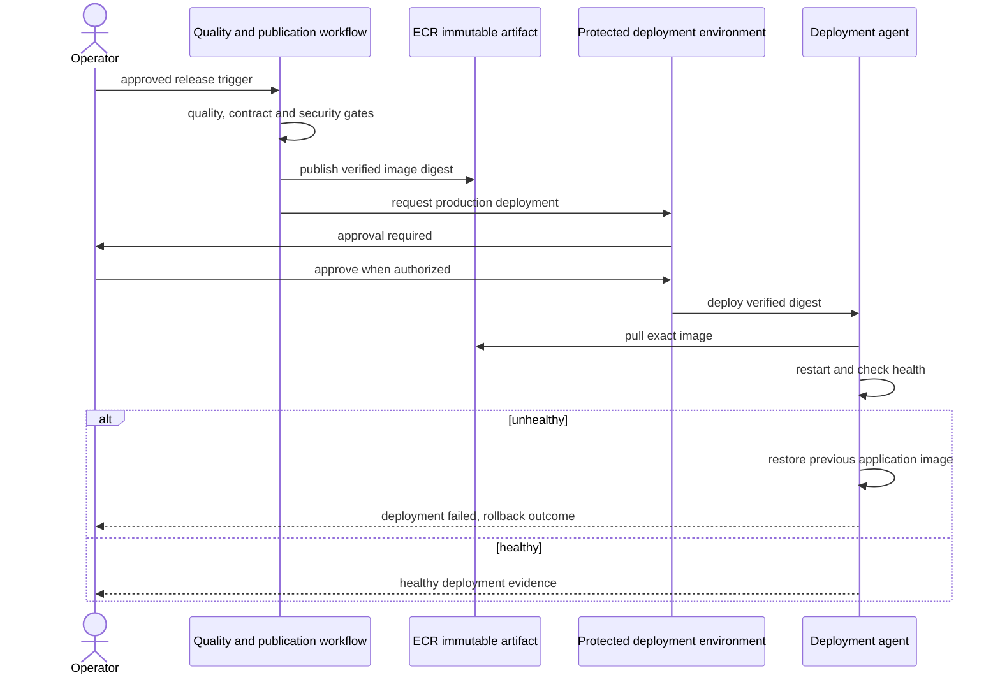

# Production Backend Handover — Manual Operations Before the First Deployment

**Status:** ARCHIVED procedure (2026-09-21) - the Sept-7 first-deployment walkthrough below was superseded by the runbook; only the course appendix at the end is current. **Date:** 2026-09-07 **Audience:** a team member with administrative AWS credentials on account `402178232802` (region `ap-southeast-1`) and the `gh` CLI authenticated against `PPsyrius/iss-groupbuy-team8` with admin rights.

Everything below happens **outside** the repository. The authoritative references are:

- Runbook (most detailed): [backend-prod-operations-runbook.md](backend-prod-operations-runbook.md)
- Design (rationale; wins on conflict): [backend-prod-terraform-deployment.md](backend-prod-terraform-deployment.md)
- Dev entry-layer tutorial (CloudFront pattern we replicate): [../dev-cloudfront-deployment.md](../dev-cloudfront-deployment.md)

---

> **Archived procedure (2026-09-21):** the original sections 0-10, troubleshooting, and red lines (2026-09-07, written against unmerged branch `chore/prod-pipeline-build-20260906`) were superseded by the canonical [operations runbook](backend-prod-operations-runbook.md), which covers the same steps plus steady-state operations. Full history remains in git. Only the course appendix below is current.

## Course analysis and contribution

Member: Panpakorn Siripanich (Pan), the non-functional production-readiness use case selected in issues #48/#49. This appendix explains the existing design for the course report; it does not authorize deployment or replace the operational steps above. Scope/evidence snapshot: 2026-09-11. See the [original backend contribution map](../../../backend/docs/design/backend-skeleton-plan.md#13-course-report-analysis-and-design-map).

**Analysis:** the release operator needs repeatable, reviewed promotion of the exact tested image. Preconditions are provisioned infrastructure, configured environment protections and least-privilege credentials. Main flow is quality/security validation → publish immutable artifact → approval → deploy → health verification. Success is a healthy verified release; failed health checks require application rollback without destructive database reversal. Missing approval/config must block.

**Design:** Terraform defines resources, GitHub Actions gates the workflow, separate environment subjects scope OIDC credentials, image digests prevent artifact substitution, and deployment scripts perform health checking and rollback. Workflow comments alone do not enforce reviewer settings: the actual GitHub environment must be configured and inspected. Repository files are not proof of an active AWS instance or a successfully rehearsed release.

**Pattern analysis:** IaC, immutable artifacts, approval gates and compensating rollback are operational/architectural patterns, not GoF object patterns. Their problem is repeatable governed delivery, their context is a staged release pipeline, their forces are auditability/least privilege/ recoverability, and their solution is the separated artifacts and gates above. Do not label YAML jobs Command or the approval sequence Chain of Responsibility without actual corresponding object participants. No undoable domain Memento exists in image rollback. Pan must confirm assessment acceptance of this non-functional case or agree another evidenced functional UC with the team.

The sequence below is operational UML, not a claim of Java pattern classes or a new deployment API. Its objects are Operator, CI, Artifact Registry, Approval Gate and Deployment Agent; a GoF class diagram would invent implementation that is not present.

Contribution evidence must include member-authored work and actual reviewed plan, protection rules and rehearsal/rollback results. Separate Pan's verified operations/design from Liu Jin's pipeline foundation. The dated TODO and #48 are checklists, not fresh cloud verification. No credentials, release tags, Terraform apply, cloud mutation or deployment is produced by this documentation edit.
