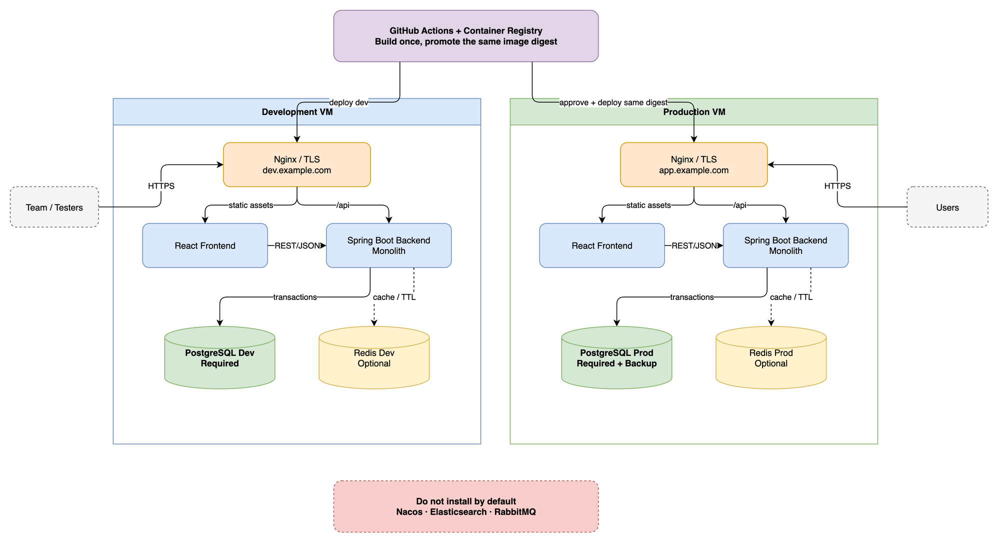

# AWS Dev and Production Deployment Guide

## Group Buying Web Application

**Document status:** Proposed implementation baseline  
**Application stack:** React, Java Spring Boot, PostgreSQL, optional Redis  
**Delivery platform:** GitHub Actions  
**Cloud platform:** Amazon Web Services  
**Environments:** Development and Production  
**Last updated:** 26 August 2026

---

## 1. Executive Summary

This document defines a practical AWS deployment architecture for a course-scale group buying web application. The solution uses two independent Amazon EC2 instances:

- one EC2 instance for the **Development** environment;
- one EC2 instance for the **Production** environment.

Each environment runs an isolated Docker Compose stack containing:

- an Nginx reverse proxy and TLS endpoint;
- a React frontend container;
- a Spring Boot backend container;
- a PostgreSQL container with a dedicated persistent volume;
- an optional Redis container, enabled only when a concrete caching, rate-limiting, session, or TTL use case exists.

Nacos, Elasticsearch, and RabbitMQ are intentionally excluded from the initial architecture. They do not provide sufficient value for the current monolithic application and would introduce unnecessary operational and security overhead.

GitHub Actions performs continuous integration, security checks, image creation, and deployment orchestration. Container images are built once, scanned, pushed to Amazon Elastic Container Registry (ECR), deployed to Development, verified, and then promoted to Production by immutable image digest after approval.

The recommended implementation deliberately prioritises:

- reproducibility;
- environment isolation;
- traceability from Git commit to deployed image;
- automated quality and security gates;
- minimal server maintenance;
- demonstrable DevSecOps practices suitable for the course requirements.

---

## 2. Scope and Assumptions

### 2.1 In scope

This guide covers:

- AWS infrastructure required for two environments;
- environment and data isolation;
- Docker Compose deployment;
- PostgreSQL and optional Redis deployment;
- GitHub Actions CI/CD design;
- Terraform workflow and remote state;
- identity, secret, and network security;
- deployment verification, debugging, backup, and rollback;
- recommended evidence for the final course report and presentation.

### 2.2 Out of scope

The first implementation does not aim to provide:

- multi-region disaster recovery;
- automatic horizontal scaling;
- Kubernetes orchestration;
- database clustering or automatic failover;
- zero-downtime blue/green deployment;
- production-grade payment processing;
- a microservice architecture;
- high-volume search or event-stream processing.

These capabilities can be introduced later if a measured requirement justifies them.

### 2.3 Workload assumptions

The design assumes:

- a small course project team;
- a moderate number of demonstration users;
- a small product catalogue;
- a single Spring Boot backend instance per environment;
- simulated or sandbox payment processing;
- no requirement for production-grade high availability;
- two EC2 instances are sufficient for the agreed course scope.

---

## 3. Architecture Decisions

| Area | Selected option | Rationale |
|---|---|---|
| Application architecture | Spring Boot monolith | Easier to analyse, test, deploy, and demonstrate within the available project effort |
| Frontend | React container | Independent build and deployment artifact |
| Primary database | PostgreSQL | Transactions, constraints, concurrency controls, and relational modelling are suitable for group deals, inventory, and orders |
| Cache | Redis, optional | Added only for a defined cache, TTL, session, or rate-limiting requirement |
| Service discovery | No Nacos | A single backend service does not require service discovery |
| Search platform | No Elasticsearch initially | PostgreSQL full-text search and `pg_trgm` are sufficient for a small catalogue |
| Message broker | No RabbitMQ initially | Reliable distributed asynchronous processing is not yet a core requirement |
| Compute | Two EC2 instances | Clear Development and Production host-level separation |
| Runtime | Docker Engine and Docker Compose | Reproducible deployment without installing Java, Node.js, PostgreSQL, or Redis directly on the host |
| Image registry | Amazon ECR | Private AWS-native storage for frontend and backend images |
| CI/CD | GitHub Actions | Native Pull Request integration and pipeline-as-code |
| AWS authentication | GitHub OIDC federation | Temporary credentials instead of stored long-lived AWS access keys |
| Remote administration | AWS Systems Manager | Deployment and diagnostics without exposing SSH to the internet |
| Infrastructure as Code | Terraform | Versioned and reviewable AWS infrastructure |
| Terraform state | Versioned encrypted S3 backend with S3 lockfile | Remote state, recovery, and protection against concurrent writes |
| Configuration and secrets | SSM Parameter Store `SecureString`, or Secrets Manager where rotation is required | Environment-specific encrypted configuration with IAM-controlled access |
| Monitoring | Spring Boot Actuator and CloudWatch Agent | Health, system metrics, and centralised logs without a full observability platform |

---

## 4. Target Deployment Architecture



### 4.1 Logical deployment

```text
GitHub Repository
    |
    v
GitHub Actions
    |-- CI: frontend, backend, Terraform, and security checks
    |-- Build frontend and backend images once
    |-- Push immutable images to Amazon ECR
    |
    +--> Development EC2
    |      |-- Nginx/TLS
    |      |-- React frontend
    |      |-- Spring Boot backend
    |      |-- PostgreSQL Development
    |      `-- Redis Development, optional
    |
    `--> Production approval
           |
           `--> Production EC2
                  |-- Nginx/TLS
                  |-- React frontend
                  |-- Spring Boot backend
                  |-- PostgreSQL Production
                  `-- Redis Production, optional
```

### 4.2 Build once, promote the same artifact

The frontend and backend images must be built once for a given Git commit. Development and Production must use the same image digests.

Example:

```text
Frontend image:
123456789012.dkr.ecr.ap-southeast-1.amazonaws.com/groupbuy-frontend@sha256:abc...

Backend image:
123456789012.dkr.ecr.ap-southeast-1.amazonaws.com/groupbuy-backend@sha256:def...
```

Production deployment must promote these exact digests after Development verification. Rebuilding the images for Production would weaken traceability because the resulting binaries could differ even if they use the same Git tag.

---

## 5. AWS Resource Inventory

### 5.1 Required resources

The Terraform configuration should provision at least:

1. One VPC.
2. Public subnets for the two demonstration servers.
3. An Internet Gateway and route tables.
4. One Development EC2 instance.
5. One Production EC2 instance.
6. Separate Development and Production security groups.
7. Encrypted EBS volumes.
8. Two ECR repositories:
   - `groupbuy-frontend`;
   - `groupbuy-backend`.
9. IAM instance roles and instance profiles.
10. A GitHub Actions OIDC provider and restricted IAM roles.
11. SSM Parameter Store paths for each environment.
12. An S3 bucket for Terraform state.
13. An S3 bucket or protected prefix for Production database backups.
14. CloudWatch log groups and basic alarms.

### 5.2 Optional resources

The following are useful but not mandatory for the initial version:

- Route 53 hosted zone and DNS records;
- Elastic IP addresses for stable direct-to-EC2 DNS targets;
- customer-managed KMS keys;
- CloudWatch dashboards;
- SNS notifications for deployment or alarm events;
- AWS Secrets Manager if automatic credential rotation is required.

### 5.3 Suggested resource naming

```text
groupbuy-dev-ec2
groupbuy-prod-ec2
groupbuy-dev-sg
groupbuy-prod-sg
groupbuy-frontend
groupbuy-backend
/groupbuy/dev/*
/groupbuy/prod/*
groupbuy-dev-logs
groupbuy-prod-logs
```

Tag all resources consistently:

```text
Project     = groupbuy
Environment = dev | prod
ManagedBy   = terraform
Owner       = <team-name>
```

Tags are useful for cost allocation, SSM command targeting, troubleshooting, and cleanup.

---

## 6. Network and Security Design

### 6.1 EC2 placement

For a cost-conscious course implementation, both EC2 instances may use public subnets. Each instance should still be treated as an independent environment.

The instances do not provide high availability merely because they are in different subnets or Availability Zones. Their purpose is environment isolation, not Production failover.

### 6.2 Inbound security group rules

Recommended public inbound rules:

| Port | Source | Purpose |
|---|---|---|
| 80/TCP | Internet | HTTP redirect and certificate issuance |
| 443/TCP | Internet | HTTPS application access |
| 22/TCP | None by default | Use Systems Manager instead of public SSH |

If SSH is temporarily required, restrict port 22 to a known team IP range and remove the rule after use.

Never expose the following ports publicly:

- PostgreSQL `5432`;
- Redis `6379`;
- Spring Boot internal port such as `8080`;
- Actuator management port;
- Docker daemon socket.

### 6.3 Docker networking

Only Nginx should publish ports on the EC2 host. PostgreSQL and Redis should be reachable only from the backend through an internal Docker network.

```text
Internet
   |
80/443
   |
Nginx
   |-------------------|
Frontend            Backend
                       |
                 internal network
                   |          |
              PostgreSQL    Redis
```

### 6.4 TLS and DNS

Recommended hostnames:

```text
dev.example.com  -> Development EC2
app.example.com  -> Production EC2
```

For the simplified direct-to-EC2 design, Nginx with an ACME client such as Certbot can terminate TLS. Certificate files must be persisted and renewed automatically.

An Application Load Balancer with AWS Certificate Manager can be introduced later, but it is not required for the first version and increases cost and infrastructure complexity.

---

## 7. Environment Isolation

Development and Production must not share application data or credentials.

| Concern | Development | Production |
|---|---|---|
| EC2 instance | Dedicated Dev instance | Dedicated Production instance |
| GitHub Environment | `development` | `production` |
| PostgreSQL | Dev container and volume | Production container and volume |
| Redis | Dev container, if enabled | Production container, if enabled |
| Database user | Dev-specific | Production-specific |
| JWT/signing secret | Dev-specific | Production-specific |
| Parameter path | `/groupbuy/dev/*` | `/groupbuy/prod/*` |
| Domain | `dev.example.com` | `app.example.com` |
| Test data | Permitted | Prohibited unless explicitly approved |
| Deployment | Automatic after `main` merge | Approval required |
| Backup policy | Optional or short retention | Required |
| Log retention | Shorter | Longer and access-controlled |

Production credentials must never be copied to Development. Production data must not be used as Development test data unless it is explicitly anonymised.

---

## 8. Middleware Selection

### 8.1 PostgreSQL: required

PostgreSQL is the system of record for:

- users and roles;
- products and merchants;
- group buying campaigns;
- group memberships;
- inventory reservations;
- orders;
- payment simulation records;
- audit fields and status transitions.

Critical business correctness should rely on database transactions and constraints. Recommended controls include:

- unique constraints to prevent duplicate participation;
- foreign keys for relationship integrity;
- optimistic locking for concurrent updates;
- atomic conditional inventory updates;
- transactions around group completion and order creation;
- migration scripts managed by Flyway or Liquibase.

PostgreSQL should remain authoritative even if Redis is introduced.

### 8.2 Redis: optional

Redis should be enabled only when the team implements at least one explicit use case such as:

- caching frequently viewed group deal summaries;
- login session storage;
- short-lived verification data;
- API rate limiting;
- data with a natural TTL;
- temporary idempotency keys.

Redis must not be the only source of truth for inventory, group membership, or orders. The application must continue to preserve correctness when Redis is restarted or its cache is cleared.

Development and Production require separate Redis containers and volumes. Logical Redis databases such as DB 0 and DB 1 are not sufficient environment isolation.

### 8.3 Nacos: excluded initially

Nacos would be justified for service discovery or centralised configuration across multiple independently deployed services. The selected backend is a single Spring Boot monolith, so service discovery is unnecessary.

Spring Boot supports environment-specific external configuration through configuration files, environment variables, mounted configuration, and command-line arguments. The application should use:

```text
SPRING_PROFILES_ACTIVE=dev
SPRING_PROFILES_ACTIVE=prod
```

Sensitive values are supplied from AWS Parameter Store or Secrets Manager rather than committed configuration files.

### 8.4 Elasticsearch: excluded initially

For the expected catalogue size, PostgreSQL can provide:

- indexed filtering;
- `ILIKE` search;
- full-text search;
- GIN indexes;
- trigram similarity through `pg_trgm`.

Elasticsearch should be reconsidered only if the team demonstrates a need for large-scale relevance ranking, language analysis, highlighting, complex aggregation, or search performance that PostgreSQL cannot meet.

### 8.5 RabbitMQ: excluded initially

RabbitMQ should be introduced only if reliable asynchronous work is a selected design problem, for example:

- retried notification delivery;
- multiple independent consumers;
- dead-letter handling;
- long-running background work;
- reliable event distribution across services.

For the initial monolith, simpler alternatives include:

- Spring application events;
- a scheduled worker;
- a database-backed job table;
- a transactional outbox implemented within PostgreSQL.

---

## 9. EC2 Host Configuration

### 9.1 Host software

The EC2 host should contain only the software required to operate containers and AWS management agents:

- Docker Engine;
- Docker Compose plugin;
- AWS Systems Manager Agent;
- AWS CLI, if used by deployment scripts;
- CloudWatch Agent;
- basic operating-system security and monitoring packages.

Do not install Java, Node.js, PostgreSQL, Redis, Nacos, Elasticsearch, or RabbitMQ directly on the host. They should run as version-pinned containers if selected.

### 9.2 Host hardening

At minimum:

- use a supported EC2 operating-system image;
- apply security updates during instance provisioning;
- enable EBS encryption;
- avoid password-based SSH;
- use SSM Session Manager for administrative access;
- restrict the instance IAM role to required ECR, SSM, Parameter Store, KMS, S3, and CloudWatch actions;
- do not expose the Docker socket;
- configure disk-usage monitoring;
- configure log rotation;
- set Docker container restart policies;
- run application containers as non-root users where supported.

AWS EBS encryption protects volumes and snapshots using AWS KMS. It covers data at rest and data moving between the instance and the attached encrypted volume.

---

## 10. Docker Compose Baseline

The same Compose template should be used in both environments. Environment differences must come from variables, secrets, domain configuration, and image digests.

Illustrative structure:

```yaml
services:
  reverse-proxy:
    image: nginx:<pinned-version>
    ports:
      - "80:80"
      - "443:443"
    volumes:
      - ./nginx:/etc/nginx/conf.d:ro
      - tls-data:/etc/letsencrypt
    depends_on:
      frontend:
        condition: service_healthy
      backend:
        condition: service_healthy
    restart: unless-stopped
    networks:
      - public

  frontend:
    image: ${FRONTEND_IMAGE}
    restart: unless-stopped
    networks:
      - public

  backend:
    image: ${BACKEND_IMAGE}
    environment:
      SPRING_PROFILES_ACTIVE: ${SPRING_PROFILE}
      SPRING_DATASOURCE_URL: jdbc:postgresql://postgres:5432/${POSTGRES_DB}
      SPRING_DATASOURCE_USERNAME: ${POSTGRES_USER}
      SPRING_DATASOURCE_PASSWORD: ${POSTGRES_PASSWORD}
      SPRING_DATA_REDIS_HOST: redis
    depends_on:
      postgres:
        condition: service_healthy
    restart: unless-stopped
    networks:
      - public
      - internal

  postgres:
    image: postgres:<pinned-major-and-minor-version>
    environment:
      POSTGRES_DB: ${POSTGRES_DB}
      POSTGRES_USER: ${POSTGRES_USER}
      POSTGRES_PASSWORD: ${POSTGRES_PASSWORD}
    volumes:
      - postgres-data:/var/lib/postgresql
    healthcheck:
      test: ["CMD-SHELL", "pg_isready -U ${POSTGRES_USER} -d ${POSTGRES_DB}"]
      interval: 10s
      timeout: 5s
      retries: 10
    restart: unless-stopped
    networks:
      - internal

  redis:
    image: redis:<pinned-version>
    profiles: ["redis"]
    command: ["redis-server", "--appendonly", "yes"]
    volumes:
      - redis-data:/data
    restart: unless-stopped
    networks:
      - internal

networks:
  public:
  internal:
    internal: true

volumes:
  postgres-data:
  redis-data:
  tls-data:
```

This is a structural example, not a complete production-ready Compose file. The final configuration must additionally define:

- container health checks;
- memory and CPU safeguards appropriate to the EC2 size;
- read-only filesystems where feasible;
- non-root users;
- secure Redis authentication if Redis is enabled;
- log rotation;
- graceful shutdown;
- explicit image digests for Production.

Do not commit `.env.dev` or `.env.prod` files containing real secrets.

---

## 11. Configuration and Secret Management

### 11.1 Parameter hierarchy

Suggested Parameter Store layout:

```text
/groupbuy/dev/database/name
/groupbuy/dev/database/username
/groupbuy/dev/database/password
/groupbuy/dev/jwt/secret
/groupbuy/dev/redis/password

/groupbuy/prod/database/name
/groupbuy/prod/database/username
/groupbuy/prod/database/password
/groupbuy/prod/jwt/secret
/groupbuy/prod/redis/password
```

Use `SecureString` for sensitive values. AWS Systems Manager encrypts `SecureString` values using AWS KMS. If automatic secret rotation or more advanced secret lifecycle controls are required, use AWS Secrets Manager instead.

### 11.2 Environment-specific IAM

The Development EC2 role should read only:

```text
/groupbuy/dev/*
```

The Production EC2 role should read only:

```text
/groupbuy/prod/*
```

Production access must not imply Development access, and Development access must never imply Production access.

### 11.3 Runtime retrieval

The deployment script may retrieve parameters and generate an environment file with permissions set to `0600`. It must:

- avoid printing secret values;
- avoid enabling shell command tracing around secret retrieval;
- remove temporary plaintext files when no longer needed;
- restrict read access to the deployment user;
- ensure GitHub Actions logs do not contain credentials.

---

## 12. Terraform Repository Structure

Recommended repository layout:

```text
deployment/
  compose.yaml
  nginx/
  scripts/
    deploy.sh
    health-check.sh
    backup-postgres.sh

infra/
  bootstrap/
    state-bucket/

  modules/
    network/
    ec2-environment/
    ecr/
    iam/
    observability/

  environments/
    dev/
      backend.tf
      main.tf
      variables.tf
      dev.tfvars

    prod/
      backend.tf
      main.tf
      variables.tf
      prod.tfvars
```

Using separate environment directories and state keys makes accidental cross-environment changes less likely than putting all resources into one shared state.

### 12.1 Remote state

Use an S3 backend with:

- S3 Block Public Access;
- server-side encryption;
- bucket versioning;
- restricted IAM access;
- S3 state locking using `use_lockfile = true`;
- separate Development and Production state keys.

Example:

```hcl
terraform {
  backend "s3" {
    bucket       = "<terraform-state-bucket>"
    key          = "groupbuy/dev/terraform.tfstate"
    region       = "ap-southeast-1"
    encrypt      = true
    use_lockfile = true
  }
}
```

Production uses a different key:

```text
groupbuy/prod/terraform.tfstate
```

Current Terraform documentation supports S3 lockfiles and deprecates DynamoDB-based state locking. Bucket versioning should be enabled so previous state versions can be recovered after human error.

### 12.2 Infrastructure Pull Request workflow

For Terraform changes, Pull Requests should run:

```text
terraform fmt -check
terraform init
terraform validate
terraform plan
IaC security scan
```

The Plan should be attached to the workflow summary or Pull Request without exposing sensitive values.

Recommended apply policy:

- Development infrastructure: apply after merge, with team visibility.
- Production infrastructure: require a GitHub Production Environment approval.
- Destructive Production changes: require explicit review of the Plan.

Do not run unrestricted `terraform apply -auto-approve` for Production immediately after every merge.

---

## 13. AWS Identity for GitHub Actions

GitHub Actions should authenticate to AWS using OIDC federation rather than stored AWS access keys.

AWS recommends temporary credentials through OIDC federation instead of long-lived credentials stored in external applications. The IAM trust policy must restrict access to the expected GitHub organisation, repository, branch, or GitHub Environment.

Suggested roles:

```text
GroupBuyGitHubDevDeployRole
GroupBuyGitHubProdDeployRole
GroupBuyGitHubTerraformDevRole
GroupBuyGitHubTerraformProdRole
```

The Production role trust policy should be limited to the protected GitHub `production` Environment. Its permission policy should allow only required actions such as:

- reading the selected image metadata;
- invoking SSM Run Command against the Production instance;
- reading deployment status;
- applying Production Terraform when explicitly approved.

Avoid a single broad role with administrator permissions for all workflows.

Example GitHub workflow permissions:

```yaml
permissions:
  contents: read
  id-token: write
```

All other permissions should remain unset or read-only unless a job explicitly needs them.

---

## 14. Continuous Integration Design

### 14.1 Pull Request checks

Every Pull Request should run the checks relevant to changed paths.

#### Frontend pipeline

```text
npm ci
ESLint and formatting check
TypeScript check, if applicable
Unit and component tests
Coverage report
Sonar analysis
Dependency vulnerability scan
Secret scan
Production build
```

#### Backend pipeline

```text
Maven clean verify
Checkstyle or SpotBugs
JUnit unit tests
Integration tests
JaCoCo coverage
Sonar analysis
Dependency vulnerability scan
Secret scan
JAR build
```

#### Infrastructure pipeline

```text
Terraform formatting
Terraform validation
Terraform plan
Dockerfile and Compose configuration scan
Terraform/IaC misconfiguration scan
```

### 14.2 Pull Request quality gates

A Pull Request must not merge when:

- compilation fails;
- a required test fails;
- the Sonar Quality Gate fails;
- a real secret is detected;
- an unapproved Critical vulnerability is present;
- an unapproved fixable High vulnerability is present;
- Terraform validation fails;
- required reviews are missing.

Use GitHub branch protection or rulesets to make the final CI gate mandatory.

---

## 15. Continuous Delivery Design

### 15.1 Application release flow

```text
1. Merge Pull Request into main.
2. Build frontend and backend images once.
3. Tag images with the Git commit SHA.
4. Scan images for vulnerabilities, secrets, and misconfiguration.
5. Generate SBOMs.
6. Push images to ECR.
7. Resolve and record immutable image digests.
8. Deploy the digests automatically to Development.
9. Run health checks, smoke tests, E2E tests, and DAST.
10. Stop promotion if Development verification fails.
11. Request approval for the GitHub Production Environment.
12. Back up the Production database.
13. Deploy the same image digests to Production.
14. Run Production health and smoke checks.
15. Roll back the application images if verification fails.
16. Record the deployment result and artifact versions.
```

### 15.2 ECR repositories

Use two ECR repositories:

```text
groupbuy-frontend
groupbuy-backend
```

Recommended tags:

```text
git-<full-or-short-sha>
release-<semantic-version>
```

Deployment should use the digest rather than a mutable `latest` tag.

ECR access should use IAM permissions. ECR authentication tokens are temporary, so deployment scripts should authenticate immediately before pulling images rather than storing registry passwords.

### 15.3 GitHub Environment configuration

#### Development

- automatic deployment after successful `main` pipeline;
- only `main` may deploy;
- Development-specific AWS role;
- no access to Production parameters;
- short log and artifact retention acceptable.

#### Production

- required reviewer approval, if supported by the repository plan;
- prevent self-approval where available;
- only protected branches or release tags may deploy;
- dedicated Production AWS role;
- dedicated concurrency group to prevent overlapping deployments;
- longer log and evidence retention.

---

## 16. Deployment Through AWS Systems Manager

AWS Systems Manager Run Command can securely execute deployment commands on managed EC2 instances without exposing SSH.

### 16.1 EC2 prerequisites

Each instance must:

- run SSM Agent;
- have an instance profile permitting Systems Manager management;
- have outbound connectivity to the required SSM and ECR endpoints;
- have Docker and Compose installed;
- be tagged with its environment.

### 16.2 Deployment sequence on an instance

The deployment command or script should:

```text
1. Acquire a deployment lock.
2. Read the target frontend and backend image digests.
3. Authenticate Docker to ECR using the EC2 instance role.
4. Retrieve environment configuration and secrets.
5. Pull the new images.
6. Back up PostgreSQL when deploying Production.
7. Run or validate database migrations.
8. Start or update the Docker Compose services.
9. Wait for container health checks.
10. Call the application health endpoint.
11. Run smoke tests.
12. Record the deployed digests.
13. Release the deployment lock.
```

The script must exit non-zero on failure so GitHub Actions receives an accurate deployment result.

### 16.3 Avoid configuration drift

Do not manually edit application code, Compose files, or Nginx files directly on the servers. Changes must be committed to Git and deployed through the pipeline.

Emergency server changes must be documented and subsequently incorporated into Terraform, Compose, or the deployment scripts.

---

## 17. Database Migration and Backup

### 17.1 Migration approach

Use Flyway or Liquibase and keep migration scripts in the backend repository.

Migration principles:

- migrations are immutable after they have been applied;
- Development runs migrations before functional verification;
- Production validates pending migrations before deployment;
- destructive migrations require explicit review;
- application and database changes should remain backward-compatible during rollback windows.

### 17.2 Production backup

Before a Production migration:

1. run `pg_dump` using the Production database role designated for backup;
2. compress the backup;
3. encrypt it or upload it to an encrypted S3 bucket;
4. record the database version and deployment SHA;
5. apply an S3 lifecycle and retention policy;
6. periodically test restoration in Development using sanitised data.

EBS snapshots may supplement database backups but should not be the only recovery mechanism.

### 17.3 Restore test

A backup is not considered reliable until restoration has been tested. The team should perform at least one controlled restore exercise and capture:

- backup identifier;
- restore duration;
- validation queries;
- any missing steps;
- corrective actions.

---

## 18. Health Checks and Verification

### 18.1 Container health

Each container should expose or implement an appropriate health check:

- Nginx/frontend: HTTP response on a local health path;
- backend: Spring Boot Actuator health endpoint;
- PostgreSQL: `pg_isready`;
- Redis: authenticated `PING`, if enabled.

### 18.2 Deployment smoke tests

Minimum automated smoke tests:

```text
GET frontend home page returns 200
GET backend health endpoint returns UP
Database connectivity is healthy
Redis connectivity is healthy when enabled
User authentication works
Group deal listing works
Join-group happy path works with test data in Development
```

Production smoke tests must avoid creating uncontrolled business data. Use read-only tests or a dedicated synthetic test account.

### 18.3 DAST

Run an OWASP ZAP baseline or equivalent passive scan against Development after deployment. High-risk findings should block Production promotion unless the team records an approved, time-bounded exception.

Do not run destructive active security scans against Production.

---

## 19. Logging, Monitoring, and Alerting

### 19.1 Application logging

The backend should log structured events to standard output. Logs should include:

- timestamp;
- severity;
- environment;
- request or correlation ID;
- operation name;
- outcome;
- safe error context.

Logs must not include:

- passwords;
- JWTs;
- session identifiers;
- database connection strings;
- payment details;
- full personal data records.

### 19.2 CloudWatch

The CloudWatch Agent can collect EC2 metrics and logs from the instances and containerised applications.

Recommended basic alarms:

- EC2 status check failure;
- high CPU for a sustained period;
- low disk space;
- backend health check failure;
- repeated container restart;
- unusually high HTTP 5xx rate, if available.

Development may use shorter retention. Production logs should have a defined retention period and restricted access.

### 19.3 Spring Boot Actuator

Expose only necessary Actuator endpoints. A typical public or proxy-accessible surface should be limited to health information. Sensitive endpoints such as environment, heap dump, and full configuration must not be publicly exposed.

---

## 20. Debugging Procedure

### 20.1 General rule

Do not debug by changing files directly in Production.

```text
Observe Production
    -> restore service or roll back if necessary
    -> reproduce in Development
    -> add a regression test
    -> fix through a Pull Request
    -> run CI and security gates
    -> deploy and verify Development
    -> approve and promote to Production
```

### 20.2 CI failures

Check the first failing job rather than the final summary:

- build or compilation;
- unit/integration test;
- Sonar Quality Gate;
- dependency scan;
- image scan;
- Terraform validation or Plan;
- deployment command;
- migration;
- smoke test;
- DAST.

Reproduce the failing command locally or in a Development container with the same tool version.

### 20.3 Runtime checks

Use SSM Session Manager or an approved Run Command to inspect Development:

```bash
docker compose ps
docker compose logs --tail=200 backend
docker compose logs --tail=200 frontend
docker compose logs --tail=200 postgres
docker compose logs --tail=200 redis
```

Check:

- container status and restart count;
- backend health endpoint;
- active Spring profile;
- database migration status;
- PostgreSQL connectivity and pool exhaustion;
- Redis connectivity and TTL behaviour;
- frontend API URL;
- browser network errors;
- Nginx routing and TLS status;
- disk and memory pressure.

Production investigation should begin with read-only evidence collection. Avoid restarting containers or modifying data before the impact and rollback options are understood.

---

## 21. Rollback Strategy

### 21.1 Application rollback

Before deployment, record the currently running frontend and backend digests.

If Production health or smoke tests fail:

1. stop further promotion;
2. restore the previous image digests in the Compose environment;
3. run `docker compose up -d`;
4. repeat health and smoke checks;
5. preserve logs and deployment evidence;
6. open an incident or defect record.

### 21.2 Database rollback

Application rollback does not automatically reverse a database migration. Therefore:

- prefer additive and backward-compatible migrations;
- avoid renaming or deleting columns in the same release that stops using them;
- use an expand-and-contract approach;
- review destructive SQL manually;
- restore from backup only when necessary and authorised.

### 21.3 Infrastructure rollback

Do not assume that applying an older Terraform configuration always restores the previous infrastructure state. Review the new Plan before applying changes. Recover Terraform state from S3 version history only as a controlled administrative operation.

---

## 22. DevSecOps Security Controls

The initial solution should demonstrate the following controls:

### Source and Pull Requests

- protected `main` branch;
- Pull Request review required;
- required CI status checks;
- CODEOWNERS for frontend, backend, infrastructure, and workflows;
- no direct Production deployment from feature branches.

### Build

- reproducible frontend dependency installation using the lockfile;
- Maven Wrapper or pinned build environment;
- unit and integration tests;
- coverage reporting;
- SAST and quality gate;
- dependency vulnerability scanning;
- secret scanning.

### Container and supply chain

- multi-stage Dockerfiles;
- version-pinned base images;
- non-root runtime users where practical;
- image vulnerability and secret scanning;
- SBOM generation;
- ECR private repositories;
- immutable Git SHA tags and recorded digests;
- third-party GitHub Actions pinned to reviewed versions or commit SHAs.

### Deployment

- GitHub OIDC temporary AWS credentials;
- separate Dev and Production IAM roles;
- Production Environment approval;
- SSM deployment rather than public SSH;
- environment-specific secrets;
- encrypted EBS and Terraform state;
- health checks and rollback;
- auditable workflow and deployment history.

### Runtime

- TLS;
- minimal public ports;
- no public PostgreSQL or Redis;
- least-privilege instance roles;
- centralised logs;
- health monitoring;
- Production database backup and restore test.

---

## 23. Suggested GitHub Workflow Files

```text
.github/workflows/
  frontend-ci.yml
  backend-ci.yml
  infrastructure-ci.yml
  build-images.yml
  deploy-development.yml
  deploy-production.yml
  scheduled-security-scan.yml
```

Suggested responsibilities:

| Workflow | Responsibility |
|---|---|
| `frontend-ci.yml` | React lint, test, SAST, SCA, and build |
| `backend-ci.yml` | Spring Boot compile, tests, coverage, SAST, SCA, and JAR build |
| `infrastructure-ci.yml` | Terraform checks, Plan, and IaC scanning |
| `build-images.yml` | Build, scan, attest, generate SBOM, and push to ECR |
| `deploy-development.yml` | Automatic Development deployment and verification |
| `deploy-production.yml` | Approved promotion of existing image digests |
| `scheduled-security-scan.yml` | Periodic dependency and image re-scan |

Use reusable workflows or local composite actions for repeated security and reporting steps, but keep the environment-specific permissions explicit.

---

## 24. Implementation Sequence

### Phase 1: AWS bootstrap

1. Select the AWS region, for example `ap-southeast-1`.
2. Create the Terraform state S3 bucket.
3. Enable encryption, versioning, public-access blocking, and lockfile support.
4. Configure the GitHub OIDC provider and bootstrap role.

### Phase 2: Core infrastructure

1. Create the VPC, subnets, route tables, and security groups.
2. Create ECR repositories.
3. Create IAM instance roles.
4. Create Development and Production EC2 instances.
5. Enable SSM management.
6. Configure encrypted EBS storage.
7. Create Parameter Store paths.

### Phase 3: Server bootstrap

1. Install Docker and Compose.
2. Install/configure CloudWatch Agent.
3. Create the deployment directory.
4. Install the Compose and deployment scripts from the repository.
5. Validate ECR pull permissions.
6. Validate access to environment-specific parameters.

### Phase 4: Continuous integration

1. Implement frontend CI.
2. Implement backend CI.
3. Implement Terraform CI.
4. Enable security scans and reports.
5. Configure required branch checks.

### Phase 5: Continuous delivery

1. Build and push SHA-tagged images.
2. Implement SSM-based Development deployment.
3. Add health, smoke, E2E, and DAST checks.
4. Configure the Production GitHub Environment.
5. Implement approved Production promotion.
6. Implement application rollback.

### Phase 6: Operations evidence

1. Configure logs and basic alarms.
2. Implement Production PostgreSQL backup.
3. Perform one restore exercise.
4. Demonstrate a failed security gate.
5. Fix the issue and demonstrate a successful pipeline.
6. Demonstrate a failed health check and image rollback.

---

## 25. Acceptance Criteria

The deployment is complete when:

- Terraform can create both environments reproducibly;
- Development and Production use separate EC2 instances;
- PostgreSQL data and credentials are isolated;
- Redis is either explicitly justified and isolated or omitted;
- PostgreSQL and Redis are not publicly reachable;
- a Pull Request cannot merge when required checks fail;
- images are built once and stored in ECR;
- image scans and SBOMs are retained;
- Development deploys automatically after the release workflow succeeds;
- Development smoke and security checks block Production promotion on failure;
- Production deployment requires approval;
- Production uses the same image digests verified in Development;
- deployment history identifies Git SHA and image digests;
- Production has a tested backup and rollback procedure;
- secrets do not appear in Git or workflow logs;
- the team can explain every selected and excluded middleware component.

---

## 26. Evidence for the Course Report and Presentation

Retain the following evidence throughout the project:

- architecture and deployment diagrams;
- architecture decision records for PostgreSQL, Redis, and excluded middleware;
- Terraform modules and environment Plans;
- GitHub Actions workflow files;
- branch protection and Environment approval configuration;
- frontend and backend test reports;
- coverage reports;
- Sonar Quality Gate results;
- dependency, secret, IaC, and image scan reports;
- SBOM files;
- ECR image tags and digests;
- Development and Production deployment history;
- smoke, E2E, and DAST reports;
- database backup and restore-test record;
- one failure-fix-pass security example;
- one deployment failure and rollback example;
- fortnightly progress reports showing work, effort, issues, and next steps.

The strongest DevSecOps demonstration is not a screenshot of a green pipeline. It is a traceable example showing:

```text
Issue introduced
    -> automated control detects it
    -> pipeline blocks release
    -> team investigates and fixes it
    -> regression test is added
    -> pipeline passes
    -> Development is verified
    -> approved artifact is promoted to Production
```

---

## 27. Future Evolution Triggers

The architecture should evolve only when a measurable requirement appears.

| Trigger | Possible evolution |
|---|---|
| Multiple independently deployed backend services | Consider service discovery and centralised configuration such as Nacos or AWS-native alternatives |
| Search relevance or catalogue volume exceeds PostgreSQL capability | Introduce OpenSearch/Elasticsearch with an explicit indexing and consistency strategy |
| Reliable asynchronous processing becomes a core requirement | Introduce RabbitMQ or an AWS-managed queue such as SQS |
| Redis becomes operationally important | Consider Amazon ElastiCache |
| Database availability becomes important | Move PostgreSQL to Amazon RDS with backups and Multi-AZ where justified |
| Application requires horizontal scaling | Introduce an ALB and multiple application instances, or evaluate ECS |
| Deployment interruption becomes unacceptable | Introduce blue/green or rolling deployment |
| Operational complexity exceeds Compose capability | Evaluate ECS before Kubernetes |

These are evolution options, not initial requirements.

---

## 28. References

- AWS IAM, [Create a role for OpenID Connect federation](https://docs.aws.amazon.com/IAM/latest/UserGuide/id_roles_create_for-idp_oidc.html)
- AWS IAM, [OIDC federation](https://docs.aws.amazon.com/IAM/latest/UserGuide/id_roles_providers_oidc.html)
- Amazon ECR, [Private registry authentication](https://docs.aws.amazon.com/AmazonECR/latest/userguide/registry_auth.html)
- AWS Systems Manager, [Run Command](https://docs.aws.amazon.com/systems-manager/latest/userguide/run-command.html)
- AWS Systems Manager, [Parameter Store](https://docs.aws.amazon.com/systems-manager/latest/userguide/systems-manager-parameter-store.html)
- AWS Systems Manager, [Parameter Store reference and SecureString](https://docs.aws.amazon.com/systems-manager/latest/userguide/what-is-a-parameter.html)
- Amazon EBS, [EBS encryption](https://docs.aws.amazon.com/ebs/latest/userguide/ebs-encryption.html)
- Amazon CloudWatch, [Collect metrics, logs, and traces using the CloudWatch Agent](https://docs.aws.amazon.com/AmazonCloudWatch/latest/monitoring/Install-CloudWatch-Agent.html)
- HashiCorp Terraform, [S3 backend](https://developer.hashicorp.com/terraform/language/backend/s3)
- HashiCorp Terraform, [State storage and locking](https://developer.hashicorp.com/terraform/language/state/backends)
- Spring Boot, [Externalized Configuration](https://docs.spring.io/spring-boot/3.5/reference/features/external-config.html)
- PostgreSQL, [Full Text Search](https://www.postgresql.org/docs/current/textsearch.html)
- PostgreSQL, [`pg_trgm`](https://www.postgresql.org/docs/current/pgtrgm.html)
- Redis, [Distributed locks](https://redis.io/docs/latest/develop/clients/patterns/distributed-locks/)
- RabbitMQ, [RabbitMQ tutorials](https://www.rabbitmq.com/tutorials)

---

## 29. Final Recommendation

Implement the initial deployment with:

```text
Two EC2 instances
GitHub Actions
GitHub OIDC to AWS
Amazon ECR
AWS Systems Manager
Terraform with encrypted versioned S3 state
Docker Compose
Nginx/TLS
React frontend
Spring Boot monolith
PostgreSQL per environment
Redis per environment only when justified
CloudWatch logs and basic health monitoring
```

Do not deploy Nacos, Elasticsearch, or RabbitMQ in the first version. Their exclusion is an intentional architecture decision based on the current workload, not a missing capability. The system can evolve when service discovery, advanced search, or reliable distributed asynchronous processing becomes a demonstrated requirement.
