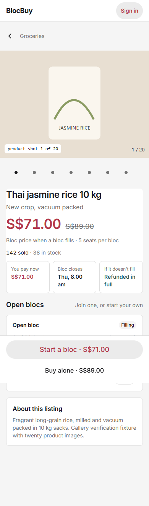
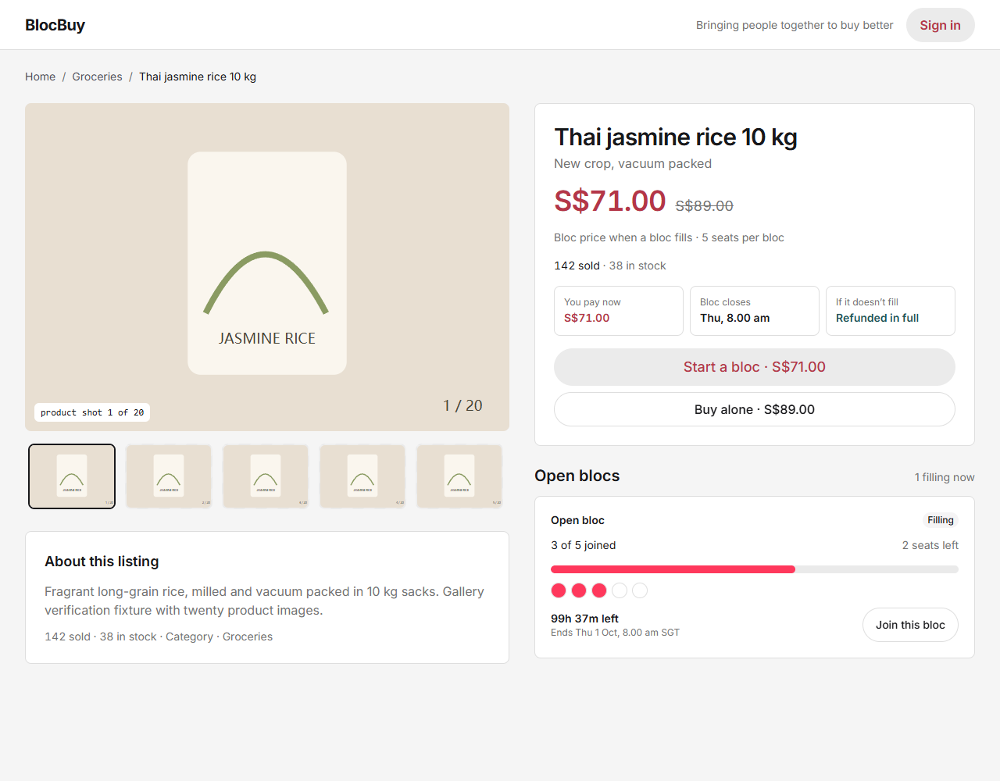

# Product gallery verification

Date: 2026-09-27. Author: Eric Wang (@EricWang1358). Issue: #204. Baseline: dev `c30ed5a1658f5836c76342961937e217eeb14c37`; candidate: `codex/checkout-polish`.

The product detail gallery now keeps up to 20 images inside its column. Desktop thumbnails scroll horizontally and load lazily; mobile uses a separate scrollable row of 44 by 44 pixel controls below the image so the controls cannot cover the caption. Selection follows the same source when images reorder, falls back to a remaining image when the selection disappears, and resets when navigating to another product. Empty and failed images retain the existing striped placeholder. The API and checkout behavior are unchanged.

## Verification

Node 24 and pnpm 12.4.2: `pnpm check` passed API generation, type checking, lint, formatting, all 220 tests across 32 files, and Knip; `pnpm build` passed. Two route regressions failed before the change: shrinking three images to two retained an invalid caption, and another product inherited the previous image selection. Both now pass. Independent review also exposed initial-selection and fallback-source drift across later refreshes; two added regressions failed before persisting the resolved selection and now pass, together with component tests for reordering, duplicate sources, lazy thumbnails and failure fallback.

The committed `frontend/e2e/product-gallery.spec.ts` passed both 390px and 1280px cases against the final production build using installed Chrome headless through a temporary local Playwright configuration. The pinned Playwright Chromium download timed out, so that exact browser build was not verified locally. Tests cover 20 images, page width, caption/control separation, mobile touch targets, sequential keyboard navigation to image 20 and selection back to image 1. The normal repository Playwright configuration remains unchanged for CI.

The screenshots below were captured separately from `pnpm build` served by Vite preview, with synthetic product/API fixtures and locally fulfilled SVG images. At 390px the document width was 390px and the initial resource list contained only image 1. Browser lazy-loading distances vary; no fixed desktop request count, real-CDN bandwidth saving or end-to-end latency improvement is claimed. These are visual fixtures, not a live checkout or Stripe verification.

## Screenshots

Mobile, 390px viewport: [full image](gallery-204/mobile.png).

Desktop, 1280px viewport: [full image](gallery-204/desktop.png).

## After deployment

Eric will open a listing with many images on a phone and desktop, select the last image with touch and keyboard, and revisit another product. Confirm the page stays within the viewport and the caption matches the displayed image. No deployment was performed for this PR.
