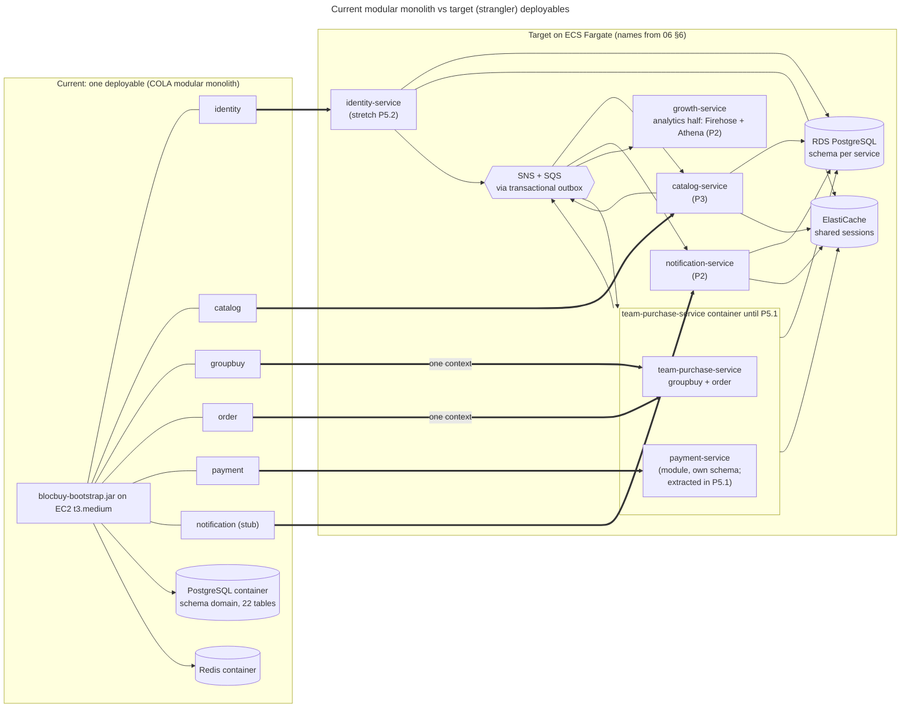

# 01. Microservice viability of the BlocBuy backend

Status: proposal for team review, 2026-09-25. Nothing in this document changes code or the locked SWE5006 stack. Any message broker is a **proposal that needs team approval** because the backend constraints currently forbid one (`.claude/skills/backend-constraints-skill/SKILL.md`, decision of 2026-08-30; restated in `backend/docs/adr/0002-team-lifecycle-events.md`, "Alternatives rejected").

## 1. Question and short answer

**Question.** Can the COLA modular monolith be turned into microservices inside the SWE5001 budget (5 people, about 10 man-days each, 50 man-days in total, conduct window 8-20 October), and should it be?

**Answer.** A full split into six services is not viable in the budget. It would put the funds-safety guarantees at risk. The most feasible option is **Option B: a modular monolith core plus extracted services (strangler)**:

- `team-purchase-service` is the Team Purchase context (groupbuy + order, as recommended in `06-eventstorming-ddd.md` §4.4). For the conduct window it also **hosts the payment module**, so settlement remains one deployable and one local transaction. It is the current monolith with the catalog code removed.
- `payment-service` is a separate context with its own schema. Its extraction is the first stretch item.
- `catalog-service` is extracted as the read-heavy service that scales out on its own.
- `notification-service` is a new service that consumes events. It is the first proof that the platform is open to new consumers.
- `identity-service` is a stretch extraction.
- `growth-service` is proposed. In this module only its analytics half is built, with no code (SNS -> Firehose -> S3 -> Athena).
- The services integrate through a transactional outbox, one SNS topic and one SQS queue per consumer.

The score comparison is in section 7.

## 2. What the code looks like today

| Fact | Evidence |
| --- | --- |
| One Maven reactor, six COLA layer modules (client, domain, application, adapter, infrastructure, bootstrap). Bounded contexts are **packages** that cut across those modules, not Maven modules. | `backend/pom.xml` `<modules>`; `backend/docs/design/backend-skeleton-plan.md` D1, D4 |
| Main code is 13.3k LOC: catalog 3180, payment 2779, order 1985, groupbuy 1890, identity 1835, common 809, bootstrap 694, notification 164 (a stub). There are about 910 tests (22.1k LOC), and the integration tests use Testcontainers. | discovery brief |
| ArchUnit enforces **layer** rules (domain free of frameworks, controllers never touch persistence, persistence is internal). No rule enforces **context** boundaries. Cross-context access is limited by the hard gate in code review and by the facades in ADR 0001. | `backend/blocbuy-bootstrap/src/test/java/com/blocbuy/architecture/ArchitectureTest.java` (rules `domain_is_framework_free`, `persistence_is_internal`, ...) |
| One PostgreSQL database `Blocbuy`, one schema `domain`, 22 tables (Flyway V1-V17). There are no foreign keys or CHECKs by policy, keys are UUIDv7 and deletes are soft. | discovery brief; `pgsql-ddl` skill |
| Redis holds only Sa-Token sessions and OAuth state. | skeleton plan D5, D6 |
| Deferred work runs as leased, idempotent scheduled jobs (`TeamExpirySweepJob`, `RefundWorkerJob`), with the lease in `sys_scheduler_lock`. This already works with several instances. | `backend/blocbuy-bootstrap/src/main/java/com/blocbuy/bootstrap/scheduling/`; ADR 0002 addendum |
| The runtime is one EC2 t3.medium that runs the backend container, PostgreSQL and Redis. It sits behind an ALB, and CloudFront sits in front of the ALB. | `infra/terraform/backend-app-stack/variables.tf` (`instance_type` "Spring Boot + PostgreSQL + Redis on one host"), `network.tf` |

### 2.1 Seams and coupling

Cross-context calls go only through application facades (ADR 0001, "one per direction of need"):

| Caller -> callee | Facade / mechanism | Coupling strength | Extraction cost |
| --- | --- | --- | --- |
| order -> groupbuy | `GroupDealPurchaseSupport.lockJoinTerms`, `GroupDealSettlementSupport.lockTeam/linkOrder/settledMember/lockExpiredTeam`, `PaidGroupDealService.startConfirmed/joinConfirmed` | **Very high**: row locks inside the same transaction | Prohibitive: the locks would have to become distributed |
| order -> payment | order implements `PaymentIntentPort` and `PaymentBusinessPort`, which `StripeCheckoutService` calls in the webhook transaction (`business.fulfil(...)`, `StripeCheckoutService.java` line 393) | **Very high**: fulfilment runs inside the webhook transaction | High |
| groupbuy -> order, payment | `TeamSucceeded` / `TeamExpired` via `ApplicationEventPublisher`, received by `@TransactionalEventListener(BEFORE_COMMIT)` in `OrderLifecycleSubscriber` and `TeamExpiryRefundSubscriber` | **High**: correctness depends on running before the commit (ADR 0002) | High |
| order -> catalog | `CatalogPurchaseSupport.lockStartQuote / requirePurchasable / consumeOneUnit`, all called in the settlement transaction (`OrderFulfilmentAdapter.java` lines 116 and 131) | Medium. Stock decrement is the only write. | Moderate: replace it with a reservation |
| order -> identity | `UserAppService.requireActive` in settlement (`OrderFulfilmentAdapter.java` line 113) | Low. It is a read. | Low: keep a local replica fed by events |
| catalog -> groupbuy | `GroupDealQueryService.OpenDealOffer` for deal progress on listings (`ProductAppServiceImpl.java`) | Low. It is a read. | Low: build a projection from events |
| payment -> groupbuy | `TeamExpired` subscriber | High (see above) | High |
| notification | none (164 LOC stub) | None | Trivial: it is new |

**Reading.** Groupbuy, order and payment form one **consistency cluster**. Catalog, identity and notification sit on the edge of that cluster and are coupled to it mainly through reads, plus one write (stock).

### 2.2 Transactional boundaries

1. **Webhook settlement is one local transaction across three contexts.** `StripeCheckoutService` marks the payment succeeded and then calls `OrderFulfilmentAdapter.fulfil(PaymentSucceeded)`. That call locks the team, the purchase intent, the order and the payment in the fixed global order team -> intent -> order -> payment (ADR 0001, "Lock order is fixed and global"). It writes the membership and the order and decrements stock, and `repository.recordOutcome` commits in the same transaction. The race for the last seat and the guarantee of one membership and one order per payment (NFR-13, NFR-27) rest on this.
2. **Team resolution is atomic with its consequences.** ADR 0002 rejects `AFTER_COMMIT` because "the team's closure and the money owed for it are one fact". NFR-30 turns that into a checked scenario.
3. **Rejection and failure are distinct.** A rejection is committed together with a refund obligation, while a failure throws and rolls back (ADR 0001, Consequences). This is useful for a distributed design. The domain already models "money moved, the business refused it, refund it", and that is exactly the compensation a saga needs.

### 2.3 Data ownership

The 22 tables divide cleanly by context. There are no physical foreign keys, so moving tables into separate schemas needs no constraint surgery:

| Context | Tables | Cross-context ids held (logical references only) |
| --- | --- | --- |
| identity | `sys_user`, `sys_user_oauth`, `sys_role`, `sys_permission`, `rel_user_role`, `rel_role_permission` | none |
| catalog | `biz_product`, `biz_team_price_policy`, `biz_team_price_quote` | none outbound |
| groupbuy | `biz_group_deal`, `biz_group_member`, `biz_group_participation_receipt` | `product_id`, `leader_user_id`, `order_id`, `user_id`, `payment_id` |
| order | `biz_order`, `biz_purchase_intent` | `payment_id`, `user_id`, `deal_id`, `product_id`, `fulfilled_payment_id` |
| payment | `biz_payment`, `log_payment_webhook_event`, `biz_refund`, `log_payment_review`, `biz_payment_review_case`, `log_refund_attempt` | `order_id`, `user_id`, `business_id`, `fulfilled_deal_id`, `deal_id` |
| common | `sys_scheduler_lock`, `sys_scheduled_item_retry` | each service gets its own copy |

Every inbound reference points at identity (`user_id`) or catalog (`product_id`). Groupbuy, order and payment reference each other densely, so they belong in one ownership unit.

## 3. What a microservice split must add

| Concern | Needed change | Present today? |
| --- | --- | --- |
| Reliable event publication | A **transactional outbox** table per producing service, written in the same local transaction as the state change. A leased relay (reusing `LeasedJobRunner`) publishes to the bus. | No. Events are in-process only. |
| Idempotent consumers | An **inbox** table (`event_id` primary key) per consumer, plus version guards on projections. At-least-once delivery is assumed. | Partly: webhook dedup in `log_payment_webhook_event` and replay-safe `fulfilmentEvidence` |
| Cross-service processes | **Sagas / process managers** with compensation: stock reservation, then settlement, then consume or release. Team expiry then releases stock and sends notifications. | Locally, via BEFORE_COMMIT listeners |
| Per-service data | One schema per service with its own DB role and grants. Flyway runs per service. A read replica or projection replaces each cross-schema read. | Single schema `domain` |
| Auth propagation | The session is validated in every service against the shared session store. Internal calls carry a service credential and the user id. | Single process |
| API gateway / routing | ALB listener rules route by path to per-service target groups. CloudFront and WAF sit in front. | ALB with a single target |
| Contract safety | OpenAPI per service (the existing `contract-check` job runs per service), **event schemas** (JSON Schema, versioned) and consumer-driven contract tests for the internal reservation API | OpenAPI for the whole monolith only |
| Service discovery | ECS Service Connect or Cloud Map DNS | n/a |
| Observability | Trace id propagated across HTTP and message attributes (the existing `X-Trace-Id` / MDC `traceId` extended to SNS/SQS), per-service dashboards, DLQ alarms | Trace id per request (NFR-09) |
| Deployment | One image, pipeline and task definition per service | One image |
| Testing | Testcontainers plus LocalStack (SNS/SQS) in integration tests, one end-to-end smoke across services | Testcontainers PostgreSQL |

## 4. Must groupbuy and order be co-located?

**Yes.** Groupbuy and order are one bounded context, Team Purchase (06 §4.4), and so one service. **Payment is a separate context but stays co-deployed during the conduct window.** 06 §6 recommends extracting it first because its port boundary is the clearest. We agree on the seam and sequence it after the scalability work, for the reasons below. The reasons:

1. **The last-seat race is a row lock.** `lockJoinTerms` and `settlement.lockTeam` hold `biz_group_deal` FOR UPDATE while the intent, order and payment are written. If groupbuy were a separate service, a JOIN would need either a distributed lock with a lease and fencing, or an optimistic "reserve a seat" step with a TTL. Either one duplicates concurrency control that PostgreSQL already provides and that `StripeLocalIntegrationTest` proves (the twenty-buyer race and the eight-thread webhook replay).
2. **BEFORE_COMMIT ordering is load-bearing.** ADR 0002 explains that the completing buyer's order is saved *after* `admit` returns. With an asynchronous hop the `confirmByDealId` sweep could miss that order. A split would need a new aggregate-level rule ("an order created after TeamSucceeded confirms itself"), and so a redesign of UC5.
3. **Money safety is the domain's top NFR.** NFR-27 and NFR-30 are satisfied by construction today. In a saga every failure becomes a compensation that the customer can see: a charged card, then a refund.
4. **Payment extraction is the first stretch item (P5.1 in 02 §12).** The existing rejection-means-refund model maps onto a saga (PaymentSucceeded -> fulfil -> Fulfilled or Rejected -> refund), and an outbox would keep the TeamExpired -> refund obligation link at-least-once instead of atomic. It adds two asynchronous hops to the money path and a new "expired but refund not yet recorded" window, which is bounded rather than permanent. That is a roadmap item (limitation AISS-03 in 02 §13), not a conduct-window item.

## 5. Risks of splitting

| ID | Risk | Likelihood | Impact | Mitigation in the proposed option |
| --- | --- | --- | --- | --- |
| R1 | Funds-safety regression (double charge, missing refund) | High for a full split | Critical | Keep the money path in one service and one transaction |
| R2 | Overselling stock once stock leaves the settlement transaction | Medium | High | Reserve stock at intent time with an idempotency key and a TTL longer than the quote's lifetime. The existing `BUSINESS_EXPIRED` path covers a late payment. |
| R3 | Lost or duplicated events | Medium | High | Outbox plus at-least-once delivery, an inbox with dedup, DLQs and alarms |
| R4 | The team spends the budget on plumbing, not on evidence | High | High | Strangler scope with two new deployables. Identity is stretch. |
| R5 | Learning curve (SNS/SQS, ECS, IaC per service) | Medium | Medium | One shared Terraform module and one shared Spring "platform starter" |
| R6 | Local development gets harder | Medium | Medium | docker compose with LocalStack. The monolith profile keeps running every context in one process. |
| R7 | Conflict with the locked SWE5006 decision (no broker) | Certain | Medium | Record the broker as ADR 0003 "proposed". Implement on a separate branch or behind a profile only after team approval. The SWE5006 deliverable keeps the in-process design. |
| R8 | Cost grows with RDS, ElastiCache, NAT and Fargate | Certain | Low-Medium | Single-AZ, burstable ARM instances, one NAT, scale to 1 (or 0) outside demos |

## 6. Team and timebox fit

The 50 man-days also have to cover the proposal, the report, the presentation, load testing and the security controls. `05-effort-estimate.md` sizes the whole core plan (P0-P4 plus deliverables) at about **47 agent-days** (PERT), which costs about **23 human man-days** of scoping, review, coordination and rehearsal when each member supervises one AI coding agent. Without agents the same scope is about 95 man-days, almost twice the guideline, so Option B fits the budget only with agent-assisted delivery. The binding constraint is the calendar: five parallel agent streams starting on 5 Oct (05 §6). Relative build sizes:

| Scope | Relative build effort | Fits? |
| --- | --- | --- |
| Containers on Fargate + RDS + ElastiCache + ALB routing (no split) | 1.0x | Yes |
| + outbox, SNS/SQS, one new consumer service | +1.0x | Yes |
| + catalog extraction (reservation, projection, replicas) | +1.5x | Yes, tight |
| + identity extraction | +0.8x | Stretch |
| + splitting groupbuy, order and payment (distributed saga for settlement) | +3x or more, with redesign of UC4/UC5/UC6 tests | **No** |

## 7. Options compared

Scores run from 1 (poor) to 5 (good). Weights reflect the SWE5001 briefing (demonstrating scalability and cloud native) and the constraints (budget, funds safety).

| Criterion (weight) | A. Keep the monolith (scale it out horizontally) | **B. Modular monolith core + extracted services (strangler)** | C. Full microservices (six services) |
| --- | --- | --- | --- |
| Fits 50 man-days (0.25) | 5 | 4 | 1 |
| Preserves funds safety, NFR-27/30 (0.20) | 5 | 5 | 2 |
| Demonstrates scalability (independent scaling) (0.20) | 2 | 4 | 5 |
| Demonstrates platform extensibility (new consumers without producer change) (0.15) | 1 | 4 | 5 |
| Operational complexity for the team (0.10) | 5 | 3 | 1 |
| Keeps SWE5006 work and tests valid (0.10) | 5 | 4 | 2 |
| **Weighted score** | **3.80** | **4.10** | **2.70** |

Arithmetic. A: 1.25+1.00+0.40+0.15+0.50+0.50 = 3.80. B: 1.00+1.00+0.80+0.60+0.30+0.40 = 4.10. C: 0.25+0.40+1.00+0.75+0.10+0.20 = 2.70.

Option A is the safe fallback. The monolith already runs with several instances (leased jobs, Redis sessions), so ECS autoscaling of one service is a credible scalability story. It cannot show independent scaling or an event-driven ecosystem, which is what the briefing's "producers, consumers, more seeds" framing asks for.

## 8. Verdict

- **Do not build full microservices** (Option C). The coupling in groupbuy, order and payment is intrinsic to the domain, and splitting it trades proven guarantees for sagas the team has no time to test.
- **Adopt Option B.** Service names follow 06 §6. It has three required deployables: `team-purchase-service` (with the payment module co-deployed), `catalog-service` and `notification-service`. The analytics half of `growth-service` needs no code (SNS -> Firehose -> Athena). The stretch deployables are `payment-service` (first) and `identity-service`. Event integration uses a transactional outbox, SNS and SQS. Each service has its own schema on a shared RDS instance.
- **Fallbacks.** If the broker proposal (ADR 0003) is not approved, the plan collapses to Option A plus a catalog read replica. That keeps the scalability demonstration (autoscaled stateless tasks behind the ALB) without the event backbone. If the broker is approved but capacity runs short, drop the catalog extraction and keep **Option A+**: the monolith on Fargate, the outbox, notification-service and autoscaling (05 §7, cut 7).
- The target architecture, sagas and decisions are in `02-proposed-architecture.md`. The runtime choice is in `03-k8s-argocd-assessment.md`.

