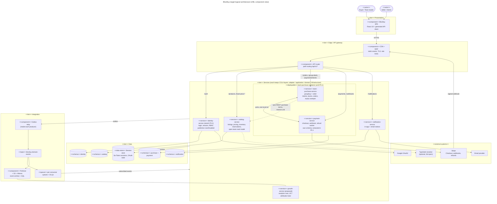
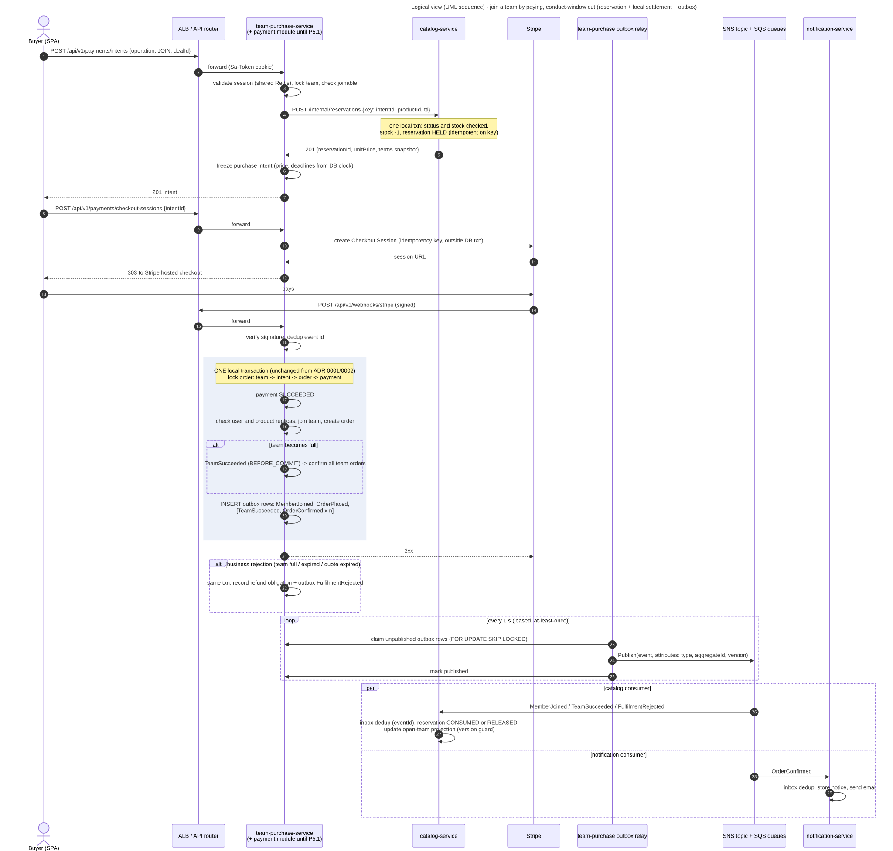
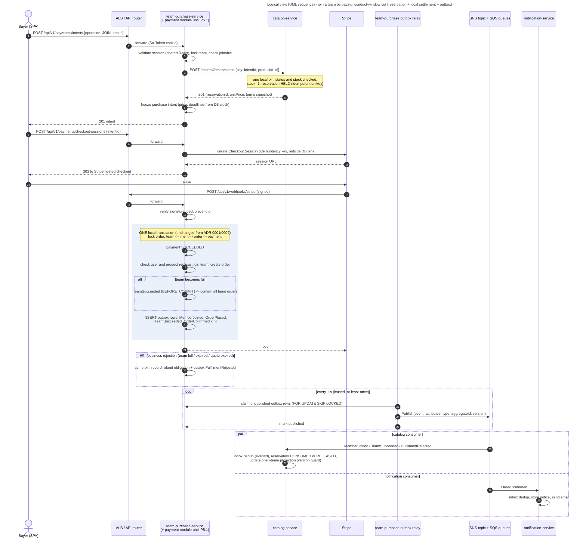
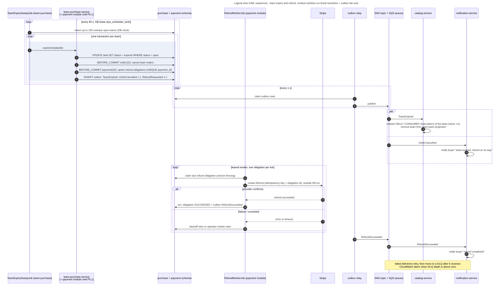
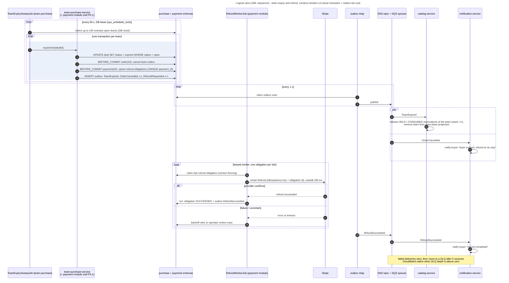
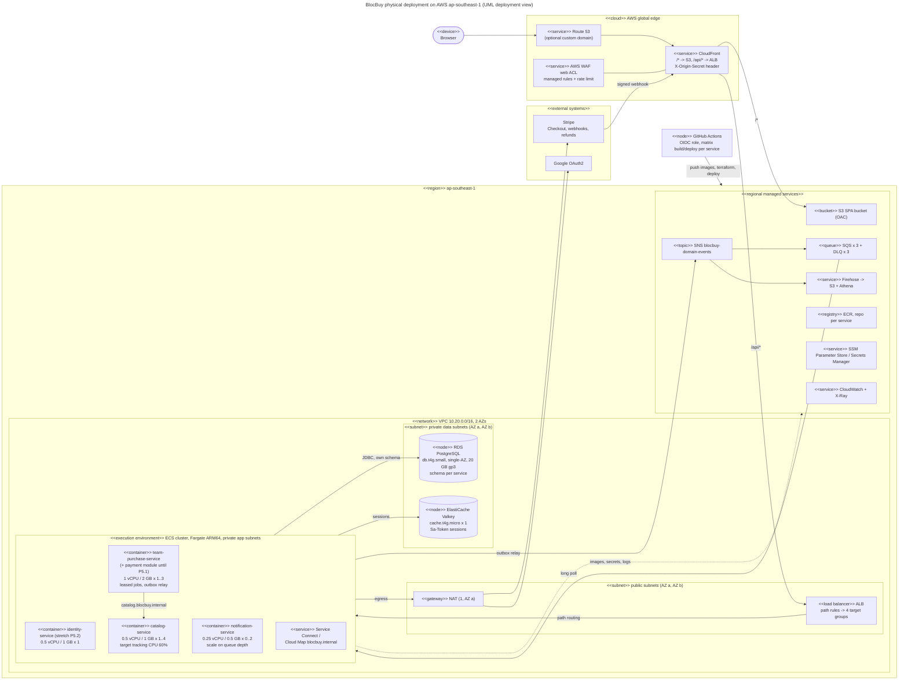

# 02. Proposed target architecture

Status: proposal for team review, 2026-09-25. It builds on the verdict in `01-microservice-viability.md` (Option B, strangler). Bounded contexts follow the existing packages: identity, catalog, groupbuy, order, payment and notification. The EventStorming/DDD refinement is in `06-eventstorming-ddd.md`.

**Alignment with the DDD study (06 §6, "Recommended service boundaries").** This document uses the same service names and context boundaries: `identity-service`, `catalog-service`, `team-purchase-service` (groupbuy + order, one consistency boundary), `payment-service`, `notification-service` and `growth-service`. It deviates in three places, each deliberately:

| Topic | 06 recommends | This study | Why |
| --- | --- | --- | --- |
| Order of extraction | payment-service first (clearest port boundary) | catalog-service first (P3). payment-service is the **first stretch item** (P5.1). Until then it is a separate module and schema **co-deployed** inside the team-purchase-service container. | The briefing marks demonstrated scalability, and catalog browse is the read-heavy path worth scaling on its own. Extracting payment turns settlement into the two-step `PaymentSucceeded` -> `FulfilmentAccepted/Rejected` exchange on the money path. That needs the `StripeLocalIntegrationTest` race and replay suites reworked across two services, which is more than the conduct window allows alongside the platform work. The ports (`PaymentIntentPort`, `PaymentBusinessPort`) and a separate `payment` schema keep the extraction mechanical later. |
| Catalog co-location until reservation is proven | Keep catalog with team-purchase until `ReserveUnit` is proven | Agreed, as a sequencing rule. P3 first builds the reservation protocol **in process** (the catalog module behind the same interface), proves it with the existing race tests, and only then moves catalog out (P3.6 route switch). | Same risk, handled by ordering inside the phase |
| Reservation key and timing | `ReserveUnit(paymentId)` before the seat commits | `ReserveUnit(intentId)` when the intent is frozen, before any Stripe session | It avoids a remote call inside the settlement transaction while the team row is locked. One intent can be fulfilled by at most one payment (partial unique index, ADR 0001), so `intentId` is just as idempotent. Trade-off: abandoned checkouts hold a unit until the TTL (AISS-06). |

> **Approval needed.** SNS/SQS and the outbox are a message broker in the sense of the locked SWE5006 decision ("no RabbitMQ / Elasticsearch / broker", backend-constraints skill, 2026-08-30). This architecture is a **proposal**. It must be recorded as a *proposed* ADR 0003 and approved by the team before any code lands. Until then the SWE5006 codebase keeps in-process events.

Cost basis: an **academic demo**. There is a single environment, traffic is low and high availability is minimal. `04-aws-cost-estimate.md` prices it at USD 220.77 per month at 24x7 and USD 271.93 for the recommended plan over the module window. Every component still scales horizontally, and section 9 shows how that is demonstrated.

## 1. Platform framing (briefing: seed, producers, consumers)

| Platform role | BlocBuy | What the platform gives them |
| --- | --- | --- |
| **Seed** | A community group buy: a seller's listing with team terms (size, lifetime, team price) | Listing, pricing strategy (dual pricing), team lifecycle and settlement as reusable services |
| **Producers** | Sellers and admins who publish listings. Team leaders who *produce* demand by starting a team. | Catalog APIs, the team-price policy, stock reservation |
| **Consumers** | Buyers who join teams and pay. **Internal consumers** of domain events (notification, analytics, future services). | Pay-first checkout, automatic refunds, notices, "my orders/teams" |
| **More seeds** | New verticals (for example neighbourhood produce boxes or bulk services) reuse the team-purchase and payment core with a new catalog category and pricing strategy | A new use case subscribes to `blocbuy-domain-events` without changing any producer |
| **Analytics** | Team fill rate, time to fill, refund rate, conversion per listing | SNS -> Firehose -> S3 -> Athena, with no application code |

**Common services and reusable libraries** (briefing question 2):

- a `blocbuy-platform-starter` Spring Boot starter, extracted from `common`, containing:
  - the Result/ErrorCode envelope;
  - the trace id filter;
  - the Sa-Token configuration;
  - the outbox writer and relay;
  - the inbox/idempotent consumer;
  - `LeasedJobRunner`;
  - event envelope types;
- one Terraform module, `ecs-service`;
- one reusable GitHub Actions workflow for building and deploying a service.

## 2. Logical architecture

### 2.1 Tiers and layers

| Tier | Elements | Notes |
| --- | --- | --- |
| Presentation | React 19 SPA (custom) | Unchanged. It calls one origin (`/api/v1/*`), so the split is invisible to the client and the generated client from `contracts/openapi.json` still works. |
| Edge / API gateway | CloudFront + WAF (COTS), ALB listener rules (COTS) | ALB path routing is the gateway. There is no custom gateway service (AD-05). |
| Services | 3 required + 1 stretch custom services | Each keeps the COLA layers (adapter, application, domain, infrastructure) and the ArchUnit rules |
| Integration | Outbox relay (custom, inside each producer), SNS topic, SQS queues and DLQs, Firehose (COTS) | At-least-once delivery. Consumers are idempotent. |
| Data | RDS PostgreSQL with one schema per service, ElastiCache Valkey/Redis | Each service can only reach its own schema (DB role grants) |
| External | Stripe, Google OAuth2, TypeSafe (optional), email (SES) | Provider I/O stays outside DB transactions |

## 3. Service catalogue

| Service | Responsibility | Data owned (schema) | Public APIs (`/api/v1`) | Internal APIs | Publishes | Consumes | Scaling profile |
| --- | --- | --- | --- | --- | --- | --- | --- |
| **team-purchase-service** (Team Purchase context: groupbuy + order; **hosts the payment module until P5.1**, still a COLA modular monolith) | Purchase intents, checkout, Stripe webhook settlement, team lifecycle, orders, refunds, operator review | `purchase` + `payment`: `biz_group_deal`, `biz_group_member`, `biz_group_participation_receipt`, `biz_order`, `biz_purchase_intent`, `biz_payment`, `log_payment_webhook_event`, `biz_refund`, `log_payment_review`, `biz_payment_review_case`, `log_refund_attempt`, `sys_scheduler_lock`, `sys_scheduled_item_retry`, `outbox_event`, `inbox_event`, replicas `product_availability` and `user_status` | `/payments/*`, `/webhooks/stripe`, `/orders/*`, `/group-deals/*` | none (it is a client of catalog) | `TeamStarted`, `MemberJoined`, `TeamSucceeded`, `TeamExpired`, `OrderPlaced`, `OrderConfirmed`, `OrderCancelled`, `FulfilmentRejected`, `RefundRequested`, `RefundSucceeded`, `RefundNeedsReview` | `ProductPublished`, `ProductDelisted`, `ProductTermsChanged`, `UserDisabled`, `UserEnabled` | Write-heavy and lock-bound on a hot team row. Scales to 1..3 tasks for webhook ingress and API. Jobs run leased (one active runner). Throughput is limited by DB row locks, not CPU. |
| **catalog-service** | Listings, admin CRUD, dual pricing, team-price policies and quotes, semantic reranking, **inventory reservations**, open-team read model | `catalog`: `biz_product`, `biz_team_price_policy`, `biz_team_price_quote`, new `biz_stock_reservation`, new `proj_open_team`, `outbox_event`, `inbox_event` | `/products/*`, `/team-price-*`, `/admin/products/*` | `GET /internal/products/{id}/purchase-terms`, `POST /internal/reservations` (idempotent key = intentId), `DELETE /internal/reservations/{key}` | `ProductPublished`, `ProductDelisted`, `ProductTermsChanged` | `TeamStarted`, `MemberJoined`, `TeamSucceeded`, `TeamExpired`, `FulfilmentRejected`, `OrderCancelled` | **Read-heavy** (browse is the hottest path). Stateless, 1..4 tasks, CPU target tracking. Public GETs are cacheable at CloudFront (short TTL). This is the main horizontal-scaling demonstration. |
| **payment-service** (logical service; co-deployed in team-purchase-service until P5.1) | Checkout sessions, Stripe webhook, payment receipt, refunds, review cases | `payment`: `biz_payment`, `log_payment_webhook_event`, `biz_refund`, `log_payment_review`, `biz_payment_review_case`, `log_refund_attempt` | `/payments/*`, `/webhooks/stripe` | after P5.1: `GET /internal/intents/{id}/quote` is called on team-purchase | after P5.1: `PaymentSucceeded`, `PaymentFailed`, `RefundSucceeded`, `RefundFailed` | after P5.1: `FulfilmentRejected`, `TeamExpired` | Bursty (webhooks). Isolate the Stripe secrets and the network. |
| **notification-service** (new) | In-app notices and email for team outcome, order confirmation and refunds | `notification`: `biz_notification`, `inbox_event` | `GET /notifications/me`, `POST /notifications/{id}/read` | none | none | `TeamSucceeded`, `OrderConfirmed`, `OrderCancelled`, `RefundSucceeded`, `RefundNeedsReview` | Bursty and asynchronous. Scales 0..2 on SQS `ApproximateNumberOfMessagesVisible`. It proves that consumers are decoupled from producers. |
| **identity-service** (stretch; until then identity stays inside team-purchase-service) | Google OAuth2 login, sessions, users, RBAC | `identity`: `sys_user`, `sys_user_oauth`, `sys_role`, `sys_permission`, `rel_user_role`, `rel_role_permission`, `outbox_event` | `/auth/*`, `/admin/users/*` | none | `UserRegistered`, `UserDisabled`, `UserEnabled`, `RoleChanged` | none | Low volume, spiky at login. 1 task. |
| **growth-service** (proposed). In the SWE5001 scope only its **analytics half** is built, and it has no code: SNS -> Firehose -> S3 -> Athena. UC7 share attribution is roadmap. | Analytics facts; later invite links and attribution | S3 bucket `blocbuy-events` (partitioned by date); later `growth` schema | Athena workgroup; later invite link and leaderboard APIs | n/a | later `JoinCredited` | all events (Firehose subscription); later `TeamStarted`, `MemberJoined`, `TeamSucceeded` | Serverless, pay per use |

### 3.1 Why groupbuy and order stay together, and why payment stays co-deployed for now

The webhook settlement locks team, intent, order and payment in one PostgreSQL transaction (ADR 0001). Team resolution runs its consequences `BEFORE_COMMIT` (ADR 0002). **Both stay intact inside team-purchase-service**, so NFR-13, NFR-27 and NFR-30 keep their current proofs (`StripeLocalIntegrationTest`, the expiry integration tests). The only change to that transaction is additive. The same transaction writes `outbox_event` rows, so the rest of the platform learns about each fact exactly when it commits.

Settlement currently makes three calls to other contexts. Each is replaced by data the service already holds:

| Today (in the settlement transaction) | Target |
| --- | --- |
| `products.requirePurchasable(productId)` | Read the local `product_availability` replica, fed by `ProductPublished/Delisted` events. The **reservation** taken at intent time already proves the product was purchasable when the price was frozen. |
| `products.consumeOneUnit(productId)` | The unit was already **reserved** in catalog at intent time. Settlement publishes `MemberJoined` / `FulfilmentRejected`, and catalog marks the reservation `CONSUMED` or `RELEASED`. |
| `users.requireActive(userId)` | Read the local `user_status` replica, fed by `UserDisabled/UserEnabled`. Suspension also revokes the session through Sa-Token (logout of all tokens). |

## 4. Integration style

| Interaction | Style | Why |
| --- | --- | --- |
| Browser -> services | Sync REST through CloudFront -> ALB | Unchanged contract (`contracts/openapi.json`, split by path per service) |
| team-purchase -> catalog: price terms, reservation | **Sync REST** over Service Connect, timeout 800 ms, 1 retry, idempotency key | The buyer is waiting, and the answer is needed before any money moves. A failure is safe because no Stripe session has been created yet. |
| Facts after commit (team, order and refund lifecycle; product and user changes) | **Async events**: transactional outbox -> SNS standard topic -> SQS queue per consumer (+ DLQ) | Decoupled, fans out to new consumers, retries built in |
| Stripe -> team-purchase | Signed webhook (unchanged), dedup table | Unchanged |

### 4.1 Messaging choice: SNS + SQS with a transactional outbox

| Option | For | Against | Verdict |
| --- | --- | --- | --- |
| **SNS topic + SQS queue per consumer** | Simplest AWS fan-out. Per-consumer DLQ and redrive. Filter policies route by `eventType`. Native Firehose subscription for analytics. Free tier covers the demo volume. The team can explain it in a presentation. | No built-in replay (Firehose archive plus redrive cover this). Standard topics do not guarantee order. | **Chosen** |
| EventBridge bus + SQS targets | Content-based rules, archive and replay, schema registry | Higher per-event cost, higher latency, one more concept to learn. Rules are overkill for about 15 event types. | Good alternative. Revisit if more than 5 consumers appear. |
| SNS FIFO + SQS FIFO | Order per `dealId` (message group) | Throughput limits, deduplication window only 5 minutes, FIFO queues on every consumer | Not needed. Ordering is handled by an aggregate version in each event. |
| Amazon MQ (RabbitMQ) / MSK (Kafka) | Familiar semantics, log replay (Kafka) | Always-on broker instances (MSK is the most expensive). RabbitMQ is explicitly rejected in the SWE5006 decision. | Rejected |

**Outbox mechanics.**

1. In the same local transaction, the service inserts `outbox_event(id uuidv7, aggregate_type, aggregate_id, aggregate_version, event_type, payload jsonb, trace_id, occurred_at, published_at null)`.
2. A relay reuses `LeasedJobRunner` (lease key `outbox-relay`, fixed delay of 1 s). It claims up to 100 rows with `FOR UPDATE SKIP LOCKED`, publishes each one with message attributes `eventType`, `eventId` and `traceId`, and then sets `published_at`.
3. Delivery is at-least-once. A crash between publish and mark causes a duplicate, which the inbox on the consumer side absorbs.
4. Published rows are deleted after 7 days by a housekeeping job.
5. Debezium/CDC is rejected: it needs another always-on runtime.

**Idempotent consumer.** Each consumer long-polls its queue (Spring Cloud AWS `@SqsListener`, or a small poller in the platform starter). In one local transaction it does `INSERT INTO inbox_event(event_id) ON CONFLICT DO NOTHING`, skips the event if the row already existed, applies the change with a version guard, and then commits. Visibility timeout is 60 s, `maxReceiveCount` is 5, then the message goes to the DLQ. A CloudWatch alarm fires when DLQ depth is above zero.

**Event contract.** A CloudEvents-style JSON envelope (`id`, `type`, `source`, `time`, `subject`=aggregate id, `dataVersion`, `data`). JSON Schemas are versioned under `contracts/events/`. CI validates producer samples against the schemas and consumer fixtures against the same files, which is the event-contract test.

## 5. Sagas

### 5.1 Join a team by paying (choreographed; reservation, then local settlement, then consume or release)

| Step | Owner | Local transaction | Compensation |
| --- | --- | --- | --- |
| 1. Reserve one unit (key = intentId, TTL = quote expiry + Stripe session lifetime + 10 min) | catalog | stock -1, reservation `HELD` | TTL sweeper releases the unit (stock +1). An explicit `DELETE` is sent if the intent is abandoned. |
| 2. Freeze the purchase intent | team-purchase | intent row (unchanged ADR 0001 semantics) | The intent expires. A late payment yields `BUSINESS_EXPIRED` and a refund (existing path). |
| 3. Stripe Checkout | team-purchase, outside the transaction | payment row `PENDING` | The session expires unpaid, which is observed through the webhook (existing) |
| 4. Settle | team-purchase | payment `SUCCEEDED` + membership + order (+ `TeamSucceeded` BEFORE_COMMIT) + outbox rows, **one transaction** | A rejection commits a refund obligation and `FulfilmentRejected` (existing rejection semantics) |
| 5. Consume or release the reservation | catalog, async | `CONSUMED` on `MemberJoined`, `RELEASED` on `FulfilmentRejected` | Idempotent by `eventId` and reservation key |

This is choreography, not a central orchestrator. The only long-lived state is the purchase intent, which already acts as the process manager's state. **Behaviour change to flag:** stock is now held from intent creation, not taken at settlement. Abandoned checkouts hold a unit until the TTL expires. This is standard reservation semantics and it prevents overselling the last unit across services.

### 5.2 Team expiry and refund

- The resolution stays **local and atomic** in team-purchase: expire the team, cancel its orders and record refund obligations in one transaction per team, exactly as ADR 0002 and its addenda describe. The only addition is outbox rows.
- The only cross-service consequences are releasing stock (catalog) and notices (notification). Both are idempotent, retryable and never on the money path.
- The Stripe refund stays in `RefundWorkerJob` (team-purchase), with the existing fencing token, provider idempotency key and review case. Refund status reaches other services only as events.

## 6. Identity and authorisation across services

| Option | For | Against | Verdict |
| --- | --- | --- | --- |
| **Sa-Token sessions in a shared ElastiCache store. Every service validates the token locally, and only identity (or team-purchase, until identity is extracted) writes sessions.** | Minimal code change (`sa-token-redis-jackson` already in use). Revocation is instant (suspend = kick out). The `HttpOnly` / `Secure` / `SameSite` cookie is unchanged (NFR-01). RBAC via `StpInterface` reads role codes cached in the session. | All services share one Redis. A Redis outage takes auth down, which is acceptable for the demo and already true today. | **Chosen** |
| Identity issues a JWT (Sa-Token JWT mode), validated at the ALB or API Gateway JWT authorizer or in each service | Stateless validation, no shared store | Revocation needs short expiry plus refresh or a deny-list. The browser cookie flow and CSRF posture change. ALB cannot validate a custom JWT without Cognito/OIDC. | Rejected for the timebox. Roadmap item. |
| Cognito user pool + ALB authenticate action | Managed, OIDC native | Rewrites the Google login and identity data. Large change. | Rejected |

**Service-to-service calls** (team-purchase -> catalog) carry:

- the caller's `X-Trace-Id`;
- `X-User-Id` for auditing only (never trusted for authorisation of user data);
- an internal credential, the Sa-Token `Same-Token` (a shared secret in SSM, rotated by Terraform), checked by an interceptor on `/internal/**`.

The ALB never routes `/internal/**`. Internal paths are reachable only through Service Connect inside the private subnets, and security groups allow only the team-purchase task security group.

## 7. Data per service

- **One RDS PostgreSQL instance with one schema per service** (`identity`, `catalog`, `purchase`, `payment`, `notification`). Each service has its own login role with `USAGE`/DML only on its schema, and Flyway runs per service with its own history table. This keeps the cost of a single instance and still makes cross-schema reads *impossible*, not just forbidden by review.
- Moving from the current `domain` schema is a set of `ALTER TABLE ... SET SCHEMA`. It is cheap because there are no foreign keys. The monolith first runs with `search_path` set to all five schemas, then each extracted service drops the schemas it does not own.
- Separate RDS instances per service are rejected for the demo. Each costs a full instance and gives no additional isolation that the course marks. Aurora Serverless v2 is noted as the production path (scale to 0.5 ACU, with read replicas for catalog).
- Cross-service reads use **projections** (catalog `proj_open_team`) and **replicas** (team-purchase `product_availability`, `user_status`) that are kept current by events and carry version guards.
- Retention: `outbox_event` and `inbox_event` 7 days. Firehose archive in S3 with a 90-day lifecycle. Existing log tables are unchanged.

## 8. Observability and security

**Observability**

- Structured JSON logs to CloudWatch Logs. The existing `traceId` MDC is propagated through the HTTP header and SNS/SQS message attributes, so one CloudWatch Logs Insights query follows a join across three services (an extension of NFR-09).
- Metrics from Micrometer to CloudWatch (existing `blocbuy.scheduler.*` meters, plus `outbox.lag.seconds`, `consumer.processed{result}` and `reservation.held`).
- The AWS Distro for OpenTelemetry (ADOT) Java agent, as a sidecar or in-image, sends traces to X-Ray, sampled at 5% plus all errors.
- One CloudWatch dashboard per service, plus a platform dashboard (ALB p95 per target group, ECS task count, SQS age of oldest message, DLQ depth, RDS CPU and connections).
- Alarms: DLQ depth above 0, outbox lag above 60 s, ALB 5xx above 1%, p95 above 2 s (NFR-15 / #180 target).

**Security controls (minimum set from the briefing)**

| Control | Mechanism |
| --- | --- |
| Edge protection | WAF managed rule groups (Common, KnownBadInputs, SQLi) + a rate-based rule. CloudFront -> ALB with the `X-Origin-Secret` header (existing). Default ALB action is 403. |
| Network isolation | Tasks, RDS and Redis in private subnets. Security groups reference each other (ALB SG -> service SGs -> data SGs). No SSH. ECS Exec for break-glass access. |
| Identity and access | Sa-Token RBAC (unchanged). Internal Same-Token. One least-privilege IAM task role per service (for example only catalog can receive from `catalog-queue`, only producers can `sns:Publish`). |
| Secrets | SSM Parameter Store SecureString or Secrets Manager, injected by the ECS task definition `secrets`. Stripe keys only in team-purchase. |
| Data | RDS and ElastiCache encrypted at rest (KMS) and TLS in transit. SNS/SQS SSE. One DB role per schema. |
| Supply chain | Existing Gitleaks, Trivy (image scan per service), CodeQL, Dependabot. ECR scan on push. Deploy by immutable digest. |
| CI identity | GitHub OIDC -> IAM roles per environment, no stored keys (NFR-04, unchanged) |

## 9. How the architecture demonstrates scalability

| Scenario | Scales | Mechanism | Evidence to capture |
| --- | --- | --- | --- |
| Browse storm (k6: 300 VUs on `GET /products`, `GET /products/{id}`) | catalog-service 1 -> 4 tasks | ECS target tracking on CPU 60%. CloudFront caching of anonymous GETs (10-30 s). team-purchase is untouched. | Task count graph, ALB p95 per target group, team-purchase CPU flat |
| Checkout / webhook burst (k6 plus Stripe CLI `trigger` or a signed synthetic webhook in the sandbox) | team-purchase-service 1 -> 3 tasks | Target tracking on ALB `RequestCountPerTarget`. Row locks keep correctness, and the test shows "N concurrent joins, exactly `teamSize` members". | NFR-13/27 invariants hold under load. p95 < 2 s at 100 users (#180). |
| Notification backlog (publish 10k synthetic events) | notification-service 0 -> 2 | Step scaling on queue depth | Queue depth drains, no DLQ |
| New consumer (the "more seeds / analytics" story) | none | Add an SQS subscription or Firehose, with zero producer change | Athena query of fill rate per product |
| Fault isolation | n/a | Stop the notification service: joins still succeed and messages wait in SQS. Kill a catalog task: the ALB drains and autoscaling replaces it. | Screenshots, alarms |

Horizontal limits and the path beyond them are documented as limitations: the single RDS writer is the ceiling, followed by an RDS read replica for catalog, then Aurora, then payment extraction.

## 10. Physical architecture

Runtime: **ECS on Fargate** (see `03-k8s-argocd-assessment.md`). One ALB with path rules and one target group per service. Service Connect (Cloud Map) handles internal calls. The VPC has 2 AZs (the ALB needs two), a single NAT gateway (a cost trade-off, recorded as a limitation), single-AZ RDS and a single ElastiCache node.

## 11. Key architectural decisions

| ID | Decision | Alternatives | Trade-offs | Rationale |
| --- | --- | --- | --- | --- |
| AD-01 | Strangler toward a **modular-monolith core + extracted services**, not full microservices | Keep the monolith; six services | + scalable parts are independent, funds safety is kept. - two styles coexist. | Coupling analysis in 01 §2. Fits 50 man-days. |
| AD-02 | **groupbuy + order form one service (team-purchase-service, as in 06 §4.4). payment-service is a separate context and schema but stays co-deployed, keeping the single settlement transaction, until P5.1.** | Split groupbuy and order; extract payment first (06 §6) | + NFR-13/27/30 unchanged during the conduct window. - payment and team-purchase scale as one unit until P5.1. | Last-seat race and BEFORE_COMMIT ordering (ADR 0001/0002). The payment split changes the money path and is sequenced after the scalability evidence. |
| AD-03 | **Transactional outbox + SNS/SQS** for async integration (**proposal; needs team approval**, because it overrides the SWE5006 no-broker decision) | EventBridge; Amazon MQ; MSK; direct REST callbacks | + at-least-once, fan-out, DLQ. - eventual consistency, one more moving part. | Cheapest managed fan-out. Firehose subscription gives analytics for free. |
| AD-04 | **Stock reservation** at intent time via sync REST to catalog, `ReserveUnit(intentId)` (06 §6 proposes `paymentId`; see the alignment table) | Decrement at settlement via async event (oversell risk); keep stock in team-purchase | + no oversell across services. - abandoned checkouts hold stock until the TTL. | Money must not move for stock that does not exist |
| AD-05 | **ALB path routing as the API gateway** behind CloudFront + WAF | API Gateway HTTP API + VPC link; Spring Cloud Gateway service | + no extra hop or code, existing Terraform. - no per-route throttling or API keys (WAF rate rules cover the demo). | Least new surface, matches the existing CloudFront -> ALB design |
| AD-06 | **Shared Sa-Token session store** (ElastiCache) validated by every service. Internal Same-Token for `/internal/**`. | JWT at the edge; Cognito | + minimal change, instant revocation. - shared Redis dependency. | Keeps NFR-01 cookie posture and existing RBAC |
| AD-07 | **One RDS instance, schema per service, one DB role each** | Instance per service; shared schema | + low cost, enforced ownership. - shared blast radius and capacity. | Academic-demo cost basis. Upgrade path to separate instances is mechanical. |
| AD-08 | **ECS Fargate** runtime, Terraform + GitHub Actions (details in 03) | EKS + Argo CD; App Runner; Lambda | + no cluster to run, fits OIDC/Terraform. - less "Kubernetes" learning. | 03 verdict |
| AD-09 | **Idempotent consumers with inbox table and aggregate version guards** | FIFO queues for ordering | + works with standard SNS/SQS. - one table per consumer. | At-least-once is the honest guarantee |
| AD-10 | **Jobs stay leased in the service that owns the data** (sweeper and refund worker in team-purchase, reservation TTL sweeper in catalog) | EventBridge Scheduler -> Lambda | + reuses `LeasedJobRunner` and its proofs. - jobs scale with the service. | Already safe with several instances (ADR 0002 addendum) |
| AD-11 | **Observability via trace id propagation + ADOT/X-Ray + CloudWatch** | Self-hosted Grafana/Prometheus/Jaeger | + managed, cheap at demo volume. - vendor lock-in. | Extends NFR-09 |

## 12. Migration plan (strangler phases)

| Phase | Goal | Work items | Exit evidence |
| --- | --- | --- | --- |
| **P0 Decide** (before 4 Oct) | Proposal approved | P0.1 Team review of 01-03. P0.2 ADR 0003 "Outbox + SNS/SQS" (proposed -> accepted). P0.3 Logical/physical diagrams and WBS in the proposal. | Signed-off proposal |
| **P1 Platform foundation** | The monolith runs unchanged on the target platform | P1.1 Terraform: VPC (2 AZ, public/private/data subnets, 1 NAT, S3 gateway endpoint). P1.2 RDS PostgreSQL + ElastiCache + parameter/secret wiring. P1.3 ECS cluster + `ecs-service` Terraform module + ALB listener rules/target groups + Service Connect namespace. P1.4 ECR repo per service + lifecycle policies. P1.5 GitHub Actions reusable build/deploy workflow (OIDC, digest pinning, ECS rolling with circuit breaker rollback). P1.6 Data move from the EC2 containers to RDS (dump/restore) + Flyway `SET SCHEMA` split into 5 schemas (identity, catalog, purchase, payment, notification) + per-schema DB roles. P1.7 CloudWatch logs/dashboard/alarms, WAF on CloudFront. | Monolith (as team-purchase-service) serves the SPA through CloudFront -> ALB -> Fargate. Smoke and E2E green. |
| **P2 Event backbone + first consumer** | Async platform proven | P2.1 `blocbuy-platform-starter` (outbox writer/relay, inbox, event envelope, trace propagation). P2.2 Outbox writes beside the existing BEFORE_COMMIT listeners and settlement. P2.3 SNS topic, SQS queues + DLQs, IAM, alarms (Terraform). P2.4 Event JSON Schemas + contract tests in CI. P2.5 notification-service (new repo module, `biz_notification`, `GET /notifications/me`, SES sandbox or log-only email). P2.6 Firehose -> S3 -> Athena analytics + 3 saved queries. P2.7 LocalStack in integration tests. | An expired team produces a notification. DLQ empty. Athena returns the fill rate. |
| **P3 Extract catalog-service** | Independent scaling of the hottest path | P3.1 New Maven reactor/module set for catalog (copy the COLA layers, own bootstrap). P3.2 Reservation aggregate + `/internal/reservations` + TTL sweeper. P3.3 `proj_open_team` projection from team events (replaces `GroupDealQueryService` reads). P3.4 Team-purchase: catalog REST client (timeouts, retry, idempotency) replacing `CatalogPurchaseSupport`, `product_availability` replica + consumer. P3.5 Split OpenAPI contract per service, update `contract-check`. P3.6 ALB route switch `/products*`, `/team-price-*`, `/admin/products*` -> catalog (the strangler cut-over, reversible by rule priority). P3.7 Remove catalog code from team-purchase. P3.8 Consumer-driven contract test for the reservation API. | Join, expiry and refund E2E green across services. `StripeLocalIntegrationTest` still green in team-purchase. |
| **P4 Scalability and resilience evidence** | Briefing's "prove it scales" | P4.1 Autoscaling policies (catalog CPU, team-purchase request count, notification queue depth). P4.2 k6 scripts (browse storm, join race, webhook burst) run from GitHub Actions or a load EC2. P4.3 Fault-injection runs (stop a service, kill a task, poison message -> DLQ -> redrive). P4.4 Dashboards and report evidence (NFR-15 target, new NFR rows). | Graphs and numbers for the report |
| **P5 Stretch** | Completeness, in priority order | P5.1 **payment-service extraction** (06 §6 rule 2: `PaymentSucceeded` -> fulfil idempotently by paymentId -> `FulfilmentAccepted/Rejected`; payment consumes `TeamExpired` to record refund obligations; internal quote API; move the `payment` schema role; route `/payments/*` and `/webhooks/stripe`; rework the race and replay suites across services). P5.2 identity-service extraction (`UserDisabled` replica in team-purchase, session writer moves). P5.3 growth-service UC7 attribution. P5.4 CloudFront caching of anonymous catalog GETs. P5.5 Staging/prod promotion with a GitHub environment approval gate. P5.6 k3s + Argo CD side demo (03 §5). | Optional |

Rollback at every phase is a routing change (ALB rule priority) or an image digest revert. The monolith keeps every context compiled in until P3.7, so P3.6 can be reversed.

## 13. Architectural limitations (feeds template §3.4)

| ID | Limitation | Roadmap |
| --- | --- | --- |
| AISS-01 | Single RDS writer, single AZ: one point of failure and the throughput ceiling | Multi-AZ, then Aurora + read replica for catalog |
| AISS-02 | Single NAT gateway in one AZ | NAT per AZ, or VPC endpoints for ECR/SSM/Logs/SQS/SNS |
| AISS-03 | Until P5.1, payment and team-purchase scale as one unit and share the settlement transaction | P5.1 payment-service extraction (06 §6 rules 2-3) |
| AISS-04 | Shared Redis for sessions | JWT with short expiry + refresh at the edge |
| AISS-05 | Events are eventually consistent (seconds). The open-team projection can lag a join. | UI shows "updating". The team-purchase API is the source of truth for joins. |
| AISS-06 | Reservations hold stock for abandoned checkouts until the TTL | Shorter TTL + an explicit release on checkout cancel |
