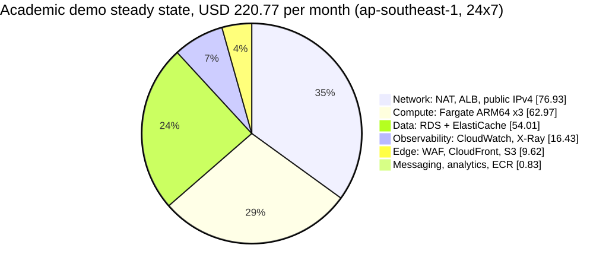
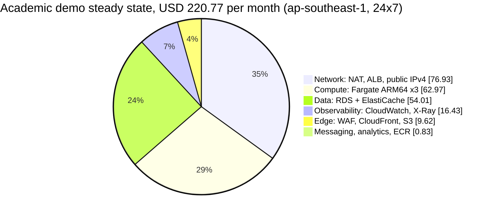

# 04. AWS cost estimate (ap-southeast-1, USD per month)

Status: proposal for team review, 2026-09-25. It prices the bill of materials in `02-proposed-architecture.md` §10 on the runtime chosen in `03-k8s-argocd-assessment.md` (ECS on Fargate, ARM64). The basis is the one the team chose: an **academic demo** with one environment, low traffic and minimal high availability.

All prices are on-demand list prices in USD, before tax and before any credits. A month is 730 hours. The **module window** runs from 2026-10-01 to 2026-11-16: 47 days, 1,128 hours, or 1.545 months.

## 1. Summary

| Variant | What runs | USD / month | Module window (47 days) |
| --- | --- | ---: | ---: |
| **A. Steady state, 24x7** | Everything in 02 §10 (core services, no identity-service) | **220.77** | **341.14** |
| B1. Demo hours, schedule only | ECS services scaled to 0 and RDS stopped outside 60 h/week | 155.71 | 240.60 |
| B2. Demo hours + off-hours teardown | B1, plus Terraform destroys the NAT gateway and ElastiCache outside demo hours | 118.77 | 183.52 |
| C. Scaling-demo burst | Incremental cost of **one** 8-hour load-test day on top of A or B | +8.23 per test day | +24.69 for 3 test days |
| **Recommended plan** (section 7) | B2 from 1 to 7 Oct, A from 8 to 26 Oct, B2 until 16 Nov, 3 test days | n/a | **271.93** |
| Recommended plan, torn down after the presentations | As above, but everything except ECR, S3 and one RDS snapshot is destroyed on 27 Oct | n/a | **191.79** |
| Baseline D1. Current monolith | 1 x EC2 t3.medium with PostgreSQL and Redis co-located, behind an ALB | 87.81 | 135.68 |
| Baseline D2. EKS + Argo CD instead of Fargate | Control plane + 2 x t4g.medium nodes, otherwise the same as A | 296.55 | 458.23 |
| Side demo D3. k3s + Argo CD | 1 x t4g.medium, 20 GB gp3 | 36.52 (24x7) | 6.00 for 5 demo days |

See also `07-digitalocean-comparison.md` §3 for the same workload priced on DigitalOcean (USD 63.15-118.45 per month), and why the figures are not like-for-like.

Stretch items add to every variant: identity-service (0.5 vCPU / 1 GB) +17.99 per month at 24x7, Secrets Manager (2 secrets) +0.80, a Route 53 hosted zone +0.50.

Three lines make up **53% of the steady state**: the NAT gateway (43.07), RDS (37.23) and the team-purchase task (35.98). The **fixed floor** is what keeps billing when every service is scaled to zero: ALB, NAT, public IPv4, ElastiCache, WAF and CloudWatch. It is about **118 USD per month**, and only destroying resources removes it.

## 2. Unit prices

Retrieved on 2026-09-25. **API** means the AWS Price List API offer file for the service and region, at `https://pricing.us-east-1.amazonaws.com/offers/v1.0/aws/<Service>/current/ap-southeast-1/index.json`, with the file's `publicationDate` shown. **Web** means the public pricing or documentation page. **Assumed** means the price was not found in either source on the retrieval date. The basis is given for each assumed price.

| Item | Unit price (USD) | Source |
| --- | --- | --- |
| Fargate Linux ARM64 vCPU | 0.04045 per vCPU-hour | API AmazonECS (2026-09-11), `APS1-Fargate-ARM-vCPU-Hours:perCPU` |
| Fargate Linux ARM64 memory | 0.00442 per GB-hour | API AmazonECS, `APS1-Fargate-ARM-GB-Hours` |
| Fargate Linux x86 vCPU / memory (for comparison) | 0.05056 / 0.00553 | API AmazonECS |
| Fargate ephemeral storage above 20 GB | 0.000133 per GB-hour (the first 20 GB is included) | API AmazonECS; Web fargate/pricing |
| Fargate Spot | up to 70% off Fargate on-demand, x86 only (see section 8) | Web fargate/pricing. **Discount in Singapore assumed** |
| Application Load Balancer | 0.0252 per hour + 0.008 per LCU-hour | API AWSELB (2026-09-11) |
| NAT gateway | 0.059 per hour + 0.059 per GB processed | API AmazonEC2 (2026-09-24), `APS1-NatGateway-Hours/-Bytes` |
| Public IPv4 address (in use or idle) | 0.005 per hour | API AmazonVPC (2026-09-17), `APS1-PublicIPv4:InUseAddress` |
| Interface VPC endpoint | 0.013 per hour per AZ + 0.01 per GB | API AmazonVPC |
| S3 gateway endpoint | free | Web (VPC pricing: gateway endpoints carry no charge) |
| Regional data transfer (cross-AZ) | 0.01 per GB each way | API AmazonEC2 |
| Internet egress, first 10 TB (Asia edge) | 0.12 per GB | API AmazonCloudFront global file (2026-09-16); used as a proxy for EC2 egress, **assumed** equal |
| RDS PostgreSQL db.t4g.small single-AZ | 0.051 per hour | API AmazonRDS (2026-09-24) |
| RDS PostgreSQL db.t4g.medium single-AZ | 0.102 per hour | API AmazonRDS |
| RDS PostgreSQL db.t4g.small Multi-AZ (for reference) | 0.102 per hour | API AmazonRDS |
| RDS gp3 storage | 0.138 per GB-month | API AmazonRDS, `APS1-RDS:GP3-Storage` |
| RDS backup storage beyond the free allocation | 0.095 per GB-month | API AmazonRDS, `APS1-RDS:ChargedBackupUsage`. Backup storage up to 100% of provisioned storage is free (RDS pricing page) |
| ElastiCache Valkey cache.t4g.micro | 0.0192 per node-hour (Redis OSS: 0.024) | API AmazonElastiCache (2026-09-14) |
| ECR storage | 0.10 per GB-month | API AmazonECR (2026-09-11) |
| SNS standard publishes | first 1 M per month free, then 0.50 per M. Delivery to SQS is free. Delivery to Firehose is 0.2542 per M. | API AmazonSNS (2026-09-15) |
| SQS standard requests | 0.40 per M. The first 1 M per month is free. | API AWSQueueService (2026-09-11). **The free 1 M is assumed** from the SQS pricing page (not in the API file) |
| Data Firehose Direct PUT ingestion | 0.037 per GB (5 KB rounding per record) | API AmazonKinesisFirehose (2026-09-11), `APS1-BilledBytes` tier 1 |
| Athena | 5.00 per TB scanned (10 MB minimum per query) | API AmazonAthena (2026-09-11) |
| S3 Standard | 0.025 per GB-month. PUT 0.005 per 1,000. GET 0.0004 per 1,000. | API AmazonS3 (2026-09-18) |
| CloudFront HTTPS requests (Asia) | 0.012 per 10,000 | API AmazonCloudFront global file (2026-09-16) |
| CloudFront flat-rate plans | Free 0 USD (1 M requests, 100 GB, no WAF). Pro 15 USD per month (10 M requests, 50 TB, WAF with 25 rules included). | Web cloudfront/pricing |
| WAF | 5.00 per web ACL per month + 1.00 per rule or rule group per month + 0.60 per M requests | API awswaf (2026-09-14), `APS1-WebACLV2`, `APS1-RuleV2`, `APS1-RequestV2-Tier1` |
| CloudWatch Logs | 0.70 per GB ingested (Standard). 0.03 per GB-month stored. 0.007 per GB scanned by Logs Insights. | API AmazonCloudWatch (2026-09-22) |
| CloudWatch custom metrics | 0.30 per metric-month (first 10,000) | API AmazonCloudWatch |
| CloudWatch alarms | 0.10 per standard-resolution alarm metric-month | API AmazonCloudWatch |
| CloudWatch dashboard | 3.00 per dashboard-month | **Assumed**: not in the regional offer file, and the pricing page did not render the rate. 3.00 is the long-standing global list price. |
| CloudWatch free tier | 5 GB logs, 10 custom metrics, 10 alarms, 3 dashboards, 1 M API requests per month | Web cloudwatch/pricing |
| X-Ray traces | 5.00 per M recorded, 0.50 per M retrieved | API AWSXRay (2026-09-11). **The free 100,000 traces per month is assumed** from the X-Ray pricing page |
| Secrets Manager | 0.40 per secret-month + 0.05 per 10,000 API calls | API AWSSecretsManager (2026-09-11) |
| SSM Parameter Store standard parameters | free | Web (standard tier has no storage charge) |
| Route 53 hosted zone | 0.50 per zone-month + 0.40 per M queries | API AmazonRoute53 global file (2026-09-11) |
| EKS control plane, standard support | 0.10 per cluster-hour | API AmazonEKS (2026-09-18), `APS1-AmazonEKS-Hours:perCluster` |
| EKS extended support | 0.50 per cluster-hour | API AmazonEKS, `APS1-AmazonEKS-Hours:extendedSupport` (the ap-southeast-1 rate; 03 uses it) |
| EC2 t3.medium / t3.small / t4g.medium / t4g.small (Linux) | 0.0528 / 0.0264 / 0.0424 / 0.0212 per hour | API AmazonEC2; the web price JSON agrees |
| EBS gp3 | 0.096 per GB-month | API AmazonEC2, `APS1-EBS:VolumeUsage.gp3` |
| T3 unlimited surplus credits | 0.05 per vCPU-hour (T4g: 0.04) | API AmazonEC2 |

The offer files were cached in the session scratchpad, not in the repository. To re-check a price, stream the offer file through a filter on `usagetype`.

## 3. Variant A: steady state, 24x7

Usage assumptions:

- Traffic is low: about 200,000 HTTP requests a month through CloudFront and the ALB.
- ALB usage averages 0.5 LCU.
- 10 GB a month goes through the NAT gateway: ECR API calls, CloudWatch Logs, SNS/SQS, SSM, Stripe and Google. ECR image layers come from S3 through the free gateway endpoint.
- Logs total 5 GB a month.
- About 30 custom metrics are exported by Micrometer, after a meter filter. The unfiltered default set runs to hundreds of metrics.
- Events total about 100,000 a month.
- Every service runs one task. notification-service may scale to 0 (02 §3), but it is priced at one task so it is always ready for a demo.

| Group | Line item | Quantity | USD / month |
| --- | --- | --- | ---: |
| Compute | Fargate team-purchase (includes the payment module) | 1 vCPU, 2 GB, 1 task, 730 h | 35.98 |
| Compute | Fargate catalog | 0.5 vCPU, 1 GB, 1 task | 17.99 |
| Compute | Fargate notification | 0.25 vCPU, 0.5 GB, 1 task | 9.00 |
| Network | ALB hours | 730 h | 18.40 |
| Network | ALB LCU | 0.5 LCU average | 2.92 |
| Network | NAT gateway hours | 1 gateway, 730 h | 43.07 |
| Network | NAT data processed | 10 GB | 0.59 |
| Network | Public IPv4, ALB | 2 addresses (one per AZ) | 7.30 |
| Network | Public IPv4, NAT Elastic IP | 1 address | 3.65 |
| Network | Cross-AZ and other data transfer | allowance | 1.00 |
| Data | RDS PostgreSQL db.t4g.small single-AZ | 730 h | 37.23 |
| Data | RDS gp3 storage | 20 GB | 2.76 |
| Data | RDS automated backups, 7 days | within the free allocation (at most 20 GB) | 0.00 |
| Data | ElastiCache Valkey cache.t4g.micro | 1 node | 14.02 |
| Delivery | ECR | 2 GB with lifecycle policies | 0.20 |
| Edge | CloudFront + S3 SPA (existing) | inside free volumes | 0.50 |
| Edge | WAF | 1 web ACL, 4 rules (3 managed groups + 1 rate rule), 0.2 M requests | 9.12 |
| Messaging | SNS | under 1 M publishes; SQS delivery free; Firehose delivery 0.1 M | 0.03 |
| Messaging | SQS, 3 queues + 3 DLQs | about 0.5-1 M long-poll requests (20 s wait) | 0.40 |
| Analytics | Firehose -> S3 -> Athena | about 0.5 GB billed, under 1 GB stored, about 100 queries | 0.20 |
| Observability | CloudWatch Logs | 5 GB ingested, about 2.5 GB kept 14 days | 3.58 |
| Observability | CloudWatch dashboard | 1 | 3.00 |
| Observability | CloudWatch alarms | 8 | 0.80 |
| Observability | CloudWatch custom metrics | about 30 | 9.00 |
| Observability | X-Ray, 5% sampling plus errors | about 10,000 traces | 0.05 |
| Config | SSM Parameter Store standard, S3 gateway endpoint, Service Connect, Cloud Map | none | 0.00 |
| | **Total, variant A** | | **220.77** |

Notes:

- **Service Connect** costs nothing extra. Its Envoy sidecar uses CPU and memory inside each task's size, so do not shrink the tasks below the 02 sizes.
- RDS and ElastiCache use AWS-managed KMS keys and SNS/SQS use SSE-SQS, so encryption at rest adds no charge.
- CloudFront -> ALB origin fetches carry no data-transfer charge. The SPA is already live on CloudFront, so its cost is mostly already being paid today.
- **Free-tier offset, not included above.** If the account's CloudWatch free tier is not already used by the existing EC2 stack, it removes up to about 10 USD: 5 GB of logs (3.50), 3 dashboards (3.00), 10 alarms (0.80) and 10 metrics (3.00). SQS and SNS already sit inside their free million.

## 4. Variant B: demo hours (60 h per week of active use)

60 h/week is about 260 h a month, or 36% of the month. RDS is priced at 1.1 times the active hours to cover the start-up time before each session.

| What | Can it be paused? | How | Still billed while paused |
| --- | --- | --- | --- |
| ECS services | **Yes** | Set the desired count to 0 (Application Auto Scaling scheduled actions, or a GitHub Actions `workflow_dispatch`). Fargate bills per second with a 1-minute minimum. | Nothing |
| RDS instance | **Yes, for up to 7 days** | `stop-db-instance`. RDS **restarts automatically after 7 days stopped**, so an EventBridge Scheduler rule must stop it again every night. | Storage (2.76) and backups |
| ElastiCache node | **No** (no stop API) | Only delete and recreate it, which takes about 10 minutes through Terraform. Sessions are disposable, so buyers only have to log in again. | Everything, unless deleted |
| NAT gateway | **No** | Delete it and recreate it through Terraform (`enable_nat = false`). Release the Elastic IP too, because an idle address still bills. | Everything, unless deleted |
| ALB | **No**, and do not delete it | Deleting it changes its DNS name, and the CloudFront origin, WAF and target groups would need re-wiring before each demo | 18.40 + 7.30 IPv4 |
| WAF, dashboards, alarms, metrics | Pro-rated per hour, but deleting them loses the evidence | Keep | Everything |

| Line item | A (24x7) | B1 (schedule only) | B2 (schedule + destroy NAT and ElastiCache) |
| --- | ---: | ---: | ---: |
| Fargate, three services | 62.97 | 22.43 | 22.43 |
| ALB hours + LCU | 21.32 | 19.44 | 19.44 |
| NAT hours + data + Elastic IP | 47.31 | 47.31 | 18.89 |
| Public IPv4, ALB | 7.30 | 7.30 | 7.30 |
| RDS instance + storage | 39.99 | 17.35 | 17.35 |
| ElastiCache | 14.02 | 14.02 | 5.49 |
| Edge, messaging, analytics, observability, other | 27.88 | 27.88 | 27.88 |
| **Total per month** | **220.77** | **155.71** | **118.77** |
| **Module window (1.545 months)** | **341.14** | **240.60** | **183.52** |

B2 saves 46% against A. It needs a Terraform `demo_mode` toggle (work item D6 in `05-effort-estimate.md`) and discipline: someone has to "switch on" the platform about 15 minutes before each session. Do not use B for any period with load tests or assessors outside the scheduled hours. The Stripe webhook and the expiry sweeper only run while team-purchase is up. Stripe retries webhooks for up to 3 days, so a paused sandbox catches up later.

## 5. Variant C: scaling-demo burst (incremental cost per test day)

This follows the scenarios in 02 §9. The platform is scaled out for 8 hours:

- catalog runs 4 tasks (3 extra);
- team-purchase runs 3 tasks (2 extra);
- notification runs 2 tasks (1 extra);
- RDS is temporarily resized to db.t4g.medium. A resize causes a few minutes of downtime, so apply it before the session.

The test drives about 1 M extra requests and 1 M events.

| Item | Basis | USD per test day |
| --- | --- | ---: |
| Extra Fargate tasks | 3 x catalog + 2 x team-purchase + 1 x notification, 8 h | 1.48 |
| RDS db.t4g.medium uplift | (0.102 - 0.051) x 8 h | 0.41 |
| ALB LCU | about 3 LCU x 8 h | 0.19 |
| CloudFront HTTPS requests | 1 M (assumes the always-free request allowance is already used) | 1.20 |
| WAF requests | 1 M | 0.60 |
| SNS publishes + Firehose delivery | 1 M + 1 M | 0.75 |
| SQS requests | about 4 M (receive + delete, 2 consumers) | 1.60 |
| Firehose ingestion | 1 M x 5 KB = 5 GB | 0.19 |
| CloudWatch Logs | about 1.5 GB extra | 1.05 |
| X-Ray | 5% of 1 M = 50,000 traces | 0.25 |
| NAT data | about 2 GB | 0.12 |
| k6 generator, EC2 t3.small | 8 h + public IPv4 + 20 GB gp3 pro-rated | 0.27 |
| Generator egress | about 1 GB of requests | 0.12 |
| **Total per test day** | | **8.23** |

Three test days (baseline, browse storm plus join race, fault injection) add **24.69 USD**. A t3.small can struggle to drive 300 virtual users. A c7g.large or t3.large for the same 8 hours adds only about 0.50-0.70 USD. The generator can also run from a GitHub-hosted runner at no AWS cost, but that runner sits in a US region, which inflates latency.

## 6. Comparison baselines

| Baseline | Line items | USD / month | Window |
| --- | --- | ---: | ---: |
| **D1. Current monolith** (`infra/terraform/backend-app-stack`: default VPC, no NAT, public EC2 with a public IP) | EC2 t3.medium 38.54; 30 GB gp3 2.88; ALB + 0.5 LCU 21.32; 3 public IPv4 10.95; logs, alarms, WAF (if added), ECR, SPA 14.12 | **87.81** | 135.68 |
| **D2. EKS + Argo CD** (03 §5, 2 managed nodes) | A minus Fargate (-62.97); EKS control plane 73.00; 2 x t4g.medium nodes 61.90; 2 x 20 GB gp3 3.84. Argo CD, the AWS Load Balancer Controller and CoreDNS run on the nodes. | **296.55** | 458.23 |
| **D3. k3s + Argo CD side demo** | t4g.medium 30.95; 20 GB gp3 1.92; public IPv4 3.65 | **36.52** at 24x7, or about 1.20 per 24-hour day | 56.43 at 24x7, **6.00** for 5 demo days |

Reading:

- The target platform costs about **2.5 times the current monolith**. The difference buys managed PostgreSQL and Redis, private subnets with a NAT, independent services and an event backbone. None of these exist today.
- EKS adds about **76 USD a month** over Fargate (+34%), and it cannot be paused, only destroyed.
- The k3s side demo is almost free if Terraform creates and destroys it around the demo days. Its public IPv4 address (3.65 per month) is easy to overlook.

## 7. Recommended spending plan for the module window

| Period | Days | Variant | USD |
| --- | ---: | --- | ---: |
| 1-7 Oct (proposal, P1 build-out) | 7 | B2 | 27.33 |
| 8-26 Oct (conduct and presentations) | 19 | A | 137.91 |
| 27 Oct-16 Nov (report writing, screenshots on demand) | 21 | B2 | 82.00 |
| Load-test days | 3 | C | 24.69 |
| **Total** | | | **271.93** |

If the report only needs the evidence already captured, destroy the stack on 27 Oct. Keep ECR (0.20), the S3/CloudFront SPA (0.50), one final RDS snapshot (at most 1.90 per month) and the CloudWatch log archive. The window total then drops to about **192 USD**.

Guard rails:

- Two AWS Budgets alerts, at 150 and 250 USD. Two action-free budgets carry no charge (**assumed** from the Budgets pricing page).
- Cost-allocation tags `project=blocbuy` and `service=<name>` on every Terraform resource, so the report can show the actual bill per service.

**Credits and free tier.** Do not count on credits.

- Accounts created after 15 July 2025 get 100 USD in credits, plus up to 100 USD more for completing onboarding activities, valid for 6 months (Web aws.amazon.com/free). Accounts on the *Free plan* cannot use every service and close when the credits run out. The *Paid plan* keeps the credits and removes the limits.
- AWS Educate / AWS Academy or any NUS-ISS credits apply only if the course actually issues them. Confirm with the instructors, then subtract.
- The always-free allowances used above (CloudWatch, SNS, SQS, X-Ray, CloudFront) are small, and they are shared with whatever else runs in the account.

## 8. Cost-optimisation levers

| Lever | Saving (USD / month vs A) | Trade-off | Verdict |
| --- | ---: | --- | --- |
| **Tasks in public subnets with `assignPublicIp` and a locked-down SG, no NAT** | about 36 (removes 47.31 NAT, adds 3 task IPv4 at 10.95) | Tasks get public addresses (inbound still blocked by security groups). Weakens the "private subnets" control in 02 §8. Every scaled-out task adds 3.65. | Good fallback if money is tight. Record it as a limitation next to AISS-02. |
| NAT instance (for example fck-nat on t4g.nano) instead of a NAT gateway | about 35-38 (**assumed**: t4g.nano was not priced in this study) | Self-managed, single instance, no SLA | Viable. Adds an ops item. |
| Interface VPC endpoints for ECR, Logs, SQS, SNS, SSM and Secrets (about 7 x 2 AZ) | **negative**: they cost about 133 per month against 43 for the NAT | Stripe and Google still need internet egress, so the NAT stays anyway | Rejected at demo scale. Keep only the free S3 gateway endpoint. |
| Graviton (ARM64) for Fargate, RDS and ElastiCache | already applied: about 20% below x86 Fargate, and Valkey is 20% below Redis OSS | The images must be built for `linux/arm64` (buildx). This is already in 03 §4.3. | Keep |
| Fargate Spot for notification, and for catalog tasks above the first | about 4-6 | **Fargate Spot is documented for x86_64 only (not verified for ARM64 in this study).** Those tasks would have to switch to x86, which costs 25% more on demand, to get up to 70% off. There is a 2-minute interruption notice. | Only for the burst tasks on test days. The saving is too small to justify a second image architecture. |
| Scheduled scale-down (variant B) | 65 (B1) to 102 (B2) | Needs switch-on discipline, and RDS restarts on its own after 7 days | **Recommended** outside 8-26 Oct |
| Trim Micrometer metrics to at most 10 custom metrics | about 6-9 | Fewer graphs. Standard ECS, ALB, SQS and RDS metrics stay free. | Recommended. Keep only the outbox lag, consumer result and reservation gauges. |
| Drop X-Ray, or keep sampling at 5% | under 1 | Loses the cross-service trace picture | Keep 5% |
| Replace WAF on CloudFront with the CloudFront flat-rate Pro plan | negative: 15 against about 9.62 | Includes WAF and DDoS protection with no overage | Not worth it at demo volume |
| Multi-AZ RDS | **+39.99** (the opposite of a saving) | Needed for the availability quality attribute | Leave for the roadmap (AISS-01). Mention its price in the report. |
| Savings Plans / Reserved Instances | none | The minimum term is 1 year, and the module lasts 7 weeks | Not applicable |

## 9. Risks to the estimate

- **Traffic is the least certain input.** Every usage-priced line (SQS, SNS, Firehose, WAF requests, logs) would stay under about 15 USD per month even at 10 times the assumed volume. The hourly resources dominate.
- **Log volume.** A DEBUG log level or chatty health checks can push ingestion to 20-30 GB a month, which is 14-21 USD. Set the log level to INFO and exclude `/actuator/health` access logs.
- **Forgotten resources** after the module: the NAT, the ALB, ElastiCache and idle Elastic IPs. The teardown checklist belongs in the deployment-operations runbook.
- **Prices change.** The offer files are dated between 2026-09-11 and 2026-09-24. Re-run the price extraction before submitting the report if more than a month has passed.
