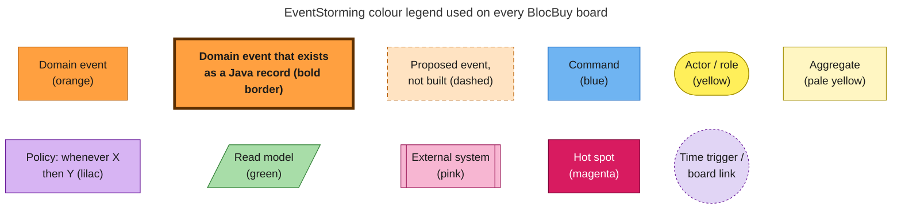
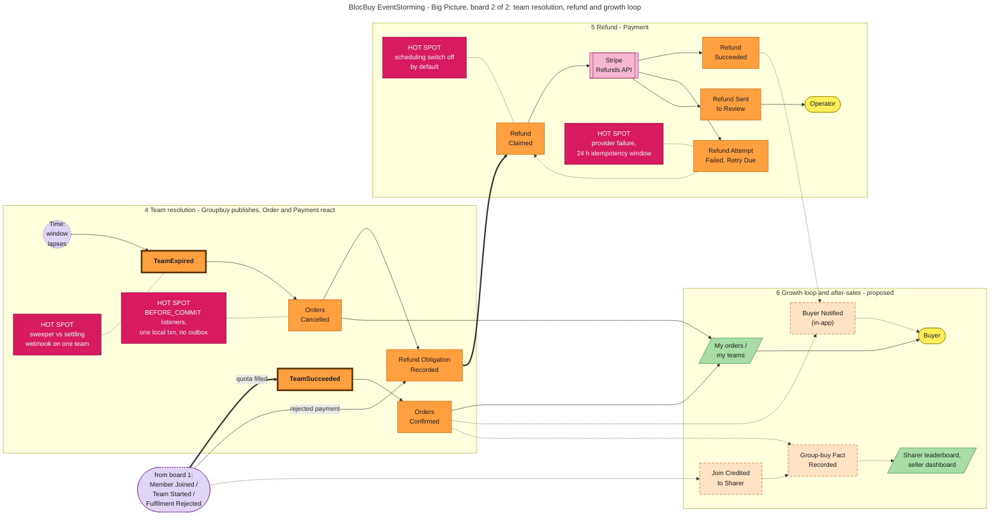
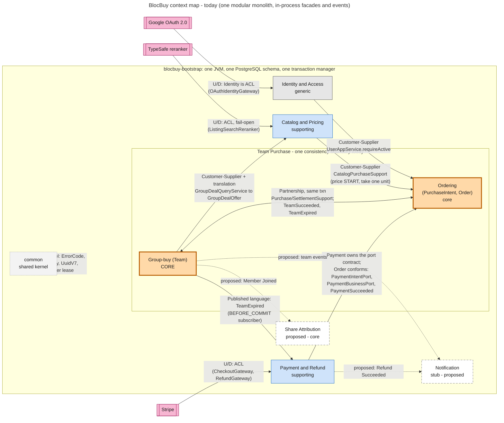
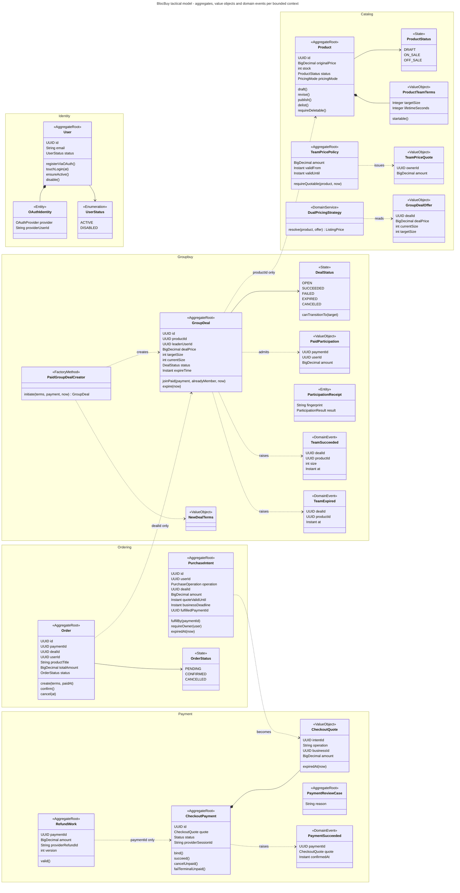
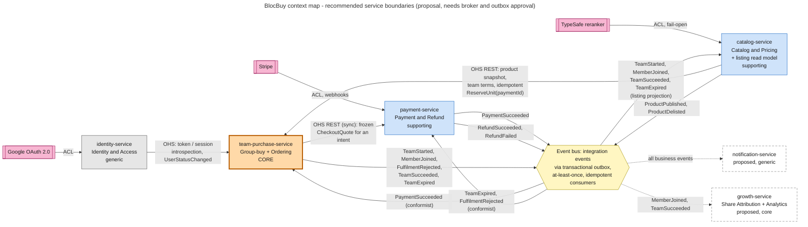

# 06. EventStorming and domain-driven design for BlocBuy

Status: architecture study (proposal). Nothing in this document changes code. Everything marked **proposed** does not exist in the repository on 2026-09-25.

This study supplies the domain view that the SWE5001 report template asks for in §3.1.4 (platform design: domain entities, bounded contexts, aggregates, domain events, and how the platform serves producers and consumers). It also gives the parallel service-architecture study a recommended mapping from bounded contexts to deployable services. That mapping is in [Recommended service boundaries](#6-recommended-service-boundaries).

## 1. Method

The team did not run a live workshop for this study. We simulated the EventStorming format of Alberto Brandolini ([Introducing EventStorming](https://ziobrando.blogspot.com/2013/11/introducing-event-storming.html)) and followed the three levels in the [Qlerify guide](https://www.qlerify.com/post/event-storming-the-complete-guide). Instead of workshop participants, the sources were:

| Source | Used for |
| --- | --- |
| `docs/SWE5006-Group-Project-Proposal-for-Team-8.md` (UC1 to UC9) | Business intent, actors, the proposed events for UC7 and notifications |
| `backend/blocbuy-domain/src/main/java/com/blocbuy/**` | Aggregates, value objects, state machines and domain event records |
| `backend/blocbuy-application/src/main/java/com/blocbuy/**` | Commands (application services), policies (subscribers, jobs), cross-context facades |
| `backend/docs/adr/0001-payment-business-integration.md`, `0002-team-lifecycle-events.md` | Consistency boundary, lock order, event timing (`BEFORE_COMMIT`) |
| Flyway `V1` to `V17` in `backend/blocbuy-bootstrap/src/main/resources/db/migration/` | Table ownership per context, idempotency indexes, refund states |
| `contracts/openapi.json` (23 operations under `/api/v1`) | Commands and read models exposed to actors |

We ran the three levels in order:

1. **Big Picture.** We placed every domain event on one timeline, from a product being listed to a refund landing. Then we added actors, external systems and hot spots, and marked the pivotal events.
2. **Process Level.** For each use case we built the chain *read model → actor → command → aggregate → event → policy → next command*.
3. **Software Design.** We grouped aggregates into bounded contexts, drew the context map, and tested one grouping question in detail: whether the order and groupbuy modules form one context.

The boards follow the usual colour code. The legend below applies to every board.

Events drawn with a **bold border** exist in the code as Java records (`PaymentSucceeded`, `TeamSucceeded`, `TeamExpired`). The other orange events are state changes the code performs but does not yet publish as event objects. Dashed events are proposed.

## 2. Big Picture

### 2.1 Actors and external systems

| Kind | Name | Role in the ecosystem |
| --- | --- | --- |
| Actor | Buyer | Consumer. Browses, signs in, pays to start or join a team, reads their own orders |
| Actor | Team leader (organiser) | A buyer who pays first to start a team and recruits others. On the platform they produce demand |
| Actor | Joiner | A buyer who pays into an open team |
| Actor | Administrator | Manages listings (UC9, API only) on behalf of sellers. The seller has no self-service GUI (proposal §6.2) |
| Actor | Operator | Handles payment and refund review cases (internal only, no HTTP endpoint) |
| Time | `TeamExpirySweepJob`, `RefundWorkerJob` | Scheduled triggers under a database lease (`sys_scheduler_lock`) |
| External | Google OAuth 2.0 | Identity provider for UC2 |
| External | Stripe | Hosted checkout, signed webhooks and refunds (test mode) |
| External | TypeSafe semantic reranker | Optional listing search reranking. Off by default and fail-open |

### 2.2 Timeline

The timeline is split into two boards so that it stays readable on a report page. Board 1 ends with a paid team membership. Board 2 continues from that point.

```mermaid
---
title: "BlocBuy EventStorming - Big Picture, board 1 of 2: listing set-up to paid team membership"
---
flowchart LR
  classDef event fill:#FFA040,stroke:#B85C00,color:#1A1A1A
  classDef eventRec fill:#FFA040,stroke:#5C2E00,stroke-width:4px,color:#1A1A1A,font-weight:bold
  classDef proposed fill:#FFE3C2,stroke:#B85C00,stroke-dasharray:6 4,color:#1A1A1A
  classDef actor fill:#FFEF5A,stroke:#A38F00,color:#1A1A1A
  classDef ext fill:#F7B6D2,stroke:#9C1A5A,color:#1A1A1A
  classDef hot fill:#D81B60,stroke:#7A0036,color:#FFFFFF
  classDef rm fill:#A8DDA8,stroke:#2E7D32,color:#1A1A1A

  subgraph P1["1 Listing set-up - Catalog (producer side)"]
    Admin(["Administrator<br/>for the seller"]):::actor
    E_Drafted["Product<br/>Drafted"]:::event
    E_Policy["Team Price Policy<br/>Configured"]:::event
    E_Terms["Team Terms<br/>Seeded"]:::event
    E_Published["Product<br/>Published"]:::event
    E_Delisted["Product<br/>Delisted"]:::event
    H_Terms["HOT SPOT<br/>no API for team terms,<br/>DB seed only"]:::hot
  end

  subgraph P2["2 Access and discovery - Identity, Catalog (consumer side)"]
    Buyer(["Buyer"]):::actor
    Google[["Google<br/>OAuth 2.0"]]:::ext
    TypeSafe[["TypeSafe<br/>reranker"]]:::ext
    E_Registered["Buyer<br/>Registered"]:::event
    E_SignedIn["Buyer<br/>Signed In"]:::event
    RM_Listing[/"Listing view:<br/>two prices +<br/>open teams"/]:::rm
    E_Quoted["Team Price<br/>Quote Issued"]:::event
  end

  subgraph P3["3 Team formation, pay first - Order, Payment, Groupbuy"]
    Leader(["Team leader<br/>(organiser)"]):::actor
    Joiner(["Joiner"]):::actor
    Stripe[["Stripe<br/>Checkout"]]:::ext
    E_Intent["Purchase Intent<br/>Issued"]:::event
    E_Session["Checkout Session<br/>Created"]:::event
    E_Webhook["Stripe Event<br/>Received"]:::event
    E_Unpaid["Checkout Expired<br/>Unpaid"]:::event
    E_Review["Payment Review<br/>Case Opened"]:::event
    E_Paid["PaymentSucceeded"]:::eventRec
    E_TeamStarted["Team<br/>Started"]:::event
    E_Joined["Member<br/>Joined"]:::event
    E_Rejected["Fulfilment Rejected,<br/>Refund Required"]:::event
    E_Order["Order Placed<br/>(pending)"]:::event
    E_Stock["Stock Unit<br/>Consumed"]:::event
    E_Invite["Invite Link<br/>Issued"]:::proposed
    H_Dup["HOT SPOT<br/>duplicate webhooks"]:::hot
    H_Race["HOT SPOT<br/>last-slot race"]:::hot
    H_Late["HOT SPOT<br/>paid after team<br/>expired"]:::hot
  end

  Admin --> E_Drafted --> E_Policy --> E_Terms --> E_Published -.-> E_Delisted
  H_Terms -.- E_Terms
  Buyer --> Google --> E_Registered --> E_SignedIn
  E_Published ==> RM_Listing
  TypeSafe -.-> RM_Listing
  E_SignedIn --> RM_Listing --> E_Quoted
  E_Quoted --> Leader
  RM_Listing --> Joiner
  Leader --> E_Intent
  Joiner --> E_Intent
  E_Intent --> E_Session --> Stripe --> E_Webhook
  H_Dup -.- E_Webhook
  E_Webhook --> E_Paid
  E_Webhook --> E_Unpaid
  E_Webhook --> E_Review
  E_Paid --> E_TeamStarted --> E_Order
  E_Paid --> E_Joined --> E_Order
  E_Paid --> E_Rejected
  E_Order --> E_Stock
  E_TeamStarted -.-> E_Invite
  H_Race -.- E_Joined
  H_Late -.- E_Rejected
```

Chronological event list, grouped by phase:

| # | Phase | Domain event | Where it happens today | Status |
| --- | --- | --- | --- | --- |
| 1 | Listing | Product Drafted | `Product.draft`, `POST /admin/products` | Built (state change) |
| 2 | Listing | Product Revised | `Product.revise`, `PUT /admin/products/{id}` | Built (state change) |
| 3 | Listing | Team Price Policy Configured | `TeamPricePolicy`, `PUT /products/{id}/team-price-policy` | Built (state change) |
| 4 | Listing | Team Terms Seeded | `ProductTeamTerms` (V14 columns), seeded in the database | Built. No API exists |
| 5 | Listing | **Product Published** (pivotal) | `ProductStatus.DRAFT/OFF_SALE → ON_SALE` | Built (state change) |
| 6 | Listing | Product Delisted | `ProductStatus.ON_SALE → OFF_SALE` | Built (state change) |
| 7 | Access | Buyer Registered | `User.registerViaOAuth` on the first Google callback | Built (state change) |
| 8 | Access | Buyer Signed In / Signed Out | `User.touchLogin`, Sa-Token session in Redis | Built (state change) |
| 9 | Discovery | Team Price Quote Issued | `TeamPriceQuote`, `POST /team-price-quotes` | Built. Checkout does not consume it yet |
| 10 | Formation | Purchase Intent Issued | `PurchaseIntent.issue`, `POST /payments/intents` | Built (state change) |
| 11 | Formation | Checkout Session Created | `CheckoutPayment.bind`, `POST /payments/checkout-sessions` | Built (state change) |
| 12 | Formation | Stripe Event Received | `log_payment_webhook_event` claim | Built (state change) |
| 13 | Formation | **PaymentSucceeded** (pivotal) | `com.blocbuy.payment.event.PaymentSucceeded` | Built (record) |
| 14 | Formation | Checkout Expired Unpaid | `CheckoutPayment.cancelUnpaid / failTerminalUnpaid` | Built (state change) |
| 15 | Formation | Payment Review Case Opened | `PaymentReviewCase` (`PROVIDER_MISMATCH`, `LATE_PAID_REQUIRES_RECOVERY`) | Built (state change) |
| 16 | Formation | **Team Started** (pivotal) | `PaidGroupDealCreator.initiate` via `PaidGroupDealService.startConfirmed` | Built (state change) |
| 17 | Formation | Member Joined | `GroupDeal.joinPaid` via `joinConfirmed` | Built (state change) |
| 18 | Formation | Order Placed (pending) | `Order.create` in `OrderFulfilmentAdapter.fulfil` | Built (state change) |
| 19 | Formation | Purchase Intent Fulfilled | `PurchaseIntent.fulfilBy(paymentId)` | Built (state change) |
| 20 | Formation | Stock Unit Consumed | `CatalogPurchaseSupport.consumeOneUnit` | Built (state change) |
| 21 | Formation | Fulfilment Rejected, Refund Required | `Outcome.rejection` → `requireRefund` | Built (state change) |
| 22 | Formation | Invite Link Issued | UC7 (#30) | **Proposed** |
| 23 | Resolution | **TeamSucceeded** (pivotal) | `com.blocbuy.groupbuy.event.TeamSucceeded` | Built (record) |
| 24 | Resolution | **TeamExpired** (pivotal) | `com.blocbuy.groupbuy.event.TeamExpired` | Built (record) |
| 25 | Resolution | Orders Confirmed | `OrderLifecycleSubscriber.onTeamSucceeded` | Built (state change) |
| 26 | Resolution | Orders Cancelled | `OrderLifecycleSubscriber.onTeamExpired` | Built (state change) |
| 27 | Resolution | Refund Obligation Recorded | `TeamExpiryRefundService.recordExpiredTeam`, `biz_refund` | Built (state change) |
| 28 | Refund | Refund Claimed | `RefundService.processNext` claim | Built (state change) |
| 29 | Refund | Refund Succeeded | `biz_refund.status = succeeded` | Built (state change) |
| 30 | Refund | Refund Attempt Failed, Retry Due | `log_refund_attempt`, status `processing` | Built (state change) |
| 31 | Refund | Refund Sent to Review | status `review` | Built (state change) |
| 32 | Growth | Join Credited to Sharer | UC7 | **Proposed** |
| 33 | Growth | Buyer Notified (in-app) | `notification` module is a stub | **Proposed** |
| 34 | Growth | Group-buy Fact Recorded | Analytics sink | **Proposed** |

The pivotal events split the story into acts: **Product Published** (supply exists), **PaymentSucceeded** (money is committed), **Team Started** (a team is born), and **TeamSucceeded / TeamExpired** (the team's fate is decided).

### 2.3 Hot spots

| ID | Hot spot | How the code answers it today | Open question |
| --- | --- | --- | --- |
| HS-1 | **Last-slot race.** Several buyers pay for the one remaining seat | The team row is locked (`SELECT ... FOR UPDATE`) before `joinPaid`. The loser gets `GROUP_REJECTED`, and a refund obligation is committed. `StripeLocalIntegrationTest` runs 20 buyers against one seat | Buyers who lose the race pay and are then refunded. Should a short seat hold before checkout prevent this? |
| HS-2 | **Duplicate or out-of-order webhooks** | `claimEvent(eventId)` on `log_payment_webhook_event`, one order per payment (`uq_biz_order_payment_id`), one fulfilled payment per intent. An 8-thread replay test covers this | The design already survives at-least-once delivery. It needs no change for a broker |
| HS-3 | **Payment arrives after the team expired** | The quote carries the team deadline. `CheckoutQuote.expiredAt` gives `BUSINESS_EXPIRED`, which leads to a refund obligation. A late payment on a cancelled payment goes to review (`LATE_PAID_REQUIRES_RECOVERY`) | Buyers see the charge before the refund. A notification is needed (proposed) |
| HS-4 | **Sweeper and webhook race on one team** | Both lock the team row first. The status-guarded `UPDATE ... WHERE status='open'` makes the loser a no-op | None |
| HS-5 | **Last stock unit taken by another team during settlement** | `consumeOneUnit` failure throws, the whole settlement rolls back, and Stripe retries. The retry then fails `requirePurchasable` cleanly and is refunded | Stock is decremented at payment time, not at team success. Is this the right business rule for teams that later expire? The unit is not returned today |
| HS-6 | **Refund failure** | Per-attempt log, idempotency key, and retry. After 23 hours the worker only searches and never creates a new refund, because Stripe may drop idempotency keys after 24 hours. Mismatches go to `review` | Who staffs the operator queue? There is no UI |
| HS-7 | **Scheduling switch off by default** | `blocbuy.scheduling.enabled=false`. Teams never expire and refunds stay `pending` until an operator enables it | A deployment runbook step is owed |
| HS-8 | **Consequences run `BEFORE_COMMIT` in one local transaction** | ADR 0002 chooses this on purpose: the team's closure and the money owed for it are one fact | This is the biggest obstacle to splitting services. There is no outbox |
| HS-9 | **No API for team terms** | Team terms are seeded in the database (ADR 0001, NFR-29) | Sellers cannot onboard themselves, which limits the producer side of the platform |
| HS-10 | **Dangling reserved `deal_id` on unpaid START intents** | Harmless because there are no foreign keys | Cleanup job owed (ADR 0001) |

## 3. Process Level

Each row reads left to right as *read model → actor → command → aggregate → event(s) → policy (→ next command)*. Commands are the real application service methods or HTTP operations.

| UC | Read model the actor decides on | Actor | Command | Aggregate | Event(s) | Policy / reaction |
| --- | --- | --- | --- | --- | --- | --- |
| UC2 Login | Sign-in page | Buyer | `GET /auth/oauth2/google` then `GET /auth/oauth2/google/callback` (`OAuthLoginAppService`) | `User`, `OAuthIdentity` | Buyer Registered (first time), Buyer Signed In | OAuth state is single-use in Redis (`OAuthStateStore`). A disabled user is refused (`User.ensureActive`). A session is issued with role `buyer` |
| UC1 Browse | Listing page (`ListingView`, `ActiveDealView`) with individual and team price | Buyer | `GET /products`, `GET /products/{id}` | `Product` (read), `GroupDeal` (read via `GroupDealQueryService`) | none (query) | `DualPricingStrategy.resolve`: the group price comes from the best open team with a matching currency. The optional reranker fails open |
| UC1 Quote | Listing detail | Buyer | `POST /team-price-quotes` | `TeamPricePolicy` | Team Price Quote Issued | The quote is owner-scoped and is not a reservation. Checkout does not consume it yet |
| UC3 Initiate | Listing detail, `ProductTeamTerms.startable()` | Team leader | `POST /payments/intents` (START, productId), then `POST /payments/checkout-sessions` | `PurchaseIntent`, then `CheckoutPayment` | Purchase Intent Issued, Checkout Session Created | Price, size and deadlines are frozen on the server. No request chooses its own price |
| UC3/UC4 Settle | none (Stripe webhook) | Stripe | `POST /webhooks/stripe` (`StripeCheckoutService.handleWebhook`) | `CheckoutPayment` → `GroupDeal` → `Order` → `PurchaseIntent` → `Product` stock | PaymentSucceeded, Team Started or Member Joined, Order Placed, Intent Fulfilled, Stock Unit Consumed, possibly TeamSucceeded | *Whenever a payment succeeds, fulfil its intent* (`PaymentBusinessPort.fulfil`). *Whenever fulfilment is rejected, owe a refund.* See the diagram below |
| UC4 Join | Open team with seats left and deadline | Joiner | `POST /payments/intents` (JOIN, dealId), then checkout | `PurchaseIntent` (locks the team through `GroupDealPurchaseSupport`) | Purchase Intent Issued | The leader and existing members are refused (`ALREADY_MEMBER`). A full or closed team is refused before any money moves |
| UC5 Succeed | none | System (last member's settlement) | `GroupDeal.joinPaid` fills the team | `GroupDeal` | **TeamSucceeded** | *Whenever a team succeeds, confirm its orders* (`OrderLifecycleSubscriber`, `BEFORE_COMMIT`, order 10) |
| UC5 Expire | Due teams (open, deadline passed, at most 100) | Time (`TeamExpirySweepJob`) | `GroupDealExpiryService.expireOne(dealId)` | `GroupDeal.expire(now)` | **TeamExpired** | *Whenever a team expires, cancel its orders* (order 10). *Whenever a team expires, owe each paid member a refund* (`TeamExpiryRefundSubscriber`, order 20) |
| UC6 Refund | Due refund obligations | Time (`RefundWorkerJob`), Operator | `RefundService.processNext`, `RefundService.reconcile` | Refund obligation (`RefundWork`, `biz_refund`) | Refund Claimed, Refund Succeeded, Refund Attempt Failed, Refund Sent to Review | Stripe refund with an idempotency key. No new refund after 23 hours. The operator can only verify an existing `re_` refund id and cannot send a new one |
| UC7 Attribution (**proposed**) | Team page with a share button | Team leader, members | Issue Invite Link; Join via Link (the intent carries an `inviteCode`) | Proposed `InviteLink`, `Attribution` | Invite Link Issued, Join Credited to Sharer | *Whenever a member joins through a link, credit the sharer*: an Observer on the subscriber side, `AFTER_COMMIT` or asynchronous, because crediting must never roll back a paid seat |
| UC8 My orders / teams | `OrderSummaryView` | Buyer | `GET /orders/me`, `GET /orders/{id}`; `GET /group-deals/me` (#179, in progress) | none (query) | none | Scoped to the authenticated user. Another buyer's order returns 404, not 403 |
| UC9 Admin listing | Admin product page (`GET /admin/products`) | Administrator (`admin` role) | Create, revise, change status, delete | `Product` (`ProductStatus` as State pattern) | Product Drafted, Revised, Published, Delisted, Deleted (draft only) | Published commercial terms (price, currency, stock) cannot be edited. Only a never-published draft can be deleted. Optimistic `version` |

### 3.1 Join and settlement (UC3, UC4)

```mermaid
---
title: "Process level - UC3 initiate / UC4 join: purchase intent, checkout and webhook settlement"
---
flowchart LR
  classDef event fill:#FFA040,stroke:#B85C00,color:#1A1A1A
  classDef eventRec fill:#FFA040,stroke:#5C2E00,stroke-width:4px,color:#1A1A1A,font-weight:bold
  classDef proposed fill:#FFE3C2,stroke:#B85C00,stroke-dasharray:6 4,color:#1A1A1A
  classDef cmd fill:#6FB4F2,stroke:#1565C0,color:#1A1A1A
  classDef actor fill:#FFEF5A,stroke:#A38F00,color:#1A1A1A
  classDef agg fill:#FFF6C2,stroke:#A38F00,color:#1A1A1A
  classDef policy fill:#D7B4F3,stroke:#6A1B9A,color:#1A1A1A
  classDef rm fill:#A8DDA8,stroke:#2E7D32,color:#1A1A1A
  classDef ext fill:#F7B6D2,stroke:#9C1A5A,color:#1A1A1A
  classDef hot fill:#D81B60,stroke:#7A0036,color:#FFFFFF

  subgraph S1["A. Quote the purchase - synchronous, browser-driven"]
    RM_L[/"Listing detail:<br/>team price, open team,<br/>seats left, deadline"/]:::rm
    Buyer(["Buyer<br/>(leader or joiner)"]):::actor
    C_Intent["Create Purchase Intent<br/>POST /payments/intents<br/>START productId | JOIN dealId"]:::cmd
    A_Intent["PurchaseIntent<br/>(order)"]:::agg
    E_Intent["Purchase Intent Issued<br/>amount, size, deadlines frozen"]:::event
    C_Checkout["Create Checkout Session<br/>POST /payments/checkout-sessions"]:::cmd
    A_Pay["CheckoutPayment<br/>(payment) CREATED"]:::agg
    E_Session["Checkout Session Created"]:::event
  end

  subgraph S2["B. Settle the payment - one local transaction, locks team, intent, order, payment"]
    Stripe[["Stripe hosted<br/>checkout"]]:::ext
    C_Hook["Handle Stripe Event<br/>POST /webhooks/stripe<br/>signature verified"]:::cmd
    P_Dedup["Policy: claim event id<br/>once, else acknowledge"]:::policy
    A_Pay2["CheckoutPayment<br/>succeed()"]:::agg
    E_Paid["PaymentSucceeded"]:::eventRec
    P_Fulfil["Policy: whenever a payment<br/>succeeds, fulfil its intent<br/>(PaymentBusinessPort.fulfil)"]:::policy
    A_Deal["GroupDeal<br/>startPaid / joinPaid"]:::agg
    E_Started["Team Started"]:::event
    E_Joined["Member Joined"]:::event
    A_Order["Order.create<br/>(pending)"]:::agg
    E_Order["Order Placed"]:::event
    E_Fulfilled["Purchase Intent<br/>Fulfilled"]:::event
    A_Product["Product<br/>consume one unit"]:::agg
    E_Stock["Stock Unit Consumed"]:::event
    E_Succ["TeamSucceeded<br/>(when size = target)"]:::eventRec
    E_Rej["Fulfilment Rejected<br/>BUSINESS_EXPIRED | GROUP_REJECTED |<br/>BUYER_INACTIVE | PRODUCT_UNAVAILABLE"]:::event
    P_Refund["Policy: whenever fulfilment<br/>is rejected, owe a refund"]:::policy
    E_Owed["Refund Obligation Recorded"]:::event
    E_Link["Invite Link Issued"]:::proposed
  end

  RM_P[/"Payment receipt<br/>GET /payments/id"/]:::rm
  H1["HOT SPOT: last-slot race -<br/>row lock on team; loser is<br/>rejected and refunded"]:::hot
  H2["HOT SPOT: replayed webhook -<br/>event claim + one order<br/>per payment index"]:::hot
  H3["HOT SPOT: stock gone at commit -<br/>throw, roll back, Stripe retries"]:::hot

  RM_L --> Buyer --> C_Intent --> A_Intent --> E_Intent --> C_Checkout --> A_Pay --> E_Session --> Stripe
  Stripe --> C_Hook --> P_Dedup --> A_Pay2 --> E_Paid --> P_Fulfil
  P_Fulfil --> A_Deal
  A_Deal --> E_Started
  A_Deal --> E_Joined
  E_Started --> A_Order
  E_Joined --> A_Order
  A_Order --> E_Order --> E_Fulfilled --> A_Product --> E_Stock
  E_Joined --> E_Succ
  P_Fulfil --> E_Rej --> P_Refund --> E_Owed
  E_Started -.-> E_Link
  E_Stock --> RM_P
  H1 -.- A_Deal
  H2 -.- P_Dedup
  H3 -.- A_Product
```

Settlement is one local transaction that touches three modules. It takes its locks in a fixed global order: **team → purchase intent → order → payment**. Every rejecting check runs before the first write. Any failure after the first write throws, so the database never holds a membership and a refund for the same payment. Provider I/O (Stripe calls) always runs outside database transactions.

### 3.2 Team lifecycle and refund (UC5, UC6)

```mermaid
---
title: "Process level - UC5 team lifecycle and UC6 refund on expiry"
---
flowchart LR
  classDef event fill:#FFA040,stroke:#B85C00,color:#1A1A1A
  classDef eventRec fill:#FFA040,stroke:#5C2E00,stroke-width:4px,color:#1A1A1A,font-weight:bold
  classDef proposed fill:#FFE3C2,stroke:#B85C00,stroke-dasharray:6 4,color:#1A1A1A
  classDef cmd fill:#6FB4F2,stroke:#1565C0,color:#1A1A1A
  classDef actor fill:#FFEF5A,stroke:#A38F00,color:#1A1A1A
  classDef agg fill:#FFF6C2,stroke:#A38F00,color:#1A1A1A
  classDef policy fill:#D7B4F3,stroke:#6A1B9A,color:#1A1A1A
  classDef rm fill:#A8DDA8,stroke:#2E7D32,color:#1A1A1A
  classDef ext fill:#F7B6D2,stroke:#9C1A5A,color:#1A1A1A
  classDef hot fill:#D81B60,stroke:#7A0036,color:#FFFFFF
  classDef time fill:#E1D5F5,stroke:#6A1B9A,stroke-dasharray:3 3,color:#1A1A1A

  subgraph R1["A. Resolve the team - groupbuy publishes inside the transition transaction"]
    T_Sweep(("TeamExpirySweepJob<br/>every 1 min,<br/>DB lease")):::time
    RM_Due[/"Due teams: open and<br/>expire_time passed<br/>(max 100, retry backoff)"/]:::rm
    C_Expire["Expire Team<br/>GroupDealExpiryService.expireOne"]:::cmd
    A_Deal["GroupDeal.expire(now)<br/>DealStatus OPEN to EXPIRED"]:::agg
    E_Exp["TeamExpired"]:::eventRec
    FromJoin(("from settlement:<br/>last seat filled")):::time
    E_Succ["TeamSucceeded"]:::eventRec
  end

  subgraph R2["B. Consequences - BEFORE_COMMIT subscribers, order 10 then payment 20"]
    P_Confirm["Policy (order):<br/>whenever a team succeeds,<br/>confirm its orders"]:::policy
    P_Cancel["Policy (order):<br/>whenever a team expires,<br/>cancel its orders"]:::policy
    A_Order["Order<br/>confirm / cancel"]:::agg
    E_Conf["Orders Confirmed"]:::event
    E_Canc["Orders Cancelled"]:::event
    P_Owe["Policy (payment):<br/>whenever a team expires,<br/>owe each paid member a refund"]:::policy
    C_Record["Record Expired Team<br/>TeamExpiryRefundService"]:::cmd
    A_Ref["Refund obligation<br/>(biz_refund, one per payment)"]:::agg
    E_Owed["Refund Obligation Recorded"]:::event
  end

  subgraph R3["C. Execute the refund - payment worker, provider I/O outside DB transactions"]
    T_Worker(("RefundWorkerJob<br/>one claim per tick")):::time
    C_Proc["Process Next Refund<br/>RefundService.processNext"]:::cmd
    A_Ref2["RefundWork<br/>pending to processing"]:::agg
    Stripe[["Stripe Refunds API<br/>idempotency key"]]:::ext
    E_Done["Refund Succeeded"]:::event
    E_Retry["Refund Attempt Failed<br/>retry due"]:::event
    E_Rev["Refund Sent to Review"]:::event
    RM_Rev[/"Payment review queue"/]:::rm
    Op(["Operator"]):::actor
    C_Recon["Reconcile Refund<br/>(verify existing re_ id only)"]:::cmd
    E_Notify["Buyer Notified"]:::proposed
  end

  RM_Mine[/"My orders<br/>GET /orders/me"/]:::rm
  H1["HOT SPOT: sweeper and webhook<br/>race on one team - both lock<br/>the team row first"]:::hot
  H2["HOT SPOT: after 23 h never<br/>create a refund again, search<br/>then send to review"]:::hot
  H3["HOT SPOT: switch off by default;<br/>obligations wait in pending"]:::hot

  T_Sweep --> RM_Due --> C_Expire --> A_Deal --> E_Exp
  FromJoin --> E_Succ --> P_Confirm --> A_Order
  E_Exp --> P_Cancel --> A_Order
  A_Order --> E_Conf
  A_Order --> E_Canc
  E_Exp --> P_Owe --> C_Record --> A_Ref --> E_Owed
  E_Owed --> T_Worker --> C_Proc --> A_Ref2 --> Stripe
  Stripe --> E_Done
  Stripe --> E_Retry -.-> T_Worker
  Stripe --> E_Rev --> RM_Rev --> Op --> C_Recon --> A_Ref2
  E_Conf --> RM_Mine
  E_Canc --> RM_Mine
  E_Done -.-> E_Notify
  E_Conf -.-> E_Notify
  H1 -.- A_Deal
  H2 -.- E_Retry
  H3 -.- T_Worker
```

## 4. Strategic design

### 4.1 The platform view (SWE5001 framing)

The SWE5001 briefing asks for a platform with a seed, producers and consumers. It also asks how new use cases plug into the platform and how analytics would work. Mapped onto BlocBuy:

| Platform concept | In BlocBuy |
| --- | --- |
| **Seed** (the core interaction the platform exists for) | The **pay-first team**: a buyer commits money to a time-boxed quota at a team price. The quota fills and every order is confirmed, or the window lapses and everyone is refunded |
| **Producers** | *Sellers* supply listings, stock, team terms and team price. Today an administrator does this for them (UC9). *Team leaders* create teams and recruit through their social graph, so they produce demand and distribution. UC7 attribution measures that contribution |
| **Consumers** | *Joiners* (and leaders, in their buyer role) who get bulk pricing with no risk, because an unfilled team is refunded |
| **Platform services** | Identity and Access; Payment and Refund (escrow-like: capture, then refund on failure); the Team engine (quota, window, state machine, lifecycle events); Catalog and Pricing (`PricingStrategy`); **proposed**: Attribution, Notification, Analytics |
| **Network effect** | Leaders pay first, so they have a reason to recruit. Every successful team brings new buyers, who become the next leaders |

**How new seeds and use cases plug in.** Most extension points already exist in the code:

- **Pricing variants.** Implement another `PricingStrategy` (Strategy pattern, selected by `PricingMode`), for example tiered prices that drop as the team grows.
- **Team variants.** Subclass `PaidGroupDealCreator` (Factory Method), for example a "flash team" with a shorter window or a team with a seller-funded seat.
- **Business-agnostic payment.** `CheckoutQuote` carries `operation` plus `businessId`, and payment calls the business back only through `PaymentIntentPort` and `PaymentBusinessPort`. A new seed, such as group booking of services or crowdfunded pre-orders, can reuse checkout, webhooks, refunds and review by implementing those two ports.
- **Lifecycle reactions.** A new consumer subscribes to `TeamSucceeded` or `TeamExpired` instead of editing groupbuy, as UC5 requires (Observer). Attribution, notifications, seller payout and analytics all plug in this way.
- **More seeds.** A second seed, such as a campaign that sells a bundle from several sellers, would add a new core context beside Team Purchase and reuse Identity, Payment, Catalog and the event contracts.

### 4.2 Subdomains

| Subdomain | Type | Why |
| --- | --- | --- |
| Team formation and resolution (group-buy) | **Core** | This is the differentiator: quota, window, last-slot fairness, and one fate for the whole team |
| Team purchase settlement (intent to order) | **Core** | Pay-first only works if a paid buyer always ends up with exactly one outcome: a seat and an order, or a refund |
| Share attribution and growth (proposed) | **Core** | The business case (proposal §4) depends on measurable, buyer-driven distribution |
| Catalog and pricing | Supporting | Needed and specific (dual pricing, team terms) but not a differentiator |
| Payment and refund orchestration | Supporting | Specific rules (pay-first, refund on expiry, operator review), with the money movement itself handled by Stripe |
| Identity and access | Generic | Google OAuth plus RBAC; could be replaced by a managed identity service |
| Notification (proposed) | Generic | In-app status messages |
| Analytics (proposed) | Generic / supporting | Facts for the seller and the platform; could run on managed services |

### 4.3 Bounded contexts

| Bounded context | Code packages | Owns (tables) | Language inside the context |
| --- | --- | --- | --- |
| Identity and Access | `identity` | `sys_user`, `sys_user_oauth`, `sys_role`, `sys_permission`, `rel_user_role`, `rel_role_permission` | user, OAuth identity, role, active/disabled |
| Catalog and Pricing | `catalog` | `biz_product`, `biz_team_price_policy`, `biz_team_price_quote` | product, listing, on sale, team terms, team price policy, quote, pricing mode |
| **Team Purchase** (recommended; today two modules) | `groupbuy` + `order` | `biz_group_deal`, `biz_group_member`, `biz_group_participation_receipt`, `biz_purchase_intent`, `biz_order` | team (deal), leader, member, seat, quota, window, purchase intent, START/JOIN, order |
| Payment and Refund | `payment` | `biz_payment`, `log_payment_webhook_event`, `biz_refund`, `log_refund_attempt`, `log_payment_review`, `biz_payment_review_case` | checkout payment, quote, session, webhook event, refund obligation, review case |
| Notification (proposed) | `notification` (stub) | none yet | notification, recipient, channel (in-app) |
| Growth: Attribution and Analytics (proposed) | none | none yet | invite link, sharer, credited join, fact |
| Shared kernel | `common` | `sys_scheduler_lock`, `sys_scheduled_item_retry` | `ErrorCode`, `BizException`, `PageQuery`/`PageResult`, `UuidV7`, scheduler lease |

The same word can mean different things in different contexts. That is expected, and the glossary in §7 records each meaning. Two examples: *quote* means a `TeamPriceQuote` in Catalog and a frozen `CheckoutQuote` in Payment. *Deal*, *team* and *group* all name the same thing: `GroupDeal` in code and "team" in the product.

### 4.4 Is order a separate context from groupbuy?

**Evidence that order and groupbuy are one consistency boundary:**

1. **One invariant covers both.** "One successful payment yields exactly one seat **and** exactly one order, or neither plus a refund obligation" (ADR 0001). `OrderFulfilmentAdapter.fulfil` admits the member, saves the order, links `biz_group_member.order_id`, marks the intent fulfilled and takes stock in **one** local transaction.
2. **The order depends on the team.** The `Order` Javadoc calls it "the system of record for one paid deal participation". Its whole lifecycle (`PENDING → CONFIRMED | CANCELLED`) is decided by the team's state machine.
3. **The subscriber ordering is correct only inside the transaction.** ADR 0002 shows that `confirmByDealId` must run after the last buyer's order is inserted in the *same* transaction. That is why the listeners run `BEFORE_COMMIT`, not as plain listeners and not `AFTER_COMMIT`.
4. **They share the team lock.** The intent path (`GroupDealPurchaseSupport`) and the settlement path (`GroupDealSettlementSupport`) both lock the team row first. That lock is the concurrency control for the last-slot race.
5. **Facts are duplicated in both directions.** `biz_group_member.order_id` points at the order and `biz_order.deal_id` points at the team. `fulfilmentEvidence` reconciles the two.

**What still argues for keeping them as separate modules and aggregates:** order is the buyer's purchase history, holds a product snapshot, and is read by UC8. A future fulfilment, delivery or after-sales process would hang off the order, not the team.

**Recommendation.** Treat groupbuy and order as **one bounded context, *Team Purchase***, deployed as **one service**. Inside it, keep **separate aggregates** (`GroupDeal`, `PurchaseIntent`, `Order`) and separate packages. Keep the local transaction and the `BEFORE_COMMIT` subscribers between them.

Splitting them would turn every seat into a distributed saga. The compensation step of that saga is a Stripe refund, the exact money risk the ADRs were written to avoid. Revisit the split only when a real after-sales domain appears (shipping, returns, pickup points). That domain would become a downstream *Fulfilment* context that consumes `TeamSucceeded` asynchronously, and the order record would stay in Team Purchase.

### 4.5 Context maps

Today everything runs in one JVM against one PostgreSQL schema. Contexts collaborate through application facades and in-process events.

| Upstream → downstream | Pattern today | Mechanism (code) | Under microservices |
| --- | --- | --- | --- |
| Google → Identity | Anticorruption layer | `OAuthIdentityGateway`, `OAuthStateStore` | Unchanged (ACL inside identity-service) |
| TypeSafe → Catalog | ACL, fail-open | `ListingSearchReranker` port | Unchanged |
| Stripe → Payment | ACL | `CheckoutGateway`, `PaymentGateway`, `RefundGateway`; the webhook is verified and translated into `CheckoutGateway.Session` | Unchanged. Payment stays the only context that talks to Stripe |
| Identity → Team Purchase | Customer-supplier | `UserAppService.requireActive` | Open host service (token or session introspection), plus a `UserDisabled` event for caching |
| Catalog → Team Purchase | Customer-supplier | `CatalogPurchaseSupport` (price a START, validate, `consumeOneUnit`) | Open host service with a published language: product snapshot, team terms, and an **idempotent `ReserveUnit(paymentId)`**. A failed reservation becomes a `PRODUCT_UNAVAILABLE` rejection and a refund |
| Team Purchase → Catalog | Customer-supplier with a small translation (`GroupDealOffer`) | `GroupDealQueryService` (a synchronous read on every listing) | **Published language events** (`TeamStarted`, `MemberJoined`, `TeamSucceeded`, `TeamExpired`) feed a listing read model in catalog. Browsing no longer calls team-purchase-service |
| Groupbuy ↔ Order | **Partnership** in one transaction | `GroupDealPurchaseSupport`, `GroupDealSettlementSupport`, `TeamSucceeded`/`TeamExpired` `BEFORE_COMMIT` | Merged into one context and service (§4.4) |
| Payment ↔ Team Purchase (checkout) | Payment defines the ports; order **conforms** by implementing them | `PaymentIntentPort`, `PaymentBusinessPort`, `PaymentSucceeded` | Synchronous open host call for the frozen `CheckoutQuote` at checkout, then asynchronous `PaymentSucceeded`. Team Purchase replies with `MemberAdmitted` or `FulfilmentRejected` |
| Team Purchase → Payment (expiry) | Published language, conformist subscriber | `TeamExpired` → `TeamExpiryRefundSubscriber` | Asynchronous `TeamExpired` through an outbox. Payment already knows each payment's team (`biz_payment.fulfilled_deal_id`), so the event needs no member list |
| All → Notification, Growth (proposed) | Subscriber | none | Asynchronous subscribers to the event bus |
| `common` | **Shared kernel** | Maven module | A small shared library (error envelope, IDs, paging). Scheduler leases move into each service's own database |

## 5. Tactical design per context

### 5.1 Identity and Access (generic)

| Element | Items |
| --- | --- |
| Aggregate | `User` (root) with `OAuthIdentity` (entity, `sys_user_oauth`). Value types: `UserStatus` (`ACTIVE`, `DISABLED`), `RegisterSource`, `OAuthProvider`, `RoleCode` (`buyer`, `admin`) |
| Invariants | Email is the canonical key for resolving an OAuth account. A disabled user cannot open a session. Provider tokens never enter the aggregate |
| Commands | Start Google login, Complete Google callback, Log out, Disable user (domain method only) |
| Events | Buyer Registered, Buyer Signed In (state changes). **Proposed** integration event: `UserDisabled` |
| Repositories / ports | `UserRepository`, `UserOAuthRepository`, `RoleRepository`; ports `OAuthIdentityGateway`, `OAuthStateStore` (Redis) |
| Read models | `GET /auth/me` |

### 5.2 Catalog and Pricing (supporting)

| Element | Items |
| --- | --- |
| Aggregates | `Product` (root, with `ListingDetails` and `ProductTeamTerms` value objects; `ProductStatus` State pattern `DRAFT → ON_SALE ⇄ OFF_SALE`); `TeamPricePolicy` (immutable, append-only revisions) |
| Value objects | `ProductTeamTerms` (target size ≥ 2, lifetime 2,400 to 86,400 s), `TeamPriceQuote`, `ListingPrice`, `GroupDealOffer`, `PricingMode` |
| Invariants | Only `ON_SALE` products are browsable and purchasable. Published price, currency and stock cannot be edited. Only a never-published draft is deletable. Optimistic `version`. SGD only |
| Domain services | `PricingStrategy` / `DualPricingStrategy` (Strategy), `PricingStrategyResolver` |
| Commands | Draft, Revise, Publish, Delist, Delete draft product; Configure team price policy; Issue quote; Consume one unit (called by Team Purchase) |
| Events | Product Drafted, Revised, Published, Delisted; Team Price Policy Configured; Team Price Quote Issued; Stock Unit Consumed. **Proposed** integration events: `ProductPublished`, `ProductDelisted`, `StockReserved` / `StockReservationRefused` |
| Repositories / ports | `ProductRepository`, `TeamPriceRepository`; `ListingSearchReranker` (ACL) |
| Read models | `ListingView`, `ListingDetailView`, `ActiveDealView` (today read synchronously from groupbuy; proposed as an event-fed projection) |

### 5.3 Team Purchase: groupbuy and order (core)

| Element | Items |
| --- | --- |
| Aggregate: `GroupDeal` (team) | Root with fields `targetSize`, `currentSize`, `status`, `startTime`, `expireTime`, frozen `dealPrice`/`currency`, `leaderUserId`. Behaviour: `startPaid` (through `PaidGroupDealCreator`, Factory Method), `joinPaid`, `expire`. Members (`biz_group_member`) and `ParticipationReceipt` (idempotency by payment fingerprint) sit inside the boundary |
| `DealStatus` state machine | `OPEN → SUCCEEDED \| EXPIRED \| FAILED \| CANCELED`. Only `OPEN` can move, never to itself, and terminal states never re-enter (`canTransitionTo`). `FAILED` and `CANCELED` are defined but no code path writes them yet |
| Team invariants | `targetSize ≥ 2`; `1 ≤ currentSize ≤ targetSize`; the leader is member 1 and cannot join again; one membership per buyer; admission only while `startTime ≤ now < expireTime`, measured on the **database clock**; the payment amount and currency must equal the frozen deal price; filling the last seat sets `SUCCEEDED` and `successTime` atomically; expiry only when due |
| Aggregate: `PurchaseIntent` | Server-owned commitment (`Terms`: operation START/JOIN, `dealId`, product snapshot, amount, target size, `quoteValidUntil`, `businessDeadline`). Invariants: owned by one user (a mismatch looks like a 404); consumed by at most one payment (`fulfilBy`, partial unique index); expires at the earlier of its two deadlines |
| Aggregate: `Order` | Product snapshot, `quantity=1`, `unitPrice`, computed `totalAmount`, `paymentId`, `dealId`. `OrderStatus` `PENDING → CONFIRMED \| CANCELLED`. One order per payment (`uq_biz_order_payment_id`). Created only inside the settlement transaction, never from the browser |
| Lock order (global) | team → purchase intent → order → payment. The subscribers' `@Order(10, 20)` follows the same order |
| Commands | Create purchase intent (START/JOIN); Fulfil paid participation (`PaymentBusinessPort.fulfil`); Expire team (`expireOne`); Confirm or cancel orders by team; Lock the expired team for refund recording |
| Domain events (built) | `TeamSucceeded(dealId, productId, size, at)`, `TeamExpired(dealId, productId, at)` |
| Domain events (**proposed**, needed for asynchronous integration) | `TeamStarted(dealId, productId, leaderId, targetSize, expireTime)`, `MemberJoined(dealId, userId, paymentId, currentSize, inviteCode?)`, `FulfilmentAccepted(paymentId, dealId, orderId)`, `FulfilmentRejected(paymentId, reason)`, `OrderConfirmed`, `OrderCancelled` |
| Policies | Settle a paid participation (the chain in §3.1); confirm orders on `TeamSucceeded`; cancel orders on `TeamExpired`; the sweeper backs off 5 minutes on a poisoned team (`sys_scheduled_item_retry`) |
| Domain services / facades | `PaidGroupDealCreator` / `StandardPaidGroupDealCreator`, `PaidGroupDealService`, `GroupDealExpiryService`, `GroupDealExpirySweeper`, `OrderFulfilmentAdapter`, `PurchaseIntentAppService`, `OrderLifecycleSubscriber` |
| Repositories | `GroupDealRepository`, `PaidGroupDealRepository`, `PurchaseIntentRepository`, `OrderRepository` |
| Read models | `ActiveDealView`/`GroupDealOffer` (served to catalog), `OrderSummaryView` (`GET /orders/me`), my teams (`GET /group-deals/me`, #179, in progress) |

### 5.4 Payment and Refund (supporting)

| Element | Items |
| --- | --- |
| Aggregates | `CheckoutPayment` (root; `Status CREATED → SUCCEEDED \| FAILED \| CANCELED`; provider references cannot be rebound after confirmation) with the `CheckoutQuote` value object (frozen amount, operation, `businessId`, two deadlines); refund obligation (`biz_refund`, worked through `RefundWork`: `pending → processing → succeeded \| failed \| review`, `version` fencing token, `UNIQUE(payment_id)`); `PaymentReviewCase` (operator work item). `Payment` is still a placeholder class |
| Invariants | The amount never comes from the browser. One pending payment per intent. One refund per payment. Provider I/O never runs inside a database transaction. A webhook is applied only after signature verification and event-id deduplication. No refund is created after the 23-hour idempotency window |
| Commands | Prepare checkout; Handle Stripe event; Expire due sessions; Record expired team (refund obligations); Process next refund; Reconcile refund; Recover payment (operator, dry-run first) |
| Domain events (built) | `PaymentSucceeded(paymentId, quote, confirmedAt)` |
| Domain events (**proposed**) | `PaymentFailed`, `RefundRequested`, `RefundSucceeded(paymentId, refundId, amount)`, `RefundFailed`, `PaymentReviewOpened` |
| Policies | Fulfil on success; owe a refund on rejection; owe refunds on `TeamExpired`; send a late payment on a cancelled attempt to review; send a provider mismatch to review |
| Ports / ACL | `CheckoutGateway`, `PaymentGateway`, `RefundGateway` (Stripe adapters); required ports `PaymentIntentPort`, `PaymentBusinessPort` (implemented by Team Purchase) |
| Repositories | `CheckoutPaymentRepository`, `PaymentRepository`, `RefundRepository` |
| Read models | Payment receipt (`GET /payments/{id}`), capabilities, review-case queue (internal) |

### 5.5 Proposed contexts

| Context | Aggregates | Consumes | Produces | Notes |
| --- | --- | --- | --- | --- |
| Share Attribution (UC7, #30) | `InviteLink(code, sharerId, dealId)`, `Attribution(joinPaymentId, sharerId)` | `TeamStarted`, `MemberJoined` (with `inviteCode`) | `InviteLinkIssued`, `JoinCredited` | Must never block or roll back a paid seat, so it subscribes after commit or asynchronously. Idempotent by `joinPaymentId` |
| Notification | `Notification(recipient, type, readAt)` | `TeamSucceeded`, `TeamExpired`, `RefundSucceeded`, `FulfilmentRejected` | `BuyerNotified` | In-app only (proposal §6.2) |
| Analytics | Append-only facts | All business events | Seller and platform dashboards | Out of scope in the SWE5006 proposal; the SWE5001 success criteria mention it |

The combined class diagram of the built model:

## 6. Recommended service boundaries

This section is the hand-off to the service-architecture study. It is a **proposal**. The backend constraints skill currently forbids a message broker ("no RabbitMQ/Elasticsearch/broker", decision 2026-08-30) and requires cross-aggregate consistency inside local transactions. Adopting the target below needs the user's explicit approval and a new ADR that supersedes the relevant parts of ADR 0002.

| Deployable | Bounded context(s) | Owns data | Sync API offered (open host service) | Publishes | Subscribes | Scaling profile |
| --- | --- | --- | --- | --- | --- | --- |
| `identity-service` | Identity and Access | `sys_user*`, roles, sessions (Redis) | OAuth login, `/auth/me`, token or session introspection | `UserRegistered`, `UserDisabled` | none | Light; could be replaced by a managed identity service |
| `catalog-service` | Catalog and Pricing + listing read model | `biz_product`, `biz_team_price_*`, listing projection | Browse and search, admin CRUD, product snapshot, team terms, idempotent `ReserveUnit(paymentId)` / `ReleaseUnit` | `ProductPublished`, `ProductDelisted` | `TeamStarted`, `MemberJoined`, `TeamSucceeded`, `TeamExpired` (projection) | **Read-heavy**; scale horizontally with caching |
| `team-purchase-service` | **Team Purchase** (groupbuy + order, one consistency boundary) | `biz_group_*`, `biz_purchase_intent`, `biz_order` | Create purchase intent, get frozen `CheckoutQuote`, my orders, my teams | `TeamStarted`, `MemberJoined`, `FulfilmentAccepted`, `FulfilmentRejected`, `TeamSucceeded`, `TeamExpired`, `OrderConfirmed`, `OrderCancelled` | `PaymentSucceeded` | **Write-contended** on hot teams; row locks per team; expiry sweeper runs here |
| `payment-service` | Payment and Refund | `biz_payment`, webhook log, `biz_refund`, review cases | Checkout session, payment receipt, Stripe webhook endpoint | `PaymentSucceeded`, `PaymentFailed`, `RefundSucceeded`, `RefundFailed` | `FulfilmentRejected`, `TeamExpired` | Bursty (webhooks); PCI-adjacent, so isolate secrets and the network |
| `notification-service` (proposed) | Notification | notifications | Unread list | none | all business events | Asynchronous |
| `growth-service` (proposed) | Share Attribution + Analytics | invite links, attributions, facts | Invite link, leaderboard | `JoinCredited` | `TeamStarted`, `MemberJoined`, `TeamSucceeded` | Asynchronous, analytical |

The target design depends on the following rules:

1. **Transactional outbox in every publishing service.** The event row commits with the state change, and a relay publishes it at least once. It replaces the `BEFORE_COMMIT` publication only *across* services. *Inside* team-purchase-service, `TeamSucceeded/TeamExpired → confirm/cancel orders` stays synchronous and `BEFORE_COMMIT`, which keeps ADR 0002's reasoning intact.
2. **Settlement becomes a two-step exchange.** Payment commits `SUCCEEDED` and emits `PaymentSucceeded`. Team Purchase fulfils it idempotently by `paymentId` (this already exists) and replies with `FulfilmentAccepted` or `FulfilmentRejected`. Payment records the refund obligation on a rejection. For a short period a payment is `SUCCEEDED` with no outcome yet; the existing recovery and review tooling (`fulfilmentEvidence`) is how operators reconcile that state.
3. **Refunds on expiry.** Payment consumes `TeamExpired(dealId)` and looks up its own payments by `fulfilled_deal_id`. The record-and-lock idempotency of `recordExpiredTeam` and `UNIQUE(payment_id)` still apply.
4. **Stock.** Catalog's `ReserveUnit(paymentId)` must be idempotent and called before Team Purchase commits the seat. A reservation left behind by a local rollback is released by a reconciliation job keyed by `paymentId`. A lower-risk first step is to keep catalog and team-purchase in the same deployable, and split them only after the reservation protocol is proven.
5. **Every consumer is idempotent.** This is already true for webhooks (HS-2), fulfilment (receipts, unique indexes) and refunds, which is why the model is ready for at-least-once delivery.
6. **Deadlines stay on one clock per service.** The team window is judged only inside team-purchase-service, using its database clock. The frozen `CheckoutQuote.businessDeadline` lets payment reject a late payment without asking.

**Suggested migration order:** (1) extract payment-service, because it has the clearest port boundary; (2) move the catalog listing read model to events; (3) extract catalog-service with `ReserveUnit`; (4) keep team-purchase-service as the remaining core. Identity can move at any point.

> **Final decision (see `02-proposed-architecture.md`, alignment table).** The service names and boundaries above are adopted unchanged, and the diagram above is the end state. The migration order differs: catalog-service is extracted first (P3) because the briefing marks demonstrated scalability and catalog browse is the read-heavy path. payment-service stays a separate module and schema **co-deployed inside team-purchase-service** until P5.1, the first stretch item, so the single settlement transaction and its race tests stay intact during the conduct window. The reservation is also keyed by `intentId` and taken when the intent is frozen, not by `paymentId` during settlement, so no remote call runs while the team row is locked (02 AD-04). Rules 2 and 3 above therefore apply from P5.1 onward.

## 7. Ubiquitous language

| Term | Meaning | Code name |
| --- | --- | --- |
| Listing / product | A sellable item with an individual price, stock and optional team terms | `Product` |
| Individual price | The listing's own price | `Product.originalPrice` |
| Team price | The lower price paid by every member of a team | `GroupDeal.dealPrice`, `TeamPricePolicy.amount` |
| Dual pricing | Showing the individual and team price side by side | `DualPricingStrategy` |
| Team terms | The number of paid members a team needs and how long it stays open | `ProductTeamTerms` |
| Team (deal, group deal) | A time-boxed group purchase of one product at the team price | `GroupDeal` |
| Team leader (initiator, organiser) | The buyer who pays first and starts a team; member 1 | `GroupDeal.leaderUserId` |
| Joiner / member | A buyer admitted to a team after paying | `biz_group_member`, `PaidParticipation` |
| Quota / target size | The member count at which a team succeeds | `targetSize` |
| Seat | One unit of quota; the last seat is contested | `currentSize < targetSize` |
| Window / deadline | The admission period `[startTime, expireTime)`, measured on the database clock | `expireTime` |
| START / JOIN | The two purchase operations: start a team on a product, or join an open team | `PurchaseOperation` |
| Purchase intent | The server's frozen answer to "what would this checkout cost, on what terms" | `PurchaseIntent` |
| Checkout quote | The payment-side copy of the intent's frozen terms | `CheckoutQuote` |
| Team price quote | An owner-scoped catalog price quotation, not a reservation | `TeamPriceQuote` |
| Pay-first | Money is committed before membership exists; membership is granted only by a verified webhook | settlement in `StripeCheckoutService` |
| Settlement / fulfilment | Turning a verified payment into a seat, an order and a stock decrement, or into a refund obligation | `PaymentBusinessPort.fulfil` |
| Rejection | A business "no" that is committed and leads to a refund (`BUSINESS_EXPIRED`, `GROUP_REJECTED`, `BUYER_INACTIVE`, `PRODUCT_UNAVAILABLE`) | `Outcome.rejection` |
| Team succeeded | The last seat was filled in time; all orders are confirmed | `TeamSucceeded`, `DealStatus.SUCCEEDED` |
| Team expired | The window lapsed short of quota; orders are cancelled and refunds are owed | `TeamExpired`, `DealStatus.EXPIRED` |
| Order | A buyer's record of one paid participation, with a product snapshot | `Order`, `OrderStatus` |
| Refund obligation | A durable debt to return a payment, executed later by the worker | `biz_refund`, `RefundWork` |
| Review case | A payment or refund needing operator judgement | `PaymentReviewCase`, refund status `review` |
| Sweeper | The scheduled job that expires due teams, one team per transaction | `TeamExpirySweepJob`, `GroupDealExpirySweeper` |
| Lease | A database row that lets one instance run a job at a time | `sys_scheduler_lock`, `LeasedJobRunner` |
| Invite link / sharer (proposed) | A link unique to the sharer that attributes joins | UC7 |
| Seed / producer / consumer | Platform terms for, respectively, the pay-first team, sellers and leaders, and joining buyers | §4.1 |

## Appendix: diagram sources

All diagram sources are in `docs/SWE5001/architecture-study/diagrams/`. Each has a rendered `.svg` beside it:

- `eventstorming-legend.mmd`
- `eventstorming-big-picture.mmd` (board 1) and `eventstorming-big-picture-2.mmd` (board 2)
- `eventstorming-process-join-settlement.mmd`, `eventstorming-process-lifecycle-refund.mmd`
- `context-map.mmd` (today) and `context-map-target.mmd` (recommended services)
- `aggregates.mmd`

To re-render a diagram: `npx -y @mermaid-js/mermaid-cli -i <name>.mmd -o <name>.svg`.
