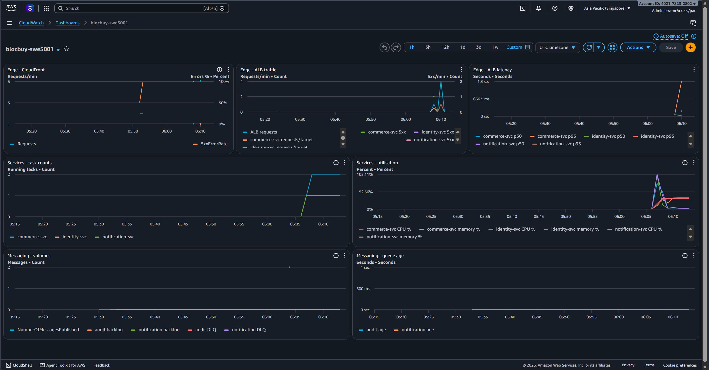

# HTTP baseline and dashboard session — 2026-10-16

Refs #457 and #458. This is a manual AWS session operated by @PPsyrius, not a GitHub deployment run. The monolith V2 baseline passed twice; the second run includes usable generator-resource observations. The operator approved a **12,000 requests/target/minute candidate**, persisted in the `swe5001-demo` environment, and verified two healthy commerce tasks in different AZs. This is not V3 scale-out or V4 queue-drain evidence. Runtime teardown and independent absence checks passed; later CloudFront metric authorization and startup recovery remain unresolved. Neither issue is closed by this record.

## Provenance and scope

| Item | Observed value |
| --- | --- |
| Account / target Region | `402178232802` / `ap-southeast-1` |
| Public target | `https://d3lvq02o2e7tcn.cloudfront.net` |
| Infrastructure and k6 source | `767d980ba2c358c1e80caf69a3c7703b76700a61`, merged PR #506 |
| V2 monolith source | `6c7a99abe9fa1352199526d5deb06aeb1b93e39e` |
| V2 monolith digest | `sha256:5310ced4efceb3e334d8961bb1000e8734bf0700e74ba4370eef88d4945a857b` |
| Monolith build/scan/publish provenance | [Promotion run 37470479078](https://github.com/PPsyrius/iss-groupbuy-team8/actions/runs/37470479078): source, successful Trivy step and exact pushed digest checked; ECR scan metadata was null, not evidence of a fresh scan |
| Distributed image source | `513f91b3dfa0c58188402f6ecb017594f5402d7e`, existing candidate tags `manual-513f91b-457`; not rebuilt for this session |
| Generator | Local Windows workstation, Docker Desktop Linux/amd64; [Docker allocation](v2-generator-docker.json); physical location not independently recorded |
| k6 image | `grafana/k6:1.6.1@sha256:a5ad6bc089a08d77c3ec49f3db8c6fa7a148e4073efcac44c675dbaf3568d8e1` |

Distributed candidate readbacks were identity `sha256:df3386295cad8b044cd6456e8171033ae3baf76cbf67805f50f4707729747b3e`, commerce `sha256:5730df6532e0e05ab8e2b8b52d8b0381c366237b828dbfacf028a194bc883a77`, and notification `sha256:57b0f2c5e638ce17f3cc2031561b6a69c59164fed56b923c41c408fda4879d10`. Image tags alone are not independent provenance; the earlier reviewed build/session evidence remains the source for those manually published images. Monolith and distributed images are different revisions, so transferring the candidate requires V3 validation.

## V2 measurements

Both runs used one stable monolith task, the existing demo catalogue, one local executor, a 100-preallocated/400-maximum VU pool, and ten one-minute plateaus. Each completed exactly **57,600 workload requests plus one catalogue setup request**, with zero browse errors and zero reported dropped iterations. The one-second terminal scheduler guard produced surplus iterations without extra HTTP, as intended. See the complete [first summary](v2-first-summary.json), [repeat summary](v2-repeat-summary.json) and [repeat calibration](v2-repeat-calibration.json).

| RPS | Expected/completed workload requests per run | First p95 (ms) | Repeat p95 (ms) |
| --- | --- | --- | --- |
| 10 | 600 | 57.05 | 53 |
| 20 | 1,200 | 34 | 39.05 |
| 40 | 2,400 | 26 | 27 |
| 60 | 3,600 | 43.05 | 28 |
| 80 | 4,800 | 28 | 23 |
| 100 | 6,000 | 26 | 23 |
| 125 | 7,500 | 23 | 42 |
| 150 | 9,000 | 26 | 23 |
| 175 | 10,500 | 35 | 23 |
| 200 | 12,000 | 49 | 23 |

The repeat ran **04:59:44.157–05:09:45.193 UTC**, with reported duration 601035.373337 ms and k6 exit 0. Every plateau met p95 <500 ms and error rate <1%. The analyzer's `kneeRps: 200` is the largest tested passing rate: **saturation was not observed**, so this is a tested lower bound, not a located saturation knee. The candidate conversion is `200 × 60 = 12000`; it is not proof that each distributed task can sustain that rate.

The [51 AWS service observations](v2-repeat-service-observations.jsonl) span 04:58:27–05:11:40 UTC, bracketing the repeat, with a maximum 17-second gap. Every observation has one running/desired monolith, zero pending, one completed deployment and the same task definition. The repeat summary embeds its start preflight; the [postflight](v2-repeat-postflight.json) has the same task ARN and sanitized CloudFront/ALB/target-group route. Observer stderr was empty. These are sampled observations plus endpoint snapshots, not continuous task-identity instrumentation.

The [191 Docker resource samples](v2-repeat-generator-stats.jsonl) cover 04:59:52.404–05:09:45.143 UTC with maximum gap 3.18 seconds, peak container CPU 15.89% and peak memory 0.56% of the Docker allocation. They begin about eight seconds after execution began, not before setup. The additional [48 host samples](v2-repeat-host-stats.jsonl) cover only 05:01:28.355–05:09:41.428 UTC: peak host CPU 19%, minimum free physical memory 15,689,680 KiB. Do not describe host coverage as the full run. The first run's PowerShell resource collector failed parsing terminal control sequences and produced no usable CPU/memory evidence; its otherwise successful summary is retained rather than substituted for the repeat.

## Persisted target and distributed checks

With operator approval, `SWE5001_COMMERCE_REQUESTS_PER_TARGET=12000` and `SWE5001_COMMERCE_MIN_CAPACITY=2` were set and read back in GitHub environment `swe5001-demo`. Matching CloudShell `TF_VAR_*` values were used for the distributed session. These settings do not change or promote an image, and the checked-in fallback of 200 remains provisional when neither setting is supplied.

The first distributed startup was interrupted during the readiness window after a CloudShell disconnect. Detached recovery began at 05:47:50 UTC; its 900-second SNS filter-settle wait began at 05:49:34, the complete messaging verification finished at 06:05:43, and all smoke checks passed at **06:10:28 UTC**, with recorded startup exit 0. See the [filtered startup record](distributed-startup-summary.txt); raw plans, recipient endpoints and private application logs are not committed.

The [commerce task snapshot](distributed-commerce-tasks.json), captured in the final bundle at **06:19:44 UTC**, shows two `RUNNING`, `HEALTHY` tasks on revision `blocbuy-swe5001-commerce-svc:4`, one in `ap-southeast-1a` and one in `ap-southeast-1b`. The [live target-tracking policy](distributed-commerce-policy.json) uses `ALBRequestCountPerTarget`, target **12000**, scale-out cooldown 60 s, scale-in cooldown 180 s, and the observed commerce ALB/target-group resource label. This verifies configuration and placement, not an actual scale-out event.

### Recovery defect and explicit operator repair

Startup returned success but [both scaling targets remained suspended](scaling-before-recovery.json): commerce bounds 2–6; notification bounds 0–4. Inspection of `env-up.sh` and `service-control.sh` identified that retrying from the interrupted bootstrap snapshots the already-suspended state, then restores it after Terraform enables services. Consequently, startup success alone is not sufficient evidence of enabled scaling.

After successful messaging readiness, the operator explicitly restored the declared running settings through `register-scalable-target`: commerce 2–6 and notification 1–4, with all three suspension flags false. The [after-recovery readback](scaling-after-recovery.json) proves those settings. This was a manual session repair, **not a shipped fix to snapshot restoration**. Add a permanent regression/fix before claiming retry-safe startup; do not silently unsuspend an intentional baseline or operator suspension.

## Dashboard evidence and authorization limitation

The [saved dashboard definition](dashboard.json) contains three rows and seven unit-separated charts. The [original working screenshot](2026-10-16-457-dashboard-edge-services-messaging.png) shows Edge, Services and Messaging datapoints, commerce at two tasks, identity/notification at one each, and queue age/backlog/DLQ at zero. The visible startup errors and utilization/latency spikes are retained; this is not a no-error interval or V3 scale-out graph.

A subsequent operator-supplied screenshot showed the CloudFront widget failing `cloudwatch:GetMetricData` with an **explicit AWS Organizations SCP deny**, while regional ALB/ECS/SQS charts still rendered. The later failure screenshot was supplied in the session conversation but its original PNG is not in this evidence directory. The earlier working screenshot does not prove the authorization problem stayed resolved. Organization policy ownership/readback and a fresh successful CloudFront query remain outstanding; adding an account IAM allow cannot override an SCP deny. Do not report the final dashboard as uniformly accessible or rerun load merely to repair this permission problem.

## Teardown and remaining acceptance

Detached `env-down.sh` began at **06:21:34 UTC** and destroyed **113 resources in 784 seconds**, finishing the destroy at 06:34:38. Its absence check passed at 06:35:02 and teardown exited 0. An independent `env-status.sh` also reported no runtime dashboard or tagged runtime resources at **06:37:51 UTC**, exit 0. The [operator-transcribed receipt](teardown-receipt.txt) preserves the supplied terminal output, not the private raw log. Persistent edge/foundation are intentionally retained; the receipt does not claim absence of unrelated AWS resources or zero account-wide cost.

- #457: teardown/absence verified; resolve or explicitly disposition the later CloudFront metric authorization failure and track the startup restoration defect. This record does not close the issue.
- #458: record the observed database connection budget before V3, validate distributed scale-out and event-relative latency/linearity, then implement/run V4 seed/burst/drain and DLQ acceptance. No connection-budget result, V3 run or V4 result is claimed here.
- Local original archives and raw k6 samples are retained outside Git; the committed JSON/JSONL files are selected non-secret evidence, not Terraform state or raw application logs. No origin-header values, credentials, cookies or email recipients are included.
