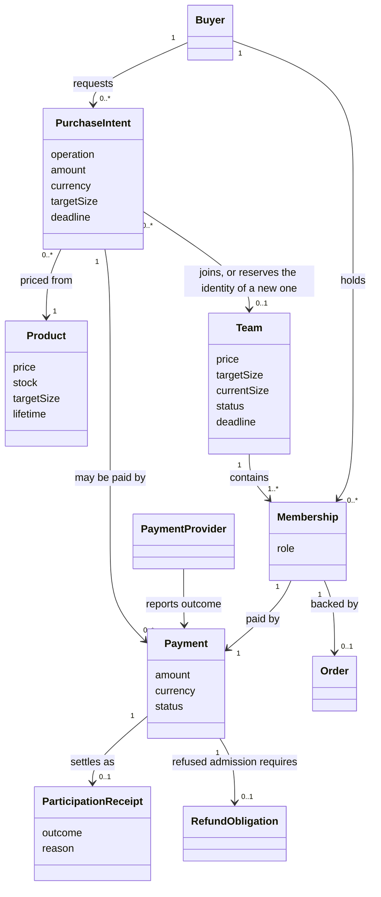
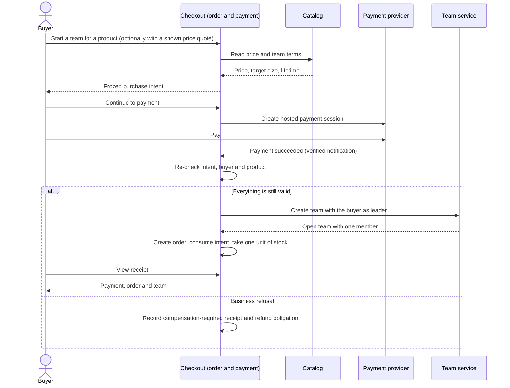
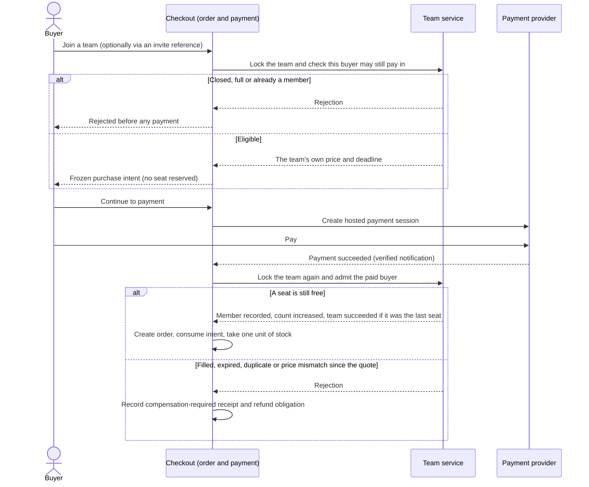
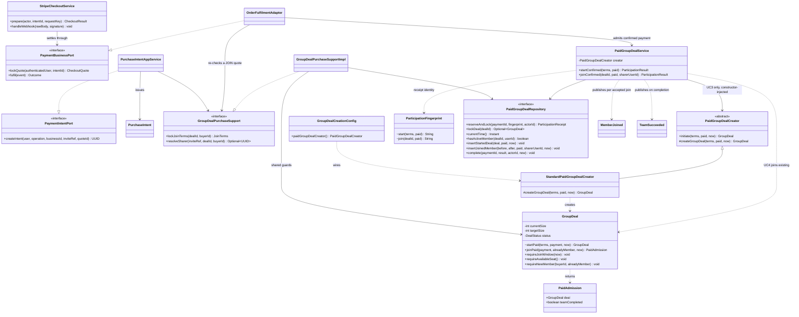
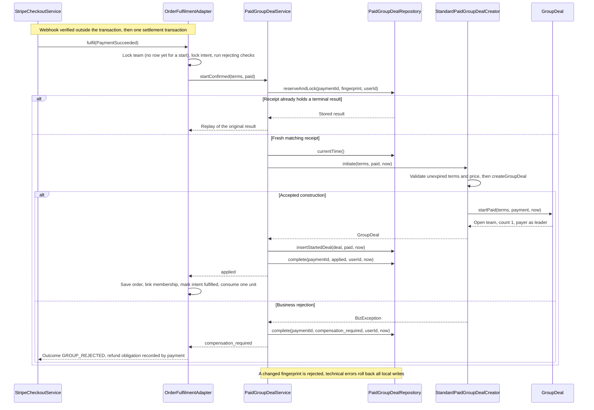
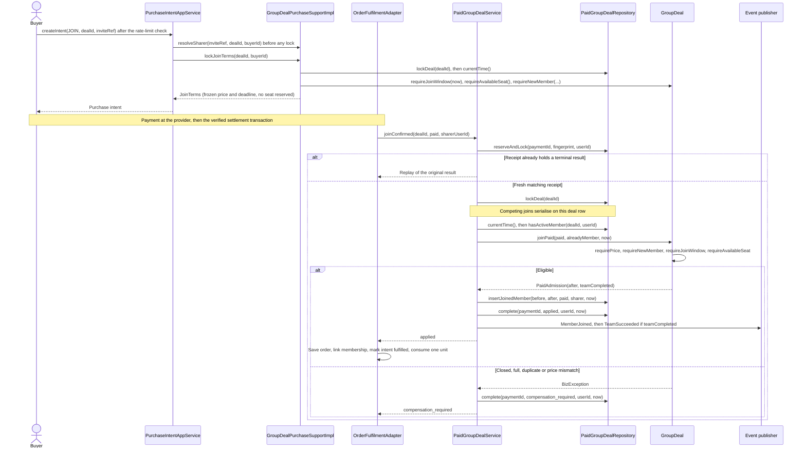
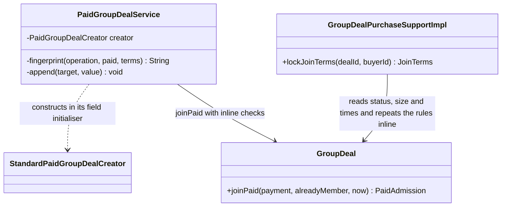
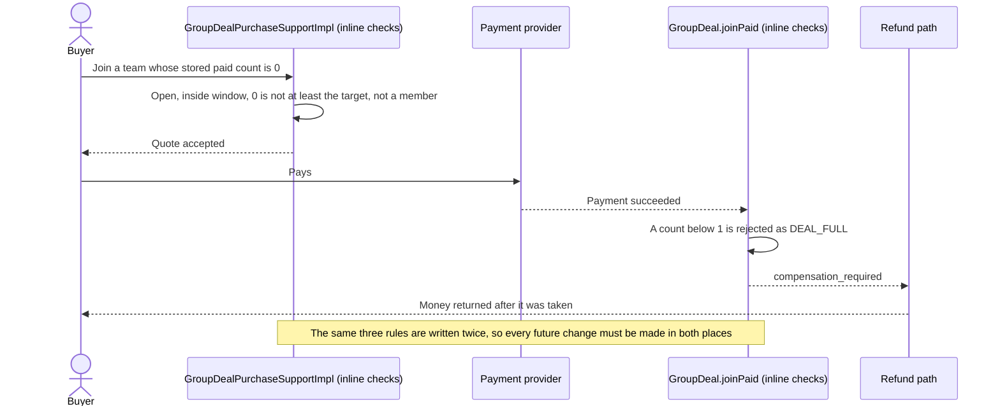
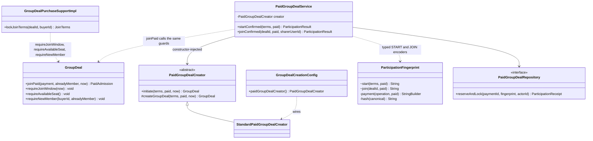
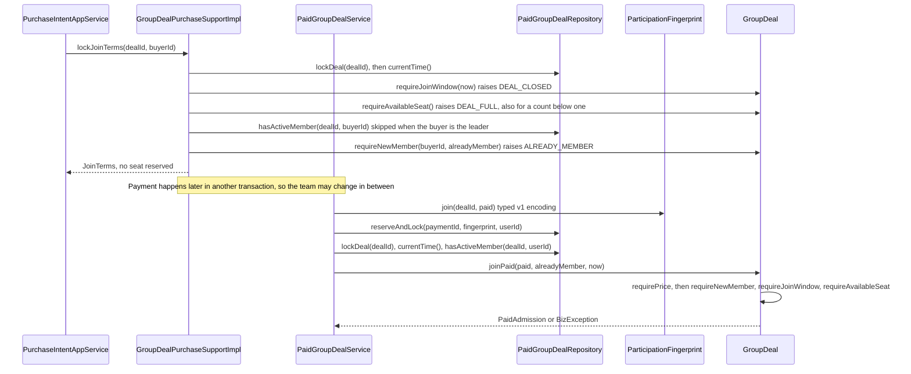

# SWE5006 final report contribution — Wang Ziang (Eric Wang)

> Draft for the report editor. The report-ready sections below are written for a reader who does not open the repository. The evidence map at the end is editorial material and should not be copied into the submitted report. The diagrams are Mermaid sources and may be rendered or redrawn in the report.

## Use case: initiate a team (pay-first) and join a team

### Analysis

**Primary actor:** a signed-in buyer, acting as the initiator of a new team (UC3) or as a joining member of an existing open team (UC4).

**Supporting actors:** the payment provider (Stripe Checkout in test mode), and the platform's catalog, order and group-buy responsibilities. A member whose invite link the buyer followed may be recorded as the sharer of a join; that attribution belongs to a separate use case and is not analysed here.

**Preconditions (UC3):** the buyer's account is active and online payments are enabled for the environment. The product is on sale, in stock and priced in SGD, and has team terms configured by an administrator (a target size of at least two and a lifetime between 2,400 and 86,400 seconds). A team price is in force for the whole 40-minute purchase window, or the buyer holds an unexpired price quote that was shown to them.

**Preconditions (UC4):** the buyer's account is active and online payments are enabled. The team is open, inside its admission window, has a free seat, and the buyer neither leads it nor already belongs to it. The join request is within the allowance of 60 intents per minute for one buyer and one team.

**Trigger:** the buyer chooses to start a team for a product, or to join a team, and continues to payment.

**Main success flow, initiate a team (UC3):**

1. The platform freezes a purchase intent for the buyer. The price, currency, target size and deadlines are read from the server, never from the request, and a team identity is reserved.
2. The buyer asks to pay. The platform re-validates that the intent belongs to the buyer and has not expired, and creates a hosted payment session at the provider.
3. The buyer pays at the provider.
4. The provider reports success. The platform verifies the notification, re-reads the session from the provider and records the payment as succeeded.
5. In one local database transaction the platform re-checks the intent, the buyer and the product, creates an open team with the buyer as its leader and first paid member, and stores the terminal receipt for the payment.
6. In the same transaction it creates the order, links it to the membership, marks the intent fulfilled and takes one unit of stock.
7. The buyer sees the payment receipt, with the order, and the team appears open with one member.

**Main success flow, join a team (UC4):**

1. The platform locks the team, checks that this buyer may still join, and freezes the team's own price and deadline into an intent. A quote reserves no seat.
2. Steps 2 to 4 of the initiation flow follow unchanged.
3. In one local transaction the platform locks the team again, reads the clock and the buyer's membership after the lock, and checks the price, membership, admission window and free seat in that order.
4. It records the member, increases the team's count by one and stores the terminal receipt. If this admission fills the last seat, the team succeeds in the same write.
5. The platform creates the order, links it to the membership, marks the intent fulfilled and takes one unit of stock. If the team succeeded, its orders are confirmed before the transaction commits.

**Alternative and exception flows:**

- If the team is closed or full, or the buyer already belongs to it, the request is rejected before any payment exists. A reconstructed team with fewer than one paid member is also rejected as full.
- If the buyer abandons payment or the hosted session expires, no team or membership exists; the unpaid intent is cleaned up later by a separate job.
- If payment succeeds but the business side then refuses it (the intent has lapsed, the buyer is inactive, the product is unavailable, or the team filled, expired or closed after the quote), the refusal is committed as a compensation-required receipt, no team or order is created, and a refund obligation is recorded for the refund use case.
- If two buyers pay for the last seat, the team lock serialises them: the first is admitted and the second receives a compensation-required outcome.
- If one buyer pays twice into the same team, the second payment is refused as a duplicate membership and compensated.
- If the amount or currency paid differs from the frozen terms, admission is refused and compensated.
- If the same payment is delivered again, the stored outcome is returned and nothing is created twice. Reusing a payment with different terms is rejected.
- If an invite reference cannot attribute the join, it is ignored and the join proceeds unattributed.
- If the join-intent allowance is exhausted, the request is answered with a rate-limit error before any business read.
- If a technical failure occurs after the first write, the whole transaction rolls back and the provider's redelivery retries it.

**Postconditions:** each succeeded payment has exactly one terminal receipt. A successful initiation leaves exactly one open team with its payer as leader, one matching paid membership, one order and a consumed intent. A successful join increases the paid count by exactly one, never beyond the target, and at most one admission completes the team. A refused payment leaves no membership and no order, only a compensation-required receipt and a refund obligation. This use case does not claim that a local transaction can undo money already moved at the provider.

### Analysis class diagram

### Analysis sequence diagram — initiate a team

### Analysis sequence diagram — join a team

### Design

The responsibilities are split by domain. Catalog owns product terms and pricing. The order module owns the purchase intent and implements the payment slice's two business ports (`PaymentIntentPort` through `PurchaseIntentAppService`, and `PaymentBusinessPort` through `OrderFulfilmentAdapter`). The group-buy module owns team admission and lifecycle, and the payment module owns the provider session, settlement and refunds. Modules reach each other only through application facades such as `CatalogPurchaseSupport`, `GroupDealPurchaseSupport` and `GroupDealSettlementSupport`, never through another module's tables. Locks are always taken in the order team, then purchase intent, then payment.

For a join, `PurchaseIntentAppService.createIntent` takes the team lock through `GroupDealPurchaseSupport.lockJoinTerms`, which reads the database clock after the lock and applies the shared domain guards on `GroupDeal`. For a start, it prices the product through `CatalogPurchaseSupport.lockStartQuote`, or `lockQuotedStart` when the buyer names a quote, and reserves the new team's identifier. The intent is saved as a `PurchaseIntent`. `StripeCheckoutService` then creates the hosted session, and on a verified webhook calls `OrderFulfilmentAdapter.fulfil`.

`fulfil` takes the team lock and then the intent lock, and runs every check that can reject (intent already spent or expired, buyer active, product purchasable) before its first write, because a rejection is committed together with a refund obligation. It then calls `PaidGroupDealService.startConfirmed` or `joinConfirmed`. These methods reserve and lock the payment's receipt, compare its fingerprint, and either replay the stored result or apply the admission. For a start, `PaidGroupDealCreator.initiate` validates the terms and builds the team. For a join, the service locks the deal, reads the database time and the buyer's membership, and calls `GroupDeal.joinPaid`, which returns a `PaidAdmission` holding the new immutable snapshot and whether this admission completed the team (introduced in PR #187). A business rejection completes the receipt as compensation-required, while a technical failure rolls everything back. Afterwards `OrderFulfilmentAdapter` saves the order, links it to the membership, marks the intent fulfilled and consumes one unit of stock, all in the same transaction. The service publishes `MemberJoined` for every accepted join and `TeamSucceeded` only for the completing admission.

Concurrency control is not a pattern claim. The deal row lock serialises two buyers racing for the last seat, the receipt is keyed by the local payment identifier, and database uniqueness backs both. The receipt is locked before the deal inside `PaidGroupDealService`, and the surrounding settlement transaction takes the team and intent locks first. Each new transaction has a ten-second timeout.

### Design Pattern

**Factory Method — creational.** The aspect that may vary is how the initial team aggregate is created for a paid start. `PaidGroupDealCreator` is the creator. Its `final` method `initiate` checks that the terms are present and unexpired and that the payment matches the frozen price and currency, then calls the protected abstract factory method `createGroupDeal`. `StandardPaidGroupDealCreator` is the concrete creator and returns `GroupDeal.startPaid(...)`, an open team with one paid leader. `GroupDeal` is the product; it is a concrete class, and no artificial product interface is drawn. `PaidGroupDealService.startConfirmed` is the client, and `GroupDealCreationConfig` registers the standard creator as the one bean.

The pattern was introduced with the original paid-participation work (commit `b6f7faf`, PR #59). Issue #421 later improved its composition boundary: the service used to instantiate `StandardPaidGroupDealCreator` itself, and it now receives the creator through its constructor. The report claims only this: creation policy is a replaceable seam, the validation in `initiate` cannot be skipped by a replacement, and the domain module stays free of Spring. It does not claim runtime-pluggable creation, because only one creator exists and choosing another still means changing the wiring at build time. The pattern governs creation of the aggregate. It does not verify payment or make the provider call atomic with the local transaction.

**Collaboration, not claimed here.** The in-process events `MemberJoined` and `TeamSucceeded` published by `PaidGroupDealService` are consumed by the order and share-credit subscribers. The Observer pattern is credited to other members' use cases (team lifecycle, expiry refunds and notifications), and this section only describes how the admission feeds it. The last-seat row lock is a pessimistic concurrency control and is not a design pattern credited here; Optimistic Offline Lock is also credited to another member.

### Design class diagram

`#` is protected and `~` is package visibility. `ParticipationFingerprint` is a package-private final helper, shown because it fixes the persisted receipt identity; it is not a pattern.

### Design sequence diagram — initiate a team

### Design sequence diagram — join a team

## Design problem: reusing admission rules between quoting and paid admission

### Problem statement

A buyer may join a team only if the team is open and inside its window, has a free seat, and the buyer is not already a member. These rules are needed twice: before payment, when the platform issues a quote (cheap to refuse, because a rejected quote costs nothing), and after payment, when the aggregate admits the buyer (the authority, because a rejection there costs a refund). Before PR #424 each caller wrote the three rules out inline, so a change to one could silently diverge from the other. The quote path also accepted a reconstructed team whose stored count was below one, which the paid path then rejected as full. The buyer would therefore pay before being compensated.

Two further seams carried similar risk. `PaidGroupDealService` instantiated its creator itself, so the creation policy could not be supplied by a test or a configuration without editing the service. And the receipt fingerprint was built by one generic helper that took the operation tag and an untyped list of terms. The fingerprint is persisted, and a receipt whose stored fingerprint differs from the recomputed one is rejected as a reused payment. An accidental change to field order, decimal scale or length prefixes would therefore break the replay of every payment already recorded.

The design must share the rules without changing which error a client receives, keep every persisted `start-v1` and `join-v1` fingerprint byte for byte, make the creator injectable, and leave lock order, event order, schema, transaction deadlines and the public API unchanged.

### Problem class diagram — unsafe baseline

This is the structure before PR #424 (base commit `4cc1f6f`).

### Problem sequence diagram — a count below one passes the quote and fails after payment

### Candidate solutions and motivation

| Candidate | Decision | Reason |
|---|---|---|
| Keep the inline checks in both callers | Rejected | This is the baseline. The rules drift apart, and the quote path already differed (it accepted counts below one and compared the status directly instead of using the lifecycle matrix in `DealStatus.canTransitionTo`). |
| Shared guard methods on the `GroupDeal` aggregate | Selected | The aggregate already owns the rules and the lifecycle matrix, the guards are plain domain methods with no new type, and each caller keeps its own order and its own locks. Issue #422 states that these guards are domain behaviour, not a new pattern. |
| Strategy (interchangeable admission algorithms) | Rejected | Admission is one rule set, not an algorithm chosen at runtime. Strategy is already used for catalog pricing, and a second registry would add an abstraction with a single implementation. |
| Specification or policy objects (composable predicates over a deal) | Rejected | A predicate returns a boolean, but clients depend on the distinct codes `DEAL_CLOSED`, `DEAL_FULL` and `ALREADY_MEMBER` and on each caller's priority. Preserving them would need an ordering mechanism for three checks, and issue #422 excludes a second lifecycle policy. The design document records that the shared guards are not an additional GoF pattern. |
| Chain of Responsibility over the checks | Rejected | The design document notes it could organise independently variable checks but does not prevent races. The three checks are fixed, and the lock and the clock read are what make them safe. |
| Builder or static factory for the initial team | Rejected | The accepted terms are already complete, so stepwise assembly adds nothing, and a static factory lacks the override seam of a creator method. The existing Factory Method is kept. |
| Registry of creators selected at runtime | Rejected for now | Issue #421 excludes additional creator registries and pattern abstractions. Only the standard creator exists, so the seam is provided without a mechanism to switch it. |
| Typed per-operation fingerprint encoders sharing one payment-field encoder | Selected | Field order becomes explicit per operation. Issue #423 requires the persisted hashes to remain identical, which a golden test pins. |
| Bump the fingerprint to a new version when refactoring | Rejected | It would invalidate every stored receipt and the replay of payments already recorded. Issue #423 excludes changing the version. |

TODO(Eric): confirm that the rejected candidates match the alternatives you actually weighed. The reasons are reconstructed from issues #421, #422 and #423 and from the design document, not from a recorded decision.

### Solution class diagram

### Solution sequence diagram

### Implementation decisions

1. **Constructor-inject the existing Factory Method (#421).** `PaidGroupDealService` declares the creator as a final constructor-injected field, and `GroupDealCreationConfig` (`@Configuration(proxyBeanMethods = false)`) registers `StandardPaidGroupDealCreator` as the single bean. The domain module stays free of Spring. `PaidGroupDealServiceTest.startUsesTheInjectedCreator` shows that a configured creator decides initiation without editing the service. Because `initiate` is `final`, any alternative creator keeps the common validation. The choice of creator is still made at build time; runtime-pluggable creation is not claimed.
2. **Put the shared guards on the aggregate (#422).** `GroupDeal` now exposes `requireJoinWindow(Instant)`, `requireAvailableSeat()` and `requireNewMember(UUID, boolean)`. `joinPaid` calls them, and so does `GroupDealPurchaseSupportImpl.lockJoinTerms`. Both callers read the clock after taking the deal lock, so the window check never uses a time from before a concurrent writer committed. The guards check facts supplied under the caller's lock. They reserve no seat and are not a concurrency gate, so the paid path must check again.
3. **Keep each caller's guard order.** The order differs on purpose, because each order is the rejection priority clients already see (issue #422 requires it to be unchanged). The quote path runs window, then seat, then membership. Paid admission runs price, then membership, then window, then seat. The membership query in the quote path runs only after the window and seat checks pass, and it is skipped when the buyer is the leader. `GroupDealPurchaseSupportImplTest.closedAndFullTeamsAreRejectedBeforeDuplicateMembership` and `PaidGroupDealTest.admissionGuardsRejectMissingFactsAndPreservePaidRejectionPriority` pin the two orders. The second test shows a closed team still reporting the leader as a duplicate member first on the paid path.
4. **Type the receipt fingerprints and pin them with golden hashes (#423).** The generic helper that took an operation tag and untyped terms became the package-private `ParticipationFingerprint.start(NewDealTerms, PaidParticipation)` and `join(UUID, PaidParticipation)`, which share one payment-field encoder. The `start-v1` and `join-v1` tags, field order, `BigDecimal.toPlainString()` scale, UTF-16 `String.length()` prefixes, UTF-8 bytes and SHA-256 hex output are unchanged. The sharer is outside the fingerprint because it comes from the immutable intent. `PaidGroupDealServiceTest.historicalStartAndJoinFingerprintsRemainByteCompatible` asserts two fixed hashes computed before the extraction, using fixed identifiers, a scaled amount and a deal reference that contains delimiter characters and a supplementary Unicode character. `unavailableReceiptHashFailsBeforePersistence` covers a missing hash algorithm, which fails before a receipt is reserved.
5. **Make quotes reject counts below one (#422).** `requireAvailableSeat` raises `DEAL_FULL` when the stored count is below one or at least the target, so the quote path now matches paid admission. `GroupDealPurchaseSupportImplTest.aTeamWithoutItsPaidLeaderCannotBeQuoted` covers counts of 0 and -1 and checks that no invite lookup follows. The sprint log of 2026-10-07 records that two red tests reproduced the defect before the fix.
6. **State what did not change, and the evidence boundary.** Lock order, event ordering, transaction deadlines, schema and the public API are unchanged. PR #424 was merged on 2026-10-13 (merge commit `081047f`). Its backend CI run passed on `c77f0db`. The local run recorded 1,615 cases with zero failures or errors, and the five touched production files show no missed lines or branches (194 lines, 92 branches). This evidence does not cover deployment or a Stripe end-to-end run. The shared guards and the fingerprint helper are domain and application code, not additional GoF patterns.

### Transition strategy

TODO(Eric): agree the scope of this half with Yu Qianshuo before writing it; candidate outline is in the working notes.

## Other contributions

Merged work by the same author that supports the quality attributes of these two use cases. Each row is traceable to the NFR register and the cited pull request.

| Work | Quality attribute | Merged pull requests | Evidence |
|---|---|---|---|
| Best open-deal offer per product, bounded query and Redis cache | NFR-41 | [#206](https://github.com/PPsyrius/iss-groupbuy-team8/pull/206), [#366](https://github.com/PPsyrius/iss-groupbuy-team8/pull/366), [#429](https://github.com/PPsyrius/iss-groupbuy-team8/pull/429) | `backend/docs/design/best-open-deal-cache.md`, `docs/perf/catalog-best-offer-query.md` |
| Rate limits on JOIN intents, checkout preparation and invite creation | NFR-46 | [#365](https://github.com/PPsyrius/iss-groupbuy-team8/pull/365) | `backend/docs/design/write-rate-limits.md` |
| Invite sharer resolved before the team row lock (the invite-reference cache itself is a teammate's work) | NFR-53 | [#428](https://github.com/PPsyrius/iss-groupbuy-team8/pull/428) | `PurchaseIntentAppServiceTest` pins the lookup-before-lock order |
| Buyer receipt reads the payment row once | NFR-38 | [#191](https://github.com/PPsyrius/iss-groupbuy-team8/pull/191) | Receipt service and repository tests |
| 100-user performance baseline | NFR-15 | [#289](https://github.com/PPsyrius/iss-groupbuy-team8/pull/289) | `docs/perf/sprint3-baseline.md`, measured locally |

The notification consumer for issue #446 (an idempotent SQS consumer that turns integration events into in-app notifications) is merged on `dev` and the issue was closed on 2026-10-16. The consumed-message ledger landed in [#505](https://github.com/PPsyrius/iss-groupbuy-team8/pull/505), and the event handler and SQS consumer landed in [#513](https://github.com/PPsyrius/iss-groupbuy-team8/pull/513), after the handler ([#508](https://github.com/PPsyrius/iss-groupbuy-team8/pull/508)) and the consumer ([#510](https://github.com/PPsyrius/iss-groupbuy-team8/pull/510)) had been reviewed as a stack of pull requests. The end-to-end acceptance on ECS belongs to the #448 evidence session and is not claimed here, and no design pattern is claimed for this work in this contribution.

## Evidence map for the report editor (exclude from the submitted report)

- Use-case and design-problem assignment: Sprint 4 plan, section 11 “Assignment by use case and design problem”; GitHub issue #463. The plan words the design problem as “Factory Method / policy objects for admission”; the implemented change is a constructor-injected Factory Method plus shared domain guards, not policy objects (issues #421, #422, #423).
- Original UC3/UC4 slice and Factory Method: commits `b6f7faf` and `f104abb` (PR #59); `backend/docs/design/paid-group-participation.md` (current-state section, UC3 and UC4 sections); `PaidGroupDealCreator`; `StandardPaidGroupDealCreator`; `GroupDealCreationConfig`. PR #187 (issue #186) introduced `PaidAdmission`.
- Admission-rule reuse: PR #424 (merge commit `081047f`), issues #421, #422, #423; `GroupDeal.requireJoinWindow`, `requireAvailableSeat`, `requireNewMember`; `GroupDealPurchaseSupportImpl.lockJoinTerms`; `ParticipationFingerprint`; NFR-62 in `docs/quality/nfr-register.md`; `docs/agile/sprint-03/log/2026-10-07.md`; `docs/agile/sprint-04/log/2026-10-13.md`.
- Tests: `PaidGroupDealServiceTest` (`startUsesTheInjectedCreator`, `historicalStartAndJoinFingerprintsRemainByteCompatible`, `unavailableReceiptHashFailsBeforePersistence`); `GroupDealPurchaseSupportImplTest` (`aTeamWithoutItsPaidLeaderCannotBeQuoted`, `closedAndFullTeamsAreRejectedBeforeDuplicateMembership`, `theClockIsReadOnlyAfterTheLock`); `PaidGroupDealTest` (`admissionGuardsRejectMissingFactsAndPreservePaidRejectionPriority`); `PaidGroupDealServiceIT` and `PaidGroupDealRepositoryIT` for locking, replay and the last-seat race.
- Checkout flow and boundaries: `backend/docs/adr/0001-payment-business-integration.md` (intent ownership, lock order, rejection versus failure, START quote addendum); `backend/docs/adr/0002-team-lifecycle-events.md` (event phases and ordering); `PurchaseIntentAppService`; `OrderFulfilmentAdapter`; `PaymentBrowserService`; `StripeCheckoutService`.
- Important accuracy limits: the Factory Method has one concrete creator and build-time wiring, so runtime-pluggable creation is not claimed; the shared guards and the fingerprint helper are not additional GoF patterns; Observer and Optimistic Offline Lock are credited to other members (the events appear here only as a collaboration); the verification is local and CI-level, with no deployment or Stripe end-to-end evidence; issues #26 and #27 still show `@TBD` in their accountable-member field.
