# SWE5006 final report contribution — Wang Ziang (Eric Wang)

> Draft for the report editor. It supplies two report sections: the use case analysis and design of UC3 (start a team) and UC4 (join a team) for section 3.4, and the Factory Method design problem for section 3.5. The report-ready text is written for a reader who does not open the repository. The "Other contributions" table and the evidence map at the end are editorial material and are not part of sections 3.4 or 3.5. The diagrams are Mermaid sources and may be redrawn in the report. Analysis names follow the presentation deck (slides 12 to 18); the deck draws the UC4 models, and the UC3 analysis model below is drawn in the same style.

## Use case analysis and design: start a team (UC3) and join a team (UC4)

### Use case description

**Primary actor:** a signed-in buyer, acting as the initiator of a new team (UC3) or as a joining member of an existing open team (UC4).

**Secondary actor:** the payment provider (Stripe Checkout, test mode). A member whose invite link the buyer followed may be recorded as the sharer of a join; that attribution belongs to another use case and is not analysed here.

**Preconditions (UC3):** the buyer's account is active and online payments are enabled for the environment. The product is on sale, in stock and priced in SGD, and has team terms configured by an administrator (a target size of at least two and a lifetime between 2,400 and 86,400 seconds). A team price is in force for the whole 40-minute purchase window, or the buyer holds an unexpired price quote that was shown to them.

**Preconditions (UC4):** the buyer's account is active and online payments are enabled. The team is open, inside its admission window, has a free seat, and the buyer neither leads it nor already belongs to it. The join request is within the allowance of 60 intents per minute for one buyer and one team.

**Trigger:** the buyer chooses to start a team for a product, or to join a team, and continues to payment.

**Main success flow, start a team (UC3):**

1. The system checks that the product can start a team and freezes the buyer's terms: price, currency, target size and deadlines come from the server, never from the request, and a team identity is reserved.
2. The buyer asks to pay. The system checks that the frozen terms still belong to the buyer and have not lapsed, and opens a hosted payment page at the provider.
3. The buyer pays at the provider.
4. The provider reports success. The system verifies the report, re-reads the payment from the provider and records the payment as succeeded.
5. The system checks the terms, the buyer and the product again, creates an open team with the buyer as its leader and first paid member, and records the outcome for the payment.
6. Together with step 5 it creates the buyer's order and takes one unit of stock.
7. The buyer sees the payment receipt with the order, and the team appears open with one member.

**Main success flow, join a team (UC4):**

1. The system checks that this buyer may still join the team (open, inside its window, a free seat, not already a member) and freezes the team's own price and deadline. No seat is reserved.
2. Steps 2 to 4 of the start flow follow unchanged.
3. The system checks the admission rules again against the team as it is now, in this order: the amount paid, membership, the admission window, a free seat.
4. It records the member, increases the team's count by one and records the outcome for the payment. If this admission fills the last seat, the team succeeds.
5. The system creates the buyer's order and takes one unit of stock. If the team succeeded, all of its orders are confirmed. (The analysis models below leave stock and `Product` out, as the deck's UC4 model does.)

**Alternative and exception flows:**

- If the team is closed or full, or the buyer already belongs to it, the request is rejected before any payment exists. A stored team with fewer than one paid member is also rejected as full.
- If the buyer abandons payment or the hosted page expires, no team or membership exists; the unpaid terms are cleaned up later.
- If payment succeeds but the system then refuses it (the terms have lapsed, the buyer is inactive, the product is unavailable, or the team filled, expired or closed after the quote), the payment's outcome is recorded as refund required (a team-rule refusal also completes the participation receipt as compensation required), no team, membership or order is created, and a refund is owed (the refund itself is UC6).
- If two buyers pay for the last seat, admissions are taken one at a time: the first is admitted and the second is refused and refunded.
- If one buyer pays twice into the same team, the second payment is refused as a duplicate membership and refunded.
- If the amount or currency the provider reports differs from the frozen terms, the payment is not settled and is held for operator review.
- If the provider reports the same payment again, the recorded outcome is returned and nothing is created twice. Reusing a payment for different terms is rejected.
- If an invite reference cannot attribute the join, it is ignored and the join proceeds unattributed.
- If the join allowance is exhausted, the request is refused with a rate-limit error before any team is read.
- If a technical failure occurs part-way, nothing of the admission is kept and the provider's redelivery retries it.

**Postconditions:** each succeeded payment has exactly one recorded outcome. A successful start leaves exactly one open team with its payer as leader, one matching paid membership and one order. A successful join increases the paid count by exactly one, never beyond the target, and at most one admission completes the team. A refused payment leaves no membership and no order, only a refund-required outcome and a refund obligation. This use case does not claim that the system can undo money already moved at the provider.

### Analysis models

The analysis models use the three stereotypes «boundary», «control» and «entity». Actors talk only to boundaries, attributes sit only on entities, and the models contain no platform, framework, lock or service. The buyer and the payment provider are actors, not classes. The purchase intent and the participation receipt are design classes and do not appear here.

#### Analysis class diagram — start a team (UC3)

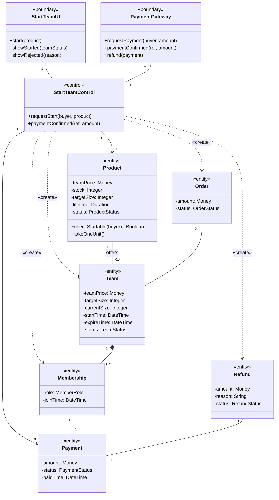

#### Analysis sequence diagram — start a team (UC3)

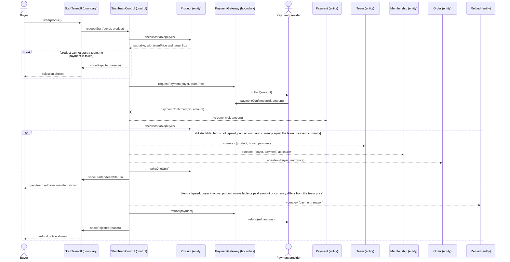

A new team has one member and a target size of at least two, so a start never completes a team; that is why no order is confirmed here.

#### Analysis class diagram — join a team (UC4)

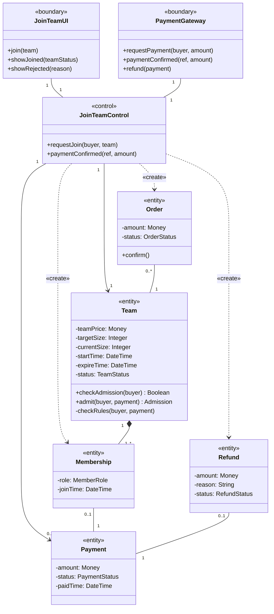

Order is associated only with Team, for readability; the design also links an order to its payment and to its membership.

#### Analysis sequence diagram — join a team (UC4)

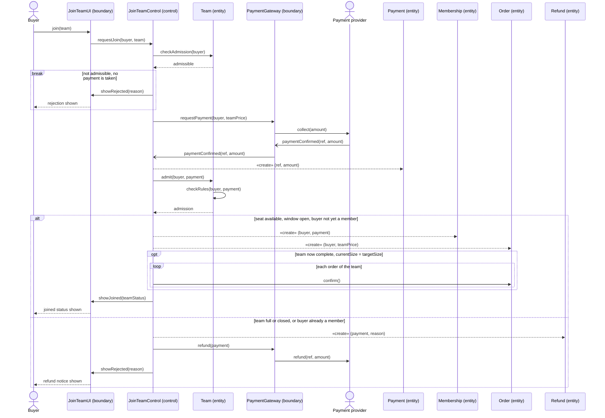

`checkAdmission` is the check before payment (it reserves no seat), and `admit` is the authority after payment, because the team may change while the buyer pays.

### State of the team, the order and the payment

Team state gates UC4, UC5, UC6 and UC8, so the team has its own statechart: see the "Team" section of the statecharts draft (`docs/swe5006/report-drafts/statecharts.md`, PR #628; deck slide 17). OPEN accepts paid joins while seats remain, the last seat moves it to SUCCEEDED, and its deadline moves it to EXPIRED; FAILED and CANCELED are declared but never written. The same draft holds the statecharts of the two other objects whose state UC3 and UC4 set: the Order (created PENDING by a start or a join, then CONFIRMED or CANCELLED with the team) and the Checkout payment (CREATED to SUCCEEDED before admission). The charts are not repeated here.

### From analysis to design

The design follows the transition strategies of report section 3.2 (PR #624), which are not restated here. UC3 and UC4 apply eight of them: Language, framework; Presentation; Distribution; Persistence; External interface; Security; Concurrency; Domain events. Scheduling belongs to team expiry (UC5 and UC6).

| Analysis class | Design elements | Strategy |
|---|---|---|
| «boundary» `StartTeamUI`, `JoinTeamUI` | route component `ProductDetailPage` with the hook `useCheckout` (`begin("START" or "JOIN", …)`); REST endpoints under `/api/v1/payments` called through the generated client | Presentation, Distribution |
| «boundary» `PaymentGateway` | port `CheckoutGateway`, adapter `StripeCheckoutGateway`, `StripeWebhookController` | External interface |
| «control» `StartTeamControl`, `JoinTeamControl` | split by step: `StripeCheckoutController` → `PaymentBrowserService` (the buyer's requests), `PurchaseIntentAppService` (terms before payment), `StripeCheckoutService` (checkout and settlement), `OrderFulfilmentAdapter` (what the money buys), `PaidGroupDealService` (creation and admission) | Language, framework; Distribution; Concurrency |
| «entity» `Team`, `Membership` | aggregate `GroupDeal` behind the ports `GroupDealRepository` (reads) and `PaidGroupDealRepository` (paid path); members are rows written with it | Persistence, Concurrency |
| «entity» `Product` | catalog facade `CatalogPurchaseSupport` (`lockStartQuote`, `lockQuotedStart`, `consumeOneUnit`) | Distribution |
| «entity» `Payment` | aggregate `CheckoutPayment` | Persistence, Concurrency |
| «entity» `Refund` | refund obligation row written by `requireRefund` | Persistence |
| «entity» `Order` | aggregate `Order`; the frozen terms become the design class `PurchaseIntent` | Persistence |

### Design

The responsibilities are split by bounded context. Catalog owns product terms and pricing. The order module owns the purchase intent and implements the payment slice's two business ports (`PaymentIntentPort` through `PurchaseIntentAppService`, and `PaymentBusinessPort` through `OrderFulfilmentAdapter`). The group-buy module owns team creation, admission and lifecycle, and the payment module owns the provider session, settlement and refunds. Modules reach each other only through application facades such as `CatalogPurchaseSupport`, `GroupDealPurchaseSupport` and `GroupDealSettlementSupport`, never through another module's tables.

Before payment, `PurchaseIntentAppService.createIntent` freezes the terms. For a join it calls `GroupDealPurchaseSupport.lockJoinTerms`, which reads the database clock after locking the team and applies the shared guards on `GroupDeal` (this is `checkAdmission` in the analysis model). For a start it prices the product through `CatalogPurchaseSupport.lockStartQuote`, or `lockQuotedStart` when the buyer names a quote, and reserves the new team's identifier. The intent is saved as a `PurchaseIntent`. `StripeCheckoutService` then creates the hosted session, and on a verified webhook settles the payment in one database transaction.

Settlement calls `OrderFulfilmentAdapter.lockForSettlement`, locks the payment, records it as succeeded and calls `fulfil`. `fulfil` runs every check that can reject (intent already spent or expired, buyer active, product purchasable) before its first write, because a rejection is committed together with a refund obligation. It then calls `PaidGroupDealService.startConfirmed` or `joinConfirmed`. Both reserve and lock the payment's participation receipt, compare its fingerprint, and either replay the stored result or apply the payment. For a start, the injected `PaidGroupDealCreator.initiate` validates the terms and builds the team (the Factory Method of section 3.5). For a join, the service locks the deal, reads the database time and the buyer's membership, and calls `GroupDeal.joinPaid` (this is `admit` in the analysis model), which returns a `PaidAdmission` holding the new immutable snapshot and whether this admission completed the team. A business rejection completes the receipt as compensation required; a technical failure rolls everything back. `OrderFulfilmentAdapter` then saves the order, links it to the membership, marks the intent fulfilled and consumes one unit of stock in the same transaction. The service publishes `MemberJoined` for every accepted join and `TeamSucceeded` only for the completing admission.

On the paid path, locks are taken team (group deal) → purchase intent → payment → participation receipt, each `SELECT … FOR UPDATE`. Inside `PaidGroupDealService` the receipt is locked before the deal; this cannot deadlock because a receipt is keyed by payment ID (backend ADR 0001). The team row is then written only through a guarded `UPDATE … WHERE current_size = expectedSize AND status = expectedStatus`, and unique indexes back every "at most one" rule; report section 3.2, Concurrency, gives the details.

**Patterns and mechanisms credited elsewhere.** `MemberJoined` and `TeamSucceeded` feed the Observer pattern, which is Yorik's design problem (team outcome, deck slide 19); this section only shows the admission that publishes them. Template Method (outbox transports) is Pan's, and Strategy (UC1 pricing) is Lim's. The Transactional Outbox and the Idempotent Receiver are Pan's mechanisms. The row locks and the guarded update belong to the Concurrency strategy, not to a pattern.

### Design class diagram

```mermaid
classDiagram
    class ProductDetailPage {
        <<route component>>
        -onJoin() void
    }
    class useCheckout {
        <<hook>>
        +begin(operation, businessId, quoteId) CheckoutOutcome
    }
    class StripeCheckoutController {
        +intent(csrf, request) Result~IntentResponse~
        +checkout(csrf, key, request) Result~CheckoutResult~
    }
    class StripeWebhookController {
        +handleStripeEvent(payload, signatureHeader) Result~Void~
    }
    class PaymentBrowserService {
        +createIntent(user, operation, businessId, inviteRef, quoteId) UUID
        +prepare(user, intent, requestKey) CheckoutResult
    }
    class StripeCheckoutService {
        +prepare(actor, intentId, requestKey) CheckoutResult
        +handleWebhook(rawBody, signature) void
    }
    class CheckoutGateway {
        <<interface>>
        +createCheckoutSession(payment) Session
        +retrieveCheckoutSession(sessionId) Session
        +verifyCheckoutWebhook(rawBody, signature) Optional~Event~
    }
    class StripeCheckoutGateway
    class PaymentIntentPort {
        <<interface>>
        +createIntent(user, operation, businessId, inviteRef, quoteId) UUID
    }
    class PaymentBusinessPort {
        <<interface>>
        +lockQuote(authenticatedUser, intentId) CheckoutQuote
        +lockForSettlement(quote) void
        +fulfil(event) Outcome
    }
    class PurchaseIntentAppService
    class OrderFulfilmentAdapter
    class PurchaseIntent
    class CatalogPurchaseSupport {
        <<interface>>
        +lockStartQuote(productId, now) StartQuote
        +lockQuotedStart(productId, quoteId, buyerId) StartQuote
        +consumeOneUnit(productId) boolean
    }
    class GroupDealPurchaseSupport {
        <<interface>>
        +lockJoinTerms(dealId, buyerId) JoinTerms
        +resolveSharer(inviteRef, dealId, buyerId) Optional~UUID~
    }
    class GroupDealPurchaseSupportImpl
    class PaidGroupDealService {
        -PaidGroupDealCreator creator
        +startConfirmed(terms, paid) ParticipationResult
        +joinConfirmed(dealId, paid, sharerUserId) ParticipationResult
    }
    class PaidGroupDealCreator {
        <<abstract>>
        +initiate(terms, payment, now) GroupDeal
        #createGroupDeal(terms, payment, now)* GroupDeal
    }
    class StandardPaidGroupDealCreator {
        #createGroupDeal(terms, payment, now) GroupDeal
    }
    class GroupDealCreationConfig {
        +paidGroupDealCreator() PaidGroupDealCreator
    }
    class GroupDeal {
        -int currentSize
        -int targetSize
        -DealStatus status
        ~startPaid(terms, payment, now)$ GroupDeal
        +joinPaid(payment, alreadyMember, now) PaidAdmission
        +requireJoinWindow(now) void
        +requireAvailableSeat() void
        +requireNewMember(buyerId, alreadyMember) void
    }
    class PaidAdmission {
        +GroupDeal deal
        +boolean teamCompleted
    }
    class ParticipationFingerprint {
        ~start(terms, paid) String
        ~join(dealId, paid) String
    }
    class PaidGroupDealRepository {
        <<interface>>
        +reserveAndLock(paymentId, fingerprint, actorId) ParticipationReceipt
        +lockDeal(dealId) Optional~GroupDeal~
        +currentTime() Instant
        +hasActiveMember(dealId, userId) boolean
        +insertStartedDeal(deal, paid, now) void
        +insertJoinedMember(before, after, paid, sharerUserId, now) void
        +complete(paymentId, result, actorId, now) void
    }
    class PaidGroupDealRepositoryImpl
    class PaidGroupDealMapper {
        +lockDeal(dealId) BizGroupDealDO
        +updateDeal(deal, expectedSize, expectedStatus) int
    }
    class MemberJoined
    class TeamSucceeded

    ProductDetailPage ..> useCheckout
    useCheckout ..> StripeCheckoutController : HTTP through the generated client
    StripeCheckoutController --> PaymentBrowserService
    PaymentBrowserService --> PaymentIntentPort
    PaymentBrowserService --> StripeCheckoutService
    StripeWebhookController ..> StripeCheckoutService : through PaymentAppService
    StripeCheckoutService --> CheckoutGateway
    StripeCheckoutGateway ..|> CheckoutGateway
    StripeCheckoutService --> PaymentBusinessPort : settles through
    PurchaseIntentAppService ..|> PaymentIntentPort
    OrderFulfilmentAdapter ..|> PaymentBusinessPort
    PurchaseIntentAppService --> PurchaseIntent : issues
    PurchaseIntentAppService --> CatalogPurchaseSupport : UC3 terms
    PurchaseIntentAppService --> GroupDealPurchaseSupport : UC4 terms
    OrderFulfilmentAdapter --> CatalogPurchaseSupport : consumes stock
    OrderFulfilmentAdapter --> PaidGroupDealService : admits confirmed payment
    GroupDealPurchaseSupportImpl ..|> GroupDealPurchaseSupport
    GroupDealPurchaseSupportImpl ..> GroupDeal : shared guards
    GroupDealPurchaseSupportImpl --> PaidGroupDealRepository
    PaidGroupDealService --> PaidGroupDealCreator : UC3, constructor-injected
    GroupDealCreationConfig ..> StandardPaidGroupDealCreator : instantiates
    PaidGroupDealCreator <|-- StandardPaidGroupDealCreator
    StandardPaidGroupDealCreator ..> GroupDeal : creates
    PaidGroupDealService ..> GroupDeal : UC4 joins existing
    GroupDeal ..> PaidAdmission : returns
    PaidGroupDealService ..> ParticipationFingerprint : receipt identity
    PaidGroupDealService --> PaidGroupDealRepository
    PaidGroupDealRepositoryImpl ..|> PaidGroupDealRepository
    PaidGroupDealRepositoryImpl --> PaidGroupDealMapper
    PaidGroupDealService ..> MemberJoined : publishes per accepted join
    PaidGroupDealService ..> TeamSucceeded : publishes on completion
```

`#` is protected and `~` is package visibility. Mermaid allows one stereotype per class, so the strategy that produced each design class is given in this table instead of in the diagram (the deck's slide 15 draws the tags on the classes):

| Design classes | Strategy (report section 3.2) |
|---|---|
| `ProductDetailPage`, `useCheckout` | Presentation |
| generated client (`@/api/generated`), `StripeCheckoutController`, `StripeWebhookController` | Distribution; the controllers also Security (CSRF check, webhook signature) |
| `PaymentIntentPort`, `PaymentBusinessPort`, `PurchaseIntentAppService`, `OrderFulfilmentAdapter`, `CatalogPurchaseSupport`, `GroupDealPurchaseSupport` | Distribution (cross-context seams); `PaymentBusinessPort` and `OrderFulfilmentAdapter` also Concurrency (they take the team and intent locks) |
| `PaymentBrowserService` | Security (at most 60 JOIN intents per minute for one buyer and one team) |
| `StripeCheckoutService` | External interface, Concurrency (one transaction, 10 s timeout) |
| `CheckoutGateway`, `StripeCheckoutGateway` | External interface; the adapter also Security (verifies the webhook signature) |
| `PaidGroupDealCreator`, `StandardPaidGroupDealCreator`, `GroupDealCreationConfig` | Language, framework (Spring wiring at the composition boundary, domain free of Spring) |
| `GroupDeal`, `PurchaseIntent` | Persistence (aggregates) |
| `PaidGroupDealRepository`, `PaidGroupDealRepositoryImpl`, `PaidGroupDealMapper`, `ParticipationFingerprint` | Persistence, Concurrency (row locks, guarded update, receipt replay) |
| `PaidGroupDealService` | Concurrency, Domain events |
| `PaidAdmission` | none of its own: the value `GroupDeal.joinPaid` returns (the admitted team and whether it completed), from which `PaidGroupDealService` decides to publish `TeamSucceeded` |
| `MemberJoined`, `TeamSucceeded` | Domain events |

### Design sequence diagram — start a team (UC3)

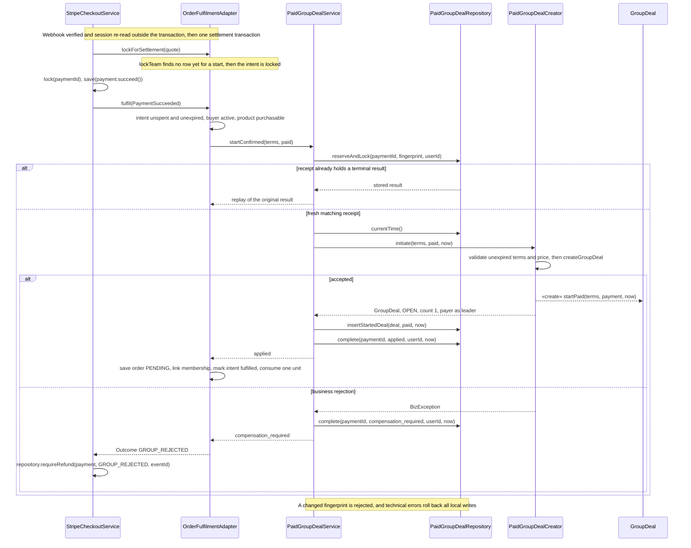

The `Creator` lifeline is the injected `PaidGroupDealCreator`; at run time it is the `StandardPaidGroupDealCreator` bean.

### Design sequence diagram — join a team (UC4)

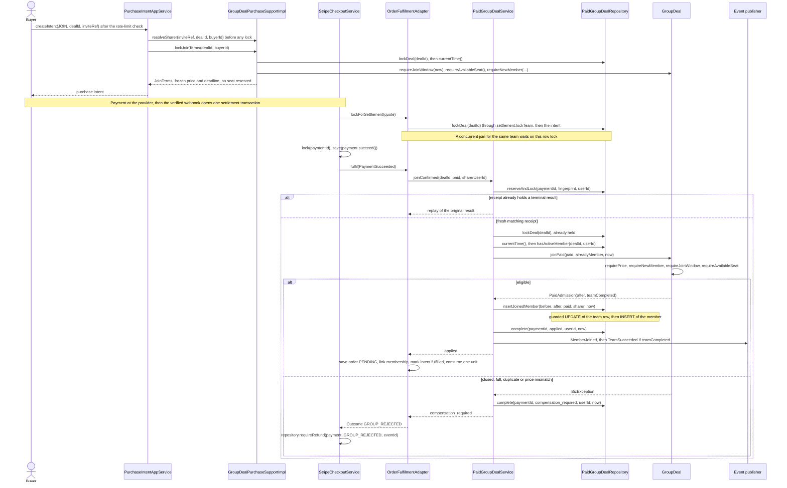

`TeamSucceeded` is handled before the transaction commits by `OrderLifecycleSubscriber`, which confirms the team's orders (Yorik's Observer, section 3.5).

## Design problem: creating the team without naming its class (UC3, Factory Method)

### Where the problem shows

UC3 ends by creating a team. The rules for a paid start are fixed: the terms must be present and unexpired, and the payment must match the frozen price and currency. The class of team that is created is what may change. Until PR #424 (merged 13 October 2026, commit `081047f5`), the client of the team creator, `PaidGroupDealService`, named the concrete creator in a field initialiser:

```java
private final PaidGroupDealCreator creator = new StandardPaidGroupDealCreator();
```

The class diagram shows it as a dependency from the client on the concrete class, next to the dependency on the abstract one:

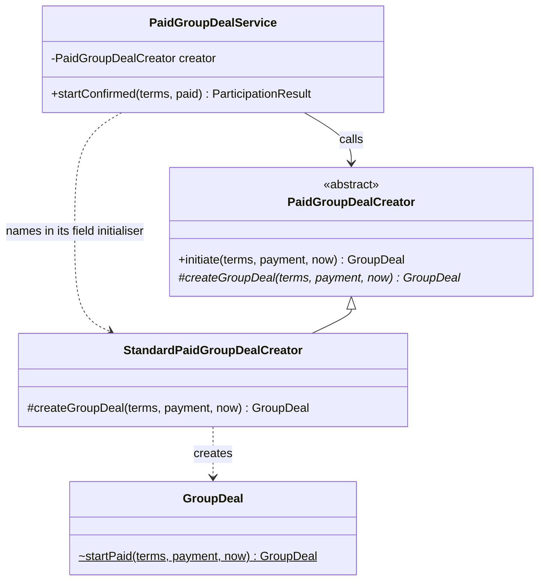

The sequence diagram shows the client creating its creator when it is itself constructed:

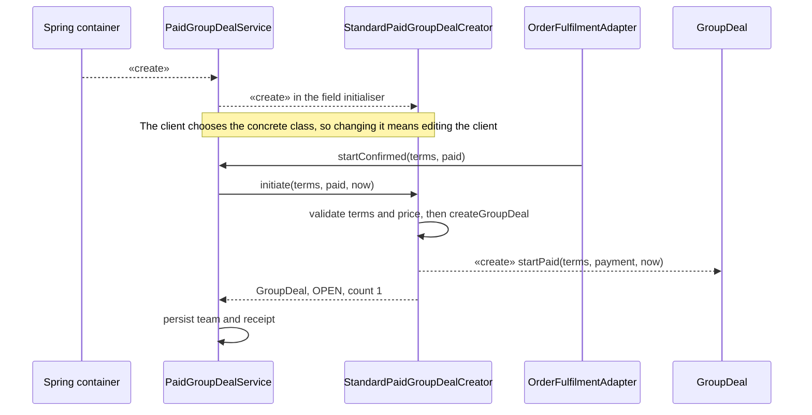

### Cause for redesign

The cause is creating an object by specifying a class explicitly (SDP 05a p15). The service committed itself to `StandardPaidGroupDealCreator`, so supplying another creator, in production or in a test, meant editing the service. Without any creator at all the service would build the team itself, and the start rules would sit in whichever caller did so.

### What varies

The class of team that is instantiated (GoF: "subclass of object that is instantiated", SDP 05a p13). The rules of a paid start do not vary.

### Candidate patterns and why Factory Method was chosen

| Candidate | Decision | Reason |
|---|---|---|
| Construct the team in the service (direct `GroupDeal.startPaid` call) | Rejected | `startPaid` is package-private and static (`GroupDeal.java:122`), so the service in another package cannot call it without widening the visibility of team construction. It would also fix the team class in the client and leave the start rules to each caller. |
| Keep naming the concrete creator in the client (the state before PR #424) | Rejected | It is the cause above: the client depends on the concrete class. |
| Static simple factory, `create(type)` with a switch | Rejected | Static methods cannot be overridden, so making the factory static "forbids subclassing of the base factory class" (SDP 01a p34); every new team class edits the switch. It is a simple factory, not GoF Factory Method. |
| Abstract Factory | Rejected | It creates families of related products. A start creates one product, the team; the member and the receipt are rows written by the repository, not products of a factory. |
| Builder, or a static factory method on `GroupDeal` | Rejected | The accepted terms (`NewDealTerms`) are already complete, so stepwise assembly adds nothing, and a static method has no override point for a different team class. |
| Registry of creators chosen at run time by a key | Rejected for now | There is one team class and no run-time choice to make; issue #421 excludes additional creator registries. A registry would add a lookup and a key with a single entry. |
| **Factory Method** | **Selected** | The Creator's `initiate` keeps the start rules in one place and calls the factory method `createGroupDeal`; a ConcreteCreator decides the team class. The client depends only on the abstract Creator, and the composition root chooses the ConcreteCreator. |

### After applying Factory Method

The participants: Creator `PaidGroupDealCreator` (abstract, with the public final template `initiate` and the protected abstract factory method `createGroupDeal`); ConcreteCreator `StandardPaidGroupDealCreator` (final); Product `GroupDeal`, a concrete class with no product interface; Client `PaidGroupDealService`, which receives the Creator through its constructor; and `GroupDealCreationConfig`, whose `@Bean` method instantiates the ConcreteCreator.

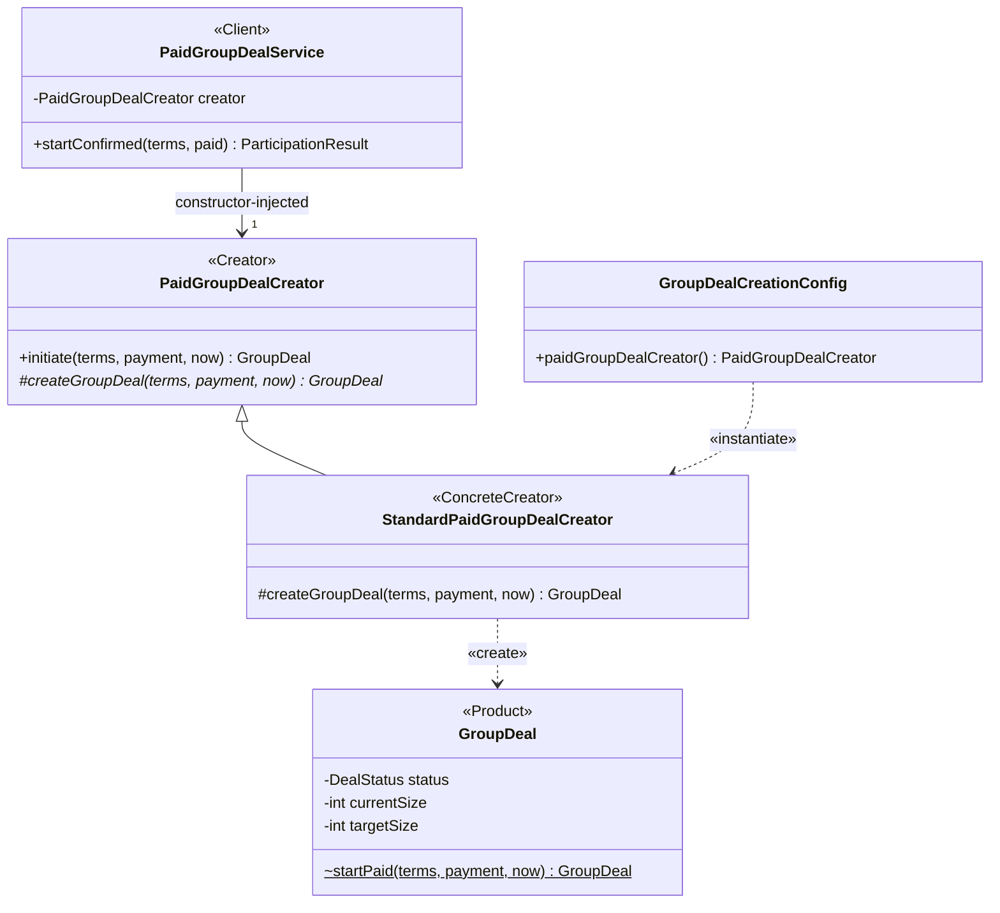

`initiate` is `final` in Java (`{leaf}` in UML) and `StandardPaidGroupDealCreator` is a `final` class. `initiate` rejects null input or `now ≥ terms.expireTime()`, calls `payment.requirePrice(price, currency)`, and then returns `createGroupDeal(terms, payment, now)`.

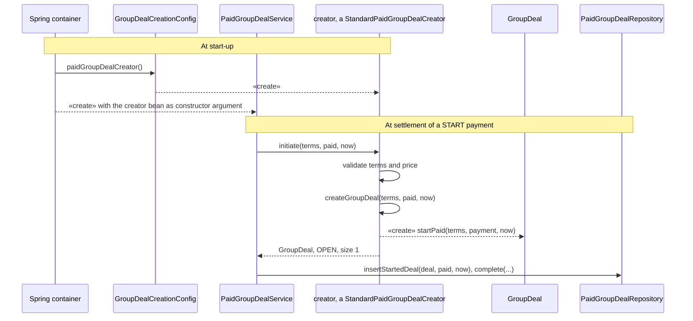

`initiate` is a template method that calls a factory method (GoF p136), so a second ConcreteCreator could change the team class but could not skip the start rules.

### Implementation decisions

1. **Inject the Creator through the constructor (#421, PR #424).** `PaidGroupDealService` declares `private final PaidGroupDealCreator creator` and Lombok's `@RequiredArgsConstructor` generates the constructor. `GroupDealCreationConfig` (`@Configuration(proxyBeanMethods = false)`) registers `StandardPaidGroupDealCreator` as the single `PaidGroupDealCreator` bean. The configuration lives in the application module, so the domain module, which holds the Creator hierarchy, stays free of Spring.
2. **Keep construction inside the domain package.** `GroupDeal.startPaid` stays package-private and static, so only code in `com.blocbuy.groupbuy.model`, such as the creator, can build a paid start; `createGroupDeal` performs no persistence, and the service writes the team and the receipt in its own transaction (`insertStartedDeal`, then `complete`).
3. **Choose the ConcreteCreator at build time.** There is one ConcreteCreator, and choosing another means changing the wiring; run-time selection of creators is not claimed.
4. **Two refactorings in the same PR, which are not the pattern.** PR #424 also moved the join admission rules that quoting and paid admission both need into shared `GroupDeal` guards (`requireJoinWindow`, `requireAvailableSeat`, `requireNewMember`; #422), so a quote now rejects a stored team with fewer than one paid member before payment instead of after it. It also replaced one generic receipt-fingerprint helper with typed START and JOIN encoders in `ParticipationFingerprint` (#423), pinned by golden hashes so that every stored fingerprint stays byte-for-byte the same. Both are refactorings; #422 also fixes the below-one-count quote defect (quotes now reject a team with fewer than one paid member before payment). Neither is a design pattern.
5. **Evidence.** `PaidGroupDealServiceTest.startUsesTheInjectedCreator` gives the service a mocked Creator and shows that it decides initiation without editing the service. `PaidGroupDealTest.createsOpenDealWithExactlyOnePaidLeader` checks the Product (OPEN, count 1, payer as leader), and `PaidGroupDealTest.initiationRejectsExpiredTermsInvalidSizeAndMissingClock` checks the rules in `initiate`. For the refactorings, `GroupDealPurchaseSupportImplTest.aTeamWithoutItsPaidLeaderCannotBeQuoted`, `GroupDealPurchaseSupportImplTest.closedAndFullTeamsAreRejectedBeforeDuplicateMembership`, `PaidGroupDealTest.admissionGuardsRejectMissingFactsAndPreservePaidRejectionPriority` and `PaidGroupDealServiceTest.historicalStartAndJoinFingerprintsRemainByteCompatible` pin the guard orders and the stored hashes. Two red tests reproduced the below-one-count quote defect before the fix. The local verification of the change ran 1,615 test cases with no failures or errors, and the five touched production files had no missed lines or branches (194 lines, 92 branches), as recorded in the sprint log of 7 October (`docs/agile/sprint-03/log/2026-10-07.md`). This is local and CI evidence; it does not cover a deployment or a Stripe end-to-end run.

### Liability, and why the flexibility is still needed

Factory Method costs one ConcreteCreator per team class: a new kind of team needs a new creator subclass as well as a new product. Today the flexibility is not exercised. `StandardPaidGroupDealCreator` is the only ConcreteCreator, and `GroupDeal` is `public final` (`GroupDeal.java:19`), so a second team type would also need `GroupDeal` opened for extension or a new product class. The variation point is still worth its one extra class. The project proposal (section 6.3, cited on deck slide 18) makes extensibility the primary design driver (new team-resolution behaviour without editing domain logic). The final `initiate` keeps the start rules in one place for any future creator, and the injected Creator already lets tests supply their own.

## Other contributions (not part of report sections 3.4 or 3.5)

Merged work by the same author that supports the quality attributes of these two use cases. Each row is traceable to the NFR register and the cited pull request.

| Work | Quality attribute | Merged pull requests | Evidence |
|---|---|---|---|
| Best open-deal offer per product, bounded query and Redis cache | NFR-41 | [#206](https://github.com/PPsyrius/iss-groupbuy-team8/pull/206), [#366](https://github.com/PPsyrius/iss-groupbuy-team8/pull/366), [#429](https://github.com/PPsyrius/iss-groupbuy-team8/pull/429) | `backend/docs/design/best-open-deal-cache.md`, `docs/perf/catalog-best-offer-query.md` |
| Rate limits on JOIN intents, checkout preparation and invite creation | NFR-46 | [#365](https://github.com/PPsyrius/iss-groupbuy-team8/pull/365) | `backend/docs/design/write-rate-limits.md` |
| Invite sharer resolved before the team row lock (the invite-reference cache itself is a teammate's work) | NFR-53 | [#428](https://github.com/PPsyrius/iss-groupbuy-team8/pull/428) | `PurchaseIntentAppServiceTest` pins the lookup-before-lock order |
| Buyer receipt reads the payment row once | NFR-38 | [#191](https://github.com/PPsyrius/iss-groupbuy-team8/pull/191) | Receipt service and repository tests |
| 100-user performance baseline | NFR-15 | [#289](https://github.com/PPsyrius/iss-groupbuy-team8/pull/289) | `docs/perf/sprint3-baseline.md`, measured locally |

The notification consumer for issue #446 (an idempotent SQS consumer that turns integration events into in-app notifications) is merged on `dev` and the issue was closed on 2026-10-16. The consumed-message ledger landed in [#505](https://github.com/PPsyrius/iss-groupbuy-team8/pull/505), and the event handler and SQS consumer landed in [#513](https://github.com/PPsyrius/iss-groupbuy-team8/pull/513), after the handler ([#508](https://github.com/PPsyrius/iss-groupbuy-team8/pull/508)) and the consumer ([#510](https://github.com/PPsyrius/iss-groupbuy-team8/pull/510)) had been reviewed as a stack of pull requests. The end-to-end acceptance on ECS belongs to the #448 evidence session and is not claimed here, and no design pattern is claimed for this work in this contribution.

## Evidence map for the report editor (exclude from the submitted report)

- Assignment: Sprint 4 plan, section 11 (`docs/agile/sprint-04/plan.md:205`) and issue #463. The plan words the design problem as "Factory Method / policy objects for admission"; the report claims Factory Method for UC3 (deck slide 18). The admission guards of #422 are refactorings, not policy objects or a pattern.
- Deck alignment: UC4 analysis names and operations from `docs/swe5006/presentation/src/diagrams/uc4-analysis-class.svg` and `uc4-analysis-seq.svg` (slide 14); design classes and strategy tags from `uc4-design-class.svg` and `uc4-design-seq.svg` (slides 15–16); Factory Method participants from `fm-start.svg` (slide 18). The UC3 analysis model (`StartTeamUI`, `StartTeamControl`, `Product`) is drawn for the report only; the deck has no UC3 analysis slide.
- Factory Method code: `backend/blocbuy-domain/src/main/java/com/blocbuy/groupbuy/model/PaidGroupDealCreator.java` (abstract class L12, `public final initiate` L14, `protected abstract createGroupDeal` L23); `StandardPaidGroupDealCreator.java` (final, L6); `GroupDeal.java` (`public final class` L19, package-private static `startPaid` L122); `backend/blocbuy-application/src/main/java/com/blocbuy/groupbuy/service/GroupDealCreationConfig.java` (L9–14); `PaidGroupDealService.java` (`@RequiredArgsConstructor`, `private final PaidGroupDealCreator creator`, `creator.initiate` in `startConfirmed`).
- Before state: `git show 081047f5^:backend/blocbuy-application/src/main/java/com/blocbuy/groupbuy/service/PaidGroupDealService.java` (L47, the field initialiser). The Creator hierarchy dates from commit `b6f7fafd` (9 September 2026, PR #59).
- PR #424 (13 October 2026, `081047f5`) closed #421 (inject the Creator), #422 (shared quote and paid-admission guards) and #423 (typed START and JOIN receipt fingerprints). Design record: `backend/docs/design/paid-group-participation.md` (reuse and receipt-compatibility amendment). Verification figures (1,615 cases; 194 lines, 92 branches): `docs/agile/sprint-03/log/2026-10-07.md` line 16. NFR-62 in `docs/quality/nfr-register.md`.
- Tests: `PaidGroupDealServiceTest` (`startUsesTheInjectedCreator`, `historicalStartAndJoinFingerprintsRemainByteCompatible`, `unavailableReceiptHashFailsBeforePersistence`); `PaidGroupDealTest` (`createsOpenDealWithExactlyOnePaidLeader`, `initiationRejectsExpiredTermsInvalidSizeAndMissingClock`, `admissionGuardsRejectMissingFactsAndPreservePaidRejectionPriority`); `GroupDealPurchaseSupportImplTest` (`aTeamWithoutItsPaidLeaderCannotBeQuoted`, `closedAndFullTeamsAreRejectedBeforeDuplicateMembership`, `theClockIsReadOnlyAfterTheLock`); `StripeLocalIntegrationTest.twentyBuyersRaceForLastSeatAndNineteenRefundObligationsPersist` (last-seat race, local).
- Concurrency facts referenced, not restated: lock order in `OrderFulfilmentAdapter.java` Javadoc (L37) and backend ADR 0001 (L71–75); guarded update in `PaidGroupDealMapper.xml` `updateDeal`; unique indexes in the Flyway migrations V5, V7, V9, V11, V12 and V15. Report section 3.2 (PR #624), Concurrency, owns them.
- Statecharts: `docs/swe5006/report-drafts/statecharts.md` (PR #628; sections Team, Order, Checkout payment); deck slide 17 (`team-statechart.svg`).
- Pattern credits (deck slides 6 and 18–23): Factory Method Eric, Observer Yorik, Template Method Pan, Strategy Lim, State Liu Jin. Transactional Outbox and Idempotent Receiver are Pan's mechanisms (Sprint 4 plan L206).
- Accuracy limits: one ConcreteCreator with build-time wiring, so run-time pluggable creation is not claimed; the proposal section 6.3 wording is quoted from deck slide 18, as the proposal is not in the repository; verification is local and CI-level, with no deployment or Stripe end-to-end evidence; issues #26 and #27 still show `@TBD` in their accountable-member field.
