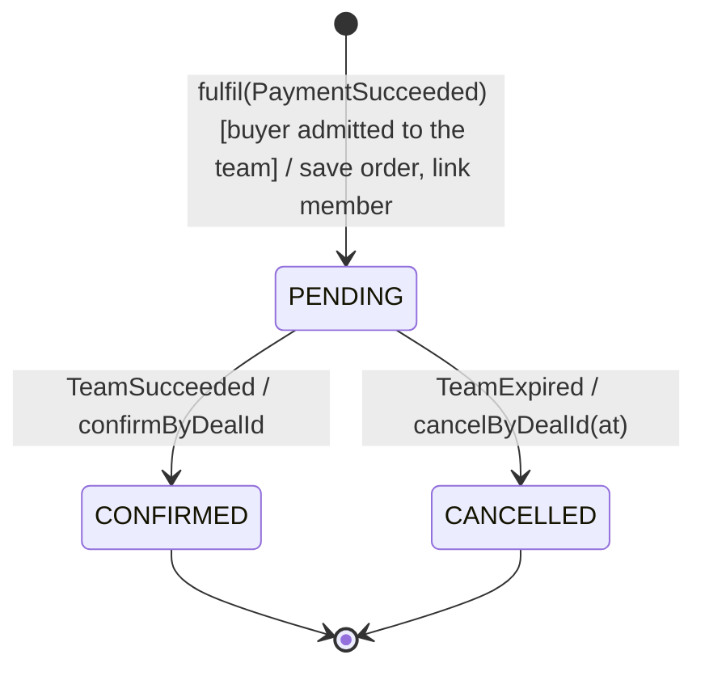
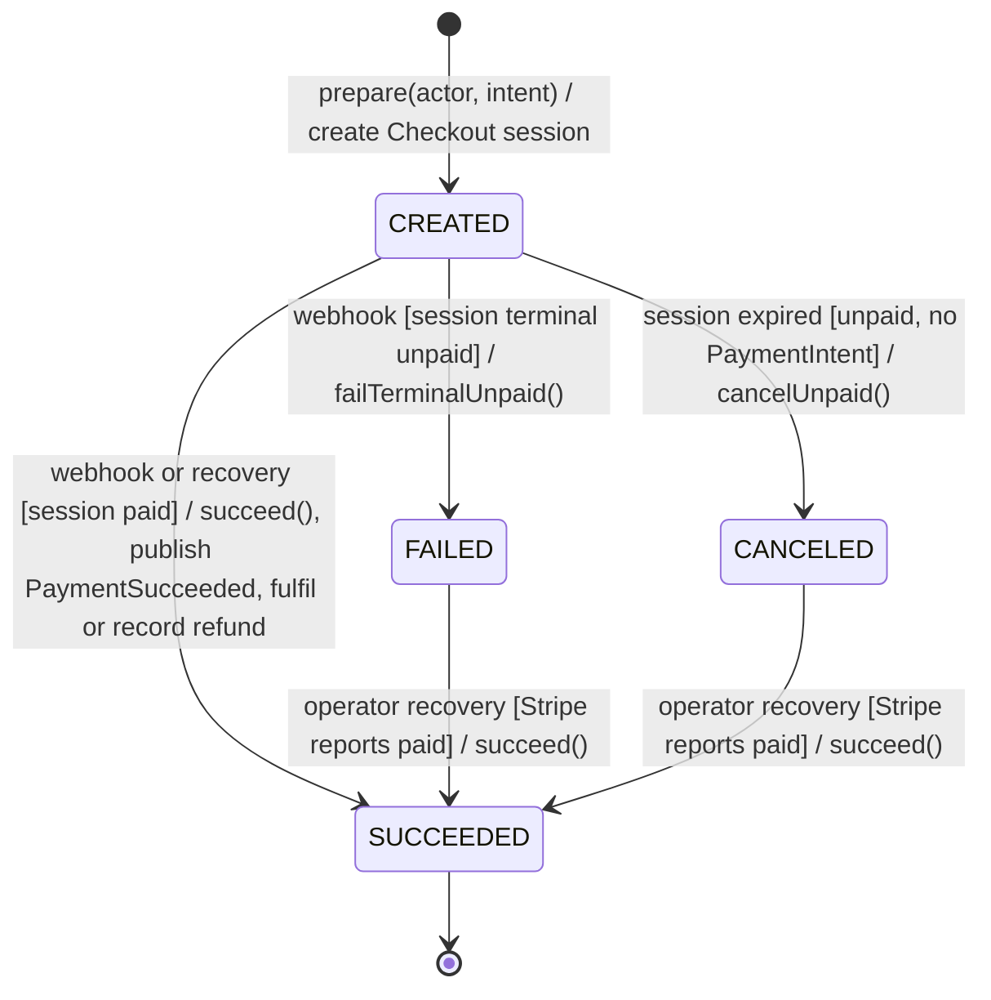
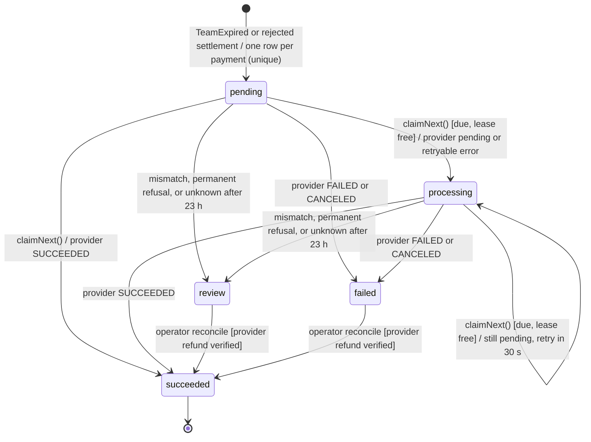

# SWE5006 final report: statecharts for Order, checkout payment and refund obligation

> Draft for the report editor (#463, #618), for section 3.4. The deck already has statecharts for the team (`team-statechart.svg`, `DealStatus`) and the listing (`listing-statechart.svg`, `ProductStatus`). This file adds the three other objects whose state changes the behaviour of more than one use case (Software Analysis and Design, 03c "Design With Statechart" pp. 4, 10-11). Diagrams are Mermaid sources. Transition labels read *trigger [guard] / effect*. Each table row names the code that enforces the transition. All references are to `dev` at `05924410`.

## Order

An order is the buyer's record of one paid participation. It is created PENDING when a payment is fulfilled, and it moves once, with the team's fate. It gates UC4 (join), UC5 (team resolution), UC6 (refund) and UC8 (my orders).

| Transition | Enforced by | Use cases |
|---|---|---|
| create PENDING | `OrderFulfilmentAdapter.fulfil`: `orders.save(orderFor(...))`, then `linkOrder`, inside the settlement transaction | UC3, UC4 |
| PENDING → CONFIRMED | `OrderLifecycleSubscriber.onTeamSucceeded` (`BEFORE_COMMIT`, `@Order(10)`) → `BizOrderMapper.confirmPendingByDealId`: `UPDATE ... WHERE status = 'pending'` | UC5 (complete) |
| PENDING → CANCELLED | `OrderLifecycleSubscriber.onTeamExpired` (`BEFORE_COMMIT`, `@Order(10)`) → `cancelPendingByDealId` with the team's resolution time | UC5 (expire), UC6 |
| guard for single orders | `OrderStatus.canTransitionTo`: only PENDING may move, never to itself; `Order.confirm()` and `Order.cancel(at)` throw `ORDER_STATE_INVALID` otherwise | all |

Both sweeps are status-guarded SQL, so a replayed team event changes zero rows.

## Checkout payment

A checkout payment is one attempt to pay through Stripe Checkout, with a frozen quote. It gates UC3 and UC4 (only a SUCCEEDED payment is fulfilled) and UC6 (only a SUCCEEDED payment can be refunded).

| Transition | Enforced by | Use cases |
|---|---|---|
| create CREATED | `StripeCheckoutService.prepare` (`POST /api/v1/payments/checkout-sessions`) | UC3, UC4 |
| CREATED → SUCCEEDED | `StripeCheckoutService.settle`: `payment.succeed()` when the re-read session is paid, then `fulfilOrCompensate`; the event ID claim makes redelivery a no-op | UC3, UC4 |
| CREATED → FAILED | `settle` → `applyUnpaidFact`: `failTerminalUnpaid()` when the session reports a terminal unpaid failure | UC3, UC4 |
| CREATED → CANCELED | `applyUnpaidFact` → `cancelUnpaid()` for an expired, unpaid session without a PaymentIntent; sessions are expired by `expireDueSessions` | UC3, UC4 |
| FAILED or CANCELED → SUCCEEDED | Only through the audited operator recovery (`recover`). A late webhook that reports a paid session on a FAILED or CANCELED payment does **not** move it: it opens a review case `LATE_PAID_REQUIRES_RECOVERY` | operator |
| guard | `cancelUnpaid()` and `failTerminalUnpaid()` leave a SUCCEEDED payment unchanged | all |

## Refund obligation

A refund obligation is one row of `biz_refund`: a promise to refund one payment. The refund worker works it off outside any business transaction. It gates UC6. A buyer's receipt shows its status (`frontend/src/features/payment/refund-status.ts`).

| Transition | Enforced by | Use cases |
|---|---|---|
| create pending | `PaymentMapper.refundExpiredTeam`, one row per fulfilled payment of the expired team, called by `TeamExpiryRefundService.recordExpiredTeam` before commit. `PaymentMapper.refund` covers a rejected settlement, such as a lost last-seat race or an expired quote. Both use `ON CONFLICT (payment_id)`, so there is one obligation per payment. | UC6; UC4 (rejected join) |
| claim | `RefundMapper.claimNext`: only `pending` or `processing`, due, and with no live lease (`FOR UPDATE SKIP LOCKED`, 2-minute lease, `version + 1`) | UC6 |
| outcome | `RefundService.processNext` → `apply` → `RefundMapper.finish`, version-fenced (`WHERE version = #{work.version}`). The provider status maps to `succeeded`, `failed`, `processing` or `review` | UC6 |
| review after 23 h | `processNext`: at or after 23 hours from the first attempt, the worker only searches (`findRefund`) and never creates; if nothing is found, the obligation goes to `review` | UC6 |
| operator reconcile | `RefundMapper.claimReview` (status `review` or `failed`) and `RefundService.reconcile`; an operator can only verify an existing provider refund, never send another | operator |

**Design observation.** The refund states are plain strings (`RefundService` constants; migration V11), not an enum like `OrderStatus` or `DealStatus`. No `canTransitionTo` rule exists in the domain, so the transitions above are enforced only by the SQL predicates and the service. A `RefundStatus` enum with its own transition table would put this statechart into code, as the team and the order already do.
