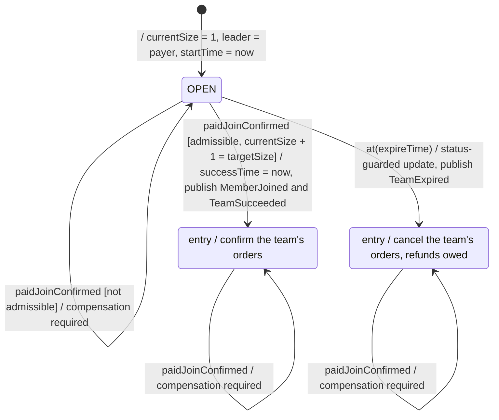
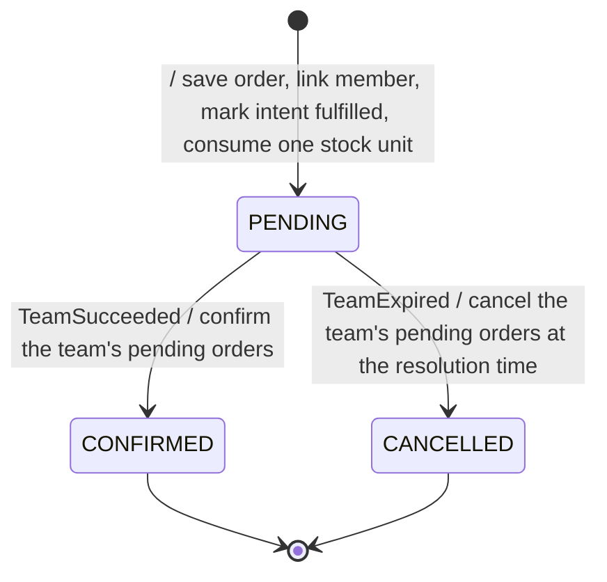
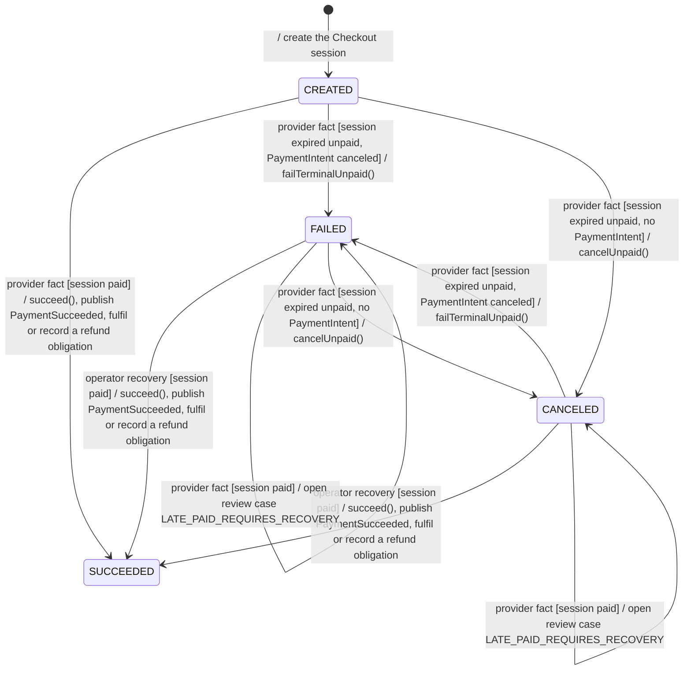
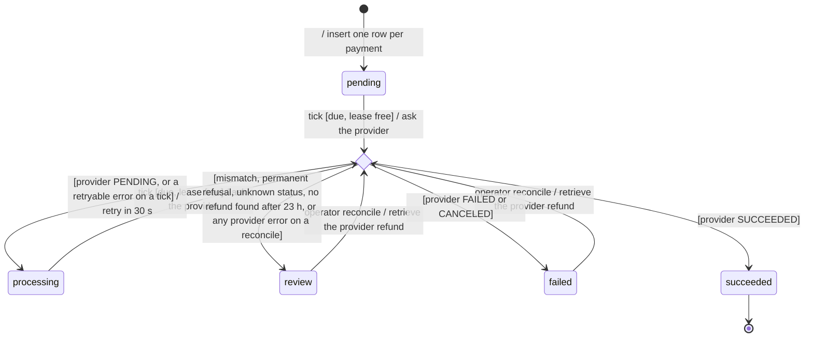

# SWE5006 final report: statecharts for the team, Order, checkout payment and refund obligation

> Draft for the report editor (#463, #618), for section 3.4. The team, the Order and the checkout payment belong with Eric's UC3/UC4 analysis and design (3.4); the refund obligation belongs with Yorik's UC6 (3.4). The team statechart is the one rubric row 2.4 requires (deck slide 17); the listing statechart (`ProductStatus`) belongs with the State pattern in 3.5. This file covers four objects with significant, dynamic states (Software Analysis and Design, 03c "Design With Statechart" p. 11). Diagrams are Mermaid sources in UML 2.5 notation: a transition reads *trigger [guard] / effect* (03c p. 3 shows trigger, guard and action), an initial transition carries only its effect, as in the deck's team statechart, and a diamond is a choice on the result of the effect. Code was read on `dev` at `22f56584`. Names follow the code: the order and the payment use their enum constants in upper case (the order's `CANCELLED` and the payment's `CANCELED` are both spelled as in the code), and the refund obligation uses the lower-case status strings stored in `biz_refund.status`.

## Team

A team (`GroupDeal`) is one group-buy of one product at a fixed team price. A confirmed paid start creates it (UC3), confirmed paid joins fill it (UC4), and it resolves once (UC5): it succeeds when the last seat is taken, or expires when its window closes first, which owes refunds (UC6). This is the chart the deck shows on slide 17.

*admissible* means: the paid amount equals the team price, the buyer is neither the leader nor a member, `startTime ≤ now < expireTime`, and a seat is free. `DealStatus` also declares FAILED and CANCELED, and `canTransitionTo` allows them, but no production code writes either, so they are not drawn. No final state is drawn: a resolved team still absorbs late paid joins.

| Transition | Enforced by | Use cases |
|---|---|---|
| create OPEN | `PaidGroupDealService.startConfirmed` → `PaidGroupDealCreator.initiate` (Factory Method, 3.5) → `GroupDeal.startPaid`, with the payer as sole leader | UC3 |
| OPEN → OPEN, OPEN → SUCCEEDED | `GroupDeal.joinPaid` checks price, membership, window and seat in that order, then `PaidGroupDealRepositoryImpl` writes through `PaidGroupDealMapper.updateDeal`, guarded by `current_size = expectedSize AND status = expectedStatus`, so a race loser changes zero rows; `PaidGroupDealService` publishes `MemberJoined`, and `TeamSucceeded` on the last seat | UC4, UC5 |
| not admissible | `joinPaid` throws; the receipt records a business rejection and the payment owner records a refund obligation in the same settlement transaction (see the refund obligation) | UC4 |
| OPEN → EXPIRED | `TeamExpirySweepJob` (every minute) → `GroupDealExpiryService` → `GroupDeal.expire` (`canTransitionTo(EXPIRED)`, not before `expireTime`) → `PaidGroupDealMapper.expireDeal`, guarded by `status = 'open'`; publishes `TeamExpired` | UC5, UC6 |
| entry actions | `OrderLifecycleSubscriber` (see Order); `TeamExpiryRefundSubscriber` records the refunds (see the refund obligation). Both run before the team's transaction commits | UC5, UC6 |

## Order

An order is the buyer's record of one paid participation. Creating a team (UC3) or joining one (UC4) creates it, team resolution (UC5) moves it once, and "My orders" (UC8) shows it.

| Transition | Enforced by | Use cases |
|---|---|---|
| create PENDING | `OrderFulfilmentAdapter.fulfil`, inside the settlement transaction, when a `PaymentSucceeded` payment is fulfilled and every check passes: intent neither fulfilled nor expired, buyer active, product purchasable, quote not expired, buyer admitted to the team. If a check fails, no order is created and the payment gets a refund obligation instead (see the refund obligation) | UC3, UC4 |
| PENDING → CONFIRMED | `OrderLifecycleSubscriber.onTeamSucceeded` (`BEFORE_COMMIT`, `@Order(10)`) → `OrderRepository.confirmByDealId` → `BizOrderMapper.confirmPendingByDealId`: `UPDATE ... SET status = 'confirmed' WHERE ... status = 'pending'` | UC5 (complete) |
| PENDING → CANCELLED | `OrderLifecycleSubscriber.onTeamExpired` (`BEFORE_COMMIT`, `@Order(10)`) → `OrderRepository.cancelByDealId` → `BizOrderMapper.cancelPendingByDealId`, with the team's resolution time | UC5 (expire) |

Both moves are bulk SQL guarded by `status = 'pending'`, so a replayed team event changes zero rows. The domain also has a transition rule, `OrderStatus.canTransitionTo` (only PENDING may move, never to itself), used by `Order.confirm()` and `Order.cancel(at)`; no production code calls those two methods, so on this path the rule is the SQL predicate.

## Checkout payment

A checkout payment is one attempt to pay through Stripe Checkout, with a frozen quote. Only a SUCCEEDED payment is fulfilled (UC3, UC4) or can be refunded (UC6).

A *provider fact* is a Checkout session state that `StripeCheckoutService.settle` re-reads from Stripe. It arrives by webhook (`checkout.session.completed`, `async_payment_succeeded`, `async_payment_failed`, `expired`), by the operator command `stripe-ops expire-open-sessions` (`expireDueSessions`, not scheduled), or by `stripe-ops recover`. No final state is drawn: a SUCCEEDED payment still absorbs duplicate and unpaid facts. Not drawn because it applies in every state: a provider fact whose session does not match the saved payment opens the review case `PROVIDER_MISMATCH` and changes no state (`settle` → `recordMismatch`).

| Transition | Enforced by | Use cases |
|---|---|---|
| create CREATED | `StripeCheckoutService.prepare` (`POST /api/v1/payments/checkout-sessions`) | UC3, UC4 |
| CREATED → SUCCEEDED | `settle`: `payment.succeed()` when the re-read session is paid, then `fulfilOrCompensate`; the event-ID claim makes a redelivered event a no-op | UC3, UC4 |
| CREATED → FAILED or CANCELED | `settle` → `applyUnpaidFact`. FAILED: the session expired unpaid and Stripe canceled its PaymentIntent (`Session.terminalUnpaidFailure`). CANCELED: the session expired unpaid before any PaymentIntent existed. Neither is the buyer pressing Cancel, which changes no state | UC3, UC4 |
| CANCELED → FAILED, FAILED → CANCELED | `settle` → `applyUnpaidFact` on a later unpaid fact: `failTerminalUnpaid()` and `cancelUnpaid()` refuse only a SUCCEEDED payment, so the code allows both moves. Whether Stripe sends such a sequence for one session was not checked | UC3, UC4 |
| FAILED or CANCELED → SUCCEEDED | `settle` with type `manual.recovery`, reached only through `stripe-ops recover`. Any other paid fact on a FAILED or CANCELED payment opens the review case instead (`settle`, the `isTerminalUnpaid` check) | operator |

`CheckoutPayment.succeed()` itself has no guard; the rules above live in `settle`. `cancelUnpaid()` and `failTerminalUnpaid()` leave a SUCCEEDED payment unchanged.

## Refund obligation

A refund obligation is one row of `biz_refund`: a promise to refund one succeeded payment. It is created when a team expires (UC6) or when a paid settlement is rejected because a check in the order table above failed (UC3, UC4). The refund worker runs every 30 s when scheduling is enabled (`RefundWorkerJob`, `blocbuy.scheduling.enabled`), outside any business transaction. A buyer's receipt shows the status (`frontend/src/features/payment/refund-status.ts`). The lease and `SKIP LOCKED` claim are also the refund part of the concurrency strategy (3.2.8 Concurrency); the retry and review mechanisms are Yorik's UC6 design.

| Transition | Enforced by | Use cases |
|---|---|---|
| create pending | `PaymentMapper.refundExpiredTeam`, one row per fulfilled payment of the expired team, called by `TeamExpiryRefundService.recordExpiredTeam` before commit (`TeamExpiryRefundSubscriber`, `@Order(20)`); `PaymentMapper.refund` for a rejected settlement. Both use `ON CONFLICT (payment_id)` | UC6; UC3, UC4 |
| tick | `RefundService.processNext` → `RefundMapper.claimNext`: only `pending` or `processing`, due and without a live lease (`FOR UPDATE SKIP LOCKED`, 2-minute lease, `version + 1`). The claim changes no status | UC6 |
| outcome | `RefundService.apply` → `RefundMapper.finish`, fenced by `id` and `version`; every outcome sets the next attempt 30 s later. A retryable provider error goes to `processing`, a permanent one to `review` | UC6 |
| 23 hours | `processNext`: when no provider refund ID is stored and 23 hours have passed since the first claim, the worker only searches (`findRefund`) and never creates; nothing found → `review` | UC6 |
| operator reconcile | `RefundMapper.claimReview` (status `review` or `failed`) and `RefundService.reconcile`, which only retrieves an existing provider refund and maps it with the same `apply`; a provider error goes to `review`. No command or endpoint calls `reconcile`: it needs a separately reviewed invocation | operator |

**Design observation.** None of the Order, the payment and the refund obligation enforces its transitions in the domain on its production path: the order and the refund obligation are moved by status-guarded SQL, and the payment's rules sit in `StripeCheckoutService.settle`. The refund states are plain strings (`RefundService` constants; values listed in migration V9), with no transition rule at all. Of the objects with a status, only the team (`GroupDeal`, `DealStatus.canTransitionTo`) and the listing (`ProductStatus`, the State pattern in 3.5) check their transition rules on every move. A `RefundStatus` enum with a transition table, used by `finish`, would put the refund statechart into code.
