# SWE5006 final report, section 3.2: Transition from Analysis to Design

> Draft for the report editor (#463, #614). This file holds Wang Ziang's half of section 3.2. Yu Qianshuo's half is listed in the index and is still to be written. Diagrams are Mermaid sources; render or redraw them for the report. The "Where in the code" lines and the evidence notes are for reviewers and may be shortened in the submitted report.

A transition strategy deals with one design concern, usually tied to a non-functional requirement. It states which analysis objects and which use cases it affects. It then shows the typical change to the static structure (class diagram) and to the dynamic interactions (sequence diagram), each with its rationale (Software Analysis and Design, 04a DM pp. 35-37). Together the strategies guide a designer from an analysis model to a design model for any use case of the system. This section follows the shape of the course's worked example, the OFS high-level design (04c pp. 5-15).

## Overview

BlocBuy is a client/server web system. The server is a modular monolith in Java, layered in the COLA style: adapter, application, domain and infrastructure, plus bootstrap. Six bounded contexts live inside it: catalog, groupbuy, order, payment, identity and notification. The client is a single-page web application. The layered model is in the deck's logical view (`docs/swe5006/presentation/src/diagrams/logical-layers.svg`).

These architectural decisions are taken as given. Each one is recorded in the backend decision table D1-D20 (`backend/docs/design/backend-skeleton-plan.md`) or in an ADR:

- The server runs on Java 21 and Spring Boot 4.1 (D1). The domain layer stays plain Java (D1), checked by the ArchUnit rule `domain_is_framework_free`.
- The client is React 19 with TanStack Router and TanStack Query (frontend ADR 0001). It calls the server only through a client generated from the OpenAPI contract (frontend ADR 0003; D12).
- Client and server exchange JSON over HTTPS under `/api/v1` (D11). Every response is one result envelope (frontend ADR 0009).
- Data is stored in PostgreSQL through MyBatis, with hand-written converters (D9) and versioned Flyway migrations.
- Money and seat changes are serialised by database locks. Their consequences commit with them (backend ADR 0001, 0002).

The strategies below map one kind of analysis object to its design form. The analysis objects are «boundary», «control» and «entity», drawn as in the deck's UC4 analysis model (`uc4-analysis-class.svg`).

| # | Strategy | Concern (NFR) | Author |
|---|---|---|---|
| 3.2.1 | Language, framework and packaging | maintainability | Wang Ziang |
| 3.2.2 | Presentation | usability | Wang Ziang |
| 3.2.3 | Distribution: requests, responses and errors | interoperability | Wang Ziang |
| 3.2.4 | Persistence | integrity, portability | Wang Ziang |
| 3.2.5 | Concurrency | no oversell, no double outcome | Wang Ziang |
| 3.2.6 | Transaction boundary | consistency of money and seats | Wang Ziang |
| 3.2.7 | Cross-context seams | modifiability | Wang Ziang |
| 3.2.8 | External interface | provider isolation | Yu Qianshuo |
| 3.2.9 | Security | security | Yu Qianshuo |
| 3.2.10 | Scheduling | expiry within a minute | Yu Qianshuo |
| 3.2.11 | Domain events | decoupling | Yu Qianshuo |

Rows 3.2.1-3.2.5 and 3.2.8-3.2.11 match the nine rows of the deck's strategy table (slide 10). Rows 3.2.6 and 3.2.7 cover two concerns that every money-moving design in section 3.4 depends on but the slide does not list.

## 3.2.1 Language, framework and packaging

Java 21 is the implementation language of the server. Spring Boot 4.1 provides object creation and wiring, transactions and web handling. Code follows google-java-format (AOSP style) with Checkstyle (Google checks), both enforced in the build.

**Packaging.** Each layer is a Maven module and each context a package inside it (prefix `com.blocbuy`):

| Module | Package pattern | Holds |
|---|---|---|
| `blocbuy-adapter` | `.<context>.web` | REST controllers, request records, exception handlers |
| `blocbuy-application` | `.<context>.service`, `.query`, `.command`, `.assembler` | application services, subscribers, read views |
| `blocbuy-domain` | `.<context>.model`, `.event`, `.repository`, `.gateway`, `.exception` | aggregates, value objects, domain events, ports, error codes |
| `blocbuy-infrastructure` | `.<context>.persistence`, `.gateway` | repository implementations, MyBatis mappers, data objects, provider adapters |
| `blocbuy-bootstrap` | `.bootstrap` | application start-up, scheduling, configuration |

Contexts: `catalog`, `groupbuy`, `order`, `payment`, `identity`, `notification`; shared code is under `common`.

**Impacted analysis objects.** All «control» and «entity» objects.

**Impacted use cases.** All use cases.

**Transition of static structure.**

- A «control» object becomes a Spring `@Service` class. It is wired by its constructor and holds its collaborators in `final` fields; field injection is forbidden by the `no_field_injection` rule.
- An «entity» becomes a final class or record in `blocbuy-domain`. It has no framework annotations, and its state changes only through behavioural methods, for example `GroupDeal.joinPaid`, `Order.confirm`, `Product.publish`.
- A business rule violation becomes a `BizException` carrying an `ErrorCode` enum constant of its context, for example `GroupbuyErrorCode`.

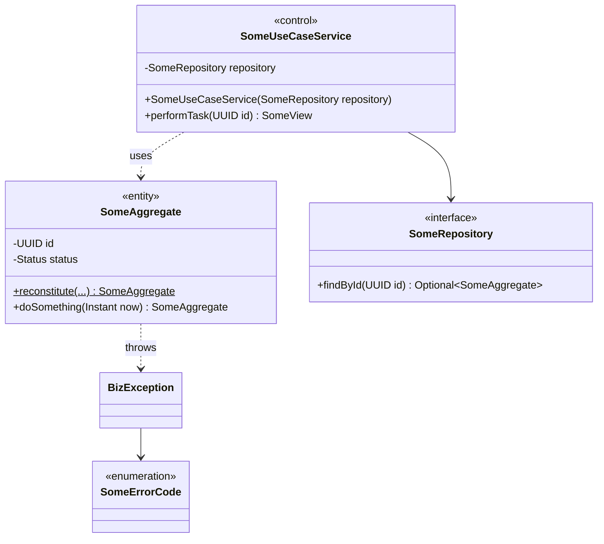

Rationale: a framework-free domain can be tested without Spring and survives a change of framework. Constructor injection makes every dependency explicit and lets unit tests build the object with `new`.

**Transition of dynamic interactions.** Services are created and wired by the container, so design sequence diagrams start at an existing service object. Entities are created through static factories that validate the new state, never through a bare constructor:

- `PurchaseIntent.issue(...)` creates a new intent;
- `GroupDeal.reconstitute(...)` rebuilds a team from storage;
- `PaidGroupDealCreator.initiate(...)` creates a paid team (the Factory Method of section 3.5).

A design sequence diagram shows these as a «create» message to the factory.

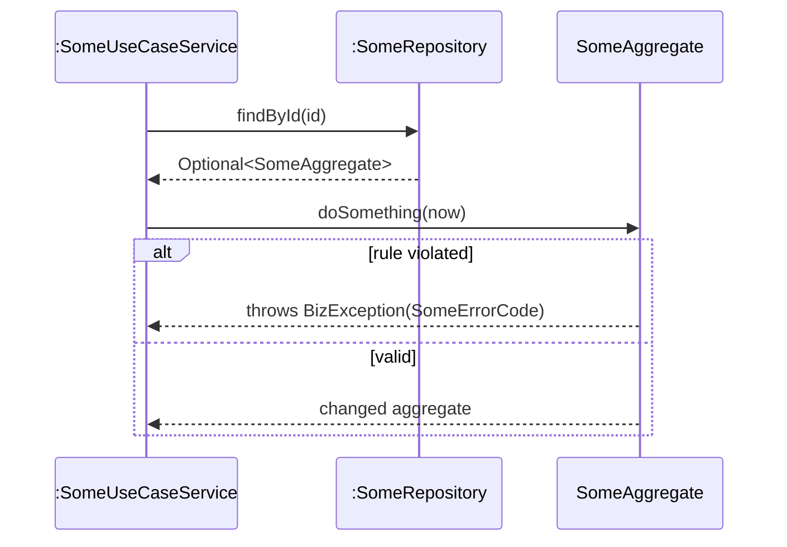

Rationale: state changes in one place, the aggregate, so every use case enforces the same invariants.

**Where in the code:**

- `backend/blocbuy-bootstrap/src/test/java/com/blocbuy/architecture/ArchitectureTest.java`: rules `domain_is_framework_free`, `no_field_injection`, `domain_has_no_outward_dependencies`;
- `GroupDeal`, `PurchaseIntent`, `Order`, `Product` in `blocbuy-domain`.

## 3.2.2 Presentation

The user interface is a single-page application in React 19. It is organised in three parts:

- **routes** in `frontend/src/routes`, with TanStack Router owning the URL state;
- **feature components and hooks** in `frontend/src/features/<area>`;
- **server state** held by TanStack Query.

The design models screens down to the route and the feature component. Smaller widgets are left to the programmer, except the controls that trigger a use case, such as the *Join this bloc* button.

**Impacted analysis objects.** Every screen «boundary», for example `JoinTeamUI` in UC4. The «control» objects stay on the server, so the client is thin. It shows state and sends commands, but it does not decide prices, seats or deadlines.

**Impacted use cases.** Every use case with a screen: UC1-UC4 and UC7-UC9. UC5 and UC6 are started by the scheduler and only show their results on existing screens.

**Transition of static structure.**

- A screen «boundary» becomes a route module plus feature components.
- A user command becomes a mutation hook built from the generated client. For example, `useCheckout` in `features/payment/use-checkout.ts` wraps the generated `createPaymentIntentMutation` and `createPaymentCheckoutMutation`.
- A server read becomes a query hook.
- The result envelope is unwrapped once, in `frontend/src/api/envelope.ts`.

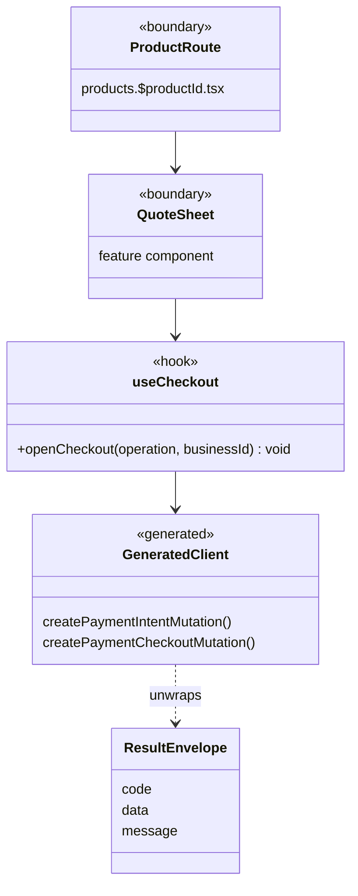

Rationale: a generated client keeps the screens in step with the contract, so a renamed field fails the frontend build instead of failing in production. A thin client keeps every business rule in one place, the server.

**Transition of dynamic interactions.**

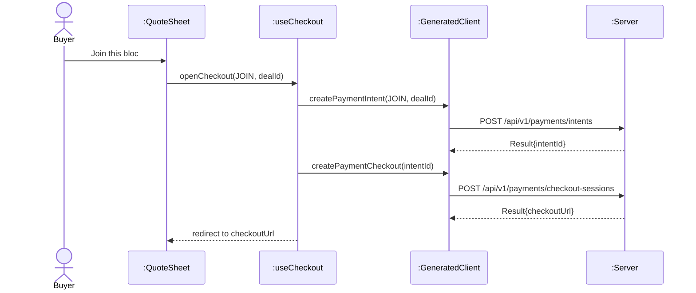

Rationale: the screen only sequences calls and redirects, while the server decides. An error envelope becomes an `ApiError`, which the component shows as a message.

**Where in the code:** `frontend/src/routes/products.$productId.tsx`, `frontend/src/features/payment/use-checkout.ts`, `frontend/src/api/envelope.ts`; frontend ADRs 0001, 0003, 0009 and 0014.

## 3.2.3 Distribution: requests, responses and errors

The client and server are separate processes, so every server-side «control» object that a screen uses is reached through a REST endpoint. Endpoints sit under `/api/v1`, exchange JSON and are described by the committed contract `contracts/openapi.json`.

**Impacted analysis objects.** Every «control» object that a «boundary» calls. The data passed between a boundary and a control becomes request and response records.

**Impacted use cases.** All use cases with a screen (UC1-UC4, UC7-UC9) and the provider callback in UC3/UC4.

**Transition of static structure.**

- Each «control» gains a `@RestController` in front of it, in the adapter module. Its request records are validated with Jakarta Bean Validation, checked by the rules `controllers_are_validated` and `numeric_request_params_have_range_constraints`.
- Controllers return read views produced by the application layer, for example `OrderSummaryView`, wrapped in `Result<T>`. Persistence classes never reach a controller (`controllers_never_touch_persistence`).
- Errors travel as `BizException(ErrorCode)`. One `GlobalExceptionHandler` turns every exception into `Result.error`, using the HTTP status that the error code declares.

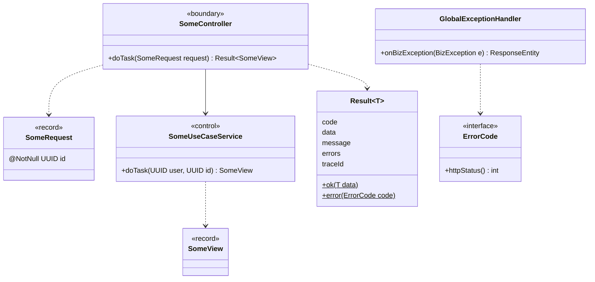

Rationale:

- Validating at the boundary keeps malformed input out of the services.
- One envelope and stable error codes let the client handle every failure the same way, with 400-415 mapped explicitly and never a 500 for a client error.
- The contract check in CI (`contract-check`) fails a pull request whose endpoints drift from `contracts/openapi.json`.

**Transition of dynamic interactions.**

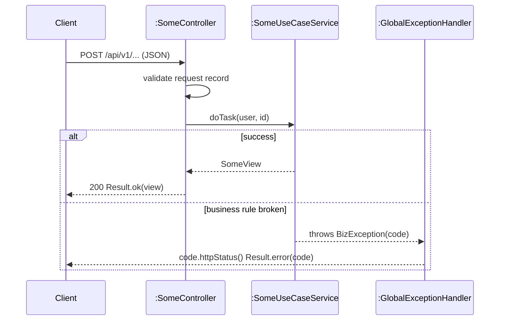

Rationale: the failure path is identical for every use case, so design sequence diagrams in section 3.4 show only the business decision and leave the HTTP mapping to this strategy.

**Where in the code:**

- `backend/blocbuy-adapter/src/main/java/com/blocbuy/common/web/Result.java` and `GlobalExceptionHandler.java`;
- `StripeCheckoutController` (UC3/UC4);
- decisions D11 and D12;
- `contracts/openapi.json`.

## 3.2.4 Persistence

Data is stored in PostgreSQL 18 through MyBatis. Every aggregate has a repository interface in the domain module, implemented in the infrastructure module by three classes:

- a repository implementation;
- a MyBatis mapper, with SQL in XML;
- a data object (DO) that mirrors a table row, with a hand-written converter between DO and aggregate (D9).

Keys are UUIDv7, references between aggregates are IDs without foreign keys, and versioned migrations evolve the schema. As in the course's DAO strategy, the collective behaviour of an entity class (find, page, lock) moves to its repository, while the entity keeps its own behaviour.

**Impacted analysis objects.** Every persistent «entity», and every «control» that reads or writes one.

**Impacted use cases.** All use cases that read or change stored data.

**Transition of static structure.**

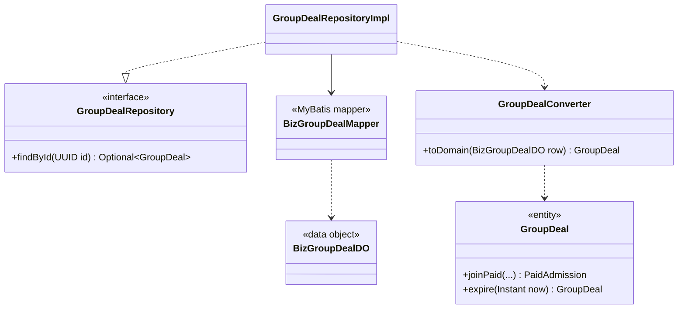

Rationale:

- The application depends only on the port (`application_uses_ports_not_tech`).
- Persistence classes are internal to infrastructure (`persistence_is_internal`), so the storage technology can change without touching domain or application code.
- Integrity rules that must hold under concurrency are also unique indexes, such as one order per payment and one member per buyer per team.

**Transition of dynamic interactions.**

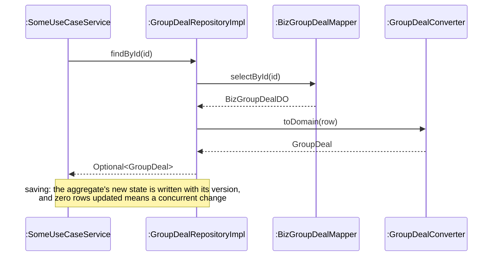

**Where in the code:** `backend/blocbuy-infrastructure/src/main/java/com/blocbuy/groupbuy/persistence/` (`GroupDealRepositoryImpl`, `BizGroupDealMapper`, `BizGroupDealDO`, `GroupDealConverter`); mapper XML under `backend/blocbuy-infrastructure/src/main/resources/mapper/`; Flyway migrations `V1`-`V28`.

## 3.2.5 Concurrency

Several buyers can pay for the last seat of a team at the same moment, and the expiry sweep can meet a late payment on the same team. The design serialises these cases in the database with four mechanisms:

- **Pessimistic locks in one global order.** Settlement locks rows with `SELECT ... FOR UPDATE` in a fixed order: team, then intent, then order, then payment. Every path that touches several of them follows that order, so two transactions never wait on each other in a cycle.
- **Guarded updates.** A state change is written as `UPDATE ... WHERE status = 'open'`, so a transition happens only once. The loser of a race updates zero rows and stops.
- **Unique indexes as a last line of defence.** Examples are one member per buyer per team, one order per payment, and one fulfilled payment per intent.
- **Work queues and jobs.** Workers claim work with `FOR UPDATE SKIP LOCKED` (refunds, outbox, intent expiry). Each scheduled job holds a lease in `sys_scheduler_lock`, so only one instance runs it.

Administrator edits of a listing use optimistic versioning instead. A stale version is refused with `412 Precondition Failed`.

**Impacted analysis objects.** «entity» objects with limited capacity or shared state:

- Team (`GroupDeal`), purchase intent, order, payment and refund obligation;
- listing (`Product`) for administrator edits.

**Impacted use cases.**

- UC3 and UC4: the last seat, and stock;
- UC5: expiry against a late join;
- UC6: concurrent refund workers;
- UC9: concurrent edits.

**Transition of static structure.** Repositories gain lock methods, for example `PaidGroupDealRepository.lockDeal` and `PurchaseIntentRepository.lockById`. Entities that are edited concurrently gain a `version` attribute. A lease repository (`SchedulerLeaseRepository`) appears for jobs.

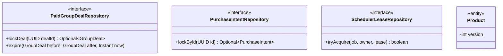

**Transition of dynamic interactions.**

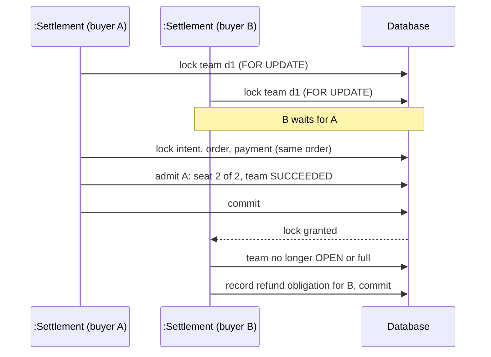

Rationale: a group-buy must never sell more seats than the target or settle one payment twice (hot spots HS-1, HS-4). Database locks hold across several application instances, which in-memory locks would not.

**Where in the code and evidence:**

- `PaidGroupDealMapper.xml` (lock and guarded update) and `PaymentMapper.xml`;
- the race test `StripeLocalIntegrationTest.twentyBuyersRaceForLastSeatAndNineteenRefundObligationsPersist`: 20 buyers, 1 seat, 19 refund obligations;
- `TeamResolutionListenerOrderTest`, which checks that orders are locked before payments when a team expires;
- backend ADR 0001.

## 3.2.6 Transaction boundary

**Decision.** Each step of a use case that changes data is one database transaction, owned by the application service:

- `@Transactional`, often with a timeout. For example, `PaidGroupDealService` uses 10 s.
- A `TransactionTemplate`, when the step must begin only after a call to an external provider has returned. For example, `StripeCheckoutService` verifies the webhook and re-reads the session from Stripe first, then settles in a transaction.

**Call rules.**

- Helper services that must run inside their caller's transaction declare `Propagation.MANDATORY`, as `OrderFulfilmentAdapter` does, so calling them outside a transaction fails.
- Calls to an external provider never run inside a transaction.
- Consequences that are part of the same business fact run as `BEFORE_COMMIT` listeners. Side effects that may fail on their own run `AFTER_COMMIT`.

**Impacted analysis objects.** «control» objects that change more than one entity. The settlement, expiry and refund controls are the main cases.

**Impacted use cases.** UC3, UC4, UC5 and UC6.

**Transition of static structure.**

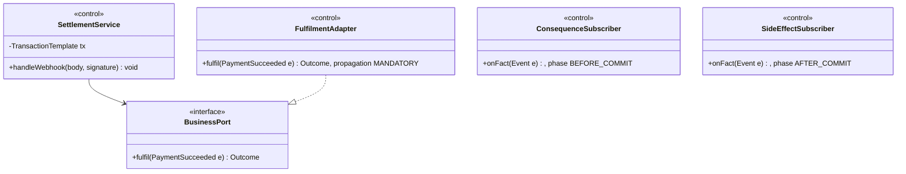

**Transition of dynamic interactions.**

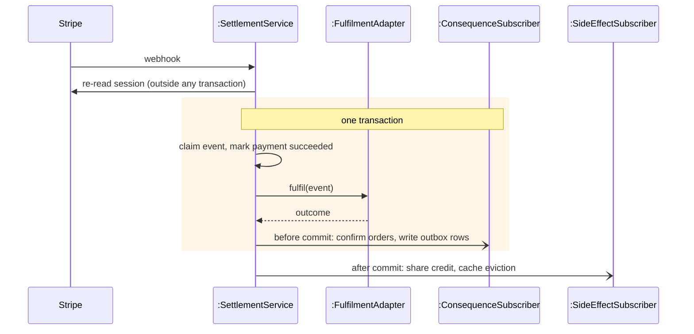

Rationale:

- A payment, its seat, its order and its stock unit change together or not at all. If the transaction fails, everything rolls back and Stripe redelivers the webhook.
- Keeping provider calls outside the transaction means a slow provider never holds database locks.

**Where in the code:**

- `StripeCheckoutService` (`handleWebhook`, `settle`), `OrderFulfilmentAdapter`, `PaidGroupDealService`;
- `OrderLifecycleSubscriber`, `TeamExpiryRefundSubscriber`, `ShareCreditSubscriber`, `OpenDealOfferCacheSubscriber`;
- backend ADRs 0002 and 0003.

## 3.2.7 Cross-context seams

The six contexts share one deployable, but code in one context reaches another only through a narrow interface. There are three kinds:

- **Supplier facades**, owned by the context that is called:
  - `CatalogPurchaseSupport`: price, purchasability and one stock unit;
  - `GroupDealPurchaseSupport` and `GroupDealSettlementSupport`: team admission and settlement.
- **Ports defined by the caller and implemented by the callee.** Payments defines `PaymentIntentPort` and `PaymentBusinessPort`, and the order context implements them in `PurchaseIntentAppService` and `OrderFulfilmentAdapter`. Payments therefore never depends on order code.
- **The identity port** `UserAppService`, the only way the commerce contexts ask about a user (`commerce_reaches_identity_only_through_user_port`).

One-way reactions use domain events instead of calls; they are covered in 3.2.11.

**Impacted analysis objects.** «control» objects whose use case spans contexts. In UC3/UC4 the checkout control needs the listing (catalog), the team (groupbuy), the order (order) and the payment (payment).

**Impacted use cases.** UC3, UC4, UC5, UC6 and UC9.

**Transition of static structure.**

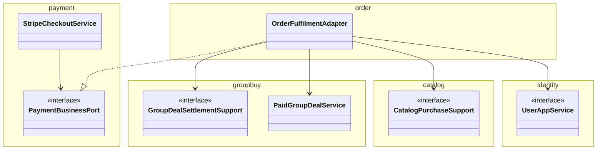

**Transition of dynamic interactions.** A cross-context call is an ordinary synchronous call on the interface, inside the caller's transaction. The design sequence diagrams in section 3.4 draw the interface as the lifeline, not the implementation behind it.

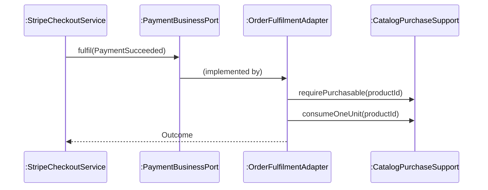

Rationale:

- Each context can change its internals without breaking the others.
- The direction of dependency follows ownership, so payments stays reusable.
- The seams are where the system was cut when it was split into services for SWE5001. There, the identity port became a remote call and the domain events became integration events, with no change to the callers.

**Where in the code:**

- the interfaces in `blocbuy-application` and `blocbuy-domain`, named above;
- `ArchitectureTest`;
- backend ADRs 0001 and 0008.

## Yu Qianshuo's half (to be written)

- **3.2.8 External interface.** Providers (Stripe, Google) behind gateway ports with adapters, and signed webhooks (ADRs 0001, 0004, 0005).
- **3.2.9 Security.** Login interceptor, role checks, CSRF header and rate limits (D6-D7, frontend ADR 0002).
- **3.2.10 Scheduling.** The scheduler actor becomes an `@Scheduled` job under a database lease (ADR 0002).
- **3.2.11 Domain events.** Event records and transactional listeners, with the outbox across services (ADRs 0002, 0003, 0007).
