# SWE5006 final report, section 3.2: Transition from Analysis to Design

> Draft for the report editor (#463, #614): section 3.2, one subsection per row of the deck's transition-strategy table (slide 10), in the deck's order and with its names. This draft covers 3.2.1 to 3.2.4 and 3.2.8; the other four rows (3.2.5 External interface, 3.2.6 Security, 3.2.7 Scheduling, 3.2.9 Domain events) are still to be written. Diagrams are Mermaid sources in UML notation: a solid arrow is a synchronous call, a dashed arrow a return. The "Where in the code" lines are for reviewers and can be cut from the submitted report. Code was read on `dev` at `22f56584`.

A transition strategy deals with one design concern, usually tied to a non-functional requirement. It names the analysis objects and use cases it affects, then shows the typical change to the static structure (class diagram) and to the dynamic interactions (sequence diagram), with the reason for each (Software Analysis and Design, 04a DM pp. 36-37). The section follows the shape of the course's worked example, the OFS high-level design (04c pp. 5-15).

## Overview

BlocBuy is a client/server web system. The server is a modular monolith in Java, layered in the COLA style; six bounded contexts live inside it: catalog, groupbuy, order, payment, identity and notification. The client is a single-page web application. The layers are drawn in the logical view (Figure 3.1-x, logical view).

These decisions are taken as given:

- The server runs on Java 21 and Spring Boot 4.1 (`backend/pom.xml`), in the COLA module layout of decision D1 (`backend/docs/design/backend-skeleton-plan.md`; its Spring Boot 3.5 entry is superseded by the upgrade).
- The client is React 19 with TanStack Router and TanStack Query (frontend ADR 0001). It calls the server only through a client generated from the OpenAPI contract (frontend ADR 0003).
- Client and server exchange JSON over HTTPS under `/api/v1`. Every JSON response is one result envelope (`Result<T>`, frontend ADR 0009); OAuth redirects are the documented exception.
- Data is stored in PostgreSQL through MyBatis with hand-written converters (D9) and versioned Flyway migrations.
- Changes to money and seats are serialised by database locks, and their consequences commit in the same transaction (backend ADRs 0001, 0002).

Not every strategy has an architecture decision record. Four have none: the server language and framework, persistence (MyBatis), the design of the scheduling job, and the concurrency approach as such. They rest on the locked decisions D1 to D20 of the skeleton plan and on design notes such as `backend/docs/design/paid-group-participation.md`; backend ADRs 0001 and 0002 record only the locks and unique indexes of the paid path and the expiry transition. Recording the four is an open item.

| Strategy | Concern | In this draft |
|---|---|---|
| 3.2.1 Language, framework | maintainability | yes |
| 3.2.2 Presentation | usability | yes |
| 3.2.3 Distribution | interoperability | yes, with cross-context seams |
| 3.2.4 Persistence | integrity | yes |
| 3.2.5 External interface | provider isolation | to be written |
| 3.2.6 Security | security | to be written |
| 3.2.7 Scheduling | expiry ≤ 1 min | to be written |
| 3.2.8 Concurrency | no oversell | yes, with the transaction boundary |
| 3.2.9 Domain events | decoupling | to be written |

### From the UC4 analysis model to design

The UC4 (join a team) analysis model (Figure 3.4-x, UC4 analysis class diagram) has one object of every kind. Each lands in the strategies below; the UC4 design class diagram (Figure 3.4-y) shows the result.

| Analysis object | Design elements | Strategy |
|---|---|---|
| «boundary» `JoinTeamUI` | route `products.$productId.tsx` (component `ProductDetailPage`), component `DealProgress`, hook `useCheckout`; REST endpoints under `/api/v1/payments` | 3.2.2, 3.2.3 |
| «boundary» `PaymentGateway` | port `CheckoutGateway`, adapter `StripeCheckoutGateway`, `StripeWebhookController` | 3.2.5 |
| «control» `JoinTeamControl` | split by step: `StripeCheckoutController` → `PaymentBrowserService` (the buyer's requests), `PurchaseIntentAppService` (quote), `StripeCheckoutService` (checkout and settlement), `OrderFulfilmentAdapter` (what the money buys), `PaidGroupDealService` (admission) | 3.2.1, 3.2.3, 3.2.8 |
| «entity» `Team`, `Membership` | aggregate `GroupDeal`; members are rows of `biz_group_member` written with it | 3.2.4, 3.2.8 |
| «entity» `Order` | aggregate `Order`, repository `OrderRepository` | 3.2.4 |
| «entity» `Payment` | aggregate `CheckoutPayment` | 3.2.4, 3.2.8 |
| «entity» `Refund` | refund obligation, a row of `biz_refund` without a domain class | 3.2.4 |

## 3.2.1 Language, framework

Java 21 is the implementation language of the server. Spring provides object creation and wiring, transactions and web handling. Code follows google-java-format (AOSP style) with Checkstyle, both enforced in the build.

**Packaging.** Each layer is a Maven module and each context a package inside it (prefix `com.blocbuy`):

| Module | Package pattern | Holds |
|---|---|---|
| `blocbuy-client` | `.common`, `.events.contract` | shared types and the contracts of integration events |
| `blocbuy-adapter` | `.<context>.web` | REST controllers, request and response records, exception handlers |
| `blocbuy-application` | `.<context>.service`, `.query`, `.command` | application services, event subscribers, read views |
| `blocbuy-domain` | `.<context>.model`, `.event`, `.repository`, `.gateway`, `.exception` | aggregates, value objects, domain events, ports, error codes |
| `blocbuy-infrastructure` | `.<context>.persistence`, `.gateway` | repository implementations, MyBatis mappers, data objects, provider adapters |
| `blocbuy-platform` | `.platform` | SWE5001 service assembly (topology guard, trace propagation); the monolith does not use it |
| `blocbuy-bootstrap` | `.bootstrap` | start-up, configuration, scheduled jobs |

**Impacted analysis objects.** All «control» and «entity» objects.

**Impacted use cases.** All.

**Transition of static structure.**

- A «control» object becomes an application service in `blocbuy-application`, created and wired by Spring: annotated `@Service`, or declared as a bean in a bootstrap configuration class when it is switched on by configuration (`StripeCheckoutService`, `OrderFulfilmentAdapter`). Collaborators arrive through the constructor into `final` fields; field injection is rejected by the ArchUnit rule `no_field_injection`.
- An «entity» becomes a final class in `blocbuy-domain` with no framework annotations (rule `domain_is_framework_free`, over the model, repository, event and exception packages). Its state changes only through behavioural methods, for example `GroupDeal.joinPaid`, `Order.confirm`, `Product.publish`.
- A broken business rule becomes a `BizException` carrying an `ErrorCode` constant of its context, for example `GroupbuyErrorCode`.

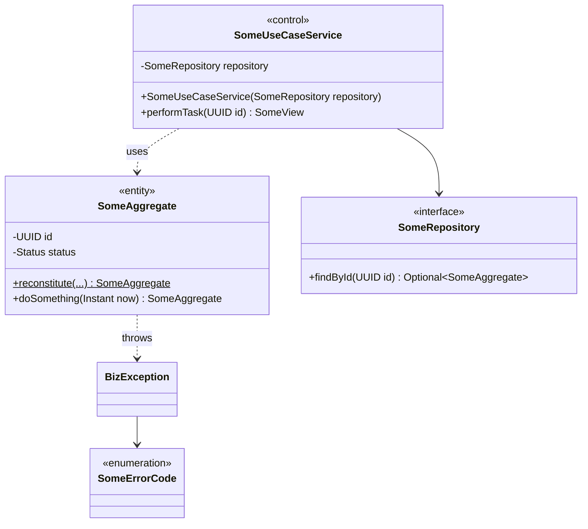

Rationale: a domain without framework code is tested without Spring, and constructor injection makes every dependency explicit, so a unit test builds the object with `new`.

**Transition of dynamic interactions.** Services exist before a use case starts, so design sequence diagrams begin at a service object. Entities are not built with a bare constructor:

- static factories validate a new state, for example `PurchaseIntent.issue(...)`, and rebuild a stored one, for example `GroupDeal.reconstitute(...)`;
- a paid team is created through a Factory Method: the abstract `PaidGroupDealCreator.initiate(...)` calls the subclass's `createGroupDeal` (the design problem of UC3, section 3.5).

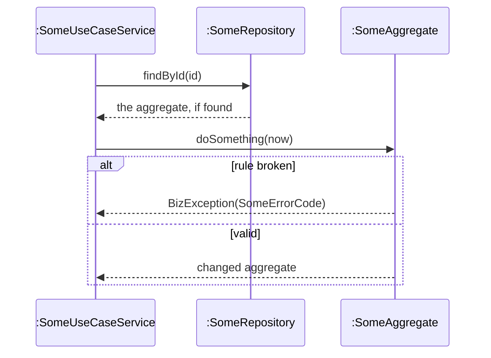

Rationale: a state change happens in one place, the aggregate, so every use case enforces the same invariants.

**Where in the code:** `ArchitectureTest` (`backend/blocbuy-bootstrap/src/test/java/com/blocbuy/architecture/`); `GroupDeal`, `PurchaseIntent`, `Order`, `Product`; `PaymentIntegrationConfiguration`, `StripeCheckoutConfiguration`.

## 3.2.2 Presentation

The user interface is a single-page application in React 19, in three parts: routes in `frontend/src/routes` (TanStack Router owns the URL), feature components and hooks in `frontend/src/features/<area>`, and server state held by TanStack Query. The design names screens down to the route and the feature component, plus the controls that start a use case, such as *Join this bloc*.

**Impacted analysis objects.** Every screen «boundary», for example `JoinTeamUI` in UC4. The «control» objects stay on the server: the client shows state, sends commands and may compute a countdown or a free seat for display, but the server decides prices, seats and deadlines.

**Impacted use cases.** Every use case with a screen: UC1 to UC4 and UC7 to UC9. UC5 and UC6 are started by the scheduler and show their results on existing screens.

**Transition of static structure.**

- A screen «boundary» becomes a route module plus feature components.
- A user command becomes a hook built on mutations generated from the contract. `useCheckout` (`features/payment/use-checkout.ts`) wraps `createPaymentIntentMutation` and `createPaymentCheckoutMutation` and exposes `begin(operation, businessId)`.
- A server read becomes a query hook.
- Generated types keep the envelope shape; the hook unwraps it with `unwrapResult` (`frontend/src/api/envelope.ts`), which throws an `ApiError` for an error envelope.

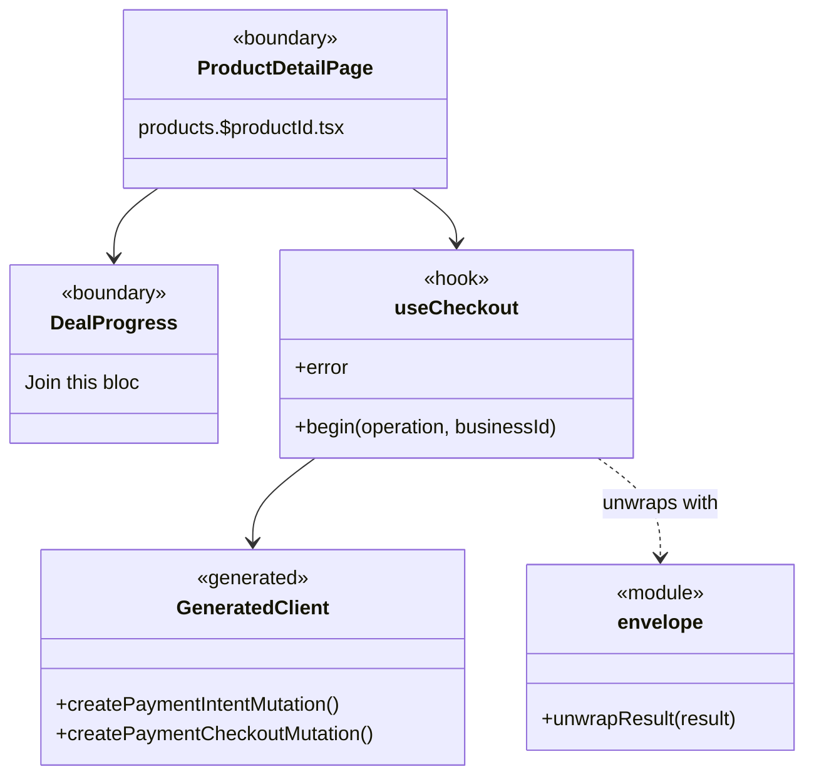

Rationale: a generated client keeps the screens in step with the contract, so a renamed field fails the frontend build instead of the running page. Keeping business decisions on the server leaves one place to change them.

**Transition of dynamic interactions.**

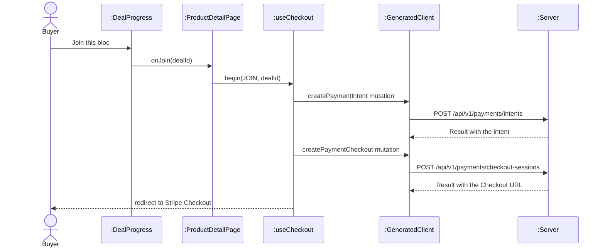

Rationale: the screen only sequences calls and redirects; the server decides. An error envelope becomes an `ApiError` inside the hook, which the page reads from `error` and shows as a message.

**Where in the code:** `frontend/src/routes/products.$productId.tsx`, `frontend/src/features/catalog/DealProgress.tsx`, `frontend/src/features/payment/use-checkout.ts`, `frontend/src/api/envelope.ts`; frontend ADRs 0001, 0003, 0009 and 0014.

## 3.2.3 Distribution

Client and server are separate processes, so every server «control» that a screen uses is reached through a REST endpoint. Endpoints sit under `/api/v1`, exchange JSON and are described by the committed contract `contracts/openapi.json`. The generated TypeScript client is the client-side stub of this distribution.

**Impacted analysis objects.** Every «control» object that a «boundary» calls. The data passed between them becomes request and response records.

**Impacted use cases.** All use cases with a screen (UC1 to UC4, UC7 to UC9), and the Stripe callback in UC3 and UC4 (`StripeWebhookController`).

**Transition of static structure.**

- Each «control» gets a `@RestController` in front of it, in the adapter module. Request bodies are records validated with Jakarta Bean Validation; ArchUnit checks that every controller is `@Validated` and that numeric query parameters carry a range (`controllers_are_validated`, `numeric_request_params_have_range_constraints`).
- A controller maps the application's read view to a response record of the adapter and wraps it in `Result<T>`, for example `OrderSummaryView` to `OrderSummaryResponse`. Persistence classes never reach a controller (`controllers_never_touch_persistence`).
- Errors travel as `BizException(ErrorCode)`. `GlobalExceptionHandler` turns them into `Result.error` with the HTTP status the error code declares (`handleBiz`), maps validation, malformed-request, authentication, permission, not-found, method and media-type errors to their 4xx statuses, and answers anything else with 500 and a trace ID. The payment web layer adds `StripeRequestExceptionHandler` for its own request errors.

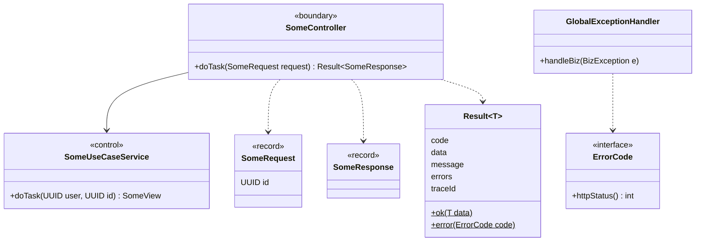

Rationale: validating at the boundary keeps malformed input out of the services, and one envelope with stable error codes lets the client handle every failure the same way. The CI job `contract-check` fails a pull request whose endpoints drift from `contracts/openapi.json`.

**Transition of dynamic interactions.**

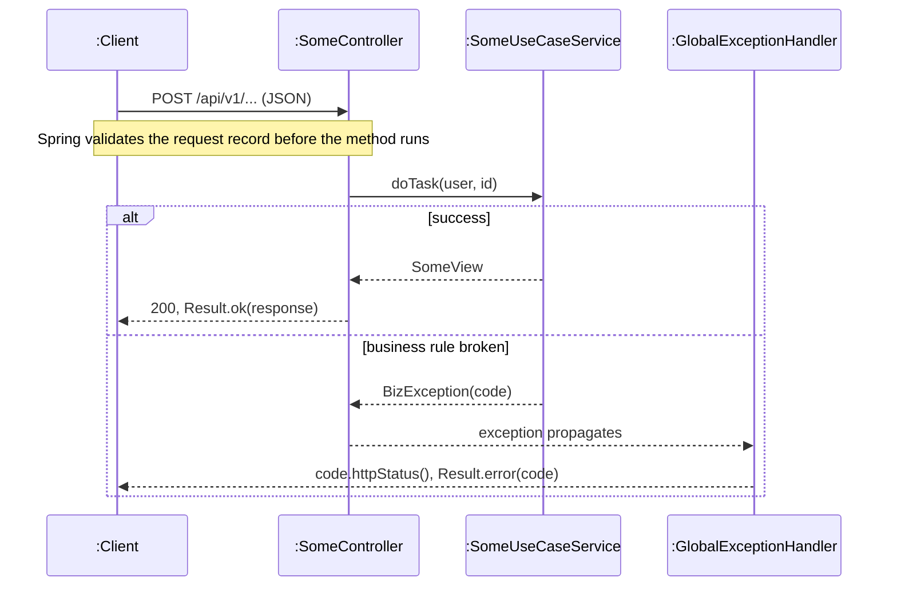

Rationale: the failure path is the same for every use case, so the sequence diagrams of section 3.4 show only the business decision and leave the HTTP mapping to this strategy.

**Where in the code:** `Result.java`, `GlobalExceptionHandler.java` (`backend/blocbuy-adapter/.../common/web/`); `OrderController`, `StripeCheckoutController`, `StripeWebhookController`; `contracts/openapi.json`.

### Cross-context seams

The six contexts share one deployable, and code in one context reaches another only through an interface it is allowed to use:

- **Supplier facades**, owned by the context that is called: `CatalogPurchaseSupport` (price, purchasability, one stock unit); `GroupDealPurchaseSupport` (the team check before payment) and `GroupDealSettlementSupport` (locking, linking and reconciliation around admission after payment; admission itself stays in `PaidGroupDealService`).
- **Ports defined by the caller.** Payment defines `PaymentIntentPort` and `PaymentBusinessPort`; the order context implements them (`PurchaseIntentAppService`, `OrderFulfilmentAdapter`). Settlement therefore depends on the port, not on order code; one payment read service uses the order's `PurchaseOperation` enum.
- **The identity port** `UserAppService`, the only way the commerce contexts ask about a user (`commerce_reaches_identity_only_through_user_port`).

One-way reactions use domain events instead of calls (3.2.9).

**Impacted analysis objects.** «control» objects whose use case spans contexts. In UC3 and UC4 the checkout control needs the listing (catalog), the team (groupbuy), the order (order) and the payment (payment).

**Impacted use cases.** UC3 and UC4 by calls; UC5 and UC6 cross contexts by domain events.

**Transition of static structure.**

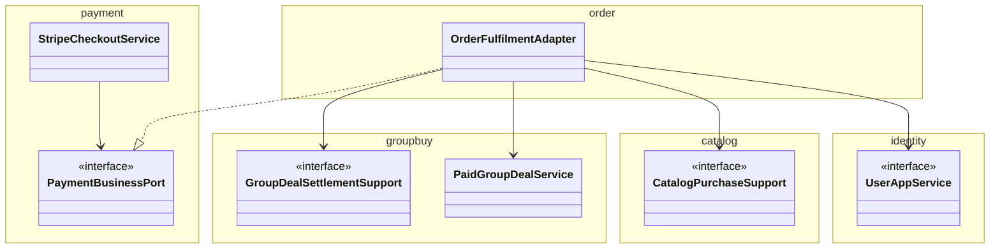

Rationale: each context can change its internals without breaking the others, and the dependency points from the caller to an interface its owner controls.

**Transition of dynamic interactions.** A cross-context call is an ordinary synchronous call on the interface, inside the caller's transaction; the design sequence diagrams of section 3.4 draw the interface as the lifeline.

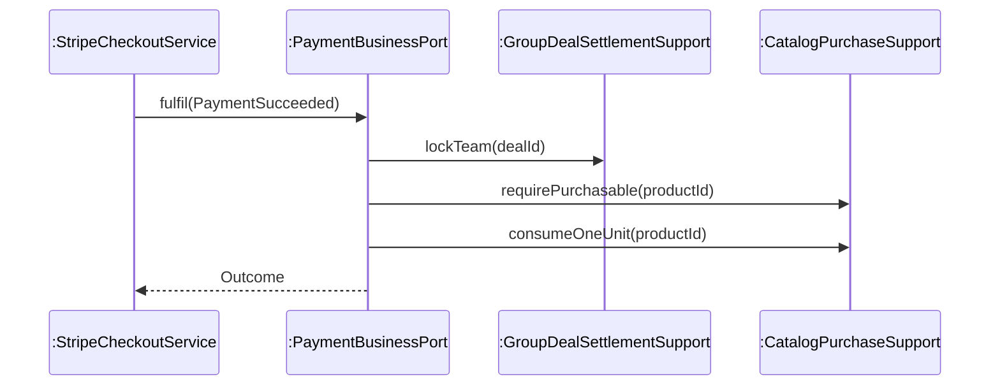

Rationale: the caller sees only the interface, so the call stays the same when the implementation moves. In the SWE5001 deployment the identity port is answered by a remote client, while catalog, groupbuy, order and payment stay together in one service (backend ADR 0008).

**Where in the code:** the interfaces named above in `blocbuy-application` and `blocbuy-domain`; `ArchitectureTest`; backend ADRs 0001 and 0008.

## 3.2.4 Persistence

Data is stored in PostgreSQL 18 through MyBatis. A persistent aggregate has a repository interface in the domain module, implemented in the infrastructure module with a MyBatis mapper (SQL in XML) and a data object (DO) that mirrors a table row; a hand-written converter maps DO to aggregate (D9). In the course's DAO strategy (04a), the mapper is the DAO that runs the SQL, and the DO is the transfer object that carries one row between the mapper and the repository; the repository puts a domain port in front of the DAO and hands out aggregates, never DOs. For a read, the converter turns the DO into the aggregate (`GroupDealConverter.toDomain`); for a write, the repository builds the DO from the aggregate (`PaidGroupDealRepositoryImpl.toRow`). The request and response records of 3.2.3 are the transfer objects between client and server. Keys are UUIDv7, references between aggregates are IDs without foreign keys, and Flyway migrations V1 to V28 evolve the schema. The collective behaviour of an entity class (find, page) moves to its repository; locking is added by 3.2.8.

Each aggregate root has one or more repository ports in the domain module. The team has two: `GroupDealRepository` for reads (find, best open deal, memberships) and `PaidGroupDealRepository` for the locked paid path (lock, insert member, expire). Reads and locked writes have different callers and SQL, so each gets its own port.

**Impacted analysis objects.** Every persistent «entity», and every «control» that reads or writes one.

**Impacted use cases.** All use cases that read or change stored data.

**Transition of static structure.**

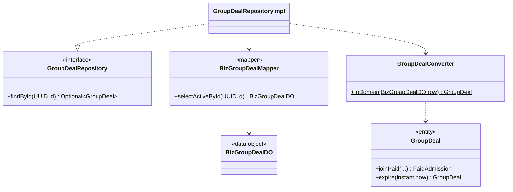

Rationale: the application depends only on the port (`application_uses_ports_not_tech`) and persistence classes stay inside infrastructure (`persistence_is_internal`), so the storage technology can change without touching domain or application code. Integrity rules that must hold under concurrency are also unique indexes, listed by name in 3.2.8.

**Transition of dynamic interactions.**

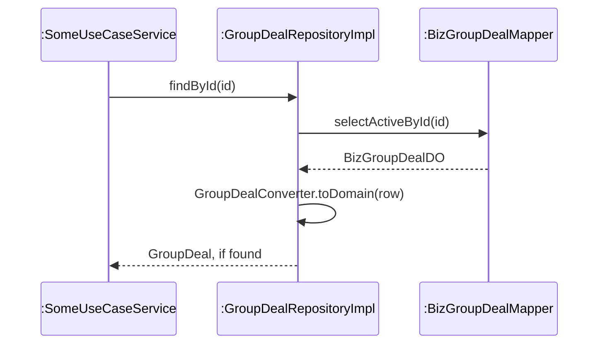

Rationale: a save is a guarded `UPDATE` that names the state it read, so a concurrent change updates zero rows and is refused: the team's row changes only if its size and status are still the ones read (`PaidGroupDealMapper.updateDeal`), a listing's only if its `version` matches (`BizProductMapper`).

**Where in the code:** `backend/blocbuy-infrastructure/src/main/java/com/blocbuy/groupbuy/persistence/`; mapper XML under `backend/blocbuy-infrastructure/src/main/resources/mapper/`; migrations under `backend/blocbuy-bootstrap/src/main/resources/db/migration/`.

## 3.2.5 External interface

Concern: provider isolation. Not in this draft; to be written for the report.

## 3.2.6 Security

Concern: security. Not in this draft; to be written for the report.

## 3.2.7 Scheduling

Concern: expiry ≤ 1 min. Not in this draft; to be written for the report.

## 3.2.8 Concurrency

Several buyers can pay for the last seat of a team at once, and the expiry sweep can meet a late payment on the same team. The design serialises these cases in the database:

- **Pessimistic locks in a fixed order.** On the paid path, locks are taken team (group deal) → purchase intent → payment → participation receipt, each `SELECT ... FOR UPDATE`; the order is a new row, inserted afterwards. On expiry, the team-outcome subscribers follow team → purchase intent → order → payment (backend ADR 0002). Inside `PaidGroupDealService` the receipt is locked before the deal; this cannot deadlock because a receipt is keyed by payment ID (backend ADR 0001). Because the expiry sweep also locks the team first, a sweep and a settlement on one team queue behind each other instead of deadlocking. The two ADRs word the lock order differently; tracked in issue #663.
- **Guarded updates.** `updateDeal` writes only `WHERE current_size = expectedSize AND status = expectedStatus`, so the loser of a race updates zero rows; `version` is incremented, not compared. The expiry update is guarded by `status = 'open'`.
- **Unique indexes as the last line of defence.** One active member per buyer per team (`uq_biz_group_member_deal_user`), one member per payment (`uq_biz_group_member_payment_id`), one participation receipt per payment (`uq_biz_group_participation_receipt_payment`), one order per payment (`uq_biz_order_payment_id`), one fulfilled purchase intent per payment (`uq_biz_purchase_intent_fulfilled_payment`) one refund obligation per payment (`biz_refund.payment_id UNIQUE`) and one obligation per provider refund (`uq_biz_refund_provider_id`, partial).
- **Work queues and leases.** Workers claim work with `FOR UPDATE SKIP LOCKED` (refunds, outbox, intent expiry), and each scheduled job holds a job lease in `sys_scheduler_lock`, so one instance runs it. A refund obligation also carries its own row lease: the worker claims one due `pending` or `processing` obligation, sets a 2-minute `lease_until` and `version + 1`; `finish` is fenced by `id` and `version` and schedules the next attempt 30 s later (fixed delay, not exponential). Its states are drawn in the [refund obligation statechart](statecharts.md#refund-obligation).

Administrator edits of a listing use an optimistic `version` instead; a stale version is refused with `412 Precondition Failed`.

**Impacted analysis objects.** «entity» objects with limited capacity or shared state: team (`GroupDeal`), purchase intent, order, payment and refund obligation; listing (`Product`) for administrator edits.

**Impacted use cases.** UC3 and UC4 (the last seat, stock), UC5 (expiry against a late payment), UC6 (concurrent refund workers), UC9 (concurrent edits).

**Transition of static structure.** Repositories gain lock methods (`PaidGroupDealRepository.lockDeal`, `PurchaseIntentRepository.lockById`); an entity edited concurrently gains a `version`; jobs get a lease port.

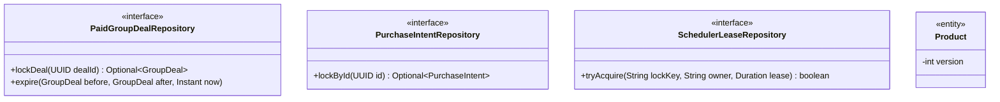

Rationale: a lock method in the port makes the locking visible in the design instead of hiding it in SQL, and a lease port lets several application instances share one schedule.

**Transition of dynamic interactions.**

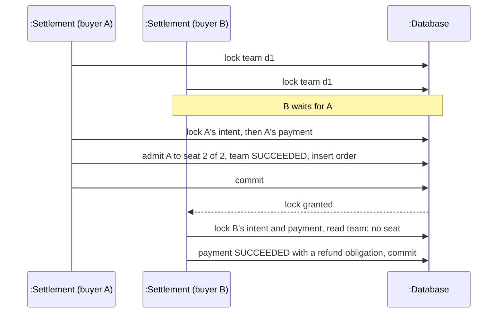

Rationale: a group-buy must never sell more seats than its target or settle one payment twice. Database locks hold across application instances, which in-memory locks would not.

**Where in the code and evidence:** `OrderFulfilmentAdapter` (lock order in its Javadoc), `PaidGroupDealMapper.xml`, `PaymentMapper.xml`, `RefundMapper.xml` (`finish`); migrations V5, V7, V9, V11, V12 and V15 (unique indexes); the race test `StripeLocalIntegrationTest.twentyBuyersRaceForLastSeatAndNineteenRefundObligationsPersist` (20 buyers, 1 seat left, 19 refund obligations); backend ADRs 0001 and 0002.

### Transaction boundary

**Decision.** Each step of a use case that changes data is one database transaction, owned by the application service: `@Transactional`, with a timeout where the step takes locks (`PaidGroupDealService`: 10 s), or a `TransactionTemplate` when the step must start only after an external provider has answered (`StripeCheckoutService` verifies the webhook and re-reads the Checkout session first, then settles).

- A collaborator that must run inside its caller's transaction declares `Propagation.MANDATORY` (`OrderFulfilmentAdapter`), so calling it without one fails.
- Calls to an external provider never run inside a transaction.
- Consequences that belong to the same business fact run as `BEFORE_COMMIT` listeners; derived side effects run `AFTER_COMMIT`. The event side of this rule (event records and the listeners themselves) belongs to 3.2.9 Domain events and to Yorik's Observer design (section 3.5).

**Impacted analysis objects.** «control» objects that change more than one entity: settlement, expiry and refund.

**Impacted use cases.** UC3, UC4, UC5 and UC6.

**Transition of static structure.**

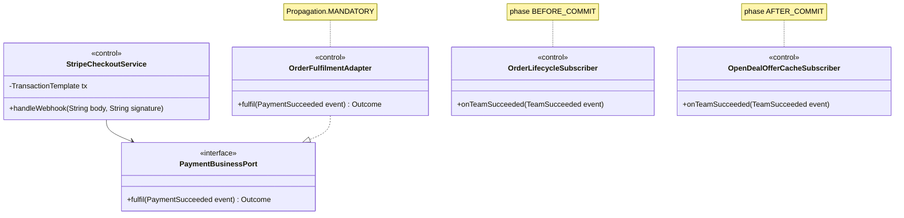

Rationale: the payment slice owns the transaction and calls the business through a port that refuses to run outside it, and a subscriber's phase states in one place whether its work is part of the fact or follows it.

**Transition of dynamic interactions.**

```mermaid
sequenceDiagram
    participant P as :Stripe
    participant S as :StripeCheckoutService
    participant F as :PaymentBusinessPort
    participant G as :PaidGroupDealService
    participant T as :TransactionManager
    participant L as :OrderLifecycleSubscriber
    participant E as :OpenDealOfferCacheSubscriber
    P->>S: webhook (signed)
    S->>P: re-read the Checkout session (no transaction open)
    P-->>S: session paid
    S->>S: begin; claim event; lock team, intent, payment; payment SUCCEEDED
    S->>F: fulfil(PaymentSucceeded)
    F->>G: admit the buyer
    G->>G: publish TeamSucceeded (team now full)
    F-->>S: Outcome
    S->>T: commit
    T->>L: before commit: confirm the team's orders
    T->>E: after commit: evict the offer cache
```

Rationale: the seat, the order and the stock unit change together with the payment's SUCCEEDED state, or not at all; a payment whose admission is rejected commits with a refund obligation instead. If the transaction fails, everything rolls back and Stripe redelivers the webhook. A slow provider never holds database locks.

**Where in the code:** `StripeCheckoutService` (`handleWebhook`, `settle`), `OrderFulfilmentAdapter`, `PaidGroupDealService`; `OrderLifecycleSubscriber`, `TeamExpiryRefundSubscriber` (before commit), `ShareCreditSubscriber`, `OpenDealOfferCacheSubscriber` (after commit); backend ADRs 0001 to 0003.

## 3.2.9 Domain events

Concern: decoupling. Not in this draft; to be written for the report.
