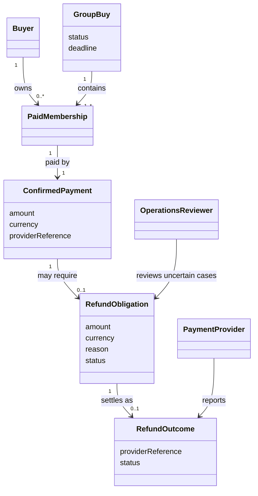
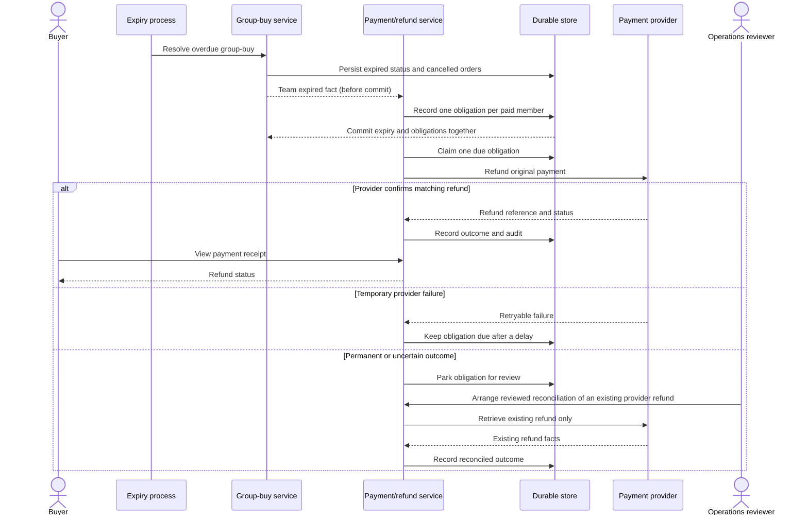
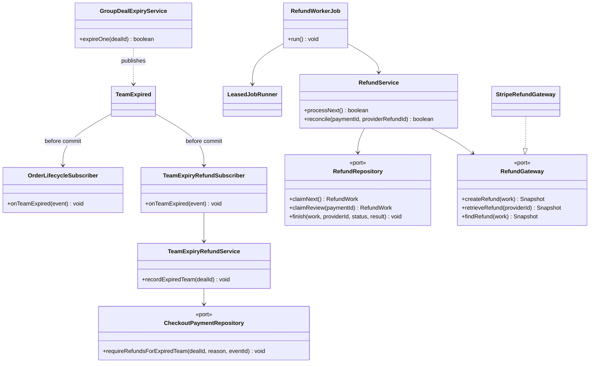
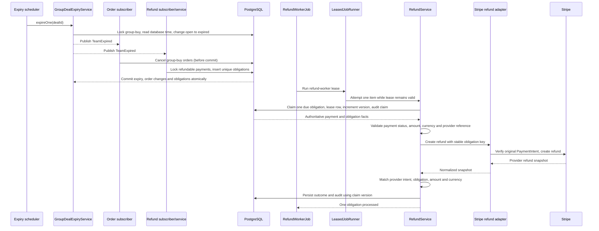
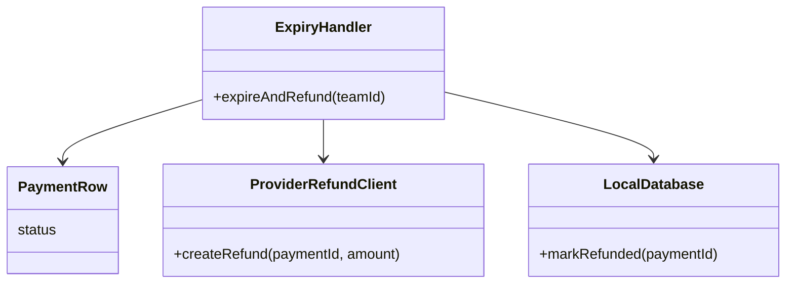
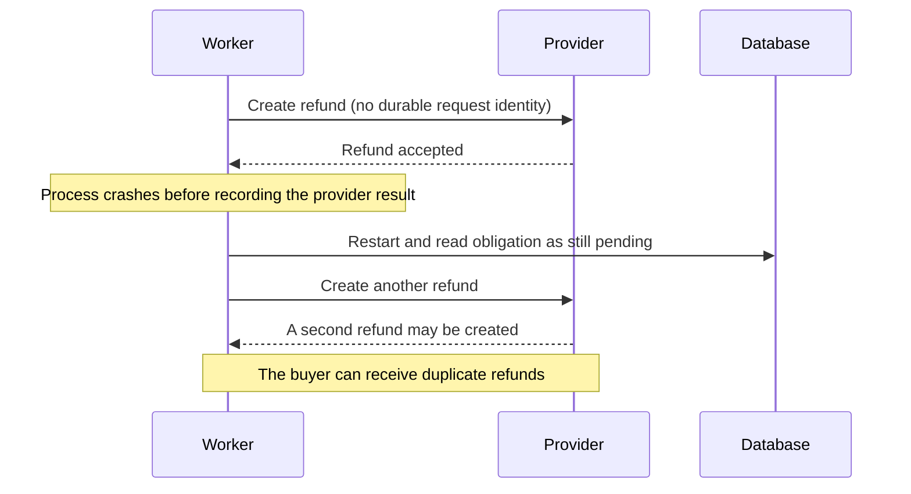
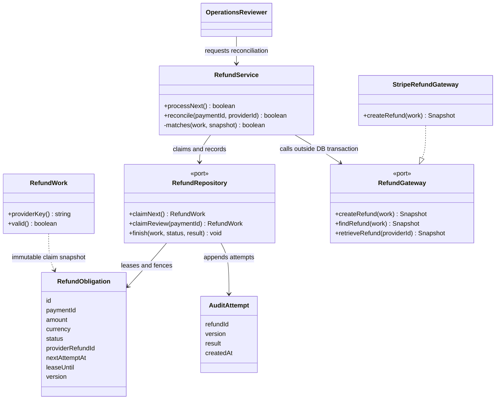
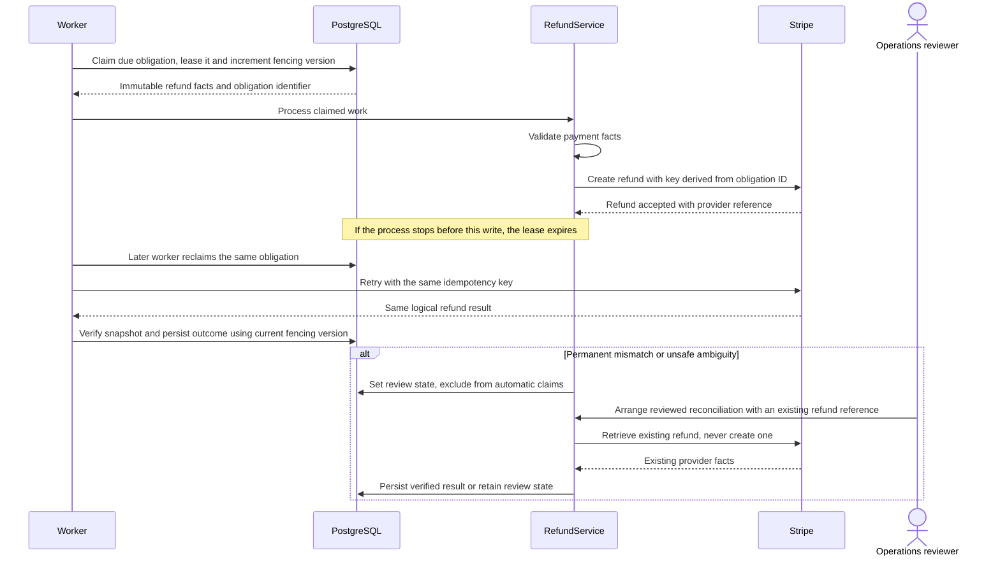

# SWE5006 final report contribution — Yu Qianshuo

> Draft for the report editor. The report-ready sections below are written for a reader who does not open the repository. The evidence map at the end is editorial material and should not be copied into the submitted report. The diagrams are Mermaid sources and may be rendered or redrawn in the report.

## Use case: refund buyers when a group-buy expires

### Analysis

**Primary actor:** the platform's expiry and refund services.

**Beneficiary:** a buyer who has paid into a group-buy that does not reach its target before its deadline.

**Supporting actors:** the payment provider and, for an uncertain or permanently invalid outcome, an operations reviewer.

**Preconditions:** a buyer's payment has been confirmed; the buyer is recorded as a paid member of an open group-buy; the group's deadline has passed; and scheduled processing is enabled for the environment.

**Trigger:** the expiry process finds a group-buy whose deadline has passed.

**Main success flow:**

1. The platform confirms that the group-buy is still open and its deadline has passed.
2. It marks the group-buy expired and cancels its outstanding orders.
3. For each confirmed payment belonging to a paid member, it records one durable refund obligation in the same database transaction as the expiry.
4. The transaction commits. A scheduled refund worker claims one due obligation under a renewable lease.
5. The worker verifies that the payment and obligation agree on the original provider payment, amount, currency and obligation identity.
6. The platform submits the refund against the original payment method and records the provider reference, reported status and audit attempt.
7. The buyer can see the refund status on the payment receipt.

**Alternative and exception flows:**

- If another transaction has already completed or expired the group-buy, the status guard makes the repeated expiry harmless.
- If the provider is temporarily unavailable, the obligation stays durable and is retried after a delay with the same provider idempotency key.
- If payment facts do not match or the provider permanently refuses the operation, automatic processing stops and the obligation is parked for review. After the 23-hour create-retry cutoff, the worker searches for an existing refund by obligation metadata; no unique match is sent to review rather than creating a new refund.
- A separately reviewed operator invocation can reconcile a review case by checking an existing provider refund. There is no supported public admin endpoint or CLI for this action, and reconciliation does not create another refund.
- If the worker stops after the provider accepted a refund but before the database records it, the expired lease allows a later worker to retry with the same key and recover the same provider result.

**Postconditions:** each paid member has one durable obligation; each known provider result is tied to one provider refund identity and a matching local status; unresolved or uncertain cases remain visible for operator action. The platform does not claim that a local test substitute is a real provider refund.

### Analysis class diagram

### Analysis sequence diagram

### Design

Expiry is a group-buy decision; payment owns the obligation and the provider interaction. The group-buy service locks and expires one overdue aggregate, then publishes an immutable expiry fact inside the transaction. Order and payment subscribers run before commit in a fixed order: the order side cancels the group's orders, and the payment side records refund obligations for its refundable payments. If either required write fails, the transaction rolls back rather than leaving an expired group with no corresponding money-owed record.

The refund worker uses short database transactions to claim and finish work, with provider I/O between them. The claim stores a lease and increments a version used as a fencing token. A unique payment-to-obligation rule prevents duplicate obligations. Before calling the provider, the service validates the authoritative payment facts; after the call, it validates the provider snapshot against the obligation before accepting the result. Provider calls always refund the original payment method.

### Design Pattern

**Observer — behavioral.** The group-buy lifecycle publishes an immutable “team expired” fact. The order and payment responsibilities subscribe independently: one cancels the orders, while the other records refund obligations. The group-buy service does not call payment or order persistence directly. Both reactions run before the same transaction commits, so this separation does not create a gap between closing the team and recording the money owed. The implementation uses in-process events; it does not send the expiry fact through a broker.

### Design class diagram

### Design sequence diagram

## Design problem: safe refund recovery across retries and crashes

### Problem statement

A refund is an external money movement and cannot be made atomic with a PostgreSQL transaction. If the provider accepts the refund and the process stops before the local result is saved, the database still appears to need a refund. A naïve retry can therefore send money twice. Conversely, marking the obligation complete before contacting the provider can leave a buyer unpaid after a crash. Replayed expiry events and concurrent workers add further duplicate paths. Permanent data mismatches must not be retried indefinitely, while transient provider outages should not erase the obligation.

The design must preserve one refund obligation per paid payment, retry uncertain transport failures without changing the provider request identity, stop automatic retries when facts are unsafe, and leave enough durable evidence for a human to resolve an ambiguous result.

### Problem class diagram — unsafe baseline

This is a conceptual failure-prone baseline, not the current implementation.

### Problem sequence diagram — the ambiguous crash window

### Candidate solutions and motivation

| Candidate | Decision | Reason |
|---|---|---|
| Mark the row refunded before the provider call | Rejected | A crash before the external call would falsely report that money had been returned. |
| Hold a database transaction open while calling the provider | Rejected | A database rollback cannot undo a provider refund; holding locks over network I/O increases contention and does not close the crash window. |
| Idempotency Key / idempotent receiver | Selected | Retries for one obligation reuse one provider request identity, so provider replay returns the same logical result instead of creating a second refund. |
| Retry with Backoff | Selected with a bounded scope | Temporary provider or network failures keep the obligation recoverable without a tight retry loop. The current implementation uses a fixed 30-second delay, not exponential backoff. |
| Human-in-the-Loop operator review | Selected | Mismatched or ambiguous work is removed from automatic claims and requires a deliberate reconciliation of an existing provider refund. |
| Distributed transaction between PostgreSQL and the provider | Rejected | No shared transaction protocol exists across the database and payment provider; durable intent plus idempotent retry is the safer boundary. |

### Solution class diagram

### Solution sequence diagram

### Implementation decisions

1. **Make the business obligation durable before external I/O.** Group expiry and obligation creation commit together. This closes the failure window where a team is expired but the system has forgotten that money is owed.
2. **Use a stable request identity.** The provider idempotency key is derived from the immutable refund-obligation ID. The same obligation therefore uses the same key on every automatic attempt, including after a worker restart.
3. **Separate database transactions from provider calls.** Claim and finish each use short database transactions; the remote request runs between them. A lease and monotonically increasing version fence stale workers.
4. **Verify before accepting provider state.** The payment must be successful and match the amount and currency. The returned provider snapshot must match the original payment, obligation, amount and currency.
5. **Retry only recoverable failures.** Transient provider errors remain processing and are made due again after a fixed 30-second delay; exponential backoff is not implemented. At 23 hours, the worker stops creating refunds, searches Stripe by obligation metadata, and sends a missing or ambiguous match to review.
6. **Stop unsafe work for a human.** Payment-state mismatches move to review instead of recurring provider calls. Automatic claims include only pending and processing work. Reconciliation retrieves a known provider refund; it does not submit a new one. This operation is not exposed as a supported admin endpoint or CLI, so a separately reviewed invocation must be arranged.
7. **Keep test evidence within its boundary.** The local PostgreSQL acceptance tests exercise the real expiry, claim, lease, retry and persistence paths with a test provider substitute. They show the crash boundary and reuse of the same key, but do not prove a deployed dev refund or a real Stripe Sandbox result.

### Transition strategy: retire the unused payment path and roll out Checkout safely

The codebase contained an unfinished legacy Stripe PaymentIntent gateway and a second payment persistence path, while the working buyer flow already used Stripe Checkout. Keeping both would have created two settlement paths and competing payment records. The team therefore retired the unused gateway, string-ID payment model and compatibility adapters instead of running old and new payment flows in parallel. The active Checkout settlement and refund path, its payment table and its public buyer contracts remain the source of truth. The server-owned purchase-intent boundary was retained because it supports BlocBuy's Checkout collaboration; it is not the retired Stripe integration. Checkout remains the documented path for adding future payment methods, subject to separate eligibility and acceptance work.

The transition is controlled at deployment time: compatible code and database changes can be deployed with Checkout disabled; Checkout activation and scheduled expiry/refund processing use separate opt-in switches. Before enabling a shared environment, an operator checks overdue teams and refund backlogs. The planned demonstration follows a paid team through expiry and a real test-mode refund; production payment processing stays disabled. Turning processing off requires draining or reconciling in-flight work. Local PostgreSQL acceptance evidence exists, but the shared-development-environment run and a real test-mode refund are still outstanding, so deployment acceptance must remain marked as pending.

## Evidence map for the report editor (exclude from the submitted report)

- Use-case and design-problem assignment: Sprint 4 plan, section “Assignment by use case”; GitHub issue #463.
- Domain boundary, expiry transaction, ordered subscribers and uniqueness: `backend/docs/adr/0002-team-lifecycle-events.md`; `TeamExpiryRefundService`; `TeamExpiryRefundSubscriber`; `RefundMapper.xml`.
- Worker, leasing, idempotency, validation and review behavior: `RefundService`; `RefundWork`; `RefundWorkerJob`; `StripeRefundGateway`; `RefundMapper.xml`; migration V11 and V16.
- Local crash/retry and replay evidence: `backend/docs/payment/stripe-refund-recovery-acceptance-20261003.md`; `StripeRolloutAcceptanceIT`; `RefundServiceTest`.
- Payment-flow transition and rollout boundary: `backend/docs/adr/0004-retire-legacy-payment-intent-path.md`; `backend/docs/adr/0005-stripe-checkout-env-flag.md`; `backend/docs/payment/stripe-rollout-runbook.md`; `backend/docs/payment/stripe-release-boundary.md`.
- Important accuracy limits: the retry delay is currently fixed at 30 seconds, not exponential; local integration evidence uses a provider substitute; shared-dev/real Sandbox acceptance remains pending; `refund.*` webhook events are not the refund settlement source; the receipt exposes refund status while the My Blocs endpoint does not.
