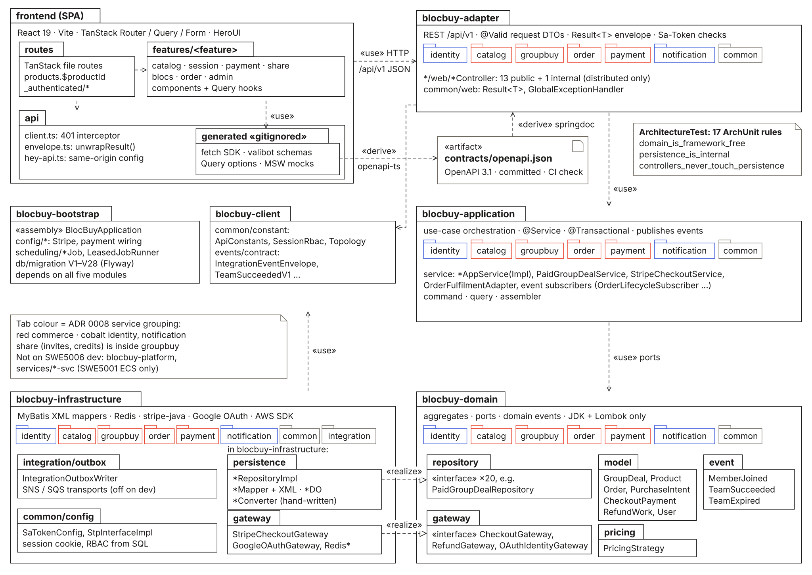
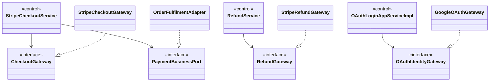
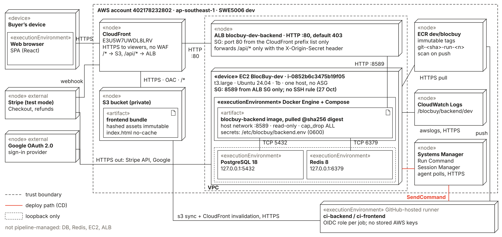

<!-- report
rubric: 3.1
owner: Liu Jin
plan: #677
sources: ../presentation/src/diagrams/logical-layers.svg, dev-deployment.svg; backend/docs/adr/; frontend/docs/adr/
owns: R33, R43
status: draft
-->

# 3 System Design

## 3.1 Software Architecture

The system this report describes is the SWE5006 system: BlocBuy's `dev` environment, a modular monolith. One Spring Boot application, split into the four COLA layers and, inside each layer, one package per bounded context, serves a React single-page application (SPA). On `dev` the backend runs as one Docker container on one EC2 host behind CloudFront, with PostgreSQL 18 and Redis 8 on the same host. Stripe (test mode) and Google sign-in are the only external systems. The same code can also be assembled as three services for the SWE5001 course; that topology appears only as a short note at the end of the deployment view, because it is not part of the system assessed here (backend ADR 0008).

A short glossary for this chapter: a **team** is one group purchase of one product, shown to buyers as a **bloc**. A leader starts it by paying upfront; others join by paying the same price; it **succeeds** when it reaches its target size before its deadline, and otherwise **expires** and every member is refunded. **Sandbox** is Stripe's test mode, in which no real money moves.

#### Logical view: layers and bounded contexts

The backend follows the COLA style of Domain-Driven Design layering, decided in the backend skeleton plan on 30 August (locked decision D1, listed in Appendix B). Each layer is one Maven module:

Table 3.1: Backend Maven modules of the monolith, their layer and their allowed dependencies.

| Module | Layer | Holds | May depend on |
| --- | --- | --- | --- |
| `blocbuy-adapter` | Adapter (presentation) | REST controllers, request and response DTOs, the `Result<T>` envelope, `GlobalExceptionHandler` | application, client |
| `blocbuy-application` | Application | Use-case services that own the transaction boundary (`@Transactional`), commands, queries, assemblers, event subscribers | domain, client |
| `blocbuy-domain` | Domain | Aggregates, value objects, domain events, repository and gateway ports (interfaces), error codes | JDK and Lombok only |
| `blocbuy-infrastructure` | Infrastructure | MyBatis mappers, data objects, repository implementations, hand-written converters, Redis, Stripe, Google and AWS SDK adapters, Sa-Token configuration | domain, client |
| `blocbuy-client` | Shared contract | Constants (`ApiConstants`, `SessionRbac`, `Topology`) and versioned integration-event contracts (`IntegrationEventEnvelope`, `TeamSucceededV1`) | none |
| `blocbuy-bootstrap` | Assembly | `BlocBuyApplication`, configuration, scheduled jobs (`LeasedJobRunner`, `TeamExpirySweepJob`, `RefundWorkerJob`), Flyway migrations | all five modules above |

The reactor also contains `blocbuy-platform` and `services/identity-svc`, `services/commerce-svc` and `services/notification-svc`. They assemble the SWE5001 services from the same modules; the monolith never depends on them and they are not deployed on `dev` (`backend/pom.xml`).

Dependencies point inward: adapter → application → domain, and infrastructure → domain. Infrastructure realises the domain's ports, so the domain never sees a framework type. This is the "dependency inversion" form of layering; the reasons and the effect on every analysis object are in section 3.2.1.

Every layer is cut by the same seven packages: six bounded contexts and a shared kernel. `catalog` holds products and team terms; `groupbuy` holds teams and their members, including share invites and referral credits; `order` holds purchase intents and orders; `payment` holds Stripe Checkout payments, refunds and the admin review queue; `identity` holds users, Google sign-in and role-based access control (RBAC); `notification` holds in-app notifications; `common` holds the error-code system, paging and the scheduler lease. Infrastructure adds one more package, `integration`, for the transactional outbox. Inside the domain module every bounded context has `model/`, `repository/`, `event/` and `exception/`. Only catalog, groupbuy, identity, payment and the shared kernel have `gateway/`, and a few add their own: `pricing/` in catalog, `query/` in groupbuy and `util/` in common (`backend/blocbuy-domain/src/main/java/com/blocbuy/`). Figure 3.1 shows the result as a UML package diagram, with the frontend on top.

{.landscape}

**Ports and adapters.** The domain declares 20 repository ports, one per aggregate root or read model (for example `GroupDealRepository`, `PaidGroupDealRepository`, `PurchaseIntentRepository`, `CheckoutPaymentRepository`, `RefundRepository`), and 12 gateway ports for everything a context needs from outside itself (`backend/blocbuy-domain/src/main/java/com/blocbuy/*/gateway/`). Figure 3.2 shows four of them, who calls them and who realises them. Three ports are realised in the application layer rather than in infrastructure, because they connect two contexts rather than an external system: the payment context asks `PaymentIntentPort` for the server-owned price and `PaymentBusinessPort` to fulfil a paid purchase, and the order context answers through `PurchaseIntentAppService` and `OrderFulfilmentAdapter`; the groupbuy context reads product titles and cover images through `ListingDisplayGateway`, which catalog answers with `GroupbuyListingDisplayAdapter`. Payment therefore never imports a groupbuy or order class, and groupbuy never imports catalog.

Figure 3.2: Ports and adapters, UML class diagram (left column application services, middle column domain ports, right column realisations). Every external call goes through a domain interface; `OrderFulfilmentAdapter` is the one realisation drawn here that lives in the application layer. The figure shows 4 of the 12 gateway ports.

The figure leaves out eight ports that follow the same pattern. `PaymentIntentPort` is realised by `PurchaseIntentAppService` and `ListingDisplayGateway` by `GroupbuyListingDisplayAdapter`, as above. `OutboxEventTransport`, used by `OutboxRelayService`, is realised by `SqsOutboxEventTransport` and `SnsOutboxEventTransport`, both subclasses of `BatchingOutboxEventTransport`; neither runs on `dev`, where the outbox writer, relay and consumer are switched off (`application-ec2.yml`; backend ADR 0007). Four ports are realised on Redis: `RateLimitGateway` by `RedisRateLimitGateway`, `OpenDealOfferCache` by `RedisOpenDealOfferCache`, `OAuthStateStore` by `RedisOAuthStateStore` and `LoginSnapshotGateway` by `RedisLoginSnapshotGateway`. `ListingSearchReranker` is realised by `TypeSafeJevListingSearchReranker`.

**Enforcement.** The rules above are tested, not only documented. `ArchitectureTest` in `blocbuy-bootstrap` holds 17 ArchUnit rules that run in every build:

Table 3.2: The 17 ArchUnit rules in `ArchitectureTest`, in five groups: layering, coding rules, context boundaries, data ownership and internal API.

| Rule | What it stops |
| --- | --- |
| `domain_is_framework_free` | Layering: Spring, MyBatis or Redis types in the domain |
| `domain_has_no_outward_dependencies` | Layering: the domain depending on application, adapter or infrastructure |
| `application_uses_ports_not_tech` | Layering: an application service calling a MyBatis mapper or `RedisTemplate` |
| `controllers_never_touch_persistence` | Layering: a controller reaching persistence |
| `persistence_is_internal` | Layering: a mapper, data object or converter leaving infrastructure |
| `no_field_injection` | Coding: field injection instead of constructor injection |
| `controllers_are_validated` | Coding: a controller without class-level `@Validated` |
| `numeric_request_params_have_range_constraints` | Coding: a numeric query parameter without `@Min`/`@Max` |
| `commerce_reaches_identity_only_through_user_port` | Boundary: catalog, groupbuy, order or payment using identity other than through `UserAppService` |
| `only_identity_reads_current_user` | Boundary: another context calling `UserAppService.currentUser`, which the remote identity client refuses |
| `nothing_depends_on_notification` | Boundary: any code depending on notification, which is reached by events only |
| `notification_depends_on_no_other_service` | Boundary: notification depending on commerce or identity code |
| `identity_persistence_is_owned` | Data: another context touching identity persistence |
| `commerce_persistence_is_owned` | Data: identity or notification touching commerce persistence |
| `notification_persistence_is_owned` | Data: another context touching notification persistence |
| `internal_controllers_are_hidden_and_distributed_only` | Internal API: a service-to-service controller active in the monolith or published in the contract |
| `internal_paths_live_in_internal_controllers` | Internal API: an `/internal/**` path outside the internal controllers |

The last three groups exist so that the SWE5001 split stays possible; in the monolith they keep the contexts loosely coupled.

**API surface.** The adapter layer has 14 `@RestController` classes and two exception advice classes (`GlobalExceptionHandler`, `StripeRequestExceptionHandler`). Thirteen controllers serve the monolith; `InternalUserController` is active only in the distributed topology. The contract is OpenAPI 3.1, generated by springdoc and committed as `contracts/openapi.json`: 27 paths and 31 operations under `/api/v1`. CI fails a pull request whose committed contract differs from the code. Every response, success or error, is one `Result<T>` envelope with a stable code; success is `COMMON_200_000` (`CommonErrorCode`). This replaced the skeleton plan's "bare DTO plus ProblemDetail" choice (D10), as the plan's historical note of 11 September records, and the frontend handles it through a single `unwrapResult` function (frontend ADR 0009).

**Frontend.** The SPA is rendered only in the browser (frontend ADR 0001). It has three layers of its own: `src/routes` (TanStack Router file routes, which own URL state; signed-in pages sit under `_authenticated`), `src/features/<area>` (`catalog`, `session`, `payment`, `share`, `blocs`, `order`, `admin`; components and TanStack Query hooks) and `src/api` (the generated client, `client.ts` with a 401 interceptor and `envelope.ts`). The client is generated from the committed contract at build time and never committed (frontend ADR 0003). The SPA calls the API on its own origin under `/api` with an HttpOnly session cookie, so no token reaches JavaScript (frontend ADR 0002).

#### Component and deployment view of the SWE5006 system

BlocBuy has no separately deployed components on `dev`: the backend is one deployable unit. The meaningful component boundaries are therefore physical, and Figure 3.3 serves as both the component and the deployment view. It is a UML deployment diagram drawn from the AWS account, read-only, on 24 October.

{.landscape}

A request flows as follows. The buyer's browser reaches one CloudFront distribution over HTTPS. CloudFront serves `/*` from a private S3 bucket through origin access control, and forwards `/api/*` to an Application Load Balancer (ALB). The ALB accepts traffic only from CloudFront's address range and only when CloudFront's secret origin header is present. It forwards to port 8589 on the EC2 host `BlocBuy-dev` (t3.large, Ubuntu 24.04), whose security group admits that port only from the load balancer (`docs/deploy/dev-cloudfront-deployment.md`). There the backend container runs read-only, without Linux capabilities, on the host network, and reaches PostgreSQL 18 and Redis 8 on the loopback interface. PostgreSQL holds every table and is the source of truth for teams, orders and payments; Redis holds only short-lived data: Sa-Token sessions, sign-in state, rate-limit counters and a cache of open teams. The backend calls Stripe and Google over HTTPS, and Stripe calls the backend back with signed webhooks through the same CloudFront path. Container logs go to CloudWatch Logs.

Delivery follows the same picture. CI on GitHub-hosted runners authenticates to AWS with one OpenID Connect (OIDC) role per job, pushes the backend image to ECR with an immutable tag, and asks Systems Manager Run Command to pull it on the host by digest; the frontend bundle is synchronised to S3 and CloudFront is invalidated. Section 4.3 describes the pipeline and its gates.

The view also shows the system's limits, which this report does not hide: one host and no auto-scaling group, so a deployment restarts the API and the database shares the host's fate; PostgreSQL, Redis, the host and the ALB are configured by hand, not by the pipeline; and the host's security group allowed SSH from any address on 21 and 24 October; the read-only check of 27 October found no port-22 rule. Appendix E lists these with their evidence. Message brokering is absent on purpose: the transactional outbox and the SNS and SQS transports are coded but switched off on `dev` (backend ADR 0007), so in-app notifications do not run there.

**Note on the SWE5001 topology.** The same code also runs on AWS ECS as three services for SWE5001: `identity-svc` (identity), `commerce-svc` (catalog, groupbuy, order and payment) and `notification-svc` (notification). The split follows transactional consistency: contexts that share a transaction stay in one service, so the four commerce contexts stay together. Commerce facts reach notification only as integration events, through a transactional outbox, one SNS topic and one SQS queue per consumer with a dead-letter queue (backend ADRs 0007 and 0008). Each service has its own database on one shared RDS instance and is granted only its own tables. That environment is also where the team's production release is promoted, by a code-owner-approved pull request; no separate SWE5006 production stack was built. Nothing in this report's design sections depends on that topology.

#### Target implementation platform

Table 3.3 lists the platform. Versions were read from `backend/pom.xml`, `frontend/package.json` and the Docker files on 26 October 2026 at commit `46faacd7`, and every one was re-read unchanged on 27 October at commit `6d14e449`.

Table 3.3: Target implementation platform of the SWE5006 system.

| Layer | Technology | Version | Notes |
| --- | --- | --- | --- |
| Backend language and runtime | Java (Eclipse Temurin JRE) | 21 | Container base `eclipse-temurin:21-jre-noble`, pinned by digest |
| Backend framework | Spring Boot | 4.1.1 | Parent BOM; Tomcat overridden to 11.0.25 for CVE fixes |
| Persistence | MyBatis Spring Boot starter, XML mappers | 4.1.0 | Hand-written SQL; no JPA |
| Schema migration | Flyway | 13.5.0 | Overrides the Boot BOM, whose Flyway does not support PostgreSQL 18; migrations V1–V28 |
| Authentication and RBAC | Sa-Token with `sa-token-redis-jackson` | 1.46.0 | Server session in Redis; roles and permissions from SQL tables |
| Payment provider SDK | stripe-java | 34.0.0 | Infrastructure module only; Stripe test mode |
| Sign-in provider SDK | google-api-client | 2.9.1 | Google OpenID Connect `id_token` verification |
| AWS SDK | AWS SDK for Java | 2.55.16 | SNS and SQS transports, off on `dev` |
| API documentation | springdoc-openapi | 3.1.1 | Exports `contracts/openapi.json` (OpenAPI 3.1) |
| Architecture tests | ArchUnit | 1.5.1 | 17 rules (Table 3.2) |
| Integration tests | Testcontainers | Spring Boot BOM | `postgres:18` and `redis:8.10` images |
| Database | PostgreSQL | 18 | One database, schema `domain`; native `uuidv7()` |
| Cache and session store | Redis | 8 | Sessions and rate limits only |
| Frontend language | TypeScript | 7.0.2 | Node 24, pnpm 12.4.2 |
| UI library | React | 19.3.1 | React Compiler through the Babel preset (frontend ADR 0010) |
| Routing, server state, forms | TanStack Router, Query, Form | 1.170.44, 5.104.3, 1.33.5 | |
| Components and styling | HeroUI, Tailwind CSS | 3.2.6, 4.3.3 | |
| Validation | Valibot | 1.5.0 | Schemas generated with the client |
| API client generator | hey-api `openapi-ts` | pre-release build `0.0.0-next-20260824173136` | Output gitignored (frontend ADR 0003) |
| Build tool | Vite | 8.3.4 | |
| Frontend tests | Vitest, Playwright | 5.0.1, 1.64.1 | MSW for API mocks |
| Cloud (SWE5006 `dev`) | AWS CloudFront, S3, ALB, EC2, ECR, Systems Manager, CloudWatch Logs | n/a | Region ap-southeast-1 |
| External services | Stripe Checkout (test mode), Google OAuth 2.0 | n/a | |

The proposal named JWT for authentication and JPA for persistence. The team replaced them with a Sa-Token server session and MyBatis before the first sprint; neither change has an ADR, and Appendix B records both.

#### Architectural decisions

Each architectural decision is recorded either as a numbered ADR or as a locked decision in the backend skeleton plan of 30 August. Table 3.4 lists the decisions that shape the architecture above; Appendix B indexes all 23 ADRs (8 backend, 15 frontend) and lists the decisions that have no ADR.

Table 3.4: Architectural decisions behind section 3.1 and where each is recorded.

| Decision | Record | Date |
| --- | --- | --- |
| Modular monolith in COLA layers, one package per bounded context | Skeleton plan D1, D4 | 30 Aug 2026 (payment context added 31 Aug) |
| Framework-free domain (JDK and Lombok only), tested by ArchUnit | Skeleton plan §4 and §8; no ADR | 30 Aug 2026 |
| PostgreSQL and Redis only; no message broker or search engine | Skeleton plan D5; amended by backend ADR 0007 for SNS and SQS | 30 Aug 2026; 11 Oct 2026 |
| Sa-Token session in Redis, RBAC from SQL tables | Skeleton plan D6, D7; frontend ADR 0002 for the cookie | 30 Aug 2026; 17 Sep 2026 |
| Pure client-side SPA on S3 and CloudFront | Frontend ADRs 0001, 0005 | 17 Sep 2026 |
| Same-origin `/api` with an HttpOnly cookie session | Frontend ADR 0002 | 17 Sep 2026 |
| Committed OpenAPI contract, generated client not committed | Skeleton plan D12, D19; frontend ADR 0003 | 30 Aug 2026; 17 Sep 2026 |
| One `Result<T>` envelope for every response | Skeleton plan historical note (supersedes D10); frontend ADR 0009 for the client | 11 Sep 2026; 16 Sep 2026 |
| Purchase intent in order, team terms on the product | Backend ADR 0001 | 22 Sep 2026 |
| A team's consequences run before the commit | Backend ADR 0002 | 22 Sep 2026 |
| Referral credit after the commit | Backend ADR 0003 | 25 Sep 2026 |
| Stripe Hosted Checkout with a server-owned intent | Frontend ADR 0014; backend ADR 0005 for the feature flag | 23 Sep 2026; 30 Sep 2026 |
| Transactional outbox to SNS and SQS for cross-service events | Backend ADR 0007 (status still "Proposed") | 11 Oct 2026 |
| One codebase, two deployment topologies | Backend ADR 0008 | 12 Oct 2026 |

Decisions without an ADR, such as MyBatis instead of JPA and the concurrency approach, are listed with their reasons in Appendix B.
