<!-- report
rubric: 3.2, 3.2.1, 3.2.2, 3.2.3, 3.2.4
owner: Wang Ziang (Eric)
plan: #677
sources: ../report-drafts/transition-strategies.md
status: draft
-->

## 3.2 Transition from Analysis to Design

Nine transition strategies take every BlocBuy analysis object from the platform-free analysis model to a design on Java 21, Spring Boot, React and PostgreSQL. Each strategy handles one design concern. It names the analysis objects and use cases it affects, then shows the typical change to the class diagram and to the sequence diagram, with the reason for each. A designer who joins the team can apply them to a new use case without asking how the existing ones were built.

BlocBuy is a client/server web system. The server is a modular monolith in Java, layered in the COLA style (adapter, application, domain and infrastructure layers), with six bounded contexts inside it: catalog, groupbuy, order, payment, identity and notification. The client is a single-page web application. Section 3.1 draws the layers. The strategies take these decisions as given:

- The server runs on Java 21 and Spring Boot 4.1.1 (`backend/pom.xml`), in the COLA module layout of decision D1 of the backend skeleton plan. That plan started on Spring Boot 3.5; the upgrade supersedes it.
- The client is React 19 with TanStack Router and TanStack Query (frontend ADR 0001). It calls the server only through a client generated from the OpenAPI contract (frontend ADR 0003).
- Client and server exchange JSON over HTTPS under `/api/v1`. Every JSON response is one result envelope, `Result<T>` (frontend ADR 0009). The OAuth redirects are the only documented exception.
- Data is stored in PostgreSQL through MyBatis, with hand-written converters (skeleton plan decision D9) and versioned Flyway migrations.
- Database locks serialise changes to money and seats, and their consequences commit in the same transaction (backend ADRs 0001 and 0002).

Table 3.5: The nine transition strategies, the concern each handles, and the decision record behind it.

| Strategy | Concern | Decision record |
|---|---|---|
| 3.2.1 Language and framework | maintainability | no ADR; skeleton plan D1 (Appendix B) |
| 3.2.2 Presentation | usability | frontend ADRs 0001, 0003, 0009, 0014 |
| 3.2.3 Distribution | interoperability between client and server, and between contexts | frontend ADR 0009; backend ADRs 0001, 0008 |
| 3.2.4 Persistence | data integrity | no ADR; skeleton plan D9 (Appendix B) |
| 3.2.5 External interface | isolation from payment and identity providers | backend ADRs 0001, 0004, 0005 |
| 3.2.6 Security | authentication, authorisation, abuse limits | frontend ADR 0002; no backend ADR |
| 3.2.7 Scheduling | timely team expiry (design bound: one sweep interval plus sweep time) | backend ADR 0002 for the expiry transition, and its addendum of 23 September for the sweep job and its lease |
| 3.2.8 Concurrency | no oversold seat, no payment settled twice | backend ADRs 0001, 0002 for the locks; no ADR for the approach as a whole |
| 3.2.9 Domain events | decoupling of consequences across contexts | backend ADRs 0002, 0003, 0007 |

Three strategies have no architecture decision record of their own: language and framework, persistence, and the concurrency approach as a whole. They rest on the locked decisions D1 to D20 of the backend skeleton plan and on design notes. Backend ADRs 0001 and 0002 record only the locks and unique indexes of the paid path and the expiry transition. The design of the scheduled jobs is recorded in the addendum of 23 September to backend ADR 0002 (`TeamExpirySweepJob`, `LeasedJobRunner` and the database lease). Appendix B lists the decisions without an ADR.

#### Every analysis object type has a strategy

Table 3.6 shows that every kind of analysis object in section 3.4 is transformed by at least one strategy. A designer starts from the object's kind and applies every strategy in its row.

Table 3.6: Analysis object types and the strategies that transform them.

| Analysis object type | Example in UC4 or UC5 | Strategies that apply |
|---|---|---|
| «boundary» screen used by a human actor (buyer, administrator) | `JoinTeamUI` | 3.2.2 Presentation, 3.2.3 Distribution, 3.2.6 Security |
| «boundary» to an external system | `PaymentGateway` | 3.2.5 External interface; 3.2.8 (no provider call inside a transaction) |
| External system as an actor (Stripe, Google) | Stripe sends the payment confirmation | 3.2.5 External interface; 3.2.3 (the Stripe callback is a REST endpoint) |
| «control» | `JoinTeamControl` | 3.2.1 Language and framework, 3.2.3 Distribution, 3.2.6 Security, 3.2.8 Concurrency, 3.2.9 Domain events |
| «entity» | `Team`, `Membership`, `Order`, `Payment`, `Refund` | 3.2.1 Language and framework, 3.2.4 Persistence, 3.2.8 Concurrency |
| Scheduler (timer actor) and the «control» it starts | the expiry sweep in UC5 and the refund worker in UC6 | 3.2.7 Scheduling; 3.2.8 (job lease, `FOR UPDATE SKIP LOCKED`); 3.2.9 (the expiry publishes an event) |

#### Worked mapping: from the UC4 analysis model to design

The UC4 (join a team) analysis model in section 3.4.1 has an object of every kind except the scheduler. Table 3.7 follows each of its objects into the design and names the strategy that put it there. Section 3.4.1 draws the full UC4 analysis and design class diagrams; the figures in 3.2.1 to 3.2.4 and 3.2.8 below each show one step of this mapping as a before-and-after pair.

Table 3.7: Where each UC4 analysis object lands in the design.

| Analysis object | Design elements | Strategy |
|---|---|---|
| «boundary» `JoinTeamUI` | route `products.$productId.tsx` (component `ProductDetailPage`), component `DealProgress`, hook `useCheckout`; REST endpoints under `/api/v1/payments` | 3.2.2, 3.2.3 |
| «boundary» `PaymentGateway` | port `CheckoutGateway`, adapter `StripeCheckoutGateway`, `StripeWebhookController` | 3.2.5 |
| «control» `JoinTeamControl` | split by step: `StripeCheckoutController` → `PaymentBrowserService` (the buyer's requests), `PurchaseIntentAppService` (quote), `StripeCheckoutService` (checkout and settlement), `OrderFulfilmentAdapter` (what the money buys), `PaidGroupDealService` (admission) | 3.2.1, 3.2.3, 3.2.8 |
| «entity» `Team`, `Membership` | aggregate `GroupDeal`; members are rows of `biz_group_member`, written with the team and read as the records `PaidMember` and `TeamMembership` | 3.2.4, 3.2.8 |
| «entity» `Order` | aggregate `Order`, repository `OrderRepository` | 3.2.4 |
| «entity» `Payment` | aggregate `CheckoutPayment`, repository `CheckoutPaymentRepository` | 3.2.4, 3.2.8 |
| «entity» `Refund` | refund obligation: a row of `biz_refund`, read by the refund worker as the record `RefundWork`; no aggregate class | 3.2.4 |

#### The typical change in one paragraph

Across all strategies, the class diagram changes in the same way. A screen «boundary» becomes a route, a component, a Query hook and the generated client. A «control» becomes a `@RestController` in front of an application service. An «entity» becomes an aggregate behind a domain repository port, implemented in infrastructure by a MyBatis mapper. A «boundary» to an external system becomes a gateway port with a provider adapter. The sequence diagram changes in the same way too. In analysis, a control simply tells an entity to update itself. In design, the application service opens one transaction, asks the repository for a locked aggregate (`PaidGroupDealRepository.lockDeal`, a `SELECT … FOR UPDATE`), lets the aggregate decide (`GroupDeal.joinPaid`), and saves the result with a guarded `UPDATE` (`PaidGroupDealMapper.xml`, `updateDeal`).

Rationale: dependency inversion. The domain names what it needs as interfaces (repository and gateway ports), and the outer layers implement them, so business rules do not depend on Spring, MyBatis or Stripe. Seventeen ArchUnit rules in `ArchitectureTest` enforce the layering in every build.

Some of the mechanisms below are named by the course but are not GoF patterns: Repository and DAO, the transactional outbox, idempotency keys and Optimistic Offline Lock. They are named as mechanisms here. The GoF patterns are in section 3.5.

### 3.2.1 Language and Framework

Java 21 is the server language and Spring Boot 4.1.1 is the framework. Spring creates and wires objects, runs transactions and handles web requests. Code follows google-java-format in the AOSP style with Checkstyle, and the build enforces both.

Each layer is a Maven module, and each bounded context is a package inside it, under the prefix `com.blocbuy` (Table 3.8).

Table 3.8: Maven modules and what each holds.

| Module | Package pattern | Holds |
|---|---|---|
| `blocbuy-client` | `.common`, `.events.contract` | shared types and the contracts of integration events |
| `blocbuy-adapter` | `.<context>.web` | REST controllers, request and response records, exception handlers |
| `blocbuy-application` | `.<context>.service`, `.query`, `.command` | application services, event subscribers, read views |
| `blocbuy-domain` | `.<context>.model`, `.event`, `.repository`, `.gateway`, `.exception` | aggregates, value objects, domain events, ports, error codes |
| `blocbuy-infrastructure` | `.<context>.persistence`, `.gateway` | repository implementations, MyBatis mappers, data objects, provider adapters |
| `blocbuy-platform` | `.platform` | the SWE5001 service assembly (topology guard, trace propagation); the monolith does not use it |
| `blocbuy-bootstrap` | `.bootstrap` | start-up, configuration, scheduled jobs |

#### Analysis objects affected

All «control» and «entity» objects. Boundaries are handled by 3.2.2, 3.2.3 and 3.2.5.

#### Use cases affected

All use cases, UC1 to UC9 and the included Pay upfront.

#### Static structure changes

- A «control» becomes an application service in `blocbuy-application`, created and wired by Spring. It is annotated `@Service` (for example `PaidGroupDealService`). A service that configuration switches on is declared instead as a bean in a bootstrap configuration class: `StripeCheckoutService` in `StripeCheckoutConfiguration`, `OrderFulfilmentAdapter` in `PaymentIntegrationConfiguration`. Collaborators arrive through the constructor into `final` fields. The ArchUnit rule `no_field_injection` rejects field injection.
- An «entity» becomes a final class in `blocbuy-domain` with no framework annotations. The rule `domain_is_framework_free` checks the model, repository, pricing, event and exception packages and `common.exception`, against Spring, MyBatis, Sa-Token, Jakarta and Jackson types; the `gateway`, `query` and `util` packages are not in its scope. Its state changes only through behavioural methods, for example `GroupDeal.joinPaid`, `Order.confirm` and `Product.publish`.
- A broken business rule becomes a `BizException` that carries an `ErrorCode` constant of its context, for example `GroupbuyErrorCode.DEAL_FULL`.

Figure 3.4 shows the change on the UC4 admission step. The analysis classes are in the top row. The «trace» dependencies lead to the design classes that realise them.

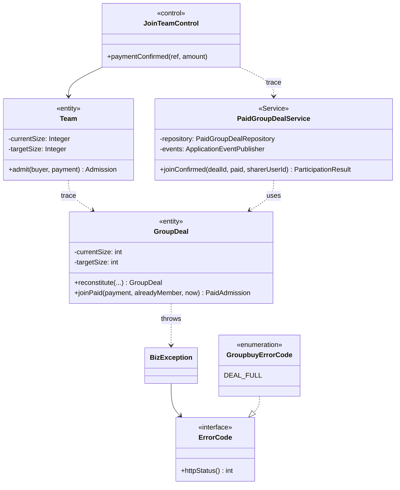

Figure 3.4: Class diagram, before (analysis, top) and after the language and framework strategy (design). The «control» becomes a Spring service with constructor-injected ports, and the «entity» becomes a framework-free aggregate that reports a broken rule as a BizException with a context error code.

Rationale: a domain without framework code can be tested without Spring. Constructor injection makes every dependency explicit, so a unit test builds the object with `new` and hands it test doubles.

#### Dynamic behaviour changes

Services exist before a use case starts, so a design sequence diagram begins at a service object, not at a newly created control. Entities are never built with a bare constructor:

- static factories validate a new state, for example `PurchaseIntent.issue(...)` and `Order.create(...)`, and rebuild a stored one, for example `GroupDeal.reconstitute(...)`;
- a paid team is created through a Factory Method: the abstract `PaidGroupDealCreator.initiate(...)` calls the subclass's `createGroupDeal(...)`. This is the design problem of UC3 in section 3.5.1.

Figure 3.5 is the analysis interaction; Figure 3.6 is the same step in design.

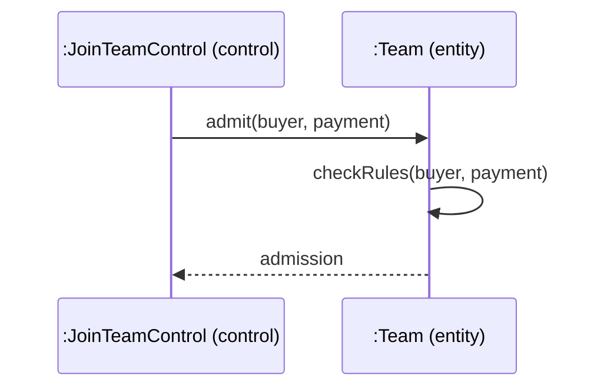

Figure 3.5: Analysis sequence of the UC4 admission step, before the strategy. The control asks the entity to admit the buyer, and the entity checks its own rules.

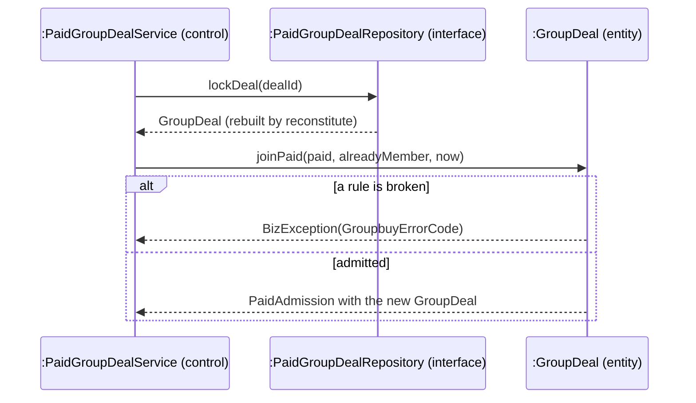

Figure 3.6: Design sequence of the same step, after the strategy. The service already exists and gets the aggregate from a port; the aggregate either returns a new immutable state or throws a coded business error.

Rationale: a state change happens in one place, the aggregate, so every use case that changes a team enforces the same invariants. Because `joinPaid` returns a new `GroupDeal` instead of changing the old one, the service holds both the state it read and the state it will write, which the guarded update of 3.2.4 needs.

### 3.2.2 Presentation

The user interface is a single-page application in React 19, in three parts: routes in `frontend/src/routes` (TanStack Router owns the URL), feature components and hooks in `frontend/src/features/<area>`, and server state held by TanStack Query. The design names each screen down to its route and feature component, plus the control that starts the use case, such as the *Join this bloc* button. (A bloc is BlocBuy's name, on screen, for a team of buyers.)

#### Analysis objects affected

Every screen «boundary», for example `JoinTeamUI` in UC4. The «control» objects stay on the server. The client shows state, sends commands and may compute a countdown or a free seat for display, but the server decides prices, seats and deadlines.

#### Use cases affected

Every use case with a screen: UC1 to UC4 and UC7 to UC9. UC5 and UC6 are started by the scheduler and show their results on existing screens.

#### Static structure changes

- A screen «boundary» becomes a route module plus feature components. `JoinTeamUI` becomes the route `products.$productId.tsx` (component `ProductDetailPage`) and the component `DealProgress`, which shows a team's progress and its join control.
- A user command becomes a hook built on mutations generated from the contract. `useCheckout` (`features/payment/use-checkout.ts`) wraps `createPaymentIntentMutation` and `createPaymentCheckoutMutation` and exposes `begin(operation, businessId)`.
- A server read becomes a query hook.
- The generated types keep the envelope shape. The hook unwraps a response with `unwrapResult` (`frontend/src/api/envelope.ts`), which throws an `ApiError` for an error envelope.

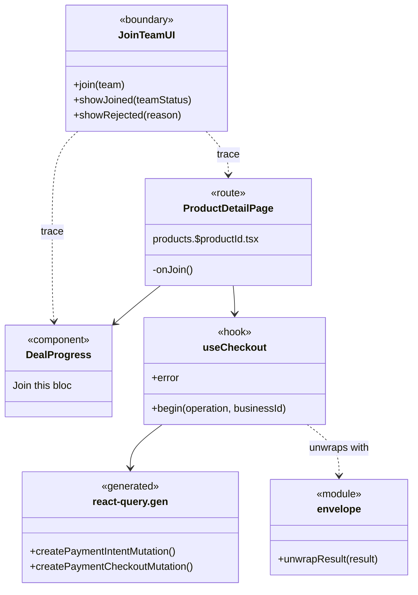

Figure 3.7: Class diagram, before (the analysis «boundary» JoinTeamUI) and after the presentation strategy. One screen boundary becomes a route, a component and a hook; the hook reaches the server only through mutations generated from the contract.

Rationale: a generated client keeps the screens in step with the contract, so a renamed field fails the frontend build instead of the running page. Keeping business decisions on the server leaves one place to change them.

#### Dynamic behaviour changes

In analysis the boundary forwards the buyer's request to the control and shows the answer (Figure 3.8). In design the component raises an event to its route, the route calls the hook, and the hook makes two calls in order: it creates a purchase intent, then a Checkout session, and then sends the browser to Stripe's hosted page (Figure 3.9).

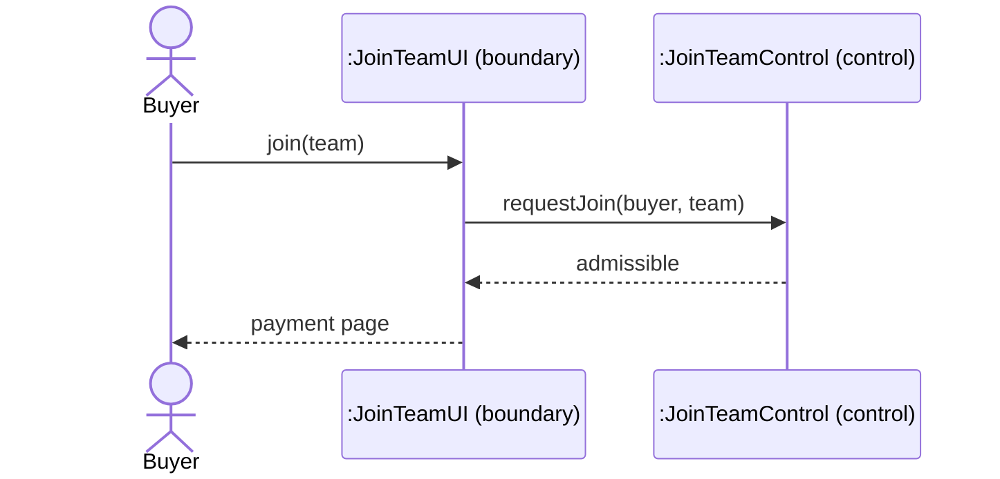

Figure 3.8: Analysis sequence of starting a join, before the strategy. The boundary passes the request to the control and shows the result.

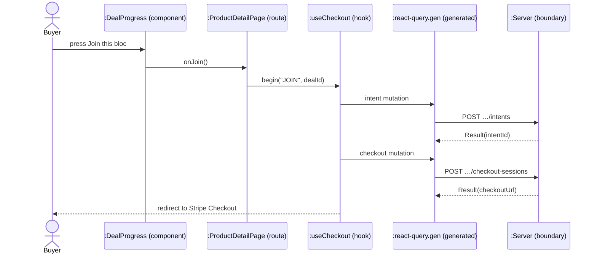

Figure 3.9: Design sequence of the same step, after the strategy. The screen only sequences two server calls and a redirect; every decision is made by the server.

Rationale: the screen only sequences calls and redirects, so a business rule never has to be repeated in the browser. An error envelope becomes an `ApiError` inside the hook, which the page reads from `error` and shows as a message. The hook stores the intent and the idempotency key in session storage, so a repeated press reuses the same purchase instead of starting a second one.

### 3.2.3 Distribution

Client and server are separate processes, so every server «control» that a screen uses is reached through a REST endpoint. Endpoints sit under `/api/v1`, exchange JSON and are described by the committed contract `contracts/openapi.json`. The client generated from it at build time is the client-side stub of this distribution.

#### Analysis objects affected

Every «control» that a «boundary» calls. The data passed between them becomes request and response records. Inside the server, every «control» whose use case spans more than one bounded context (see "Cross-context seams" below).

#### Use cases affected

All use cases with a screen (UC1 to UC4, UC7 to UC9), and the Stripe callback in UC3 and UC4 (`StripeWebhookController`). UC3 and UC4 also cross contexts by calls; UC5 and UC6 cross them by domain events (3.2.9).

#### Static structure changes

- Each «control» gets a `@RestController` in front of it, in the adapter module. Request bodies are records validated with Jakarta Bean Validation. ArchUnit checks that every controller is `@Validated` and that numeric query parameters carry a range (`controllers_are_validated`, `numeric_request_params_have_range_constraints`).
- A controller maps the application's read view to a response record of the adapter and wraps it in `Result<T>`, for example `OrderSummaryView` to `OrderSummaryResponse` in `OrderController`. Persistence classes never reach a controller (`controllers_never_touch_persistence`).
- Errors travel as `BizException(ErrorCode)`. `GlobalExceptionHandler.handleBiz` turns one into `Result.error` with the HTTP status that the error code declares. The handler maps validation, malformed-request, authentication, permission, not-found, method and media-type errors to their 4xx statuses, and answers anything else with 500 and a trace ID. The payment web layer adds `StripeRequestExceptionHandler` for its own request errors.

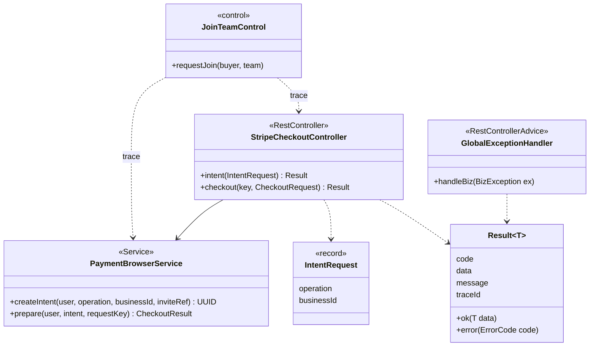

Figure 3.10: Class diagram, before (the analysis «control») and after the distribution strategy. The control's interface becomes a validated REST controller with request records, every answer is one Result envelope, and one handler maps every business error.

Rationale: validating at the boundary keeps malformed input out of the services, and one envelope with stable error codes lets the client handle every failure the same way. The CI job `contract-check` fails a pull request whose endpoints drift from `contracts/openapi.json`.

#### Dynamic behaviour changes

In analysis, the boundary calls the control directly (Figure 3.8). In design, the call crosses the network as JSON, Spring validates it before the controller method runs, and every failure takes the same path through the exception handler (Figure 3.11).

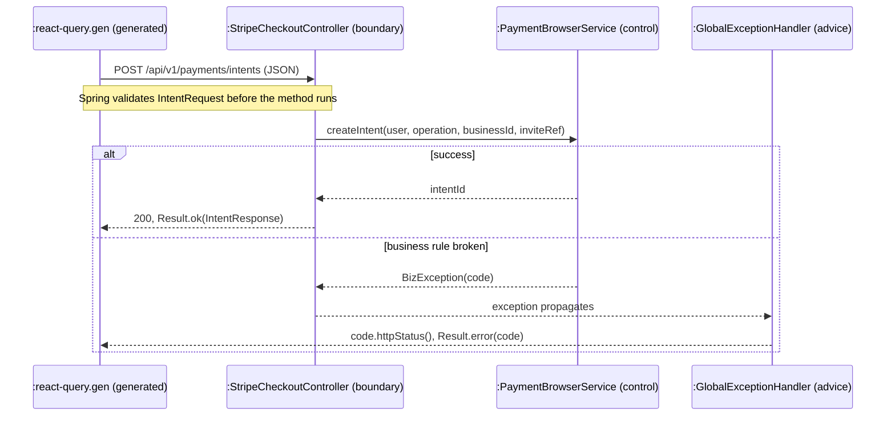

Figure 3.11: Design sequence of a remote call, after the distribution strategy. The request is validated at the boundary, and a business error becomes the status and code its ErrorCode declares.

Rationale: the failure path is the same for every use case, so the sequence diagrams of section 3.4 show only the business decision and leave the HTTP mapping to this strategy.

#### Cross-context seams

The six contexts share one deployable. Code in one context reaches another only through an interface it is allowed to use:

- **Supplier facades**, owned by the context that is called: `CatalogPurchaseSupport` (price, purchasability, one stock unit); `GroupDealPurchaseSupport` (the team check before payment) and `GroupDealSettlementSupport` (locking, linking and reconciliation around admission after payment; admission itself stays in `PaidGroupDealService`).
- **Ports defined by the caller.** Payment defines `PaymentIntentPort` and `PaymentBusinessPort`, and the order context implements them (`PurchaseIntentAppService`, `OrderFulfilmentAdapter`). Settlement therefore depends on the port, not on order code. One payment read service uses the order's `PurchaseOperation` enum.
- **The identity port** `UserAppService` is the only way the commerce contexts ask about a user (ArchUnit rule `commerce_reaches_identity_only_through_user_port`).

In UC3 and UC4 the analysis «control» needs the listing (catalog), the team (groupbuy), the order (order) and the payment (payment). Figure 3.12 shows how the design splits it along those seams; the context of each class is in brackets.

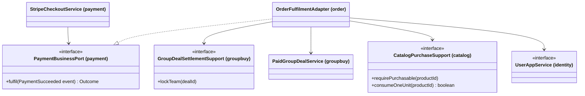

Figure 3.12: Class diagram of the cross-context seams on the settlement path, after the distribution strategy. Payment calls a port it owns; the order context implements it and reaches groupbuy, catalog and identity only through their published interfaces.

Rationale (static): each context can change its internals without breaking the others, and every dependency points from the caller to an interface that its owner controls.

A cross-context call is an ordinary synchronous call on the interface, inside the caller's transaction. The design sequence diagrams of section 3.4 draw the interface as the lifeline (Figure 3.13).

```mermaid
sequenceDiagram
    participant Pay as :StripeCheckoutService (control)
    participant Port as :PaymentBusinessPort (interface)
    participant Cat as :CatalogPurchaseSupport (interface)
    participant Grp as :PaidGroupDealService (control)
    Pay->>Port: fulfil(PaymentSucceeded)
    Port->>Port: lock team; check buyer active
    Port->>Cat: requirePurchasable(productId)
    Port->>Grp: joinConfirmed(dealId, paid, sharerUserId)
    Port->>Cat: consumeOneUnit(productId)
    Port-->>Pay: Outcome
```

Figure 3.13: Design sequence of a cross-context call during settlement. The payment service sees only its own port, and the implementation reaches the other contexts through their interfaces in one transaction. To keep the figure legible, the calls to GroupDealSettlementSupport (lock the team) and UserAppService (is the buyer active) are folded into one self-call.

Rationale (dynamic): the caller sees only the interface, so the call stays the same when the implementation moves. In the SWE5001 deployment the identity port is answered by a remote client, while catalog, groupbuy, order and payment stay together in one service (backend ADR 0008). That deployment is context only; this report describes the SWE5006 monolith.

### 3.2.4 Persistence

Data is stored in PostgreSQL 18 through MyBatis. A persistent aggregate has a repository interface in the domain module. The infrastructure module implements it with a MyBatis mapper (SQL in XML) and a data object (DO) that mirrors one table row, and a hand-written converter maps the DO to the aggregate (skeleton plan decision D9).

In the course's DAO strategy, the mapper is the DAO that runs the SQL, and the DO is the transfer object that carries one row between the mapper and the repository. The repository puts a domain port in front of the DAO and hands out aggregates, never DOs. For a read, the converter turns the DO into the aggregate (`GroupDealConverter.toDomain`). For a write, the repository builds the DO from the aggregate (`PaidGroupDealRepositoryImpl.toRow`). The request and response records of 3.2.3 are the transfer objects between client and server.

Keys are UUIDv7. References between aggregates are IDs without foreign keys, by team convention. Flyway migrations V1 to V28 evolve the schema (section 3.6). The collective behaviour of an entity class (find, page) moves to its repository; 3.2.8 adds locking.

Each aggregate root has one or more repository ports. The team aggregate has two. `GroupDealRepository` is the read port (find, best open deal, memberships). `PaidGroupDealRepository` is the write protocol of the paid path: it reserves the payment's participation receipt, locks the team, inserts a member and expires a team, all in the caller's transaction. Reads and locked writes have different callers and different SQL, so each has its own port. This is a team ruling: one read port per aggregate root, plus a separate write-protocol port where one transaction must lock across aggregates. The write protocol knowingly spans the team and its receipt in one transaction, for payment idempotency; it behaves as a unit-of-work contract even though its name says repository.

#### Analysis objects affected

Every persistent «entity», and every «control» that reads or writes one.

#### Use cases affected

All use cases that read or change stored data, which is every use case in scope.

#### Static structure changes

Rationale: the application depends only on the port (ArchUnit rule `application_uses_ports_not_tech`), and persistence classes stay inside infrastructure (`persistence_is_internal`), so the storage technology can change without touching domain or application code. Integrity rules that must hold under concurrency are also unique indexes, listed by name in 3.2.8.

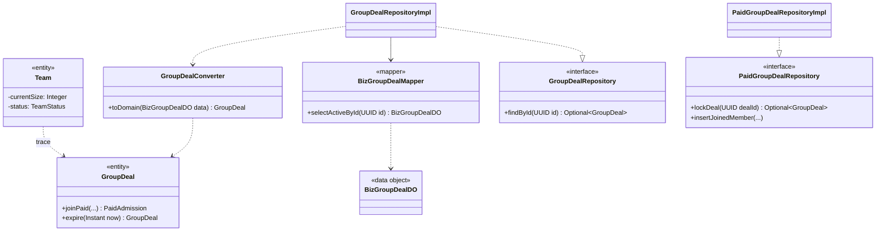

Figure 3.14: Class diagram, before (the analysis «entity» Team) and after the persistence strategy. The entity becomes an aggregate behind two domain ports; the infrastructure implements them with a MyBatis mapper, a row-shaped data object and a converter, none of which leave the infrastructure module.

#### Dynamic behaviour changes

In analysis, an entity is simply there: the control asks it a question (Figure 3.15). In design, the aggregate is loaded through the port, the converter builds it from a row, and a change is written back with a guarded `UPDATE` (Figure 3.16).

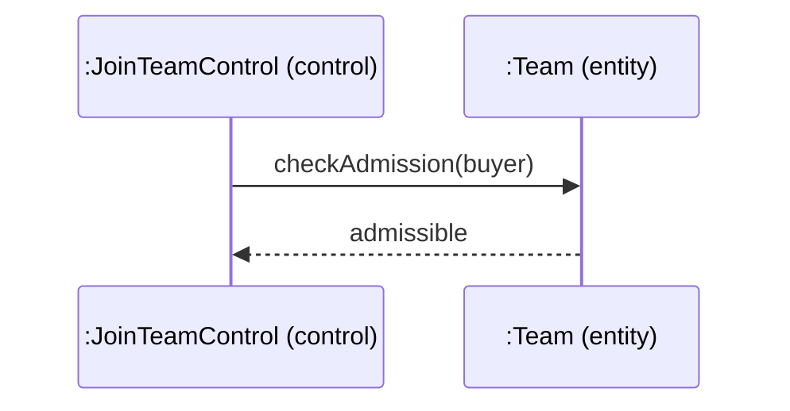

Figure 3.15: Analysis sequence, before the persistence strategy. The entity is in memory, and loading or saving it is not shown.

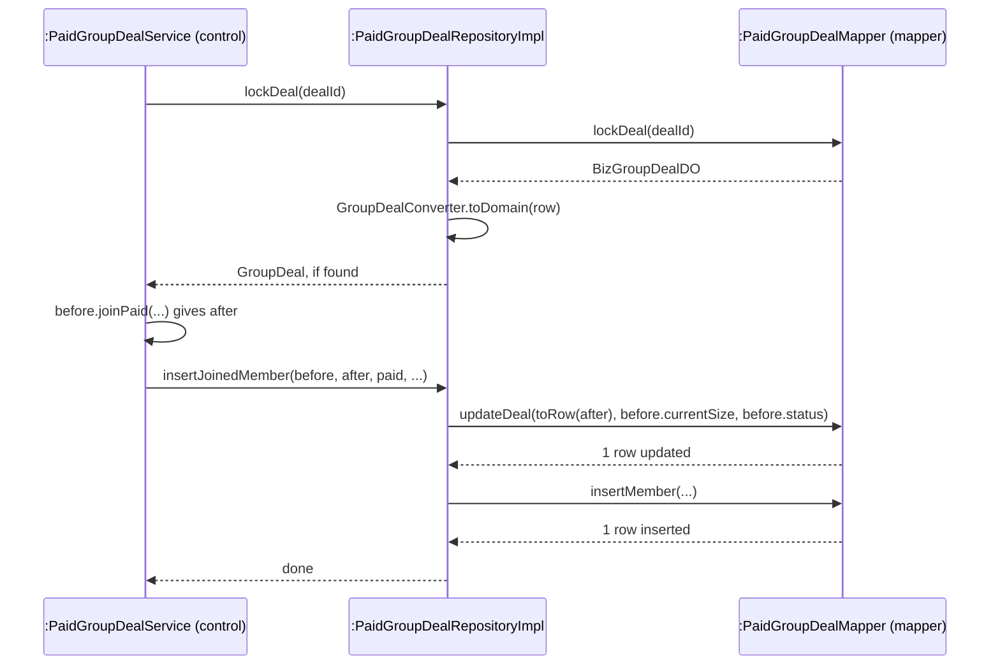

Figure 3.16: Design sequence of loading and saving a team, after the persistence strategy. The service sees only aggregates; the data object and the SQL stay behind the port, and the save names the state it read.

Rationale: a save is a guarded `UPDATE` that names the state it read, so a concurrent change updates zero rows and is refused. The team's row changes only if its size and status are still the ones read (`PaidGroupDealMapper.updateDeal`), and a listing's only if its `version` matches (`BizProductMapper`). The repository refuses any affected-row count other than one (`requireOne`), which rolls the transaction back.
