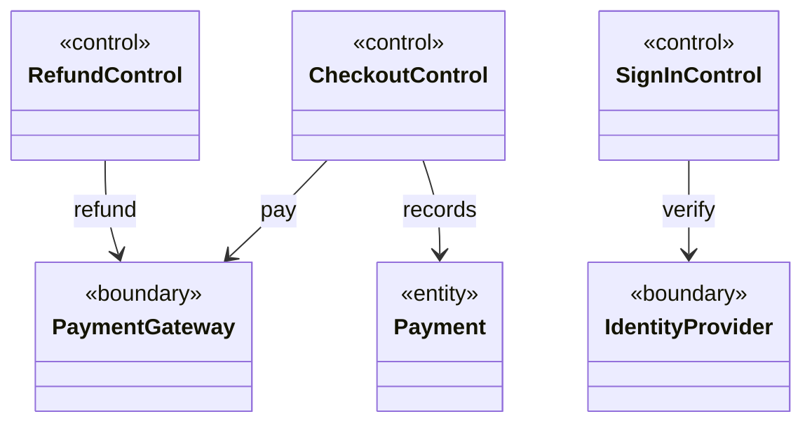
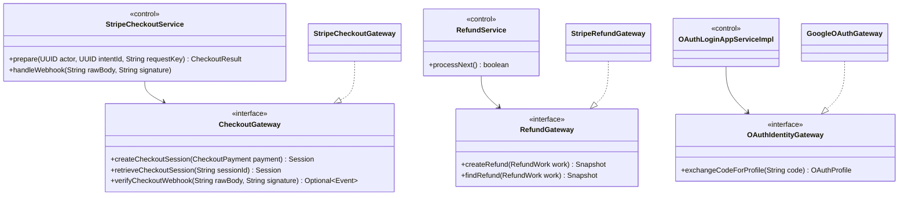
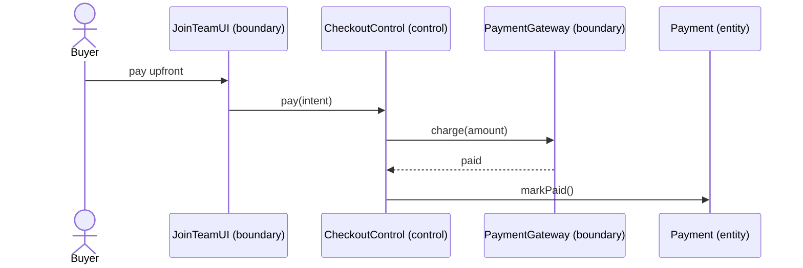
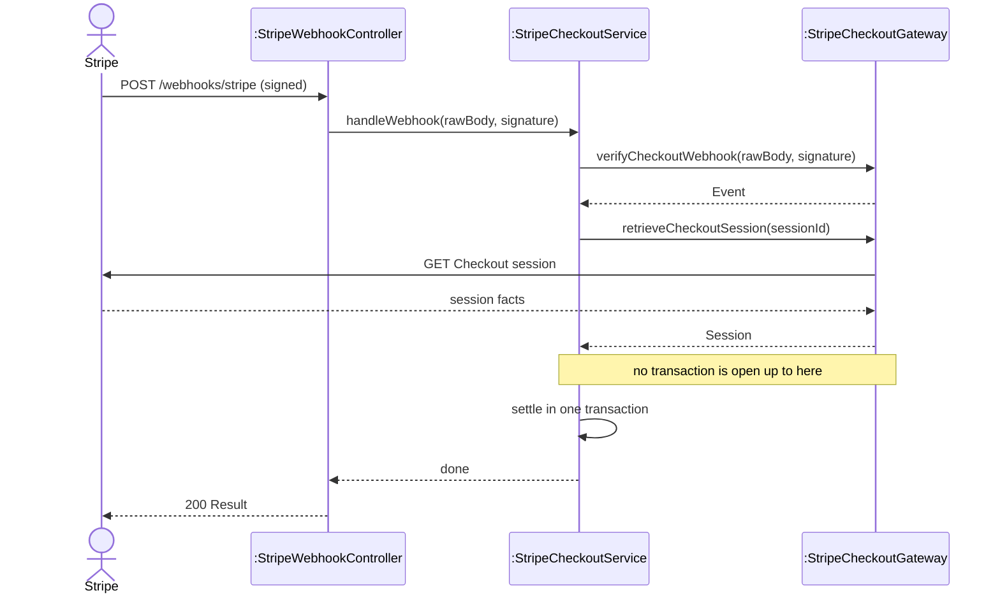
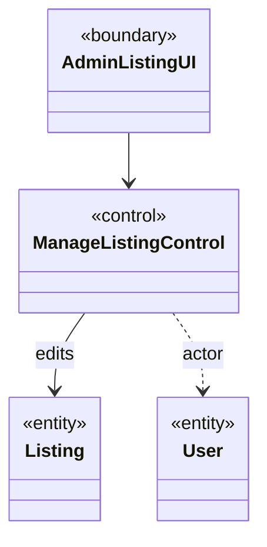
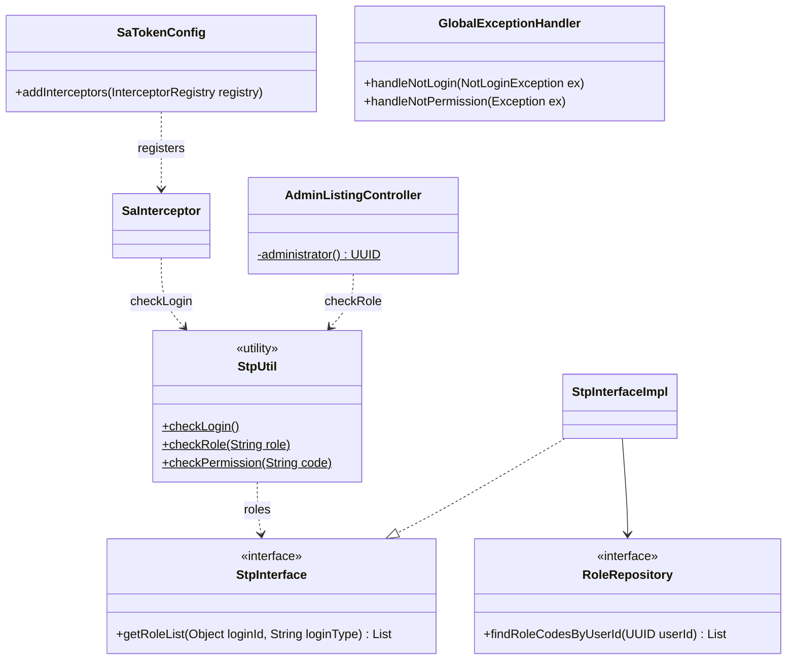
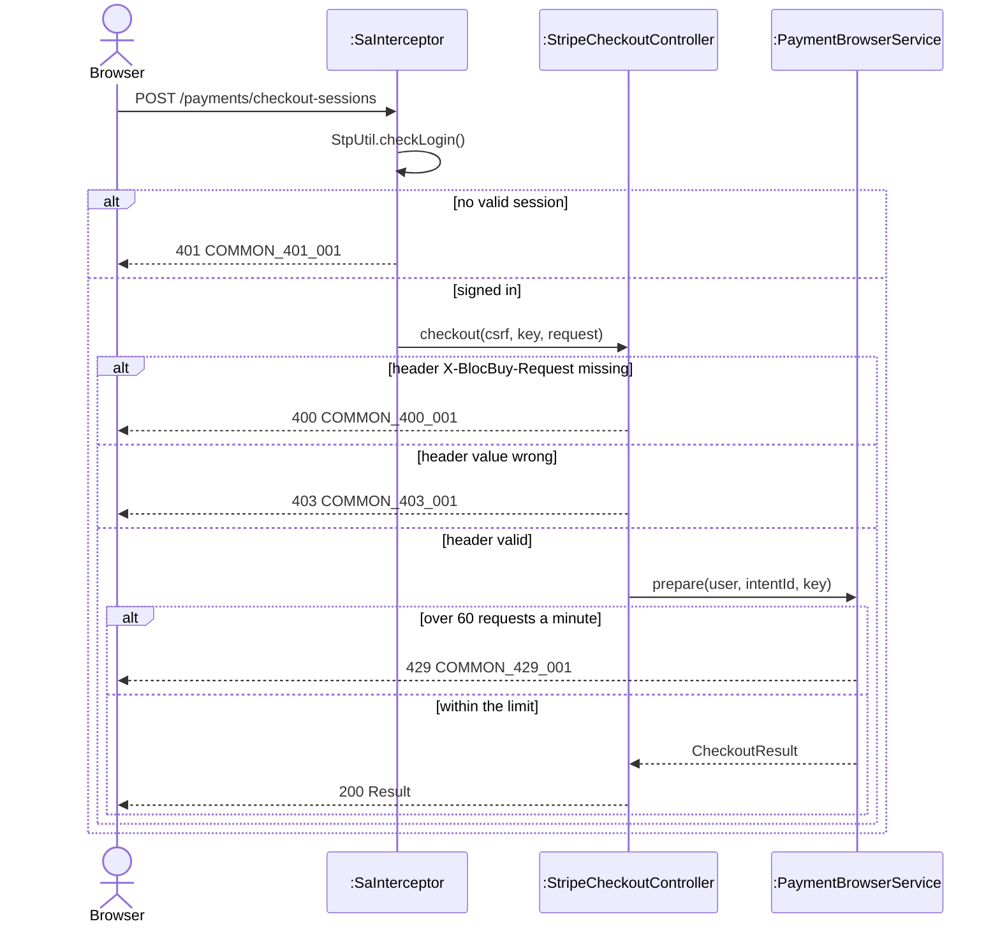
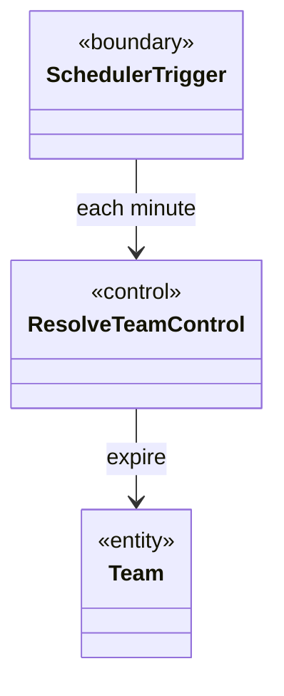
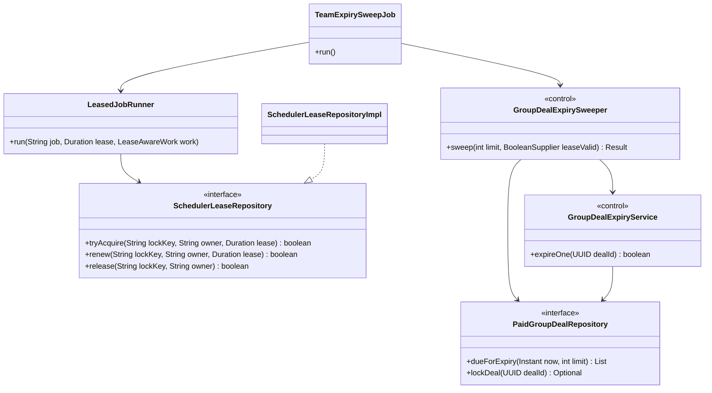
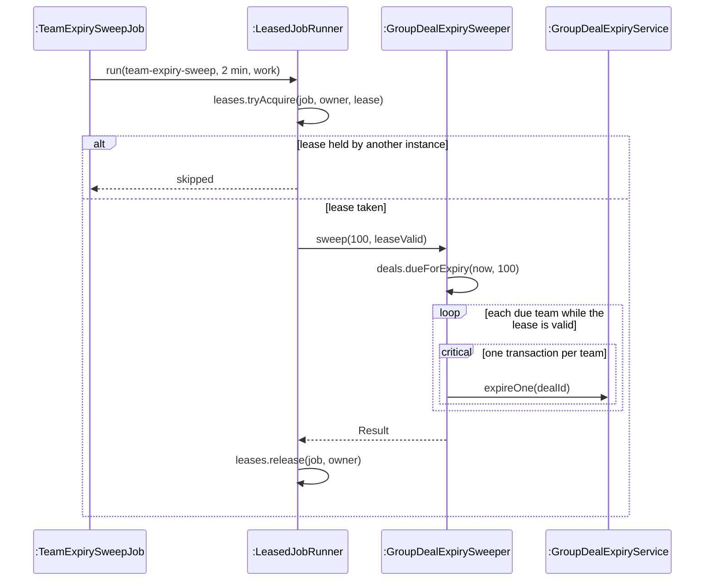

<!-- report
rubric: 3.2.5, 3.2.6, 3.2.7
owner: Yu Qianshuo (Yorik)
plan: #677
sources: ../report-drafts/transition-strategies.md; ../report-drafts/yorick-yu-contribution.md
owns: R05, R22, R29
status: draft
-->

### 3.2.5 External Interface

BlocBuy depends on two external systems: Stripe, for hosted Checkout payments and refunds, and Google, for sign-in. This strategy keeps each provider behind a port that the domain owns and an adapter in the infrastructure module. It also fixes three rules for every call that moves money: the call carries an idempotency key, it never runs inside a database transaction, and an outcome that is unsafe to retry goes to an operator instead of back into the retry loop. The concern is provider isolation. The decisions behind it are recorded in backend ADRs 0001 (payment and business integration), 0004 (retire the legacy PaymentIntent path) and 0005 (Checkout behind an environment flag).

Table 3.9: External «boundary» objects and their design elements.

| Analysis «boundary» | Port in `blocbuy-domain` | Adapter in `blocbuy-infrastructure` | Inbound entry |
|---|---|---|---|
| Payment gateway (Checkout) | `CheckoutGateway` | `StripeCheckoutGateway` | `StripeWebhookController` (signed webhook) |
| Payment gateway (refund) | `RefundGateway` | `StripeRefundGateway` | none; the refund worker asks Stripe (3.2.7) |
| Identity provider | `OAuthIdentityGateway`, `OAuthStateStore` | `GoogleOAuthGateway`, `RedisOAuthStateStore` | `AuthController` (`/auth/oauth2/google/callback`) |

#### Analysis objects affected

- The system «boundary» objects that stand for an external system: the payment gateway (Stripe) and the identity provider (Google).
- The «control» objects that call them: checkout and settlement, refund, and sign-in. They gain the transaction and retry rules below.
- The «entity» objects whose state depends on a provider answer: the payment (`CheckoutPayment`, table `biz_payment`) and the refund obligation (table `biz_refund`, read as `RefundWork`). They gain the keys that make a provider call repeatable.

#### Use cases affected

- UC2 Register and Authenticate, through Google sign-in.
- UC3 Initiate a Team and UC4 Join a Team, through the included use case Pay upfront via Stripe Checkout.
- UC5 Team Lifecycle Resolution, where a payment that settles after its team has expired is compensated instead of admitted.
- UC6 Refund on Team Expiry, which returns the money through Stripe.

#### Static structure changes

An analysis «boundary» to an external system becomes three design elements:

1. **A port** in `blocbuy-domain` that names the capability in BlocBuy's terms. Its signatures carry only provider-free records: `CheckoutGateway.Session`, `RefundGateway.Snapshot` and `OAuthIdentityGateway.OAuthProfile`.
2. **An adapter** in `blocbuy-infrastructure` that implements the port. It is the only place that imports the provider SDK: stripe-java appears in four infrastructure classes and the Google client in `GoogleOAuthGateway`, and in no other module; no ArchUnit rule enforces it. The adapter also sets the network limits: 3 s connect and 10 s read timeouts with one network retry for Stripe (`StripeClientProvider`), and 3 s and 5 s for Google.
3. **An inbound controller** in `blocbuy-adapter` for provider callbacks. It forwards the raw request to an application service and holds no logic.

A provider failure never reaches the caller as an SDK exception. The adapter turns it into a `BizException` with a context error code. For Stripe, `StripeFailureClassifier` decides whether asking again can help: a permanent refusal becomes `PAYMENT_PROVIDER_REJECTED`, and a transport, rate-limit or availability failure becomes the retryable `PAYMENT_PROVIDER_ERROR`.

The entities gain the keys that make a call safe to repeat:

- `CheckoutPayment.providerKey()` returns `blocbuy-checkout-<payment id>`, sent to Stripe as the idempotency key when the Checkout session is created.
- `RefundWork.providerKey()` returns `blocbuy-refund-<obligation id>`, so every attempt for one refund obligation uses the same key, also after a restart.
- The browser sends an `Idempotency-Key` header on checkout; the key is stored as `biz_payment.request_key` and is unique per buyer (`uq_biz_payment_request_key`, migration V9). A repeated click returns the same payment.
- Each Stripe event ID is recorded once in `log_payment_webhook_event` (`uq_log_payment_webhook_event_event_id`, migration V2), so a redelivered webhook changes nothing.

In analysis, a «control» talks to the provider «boundary» directly (Figure 3.17). In design, the application service depends on the port, and the adapter realises it (Figure 3.18).

Figure 3.17: Analysis class diagram, before the strategy. Each «control» talks to an external «boundary» directly, with no rule about keys, transactions or failures.

Figure 3.18: Design class diagram, after the strategy. Application services in `blocbuy-application` depend on ports in `blocbuy-domain`; only the adapters in `blocbuy-infrastructure` know Stripe or Google.

Rationale: the domain states what it needs from a provider as an interface, so application services and their unit tests depend on that interface and never on stripe-java or the Google client. A provider or SDK version change touches one adapter and its test, and a test replaces the adapter with a substitute.

#### Dynamic behaviour changes

In analysis, the «control» sends one message to the provider and records the answer (Figure 3.19). In design, that message becomes three steps, because a database rollback cannot undo a payment or a refund:

1. a short transaction records what BlocBuy intends to do, with the key it will use;
2. the provider call runs outside any transaction, with the idempotency key;
3. a second short transaction applies the verified answer.

`StripeCheckoutService` enforces step 2: its `outsideTransaction()` guard throws if a provider operation starts while a transaction is open. `RefundService` runs its claim and its finish in separate `TransactionTemplate` transactions with a 5 s timeout.

Inbound callbacks follow the same rule (Figure 3.20). A webhook is treated as a hint, not a fact. `StripeCheckoutService.handleWebhook` verifies the signature, then reads the Checkout session again from Stripe with BlocBuy's own key, and only then opens the settlement transaction. That transaction claims the event ID first, so a replay stops there. The webhook path needs no login; the signature authenticates it (3.2.6).

Figure 3.19: Analysis sequence diagram, before the strategy. The provider call and the state change look like one atomic step.

Figure 3.20: Design sequence diagram of the webhook's provider boundary, after the strategy. Signature verification and the re-read of the session with BlocBuy's own key happen before any transaction opens; the full settlement, from the event claim onward, is Figure 3.44.

The refund call adds the recovery mechanisms; one refund attempt is drawn in Figure 3.55. These are mechanisms, not GoF patterns: Idempotency Key, Retry with a fixed delay, and operator review. Table 3.10 records the candidates the team weighed.

Table 3.10: Candidate mechanisms for a refund that must not be lost or sent twice.

| Candidate | Decision | Reason |
|---|---|---|
| Mark the obligation refunded before calling Stripe | Rejected | A crash before the call would report money as returned when it was not |
| Hold a database transaction open across the Stripe call | Rejected | A rollback cannot undo a refund, and locks held over network I/O block webhook settlement |
| Distributed transaction across PostgreSQL and Stripe | Rejected | No shared transaction protocol exists between them |
| Idempotency Key derived from the obligation ID | Selected | Every retry for one obligation sends the same key, so Stripe returns the same refund instead of creating a second |
| Retry after a fixed 30 s delay | Selected | A transient failure keeps the obligation recoverable without a tight loop; the delay is fixed, not exponential |
| Operator review | Selected | A mismatch or an ambiguous result leaves the automatic loop and waits for a person |

Three further rules bound the retry. First, the delay is fixed, not an exponential back-off: every `finish` sets the next attempt 30 seconds later. Second, once 23 hours have passed since the first attempt and no Stripe refund ID is stored, the worker stops creating refunds, because Stripe may discard an idempotency key after 24 hours; it searches Stripe by the obligation's metadata (`findRefund`) and sends a missing or ambiguous match to review. Third, a claim sets a two-minute row lease and increments the obligation's `version`, and `finish` is fenced by `id` and `version`, so a worker whose lease expired cannot overwrite a newer result (`RefundService`, `RefundMapper.xml`). Recovery from review uses `RefundService.reconcile`, which only retrieves an existing Stripe refund and never creates one (not exposed; section 3.4.2).

Evidence:

- Automated unit tests: `RefundServiceTest.lostResponseRetriesSameDurableKey` (a lost response retries with the same key) and `oldUnknownSearchesWithoutCreatingAgain` (the 23-hour cutoff).
- With a real Stripe Sandbox, a natural expiry with exactly one refund was shown on dev on 23 October (Table E.3), and the operator recovered earlier stranded payments (the 23 Oct webhook fault, Appendix E). Refund review was not exercised on dev.

Rationale: provider I/O outside transactions means a slow or failing provider never holds database locks, and the three-step shape makes every unknown outcome recoverable by asking again with the same key. Re-reading the session turns an unauthenticated payload into a fact fetched with BlocBuy's own credentials, and recording event IDs makes Stripe's at-least-once delivery safe.

### 3.2.6 Security

Every request under `/api/v1` needs a server session unless its path is on an explicit public list. Roles and permissions are checked in the controller before any business work, and the application service checks that the signed-in user owns the object. Writes that start a payment or an invite also need a custom request header that a cross-site form cannot send, and they are rate-limited. Each kind of refusal has its own HTTP status: 401, 403, 400 or 429. The concern is security.

After Google sign-in, the server keeps a Sa-Token session in Redis, and the browser holds the token in a cookie named `blocbuy-token` that is `HttpOnly`, `Secure` and `SameSite=Lax`, valid for 24 hours (changes from the proposal: Table 2.5). Script on the page cannot read it, and a session can be ended on the server. Frontend ADR 0002 (same-origin API and cookie authentication) records the design.

#### Analysis objects affected

- Every «control» object: it is reachable only by an authenticated actor, unless its use case is anonymous.
- The «control» objects of administration (UC9): they also need the administrator role and a named permission.
- The «entity» user, with its roles and permissions (tables `sys_role`, `sys_permission`, `rel_user_role`, `rel_role_permission`).
- The GUI «boundary» objects: they hold no token. The browser sends the cookie on same-origin requests, and the admin console hides its routes from non-administrators (frontend ADR 0015), which is a convenience only; the server decides.

#### Use cases affected

- All signed-in use cases: UC3 Initiate a Team, UC4 Join a Team, Pay upfront, UC7 Share Attribution (creating an invite), UC8 View My Orders and Teams.
- UC2 Register and Authenticate, which creates the session after Google sign-in.
- UC9 Admin Listing Management, which adds the role and permission check.
- UC1 Browse and View Listings and resolving an invite link stay anonymous, for `GET` requests only.
- Stripe webhooks are public paths authenticated by their signature (3.2.5); scheduled jobs (UC5, UC6) run inside the server and pass no HTTP check.

#### Static structure changes

Security adds cross-cutting design elements around the «control» objects, not inside them:

- **Authentication, deny by default.** `SaTokenConfig` registers a `SaInterceptor` on `/api/v1/**` that calls `StpUtil.checkLogin()`. Its `PUBLIC_PATHS` exclude the OAuth endpoints, the webhooks, the API documentation and the health and metrics endpoints; `ANONYMOUS_GET_PATHS` open listings and invite resolution for `GET` only. A new endpoint is therefore protected without extra code.
- **Authorisation.** `StpInterfaceImpl` implements Sa-Token's `StpInterface` and loads role and permission codes through the `RoleRepository` port. Admin controllers call `StpUtil.checkRole(RoleCode.ADMIN)` and `StpUtil.checkPermission(...)` before any business call: `AdminListingController` checks `catalog:product:write`, `AdminPaymentController` checks `payment:read`.
- **Ownership.** The actor's ID comes from the session, never from the request body. The application service compares it with the owner of the object: for example, `StripeCheckoutService.prepare` refuses an intent that belongs to another buyer.
- **Cross-site request forgery.** `StripeCheckoutController.checkCsrf` requires the header `X-BlocBuy-Request: checkout` on `POST /payments/intents` and `POST /payments/checkout-sessions`; invite creation requires the value `invite`. A JSON body with a custom header forces a CORS preflight, and no CORS is enabled.
- **Rate limits.** The `RateLimitGateway` port, implemented by `RedisRateLimitGateway` as a fixed window in Redis, limits join intents to 60 per minute per buyer and team, and checkout preparation and invite creation to 60 per minute per buyer (`PaymentBrowserService`, `ShareInviteAppService`; `backend/docs/design/write-rate-limits.md`). If Redis is unreachable it lets the request through: the limit protects capacity, while the database locks and unique indexes protect money.
- **One mapping of refusals.** `GlobalExceptionHandler` maps `NotLoginException` to 401 `COMMON_401_001`, `NotRoleException` and `NotPermissionException` to 403 `COMMON_403_001`, a missing required header to 400 `COMMON_400_001`, and `RATE_LIMITED` to 429 `COMMON_429_001`, all in the one result envelope.

Figure 3.21: Analysis class diagram, before the strategy. The model says who acts, but not how the actor is identified or what the actor may do.

Figure 3.22: Design class diagram, after the strategy. The interceptor guards every path; the controller adds the role check; roles come from the database through a domain port; one handler turns each refusal into its status code.

Rationale: authentication sits in one interceptor with an explicit allow-list, so forgetting a check on a new endpoint fails safe. Roles live in database tables behind a port, so the domain stays free of Sa-Token (ArchUnit rule `domain_is_framework_free` bans `cn.dev33..` in the domain). Ownership stays in the application service, where the object is loaded, which closes insecure direct object references that a role check cannot see.

#### Dynamic behaviour changes

In analysis, a «boundary» calls its «control» directly. In design, a request passes a fixed series of checks, cheapest first, and is refused before any business read or provider call (Figure 3.23):

1. the interceptor checks the session: no session gives 401, and the client sends the user to sign in;
2. the controller checks the role (admin APIs) or the request header (money writes): a missing header gives 400, a wrong header or a missing role gives 403;
3. the application service checks the rate limit (429) and then ownership.

Figure 3.23: Design sequence diagram of a protected money write, after the strategy. Each check refuses with its own status before the next, more expensive step runs; every refusal is an exception that `GlobalExceptionHandler` turns into the status shown. An admin request follows the same path with `StpUtil.checkRole(RoleCode.ADMIN)` in place of the header check, and a missing role gives 403.

Evidence: automated tests that run in CI, not measurements on dev. `EndpointAuthSurfaceTest` checks that anonymous requests to protected monolith routes return 401 without calling any service (NFR-68 in `docs/quality/nfr-register.md`, enforced for monolith controllers). `PaymentBrowserControllerTest.requiresCsrfHeaderBeforeCreatingIntent` checks 400 for a missing header and 403 for a wrong one. `AdminPaymentFlowIT` checks 403 for a buyer on an admin API. `WriteRateLimitIT` checks the 429 boundaries and the fail-open behaviour.

Rationale: distinct status codes tell the client what to do next. A 401 means sign in again, a 403 means the request will never be allowed, a 400 means the client sent a malformed request, and a 429 means wait. Refusing early, before business reads and before any Stripe call, keeps a rejected request from taking locks or spending provider calls.

### 3.2.7 Scheduling

Three use cases are started by time, not by a person: a team whose deadline passes must expire, the buyers of an expired team must be refunded, and an unpaid purchase intent must lapse. The strategy turns the Scheduler actor into small timer classes in `blocbuy-bootstrap`, each running its work under a database lease so that only one application instance runs a job at a time. The work itself stays in application services. Every job is off unless the deployment switches it on. The concern is timeliness: a team should expire within about one minute of its deadline, a design bound rather than a guarantee (see the end of this section).

There is no ADR for the scheduling design as a whole. The team-expiry sweep and its lease are recorded in the addendum of 23 September to backend ADR 0002; the other jobs follow the same shape without their own record.

Table 3.11: Scheduled jobs in the monolith. Values are the code defaults; each switch is a configuration property under the prefix `blocbuy.`.

| Job (`blocbuy-bootstrap`) | Interval (fixed delay) | Lease | One unit of work | Switch |
|---|---|---|---|---|
| `TeamExpirySweepJob` | 1 min | 2 min | up to 100 overdue teams, one transaction each | `scheduling.enabled` |
| `PurchaseIntentExpiryJob` | 1 min | 2 min | up to 100 lapsed purchase intents | `scheduling.enabled` |
| `RefundWorkerJob` | 30 s | 2 min | one due refund obligation (3.2.5) | `scheduling.enabled` |
| `OutboxRelayJob` | 2 s | 2 min | up to 100 outbox rows sent to the broker (3.2.9) | `events.relay.enabled` |
| `OutboxRetentionJob` | 6 h | 5 min | delete published outbox rows older than 7 days | `scheduling.enabled` |

Both switches are off by default in every profile. On the SWE5006 dev host, `BLOCBUY_SCHEDULING_ENABLED` was set to `true` on 23 October after the operator counted the overdue teams and unfinished refunds (`backend/docs/payment/stripe-dev-recovery-acceptance-20261023.md`); the event relay stays off (off on dev, section 1.4).

#### Analysis objects affected

- The Scheduler actor, which has no user interface and no session.
- The «control» objects it starts: team expiry, refund and purchase-intent expiry. They must now work in bounded batches and tolerate running twice.
- The «entity» objects they change: the team (`GroupDeal`), the refund obligation and the purchase intent.

#### Use cases affected

- UC5 Team Lifecycle Resolution: the expiry branch is started by the sweep.
- UC6 Refund on Team Expiry: the refund worker sends the money.
- Pay upfront via Stripe Checkout: a purchase intent that was never paid lapses.
- Receive notifications (SWE5001 scope): the outbox relay delivers the events (off on dev, section 1.4).

#### Static structure changes

The Scheduler actor becomes a timer class per job. A timer class has one `@Scheduled` method with a fixed delay, so a slow run delays the next one instead of overlapping it. It hands its work to the shared `LeasedJobRunner`, which takes the lease, renews it every third of its length, runs the work and releases the lease. The lease is a row in `sys_scheduler_lock` (migration V13) behind the `SchedulerLeaseRepository` port (`tryAcquire`, `renew`, `release`), implemented by `SchedulerLeaseRepositoryImpl` with one `INSERT … ON CONFLICT DO UPDATE` statement decided on the database clock (`SysSchedulerLockMapper.xml`). The «control» object stays an application service that knows nothing of timers: `GroupDealExpirySweeper` reads the due team IDs and calls `GroupDealExpiryService.expireOne` once per team. `SchedulingConfiguration` creates the timer beans only when the switch is on.

Figure 3.24: Analysis class diagram, before the strategy. The Scheduler, through the SchedulerTrigger «boundary», starts the expiry «control» ResolveTeamControl, which changes every overdue team; the model says nothing about several instances or failures. The analysis sequence of the expiry is Figure 3.102.

Figure 3.25: Design class diagram of the team-expiry sweep, after the strategy. The timer class holds no business logic; the lease is a port in the domain; the sweeper and the per-team service are ordinary application services, testable without a scheduler.

Rationale: keeping the work in application services lets unit tests call `sweep` and `expireOne` directly. The lease lives in PostgreSQL, which BlocBuy already runs, so no scheduler product or distributed lock service is added, and two containers on one host during a redeploy cannot both run a job: the lease owner is the host name plus a per-JVM UUID. The master switch lets a deployment start the jobs only after its backlog has been checked.

#### Dynamic behaviour changes

In analysis, the Scheduler sends one message and every overdue team expires. In design, one run is a bounded loop of independent transactions (Figure 3.26):

1. take the lease, or skip the run if another instance holds it; a lease left by an instance that stopped lapses after at most two minutes, and another instance takes it;
2. read up to 100 due team IDs in one query on the database clock, oldest deadline first;
3. for each team, open one transaction: lock the team (`SELECT … FOR UPDATE`), read the database clock under the lock, expire it with a status-guarded update, and publish `TeamExpired`, whose subscribers cancel the orders and record the refund obligations before the commit (listener phases, section 3.2.9);
4. stop early if the lease could not be renewed, then release it.

A team that is filled or resolved by a concurrent webhook loses nothing: the guarded update changes zero rows and `expireOne` returns false. A team whose expiry throws is skipped for five minutes through a row in `sys_scheduled_item_retry` (migration V17), so one bad team cannot block every batch. The team sweep waits for each team's row lock; the refund worker and the purchase-intent sweep instead skip rows that another worker has locked (`FOR UPDATE SKIP LOCKED` in `RefundMapper.xml` and `BizPurchaseIntentMapper.xml`).

Figure 3.26: Design sequence diagram of one team-expiry run, after the strategy. The lease, taken through `SchedulerLeaseRepository`, makes the run single-flight across instances, and each team in the batch commits or rolls back on its own; the full expiry of one team is Figure 3.111.

Rationale: one transaction per team keeps each row lock short, which matters because webhook settlement locks the same team row first (3.2.8), and it isolates failures, so one team that cannot expire does not roll back the others. Deciding "overdue" on the database clock under the row lock gives every instance the same answer, and no decision rests on a clock reading taken before a long lock wait.

What the design promises, and what was observed:

- Design bound: a team expires within one sweep interval plus the time the sweep takes after its deadline. The bound follows from the sweep's shape. The timer waits a fixed delay of one minute after a run ends (`blocbuy.scheduling.team-expiry.interval`, default `PT1M`), and each run selects the due teams on the database clock when it starts, so a deadline that passes just after that read is picked up by the next run. It is not a one-minute guarantee: a slow run delays the next one, more than 100 due teams wait for later runs, a team whose expiry failed waits five minutes, and no team expires while the scheduling switch is off.
- Observed: the bound's status and its local measurement are in Table 1.5 (the expiry design bound, section 1.4.3); a paid team's expiry and refund were shown on dev on 23 October (Table E.3).
