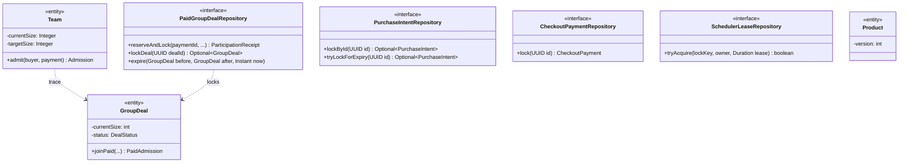
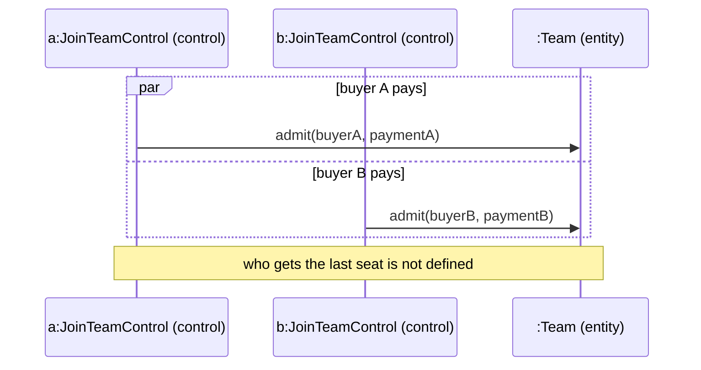
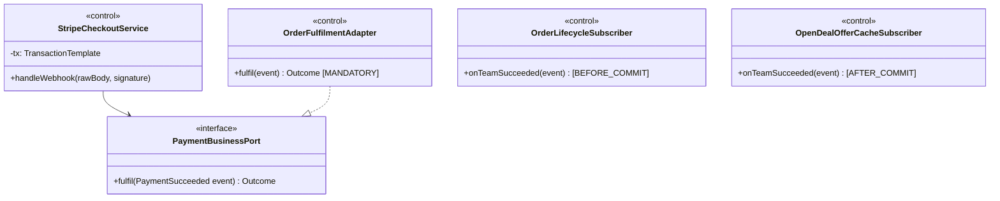

<!-- report
rubric: 3.2.8
owner: Wang Ziang (Eric)
plan: #677
sources: ../report-drafts/transition-strategies.md
status: draft
-->

### 3.2.8 Concurrency

Several buyers can pay for the last seat of a team at the same moment, and the expiry sweep can meet a late payment on the same team. The design serialises these cases in PostgreSQL, not in application memory, with four mechanisms:

- **Pessimistic row locks in a fixed order.** Every path that changes a team's seats, orders or payments first locks the team's row with `SELECT … FOR UPDATE`, so two such paths on one team run one after the other. Table 3.12 gives the order each path takes after that.
- **Guarded updates.** `PaidGroupDealMapper.updateDeal` writes only `WHERE current_size = expectedSize AND status = expectedStatus`, so the loser of a race updates zero rows and the transaction rolls back. The team's `version` is incremented, not compared. The expiry update is guarded by `status = 'open'`.
- **Unique indexes as the last line of defence.** One active member per buyer per team (`uq_biz_group_member_deal_user`), one member per payment (`uq_biz_group_member_payment_id`), one participation receipt per payment (`uq_biz_group_participation_receipt_payment`), one order per payment (`uq_biz_order_payment_id`), one fulfilled purchase intent per payment (`uq_biz_purchase_intent_fulfilled_payment`), one refund obligation per payment (`biz_refund.payment_id UNIQUE`) and one obligation per provider refund (`uq_biz_refund_provider_id`, a partial index). They are created in migrations V5, V7, V9, V11, V12 and V15.
- **Work queues and leases.** Workers claim work with `FOR UPDATE SKIP LOCKED` (refund obligations, the outbox, purchase-intent expiry). Each scheduled job holds a lease in `sys_scheduler_lock` through `SchedulerLeaseRepository.tryAcquire`, so only one application instance runs it at a time (3.2.7). A refund obligation also carries its own row lease: the worker claims one due obligation, sets `lease_until` two minutes ahead and increments `version`; `finish` is fenced by `id` and `version` and schedules the next attempt 30 seconds later (a fixed delay, not exponential back-off).

Administrator edits of a listing use an optimistic `version` instead (the Optimistic Offline Lock of section 3.5.5): `BizProductMapper` updates only `WHERE version = expectedVersion`, and a stale version is refused with `412 Precondition Failed` (`PRODUCT_VERSION_CONFLICT`).

#### Lock order

Table 3.12 states the lock order that the code takes on each path, read from the code on 26 October 2026. On existing rows, every path takes a subset of one combined order, **team → purchase intent → order → payment → participation receipt → product**, and no path holds a later lock while it waits for an earlier one. The paths therefore cannot deadlock against each other.

Table 3.12: Lock order per path, as implemented, and where each part is recorded.

| Path | Locks, in the order taken | Recorded in |
|---|---|---|
| Checkout preparation (UC3, UC4), in `OrderFulfilmentAdapter` and `StripeCheckoutService` | team (JOIN only) → purchase intent → payment | ADR 0001 |
| Paid settlement by webhook (UC3, UC4), in `StripeCheckoutService`, `OrderFulfilmentAdapter` and `PaidGroupDealService` | team → purchase intent → payment → participation receipt → product stock | ADR 0001 (team → intent → payment); `PaidGroupDealRepository` Javadoc (receipt, then team) |
| Team expiry (UC5, UC6), in `GroupDealExpiryService`, then its two subscribers | team → orders of the team → payments of the team | ADR 0002 (team → intent → order → payment) |
| Purchase-intent expiry, in `PurchaseIntentExpiryService` | team → purchase intent (`SKIP LOCKED`) | `PurchaseIntentRepository` Javadoc |
| Refund worker (UC6), in `RefundMapper.xml` | one refund obligation (`SKIP LOCKED`), and no other lock | none |
| All paths combined | team → purchase intent → order → payment → participation receipt → product | not yet in one record; open backend task, issue #663 |

Three details make the paid settlement path fit this order. First, `PaidGroupDealService.joinConfirmed` locks the team again after the receipt, but the transaction already holds that lock from the start of settlement, so it does not wait. Second, the order is a new row, inserted after the receipt; until the commit no other transaction can see it, so no other path can wait on it. Third, the product row is touched last, by the stock decrement `CatalogPurchaseSupport.consumeOneUnit`; the earlier purchasability check is a plain read. On team expiry, `OrderLifecycleSubscriber` runs at `@Order(10)` and `TeamExpiryRefundSubscriber` at `@Order(20)`, so orders are locked before payments.

The written records do not yet agree. Backend ADR 0001 states "group deal → purchase intent → payment" for the paid path. Backend ADR 0002 states "team → intent → order → payment" for the expiry subscribers. The `PaidGroupDealRepository` Javadoc says "receipt then deal" (deal is the code's name for a team). Each statement is true for its own path. The Javadoc describes the order inside `PaidGroupDealService` alone. On a JOIN, the caller has already locked the team before the receipt, so the second team lock is one the transaction already holds. On a START, the team row does not exist yet. ADR 0001 adds that the receipt cannot cause a deadlock because it is keyed by payment ID, and the payment is already locked. Neither ADR states the combined order, and neither mentions the product row that the paid path updates last. Writing the combined order into the ADRs is an open documentation task; no locking code needs to change. Until then, the order in Table 3.12 is the one a new designer must follow.

#### Analysis objects affected

- «entity» objects with limited capacity or shared state: the team (`GroupDeal`), purchase intent, order, payment and refund obligation; the listing (`Product`) for administrator edits and stock.
- «control» objects that change more than one entity in one step: settlement, expiry and refund.
- The «control» objects started by the Scheduler, which must not run twice at once (job lease).

#### Use cases affected

UC3 and UC4 (the last seat and the last stock unit), UC5 (expiry against a late payment), UC6 (concurrent refund workers) and UC9 (concurrent listing edits).

#### Static structure changes

Repositories gain lock methods, so the locking is visible in the design instead of hidden in SQL. An entity that is edited concurrently gains a `version`. Jobs gain a lease port. Figure 3.28 shows the analysis «entity» `Team` and the design elements that make it safe under concurrency.



Figure 3.28: Class diagram, before (the analysis «entity» Team, top) and after the concurrency strategy. Lock methods appear on the repository ports, a concurrently edited listing carries a version, and scheduled jobs get a lease port.

Rationale: a lock method in the port makes the locking part of the design contract, so a reviewer can check the lock order from the interfaces, and a lease port lets several application instances share one schedule.

#### Dynamic behaviour changes

The analysis model says nothing about two buyers at once (Figure 3.29). In design, both settlements ask the database for the team's row lock; the second waits until the first commits, then reads the full team and is refused (Figure 3.30).



Figure 3.29: Analysis sequence of two joins for the last seat, before the concurrency strategy. Both controls call the same entity in parallel, and the model does not say which one wins.

```mermaid
sequenceDiagram
    participant A as a:StripeCheckoutService (control)
    participant B as b:StripeCheckoutService (control)
    participant DB as :PostgreSQL (database)
    A->>DB: lock team (FOR UPDATE)
    B->>DB: lock team (FOR UPDATE)
    Note over B,DB: b waits for a's commit
    A->>DB: lock intent, payment, receipt
    A->>DB: updateDeal guarded; insert member, order
    A->>DB: commit: team SUCCEEDED
    DB-->>B: team row lock granted
    B->>DB: lock intent, payment, receipt
    B->>DB: read team: no seat left
    B->>DB: insert biz_refund (refund obligation)
    B->>DB: commit: payment SUCCEEDED, refund owed
```

Figure 3.30: Design sequence of the same race, after the concurrency strategy. The team row lock queues the second settlement behind the first; the loser's money is not lost but committed with a refund obligation.

Rationale: a group-buy must never sell more seats than its target or settle one payment twice. Database locks hold across application instances, which in-memory locks would not. Because the expiry sweep also locks the team first, a sweep and a late payment on the same team queue behind each other in the same way.

Evidence: the integration test `StripeLocalIntegrationTest.twentyBuyersRaceForLastSeatAndNineteenRefundObligationsPersist` starts 20 concurrent payments for the last seat of a team of two. It asserts that the team ends with two members, two orders and current size two, that 19 refund obligations are stored, and that stock fell by exactly two. Tested locally (Testcontainers), not on dev. This race was not reproduced on the SWE5006 dev system.

#### Transaction boundary

Each step of a use case that changes data is one database transaction, owned by the application service. `PaidGroupDealService` and `GroupDealExpiryService` use `@Transactional(timeout = 10)`. `StripeCheckoutService` uses a `TransactionTemplate` (READ COMMITTED, 10-second timeout), because its step must start only after the external provider has answered: it verifies the webhook signature and re-reads the Checkout session first, outside any transaction, and only then settles.

- A collaborator that must run inside its caller's transaction declares `Propagation.MANDATORY` (`OrderFulfilmentAdapter`), so calling it without one fails.
- No call to an external provider runs inside a transaction. `StripeCheckoutService.handleWebhook` refuses to start if a transaction is already open.
- Consequences that belong to the same business fact run as `BEFORE_COMMIT` listeners (`OrderLifecycleSubscriber`, `TeamExpiryRefundSubscriber`, and the outbox writer `IntegrationOutboxWriter`). Derived side effects run `AFTER_COMMIT` (`ShareCreditSubscriber`, `OpenDealOfferCacheSubscriber`). The event records and the listeners themselves belong to 3.2.9 Domain events and to the Observer design in section 3.5.2.

Figure 3.31 shows where these rules sit in the classes; Figure 3.32 shows the transaction boundary on the settlement of the last seat. Before this strategy the step was the analysis interaction of Figure 3.29, with no transaction at all.



Figure 3.31: Class diagram of the transaction boundary, after the concurrency strategy. The payment service owns the transaction, the business port refuses to run outside it, and each subscriber's phase says whether its work is part of the fact or follows it.

Rationale: the payment slice owns the transaction and calls the business through a port that refuses to run outside it, and a subscriber's phase states in one place whether its work is part of the fact or follows it.

```mermaid
sequenceDiagram
    participant S as :StripeCheckoutService (control)
    participant F as :PaymentBusinessPort (interface)
    participant L as :OrderLifecycleSubscriber (control)
    participant E as :OpenDealOfferCacheSubscriber (control)
    S->>S: verify signature; re-read session
    Note over S: provider calls via CheckoutGateway, no transaction open
    critical one transaction: READ COMMITTED, 10 s
        S->>S: claimEvent; lock team, intent, payment
        S->>F: fulfil(PaymentSucceeded)
        F->>F: admit buyer; team full: TeamSucceeded
        F-->>S: Outcome
        S->>L: before commit: onTeamSucceeded
        L->>L: confirm the team's orders
    end
    S-)E: after commit: onTeamSucceeded
```

Figure 3.32: Design sequence of settling the last seat, with the transaction boundary drawn as a critical region (UML has no transaction fragment). Provider calls stay outside the transaction, the confirmation of the team's orders commits with the payment, and the cache eviction runs only after the commit.

Rationale: the seat, the order and the stock unit change together with the payment's SUCCEEDED state, or not at all. A payment whose admission is rejected commits with a refund obligation instead. If the transaction fails, everything rolls back and Stripe delivers the webhook again. A slow provider never holds a database lock.
