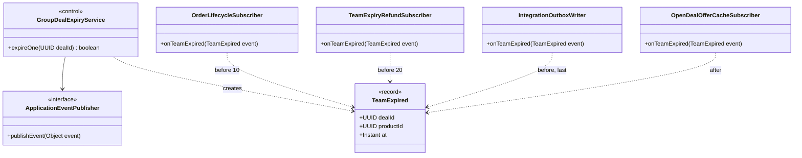
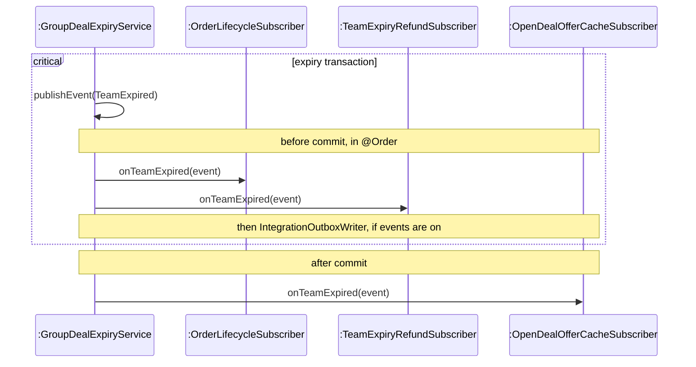

<!-- report
rubric: 3.2.9
owner: Yu Qianshuo (Yorik)
plan: #677
sources: ../report-drafts/transition-strategies.md
owns: R10, R25
status: draft
-->

### 3.2.9 Domain Events

When a «control» object in one bounded context causes consequences in another, the design publishes an immutable domain event instead of calling the other context. Each consequence is a subscriber in its own context, and its transaction phase states whether it is part of the business fact (before the commit) or follows from it (after the commit). Across services, the same events are written to a transactional outbox and relayed through a broker; that path serves SWE5001 (off on dev, section 1.4). The concern is decoupling. The decisions are backend ADRs 0002 (team lifecycle events, before-commit consequences), 0003 (referral credit after the commit) and 0007 (transactional outbox, one SNS topic and an SQS queue per consumer; status Proposed). The GoF pattern behind the in-process part, Observer, is the design problem of 3.5.2; this section gives the general rule, and 3.2.8 gives the transaction boundary it relies on.

Four domain events exist. `PaidGroupDealService` (groupbuy) publishes `MemberJoined` for every accepted join and `TeamSucceeded` when that join fills the team; `GroupDealExpiryService` (groupbuy) publishes `TeamExpired` from the sweep (3.2.7); `StripeCheckoutService` (payment) publishes `PaymentSucceeded` during settlement. Each is published inside the transaction that wrote the fact. Table 3.13 lists who reacts.

Table 3.13: Subscribers to the domain events in the monolith.

| Subscriber (context) | Events | Phase | Effect |
|---|---|---|---|
| `OrderLifecycleSubscriber` (order) | `TeamSucceeded`, `TeamExpired` | before commit, order 10 | confirms or cancels the team's orders |
| `TeamExpiryRefundSubscriber` (payment) | `TeamExpired` | before commit, order 20 | records one refund obligation per paid member |
| `IntegrationOutboxWriter` (integration) | `TeamSucceeded`, `TeamExpired`, `PaymentSucceeded` | before commit, last | writes a versioned integration event to `sys_outbox` |
| `ShareCreditSubscriber` (groupbuy) | `MemberJoined` | after commit, own transaction | credits the sharer of an attributed join (UC7) |
| `OpenDealOfferCacheSubscriber` (groupbuy) | `MemberJoined`, `TeamSucceeded`, `TeamExpired` | after commit | evicts the cached open-team offer |

`IntegrationOutboxWriter` exists only when `blocbuy.events.enabled` is on (off on dev, section 1.4). `PaymentSucceeded` is also passed directly to `PaymentBusinessPort.fulfil`, because admission must answer the payment synchronously (3.2.8).

#### Analysis objects affected

- The «control» objects whose result has consequences in another context: settlement and admission (a member joins, a team fills, a payment succeeds) and team expiry.
- The «control» objects that carry out those consequences: confirming or cancelling orders, recording refund obligations, crediting a sharer, refreshing a cached offer and, in SWE5001, notifying members.
- The «entity» objects of the consuming contexts (order, refund obligation, share credit), which are no longer changed by another context's «control».

#### Use cases affected

- UC4 Join a Team: the join that fills a team publishes `MemberJoined` and `TeamSucceeded`.
- UC5 Team Lifecycle Resolution: success confirms the orders; expiry cancels them.
- UC6 Refund on Team Expiry: the refund obligations are recorded by a `TeamExpired` subscriber.
- UC7 Share Attribution: the credit is a `MemberJoined` subscriber.
- Receive notifications (SWE5001 scope): the notification service consumes the outbox events through SNS and SQS.

#### Static structure changes

In analysis, the «control» that resolves a team reaches the order and the refund «entity» objects of other contexts directly; Figure 3.117 draws those direct dependencies. In design (Figure 3.32):

- **The event is a record in the publisher's domain package**, for example `com.blocbuy.groupbuy.event.TeamExpired(dealId, productId, at)`. It is a plain JDK record with no annotations, carries IDs and facts only, and rejects impossible values in its constructor. It is the publisher's published contract.
- **The publisher is an application service** that calls Spring's `ApplicationEventPublisher.publishEvent(...)` inside its own `@Transactional` method. It names no subscriber.
- **Each subscriber is a class in its own context** with a `@TransactionalEventListener` method. It reads only the event and writes only through its own repository port, never through the publisher's aggregate, mapper or repository, which the backend's cross-context rule forbids (ADR 0002).
- **The phase is part of the design.** Each subscriber declares `BEFORE_COMMIT` or `AFTER_COMMIT` on its `@TransactionalEventListener`; the rationale at the end of this section says which to choose. `@Order` fixes the sequence of before-commit subscribers so that they take locks in the order of Table 3.12 (section 3.2.8).
- **Across services**, `IntegrationOutboxWriter` maps an event to a versioned integration event (`TeamSucceededV1`, `TeamExpiredV1`, `PaymentSucceededV1` in `blocbuy-client`) and inserts it into `sys_outbox` in the same transaction. `OutboxRelayJob` and `OutboxRelayService` later send it to the broker (Table 3.11).

Figure 3.32: Design class diagram for `TeamExpired`, after the strategy. The publisher depends only on the event record and Spring's publisher; each subscriber depends on the record, and the relation label gives its phase (before or after the commit) and its order. The subscribers of all events after Observer are Figure 3.120.

Rationale: the publisher knows nothing about its consumers, so a new consequence is a new subscriber class in the consuming context and the publisher does not change; this is how share credit (ADR 0003) and the outbox (ADR 0007) were added after the team lifecycle (ADR 0002). The event record is the only shared type, which keeps each context's aggregates and persistence private.

#### Dynamic behaviour changes

In analysis, the «control» sends one message per consequence. In design, it publishes once, and the transaction runs the subscribers at the phase each declares (Figure 3.33):

1. inside the publisher's transaction, `publishEvent` only registers the event;
2. when the work is done, but before the commit, the before-commit subscribers run in `@Order`, on the same connection: an exception in any of them rolls back the whole resolution;
3. after the commit, the after-commit subscribers run. A write there needs its own transaction and must not throw, as in an after-commit Observer (section 3.5.2).

A subscriber must also tolerate a replay. The order updates are status-guarded, the refund obligation is unique per payment (`biz_refund.payment_id`), and the credit is unique per payment (`uq_biz_share_credit_payment`), so a repeated event changes zero rows.

Figure 3.33: Design sequence diagram of the listener phases of a team expiry, after the strategy. Orders, refund obligations and the outbox row commit with the expiry or not at all; the cache eviction follows the commit and cannot undo it. The full expiry is Figure 3.111, and the Observer collaboration is Figure 3.121.

Across services, the outbox removes the dual write of "commit, then send": an integration event exists only if its transaction committed, and the relay delivers it at least once. `IntegrationOutboxWriter` inserts the row into `sys_outbox` (migration V26) in the business transaction. Every 2 seconds, `OutboxRelayJob` has `OutboxRelayService` read up to 100 unpublished rows, send them and mark each one published. A failed send is retried after a delay that doubles from 1 second up to 5 minutes; after ten failed attempts the row is marked failed and logged as an error for an operator (`OutboxRelayService`, `OutboxMapper.xml`). Published rows are deleted after 7 days (Table 3.11). In the SWE5001 deployment the relay publishes to one SNS topic; each consumer reads its own SQS queue with a dead-letter queue after five receives, and records each `eventId` in `sys_consumed_message` so that a duplicate has no effect (ADR 0007). Locally and in CI the relay sends to ElasticMQ, an SQS emulator (`backend/elasticmq.conf`). None of this runs on the SWE5006 dev host (off on dev, section 1.4).

Rationale: the phase states in one place whether a consequence is part of the fact or follows from it. Consequences of the same fact (orders confirmed or cancelled, refund obligations, the outbox row) run at `BEFORE_COMMIT` on the publisher's connection, so they commit or roll back together with it: a team cannot be expired while nobody is owed money, and no broker is needed for that (ADR 0002). A before-commit subscriber also sees rows written after the event was published: `OrderFulfilmentAdapter` saves the last buyer's order after `joinConfirmed` returns, and that order is still confirmed with the rest of the team. Derived effects (a sharer's credit, the cached offer) run at `AFTER_COMMIT`, when the fact is final, so they cannot undo it, and their failure leaves the fact intact (ADR 0003). No listener is `@Async`, so an after-commit effect runs on the same thread, right after the commit. The outbox extends the same guarantee across services, because the event is written in the business transaction instead of being sent after it.
