<!-- report
rubric: 3.4.1, 3.4-A..E, G4
owner: Wang Ziang (Eric)
plan: #678
sources: ../report-drafts/eric-wang-contribution.md (ER:5–599); ../report-drafts/statecharts.md (SC:5–81)
status: draft
-->

### 3.4.1 UC3 Initiate a Team and UC4 Join a Team by Wang Ziang (Eric)

UC3 and UC4 share one design, so this subsection gives the full set of models for both. A buyer either starts a new team (UC3) or joins an open one (UC4). A team, shown as a "bloc" in the user interface, is one group-buy of one product at a fixed team price, with a target size and a deadline. In both use cases the system first freezes the buyer's terms, then takes the money through the included use case Pay upfront via Stripe Checkout (section 3.3.11), and admits the payment to a team only after the provider has confirmed it. The use case descriptions are in sections 3.3.4 and 3.3.5.

Pay upfront has no models of its own. Its steps are the payment and webhook steps inside the UC3 and UC4 sequences (Figures 3.39, 3.41, 3.45 and 3.46), and its states are the checkout payment statechart (Figure 3.51). Its refund side belongs to UC6 (section 3.4.2). This subsection therefore covers every use case its owner holds: UC3 and UC4 in full, and Pay upfront inside them.

Each use case has one major flow: a paid start for UC3 and a paid join for UC4. The exceptional flows of sections 3.3.4 and 3.3.5 are drawn as fragments of these two flows, not as separate flows. A refusal before payment is a `break` fragment. A refusal after payment (the team filled, closed or expired, a duplicate member, lapsed terms) is the `else` branch that creates a refund obligation. A provider report that arrives twice is the replay branch of the design sequences. These variants use the same lifelines as the main flow and differ only in a guard, so separate diagrams would repeat the main flow.

#### A Analysis class diagram

The analysis models use only «boundary», «control» and «entity» classes. Actors talk only to boundaries, attributes sit only on entities, and no platform, framework, lock or service appears. The buyer and the payment provider are actors. The purchase intent and the participation receipt are design classes (part C) and do not appear here.

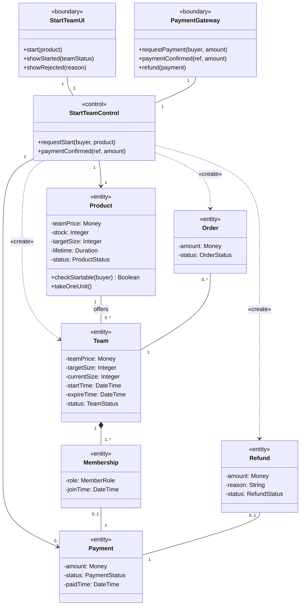

Figure 3.37: UML analysis class diagram of UC3 Initiate a team. One control owns the start rule, the Product entity decides whether a team can start, and the control creates the Team, which holds the leader's Membership, the Order or, when it refuses a paid start, a Refund.

UC4 uses the same entities without Product. The Team entity now carries the admission rule: `checkAdmission` before payment and `admit` after it. In both models the Team composes its Memberships, so the Team, not the control, adds a Membership. The Order is associated only with the Team, for readability; the design also links an order to its payment and its membership.

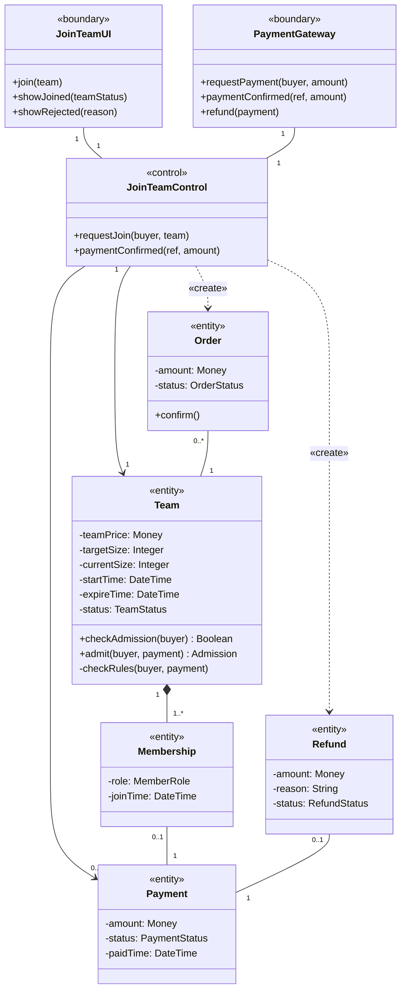

Figure 3.38: UML analysis class diagram of UC4 Join a team. The Team entity owns the join rule and holds the size and the deadline; each Membership and each Refund belongs to exactly one Payment.

#### B Analysis sequence diagrams

The payment provider is an actor of both use cases, but it talks only to the PaymentGateway boundary, so the sequence diagrams leave its lifeline out and show its part as a note; this keeps them legible on A4.

Figure 3.39 and Figure 3.40 together are the major flow of UC3, a paid start, drawn in two parts so that the lifelines stay legible. The product is checked before payment, so a product that cannot start a team is refused before money moves. It is checked again after payment, because the terms may lapse while the buyer pays.

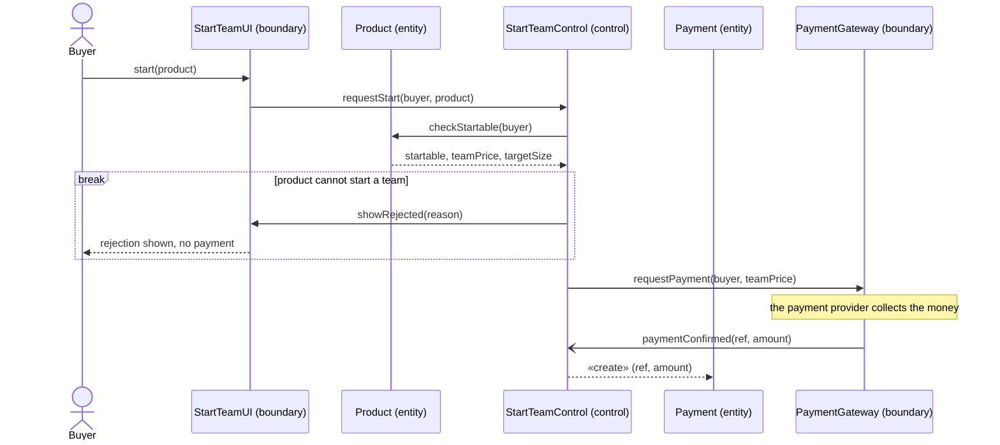

Figure 3.39: UML analysis sequence diagram of the UC3 major flow, part 1, request and payment. The `break` fragment refuses a product that cannot start a team before any money moves; the Payment exists only once the provider has confirmed it.

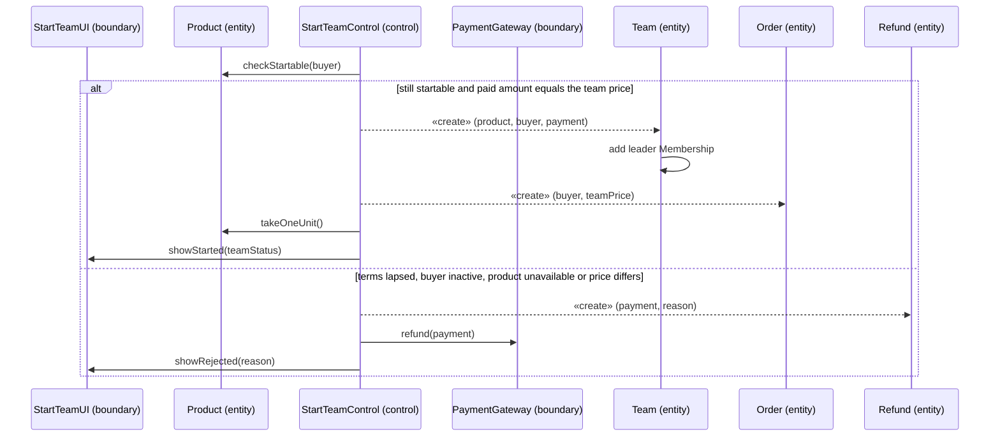

Figure 3.40: UML analysis sequence diagram of the UC3 major flow, part 2, after the payment is confirmed. The `alt` fragment either opens a team with the payer as leader or, in the exceptional flow, owes the money back as a Refund; the boundary then shows the buyer the open team or the refund notice.

A new team has one member and a target size of at least two, so a start never completes a team, and no order is confirmed in this flow.

Figure 3.41 is the major flow of UC4, a paid join. `checkAdmission` is the check before payment and reserves no seat. `admit` is the authority after payment, because the team may fill, close or expire while the buyer pays.

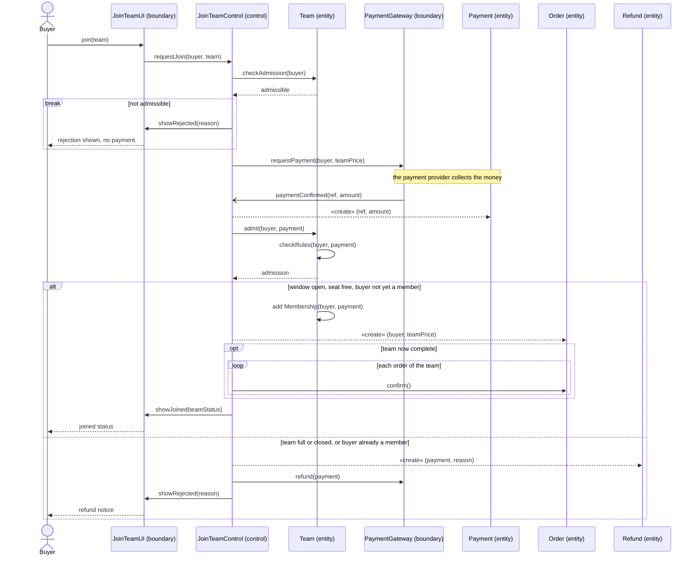

Figure 3.41: UML analysis sequence diagram of the UC4 major flow, a paid join. The rule is checked twice, before and after payment; the `opt` fragment confirms every order when this join fills the last seat, and the `else` branch covers the late-payment and duplicate-member exceptional flows.

Two exceptional flows are not drawn in the analysis model because they need design concepts to express. Two buyers who pay for the last seat are admitted one at a time, so the second meets the `else` branch of Figure 3.41; Figures 3.46 and 3.48 show how. A provider report that arrives again is answered with the stored result; that is the replay `break` of Figures 3.47 and 3.48. A provider report whose amount or currency differs from the saved payment is not refunded either: it opens an operator review case and changes no state (Figure 3.51).

#### C Design class diagram

The design splits the two controls by bounded context and by step. The catalog module owns product terms and pricing. The order module owns the purchase intent and implements the payment module's two business ports: `PaymentIntentPort` through `PurchaseIntentAppService`, and `PaymentBusinessPort` through `OrderFulfilmentAdapter`. The group-buy module owns team creation, admission and lifecycle. The payment module owns the provider session, settlement and refunds. Modules reach each other only through application facades such as `CatalogPurchaseSupport`, `GroupDealPurchaseSupport` and `GroupDealSettlementSupport`, never through another module's tables (section 3.2.3).

**Patterns and mechanisms credited elsewhere.** `MemberJoined` and `TeamSucceeded` feed the Observer pattern, which is Yorik's design problem (team outcome, section 3.5.2); this section only shows the admission that publishes them. Template Method (outbox transports) is Pan's, and Strategy (UC1 pricing) is Lim's. The Transactional Outbox writer is Yorik's (PR #473); its relay, also written by Yorik, came onto `dev` through Liu Jin's PR #485, and Pan wrote the transports' Template Method base class in that PR (commit `44fb9bed`). The Idempotent Receiver, the notification consumer's consumed-message ledger, is Eric's own (PRs #505 and #513) and lies outside UC3 and UC4. The row locks and the guarded update belong to the Concurrency strategy, not to a pattern.

The design class diagram is drawn in three parts so that it stays legible on A4: the payment slice (Figure 3.42), the cross-module seams (Figure 3.43) and the group-buy slice (Figure 3.44). Each class carries, after any UML stereotype, a tag for the transition strategy of section 3.2 that produced it: Lang 3.2.1 language and framework, Pres 3.2.2 presentation, Dist 3.2.3 distribution, Pers 3.2.4 persistence, Ext 3.2.5 external interface, Sec 3.2.6 security, Conc 3.2.8 concurrency, Evt 3.2.9 domain events. `#` is protected, `~` is package visibility, and `…` stands for parameters left out to keep a box narrow.

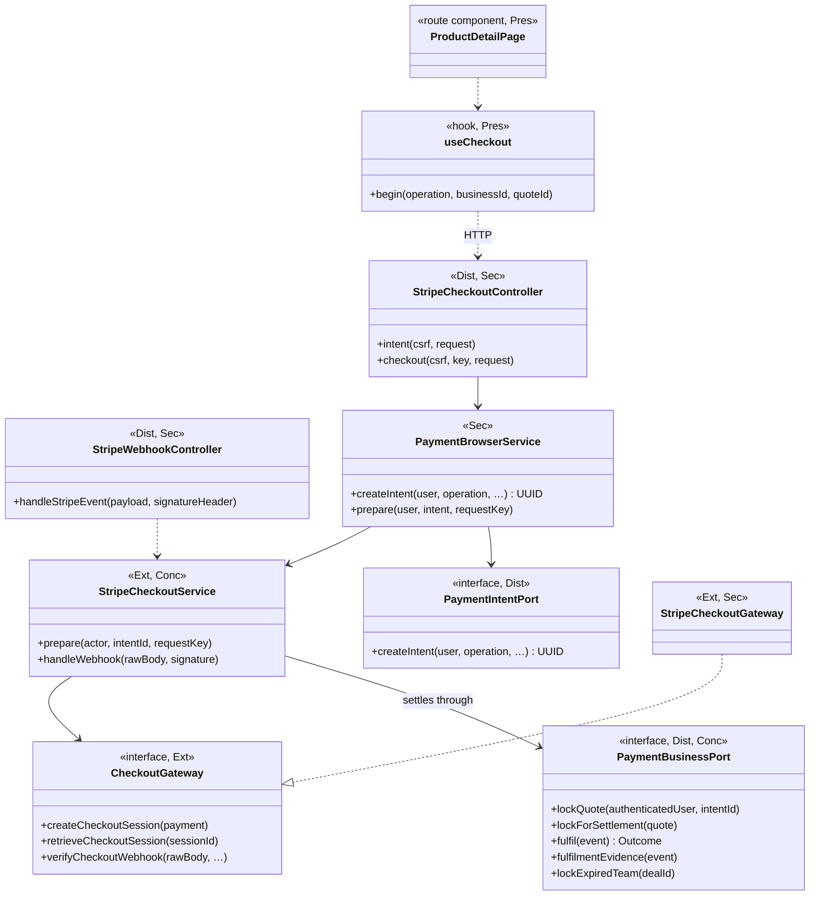

Figure 3.42: UML design class diagram of UC3 and UC4, part 1, the payment slice. The browser reaches the backend only through the generated HTTP client, the provider sits behind the port `CheckoutGateway`, and the payment module settles through the port `PaymentBusinessPort` without knowing what the money buys.

`PaymentBusinessPort` has five operations. Settlement uses `lockForSettlement` and `fulfil`. `lockQuote` re-checks the intent before a hosted payment page is created, `fulfilmentEvidence` serves operator recovery, and `lockExpiredTeam` serves UC6 (section 3.4.2). The webhook reaches `StripeCheckoutService` through the application service `PaymentAppService`, whose implementation `StripePaymentAppService` is active only when Checkout is enabled.

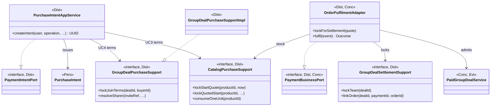

Figure 3.43: UML design class diagram of UC3 and UC4, part 2, the cross-module seams. The order module implements both payment ports and reaches the catalog and group-buy modules only through their facade interfaces.

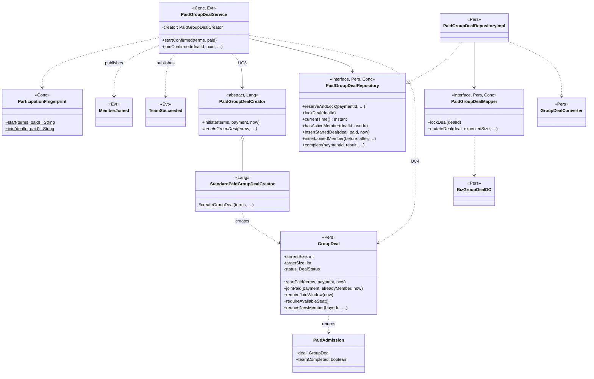

Figure 3.44: UML design class diagram of UC3 and UC4, part 3, the group-buy slice. The domain class `GroupDeal` decides admission, the repository port hides the row locks and the guarded update, and `PaidGroupDealService` publishes `MemberJoined` for every accepted join and `TeamSucceeded` only for the join that completes the team.

`PaidGroupDealService` holds the injected `PaidGroupDealCreator` for a start; that creator is the Factory Method of section 3.5.1. For a join it calls `GroupDeal.joinPaid`, which returns a `PaidAdmission`: the new immutable team snapshot and whether this admission completed the team. `PaidGroupDealRepositoryImpl` maps the aggregate to the `BizGroupDealDO` row through `GroupDealConverter` and writes it with `PaidGroupDealMapper`. `GroupDealPurchaseSupportImpl` uses the same repository port and the same `GroupDeal` guards for the check before payment.

The analysis classes map onto these design classes as follows. `checkAdmission` becomes `GroupDealPurchaseSupportImpl.lockJoinTerms`, which locks the team, reads the database clock after the lock and applies the shared guards `requireJoinWindow`, `requireAvailableSeat` and `requireNewMember`. `admit` becomes `GroupDeal.joinPaid`, which checks the paid price, membership, the window and a free seat, in that order. `Product.checkStartable` and `takeOneUnit` become the catalog facade `CatalogPurchaseSupport`. Payment becomes the aggregate `CheckoutPayment`, and Refund becomes a row of `biz_refund` written by `CheckoutPaymentRepository.requireRefund`. The frozen terms that the analysis carries as arguments become the design class `PurchaseIntent`.

#### D Design sequence diagrams

Each major flow of part B has one design sequence, which refines it step for step: the UC3 paid start refines Figures 3.39 and 3.40, and the UC4 paid join refines Figure 3.41. Each design sequence is drawn across three figures, because one diagram with every lifeline does not fit an A4 page legibly. The UC3 paid start is Figures 3.45, 3.46 and 3.47; the UC4 paid join is Figures 3.45, 3.46 and 3.48. Figure 3.45 is the phase before payment, and Figure 3.46 the settlement that both flows share; the `alt` fragments in them separate UC3 from UC4. Figures 3.47 and 3.48 then show the admission step of each flow.

Before payment, `PurchaseIntentAppService.createIntent` freezes the terms in a `PurchaseIntent`. Price, currency, target size and deadline come from the server, never from the request. The buyer's request reaches it through `StripeCheckoutController` and `PaymentBrowserService`, which first applies the JOIN allowance of 60 intents per minute for one buyer and one team.

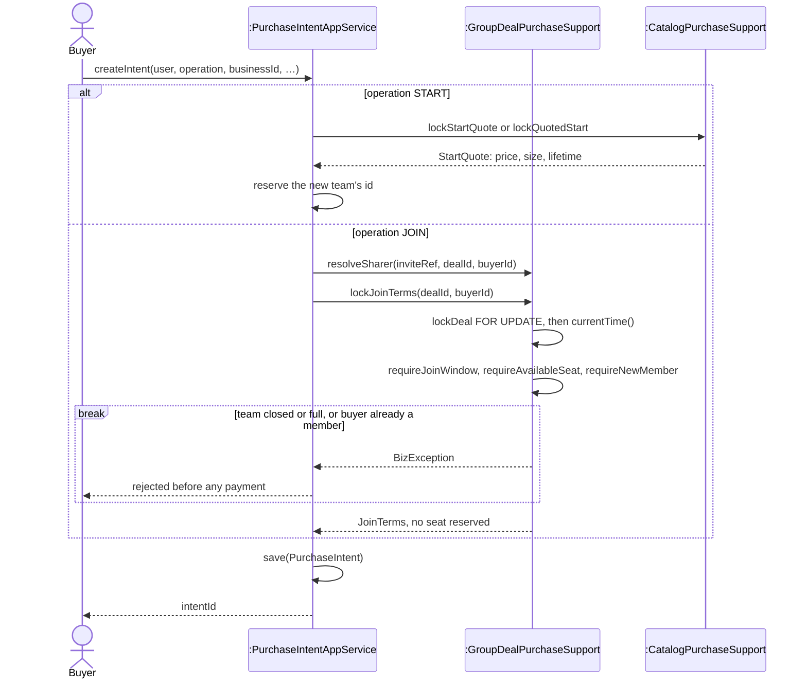

Figure 3.45: UML design sequence diagram of UC3 and UC4 before payment. A start reserves the identity of a team that does not yet exist; a join checks admission under the team row lock but reserves no seat, which is why the rule is checked again after payment.

After payment, `StripeCheckoutService.handleWebhook` verifies the provider's signature and re-reads the Checkout session from the provider outside any transaction. It then settles in one database transaction with READ COMMITTED isolation and a 10-second timeout (`StripeCheckoutService` constructor). UML has no transaction fragment, so the diagrams mark it with a `critical` fragment.

```mermaid
sequenceDiagram
    participant Pay as :StripeCheckoutService
    participant Adapter as :OrderFulfilmentAdapter
    participant Service as :PaidGroupDealService

    critical settlement transaction, READ COMMITTED, 10 s
        Pay->>Adapter: lockForSettlement(quote)
        Adapter->>Adapter: lockTeam(dealId) FOR UPDATE, then lock intent
        Note over Pay,Adapter: a start finds no team row yet; a concurrent join waits here
        Pay->>Pay: lock(paymentId), save(payment.succeed())
        Pay->>Adapter: fulfil(PaymentSucceeded)
        Adapter->>Adapter: intent unspent, buyer active, product purchasable
        alt operation START
            Adapter->>Service: startConfirmed(terms, paid)
        else operation JOIN
            Adapter->>Service: joinConfirmed(dealId, paid, sharerUserId)
        end
        Service-->>Adapter: ParticipationResult
        alt applied
            Adapter->>Adapter: save order PENDING, linkOrder, markFulfilled
            Adapter->>Adapter: consumeOneUnit(productId)
            Adapter-->>Pay: Outcome(dealId, orderId)
        else a check or the team rejected the payment
            Adapter-->>Pay: Outcome(rejection code)
            Pay->>Pay: requireRefund(payment, rejection, eventId)
        end
        Pay->>Pay: recordOutcome(paymentId, …)
    end
```

Figure 3.46: UML design sequence diagram of the settlement shared by UC3 and UC4. Every check that rejects without a write runs before the first write, so such a rejection commits only a refund obligation; a team rejection comes after admission and also commits the compensation-required receipt. A technical failure rolls back every local write and the provider's redelivery retries it.

The rejection code says which rule refused the money: `INTENT_EXPIRED`, `BUYER_INACTIVE` or `PRODUCT_UNAVAILABLE` from the checks in `OrderFulfilmentAdapter.fulfil`, `INTENT_ALREADY_FULFILLED` when a different payment finds the purchase intent already spent, `GROUP_REJECTED` when the team refused the admission, and `BUSINESS_EXPIRED` when `StripeCheckoutService` finds the quote's deadline already past and does not call `fulfil` at all. Each becomes one `biz_refund` row through `CheckoutPaymentRepository.requireRefund`, which UC6 then pays out (section 3.4.2).

Locks on the paid path are taken in a fixed order, each with `SELECT … FOR UPDATE`: group deal, then purchase intent, then payment, then participation receipt. `PaidGroupDealService` locks the receipt before it asks for the deal again; this cannot deadlock, because the deal lock is already held from `lockForSettlement` and a receipt is keyed by its payment (backend ADR 0001). ADR 0001 states the global order as deal → intent → payment, and ADR 0002 as team → intent → order → payment. Both hold for their own path, but one combined order has not yet been written down; section 3.2.8 records this as an open item.

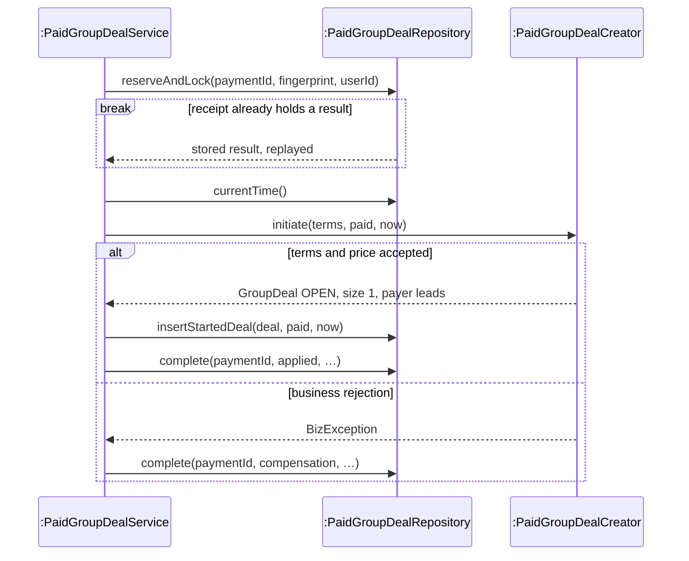

Figure 3.47: UML design sequence diagram of the UC3 admission step, `startConfirmed`. The participation receipt makes a redelivered payment replay its first result, and a rejection is committed as a compensation-required receipt, never as an exception that loses the money.

The `Creator` lifeline is the injected `PaidGroupDealCreator`; at run time it is the `StandardPaidGroupDealCreator` bean that `GroupDealCreationConfig` declares. Its `initiate` validates the terms and the price and then calls `GroupDeal.startPaid`. A payment reused for different terms produces a different fingerprint (`ParticipationFingerprint`) and is rejected.

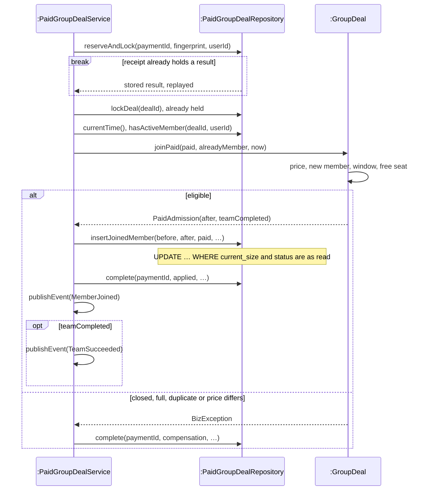

Figure 3.48: UML design sequence diagram of the UC4 admission step, `joinConfirmed`. The aggregate decides on a time and a membership read under the team lock, the guarded update is the last check, and a race loser takes the `else` branch and is owed a refund.

`PaidGroupDealRepositoryImpl.insertJoinedMember` writes the team row only through `PaidGroupDealMapper.updateDeal`, whose SQL ends `WHERE … AND current_size = #{expectedSize} AND status = #{expectedStatus}` (`PaidGroupDealMapper.xml`, line 73). A writer that read a stale snapshot changes zero rows. The same statement increments `biz_group_deal.version`, but no statement compares it, so the version column is not the guard on this path. Unique indexes back every "at most one" rule (section 3.2.8).

`TeamSucceeded` is handled before the transaction commits by `OrderLifecycleSubscriber.onTeamSucceeded`, which confirms all of the team's pending orders. Because it runs at the `BEFORE_COMMIT` phase, it sees the completing buyer's own order, which `OrderFulfilmentAdapter` saves only after `joinConfirmed` returns (backend ADR 0002). The subscribers are the Observer pattern of section 3.5.2.

**Evidence.** The admission rule and the race are covered by tests at three levels. `PaidGroupDealTest` and `DealStatusTest` are unit tests of the aggregate's guards and of the team's transition table. `StripeLocalIntegrationTest.twentyBuyersRaceForLastSeatAndNineteenRefundObligationsPersist` is an integration test against PostgreSQL 18 in Testcontainers, run locally and in CI, not on dev: twenty paid buyers race for the last seat of a two-seat team through the production intent and fulfilment ports. The team ends with 2 members, 2 orders, `current_size` 2, 19 refund obligations and stock 98. On 23 October on dev, a real Stripe Sandbox payment started a two-seat team: the webhook returned HTTP 200, and the payment settled with its team and order created (`backend/docs/payment/stripe-dev-recovery-acceptance-20261023.md`). On 24 October on dev, the team's backup demonstration video recorded a second buyer's paid join filling a two-seat team ("2 of 2 joined"; day log `docs/agile/sprint-04/log/2026-10-24.md`).

#### Statecharts of the order and the checkout payment

Two objects whose state UC3 and UC4 set have significant, dynamic states, so each has a statechart. A transition reads *trigger [guard] / effect*, and a self-transition is drawn as an internal transition inside its state. The team that UC3 creates and UC4 fills is resolved by UC5, so its statechart is in section 3.4.5 (Figure 3.49).

The order is the buyer's record of one paid participation. A start or a join creates it, team resolution moves it once, and UC8 shows it.

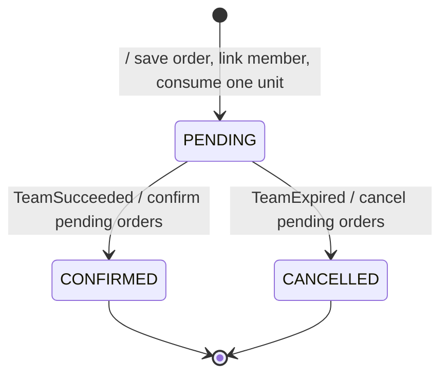

Figure 3.50: UML statechart of the order (`Order`). The order moves once, with its team; both moves are bulk SQL guarded by `status = 'pending'`, so a replayed team event changes nothing.

`OrderFulfilmentAdapter.fulfil` creates the order PENDING inside the settlement transaction. `OrderLifecycleSubscriber` moves it at `BEFORE_COMMIT` through `OrderRepository.confirmByDealId` or `cancelByDealId`. The domain also has a transition rule, `OrderStatus.canTransitionTo`, used by `Order.confirm()` and `Order.cancel(at)`, but no production code calls those two methods; on this path the rule is the SQL predicate.

The checkout payment is one attempt to pay through Stripe Checkout, with a frozen quote. Only a SUCCEEDED payment is fulfilled or can be refunded.

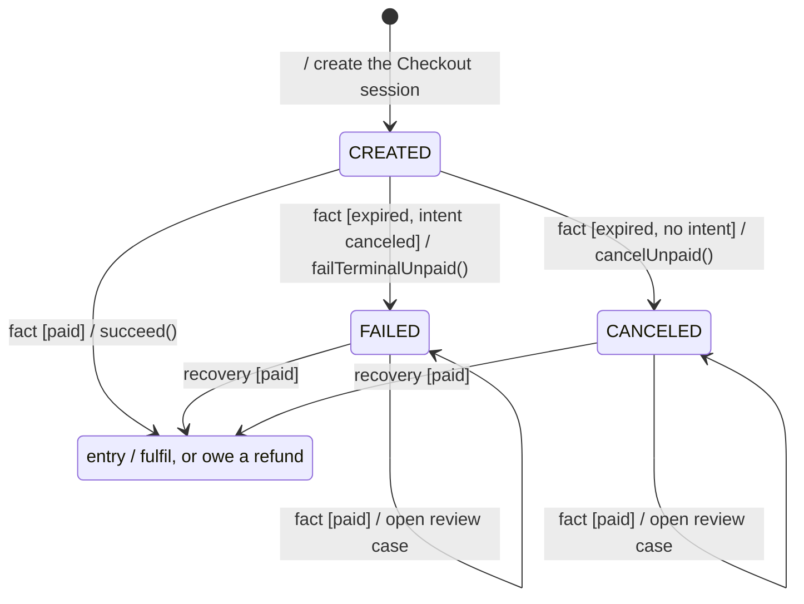

Figure 3.51: UML statechart of the checkout payment (`CheckoutPayment`). A late payment on a FAILED or CANCELED attempt is never settled automatically: it opens the review case `LATE_PAID_REQUIRES_RECOVERY`, and only the operator's recovery command moves it to SUCCEEDED.

A *fact* is a provider fact: a Checkout session state that `StripeCheckoutService` re-reads from Stripe. It arrives by webhook or by the operator command `stripe-ops expire-open-sessions`. A *recovery* is the operator command `stripe-ops recover`, which re-reads the session and settles it through the same path, so it also calls `succeed()`. On entry to SUCCEEDED the payment is fulfilled, or a refund obligation is recorded when fulfilment is refused (Figure 3.46). Two transitions are left out of the figure for legibility: a later unpaid fact can also move a CANCELED payment to FAILED, or a FAILED one to CANCELED, because `failTerminalUnpaid()` and `cancelUnpaid()` refuse only a SUCCEEDED payment. No final state is drawn, because a SUCCEEDED payment still absorbs duplicate and unpaid facts. One rule applies in every state and is not drawn: a provider fact whose session does not match the saved payment opens the review case `PROVIDER_MISMATCH` and changes no state. `CheckoutPayment.succeed()` has no guard of its own; these rules live in the private `settle` step of `StripeCheckoutService`.

#### E Compliance with the transition strategies

UC3 and UC4 apply eight of the nine transition strategies of section 3.2. Scheduling (3.2.7) does not apply: no step of UC3 or UC4 is triggered by time. It belongs to team expiry and refunds (sections 3.4.2 and 3.4.5).

Table 3.14: Transition strategies applied to UC3 and UC4.

| Strategy | Analysis object | Design element |
| --- | --- | --- |
| 3.2.1 Language and framework | «control» StartTeamControl (creation of a team) | Abstract `PaidGroupDealCreator` with `StandardPaidGroupDealCreator`, wired by the Spring configuration `GroupDealCreationConfig` at the composition boundary, so the domain stays free of Spring |
| 3.2.2 Presentation | «boundary» StartTeamUI, JoinTeamUI | Route component `ProductDetailPage` with the hook `useCheckout`, whose `begin("START" or "JOIN", …)` opens Stripe Hosted Checkout |
| 3.2.3 Distribution | «boundary» StartTeamUI, JoinTeamUI; «control» StartTeamControl, JoinTeamControl; «entity» Product | REST endpoints `POST /api/v1/payments/intents` and `POST /api/v1/payments/checkout-sessions` on `StripeCheckoutController`, called through the generated client; the controls split across modules behind `PaymentIntentPort`, `PaymentBusinessPort`, `CatalogPurchaseSupport` and `GroupDealPurchaseSupport` |
| 3.2.4 Persistence | «entity» Team, Membership, Payment, Order, Refund | Aggregates `GroupDeal`, `CheckoutPayment`, `Order` and `PurchaseIntent` behind repository ports; `PaidGroupDealRepositoryImpl`, `GroupDealConverter`, `BizGroupDealDO` and `PaidGroupDealMapper`; a Refund is a `biz_refund` row written by `requireRefund` |
| 3.2.5 External interface | «boundary» PaymentGateway | Port `CheckoutGateway` with adapter `StripeCheckoutGateway`; `StripeWebhookController` receives the provider's report and `StripeCheckoutService` re-reads the session before trusting it |
| 3.2.6 Security | «boundary» StartTeamUI, JoinTeamUI, PaymentGateway | CSRF header check in `StripeCheckoutController`; webhook signature verified through `CheckoutGateway.verifyCheckoutWebhook`; at most 60 JOIN intents per minute for one buyer and one team in `PaymentBrowserService`; price and deadline taken from the server, never from the request |
| 3.2.8 Concurrency | «entity» Team (`admit`), Payment | One settlement transaction (READ COMMITTED, 10 s) in `StripeCheckoutService`; row locks deal → intent → payment → receipt; guarded `updateDeal`; participation receipt with `ParticipationFingerprint` for replay; unique-index backstops |
| 3.2.9 Domain events | «control» JoinTeamControl (confirming orders when the team completes) | `PaidGroupDealService` publishes `MemberJoined` and `TeamSucceeded`; `OrderLifecycleSubscriber.onTeamSucceeded` confirms the orders at `BEFORE_COMMIT` |
