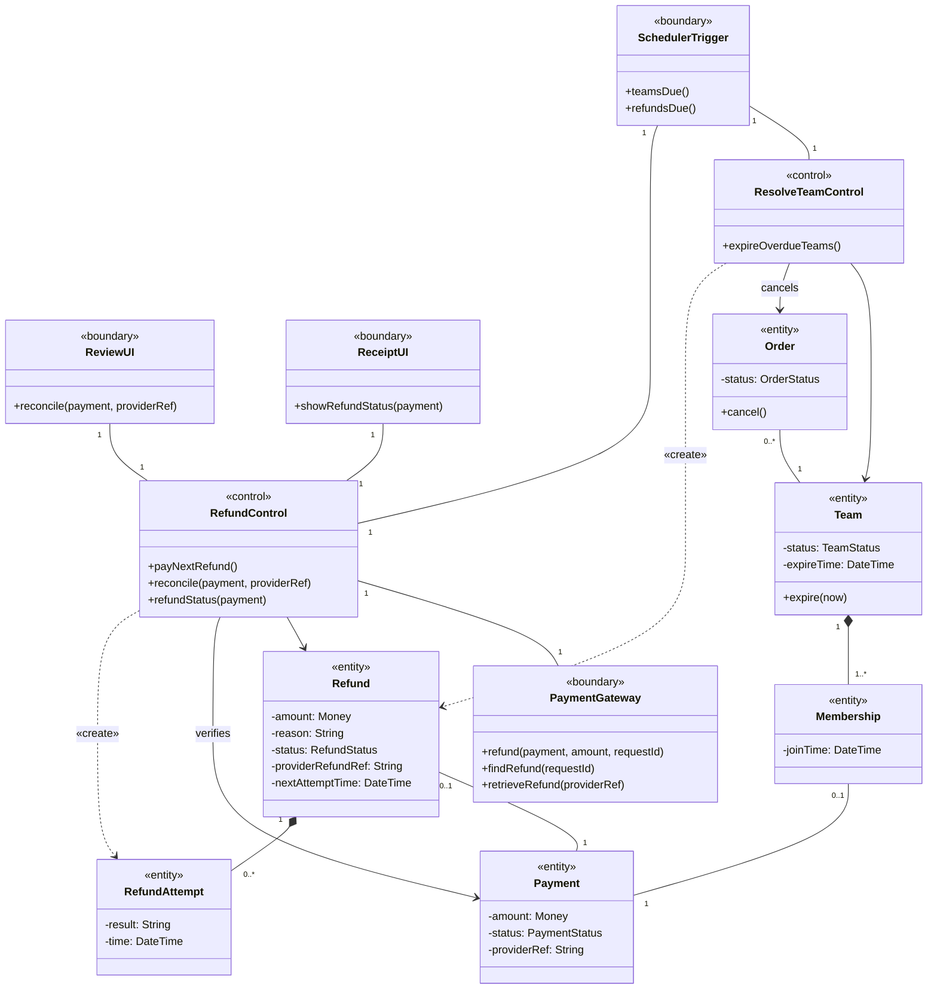
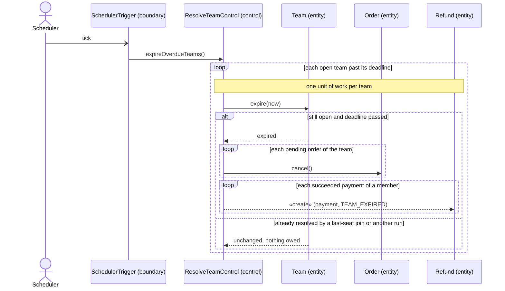
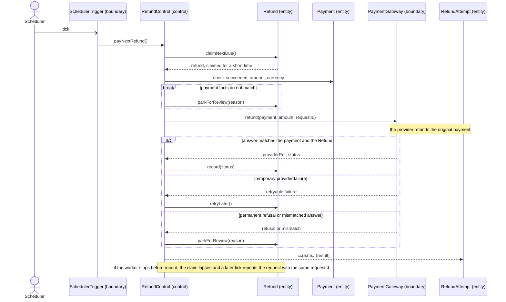
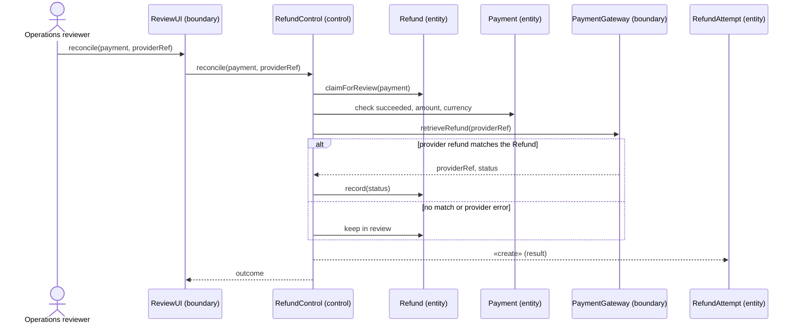
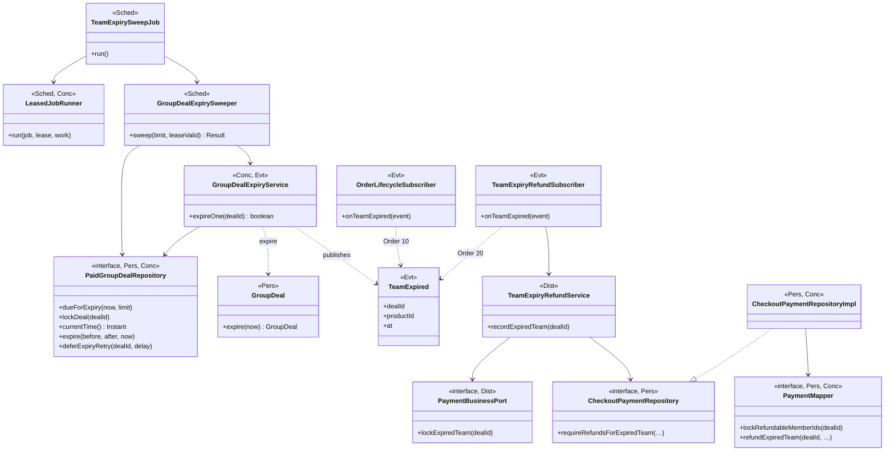
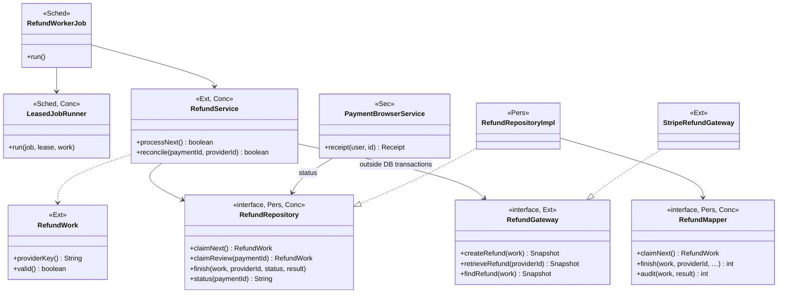
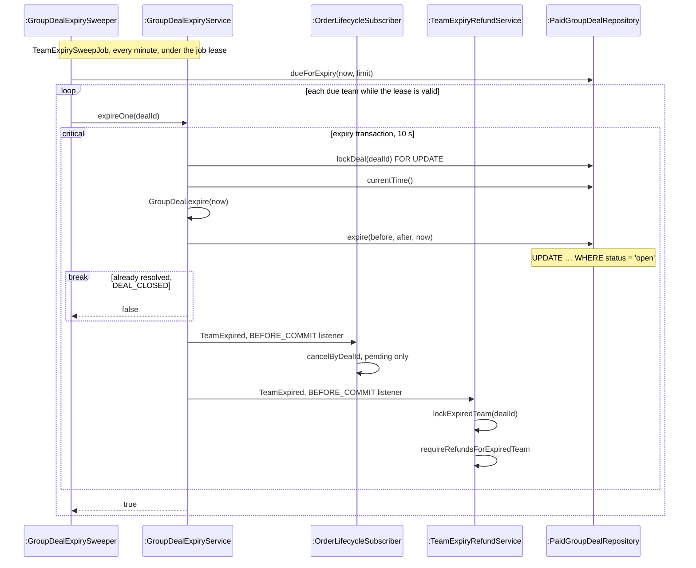
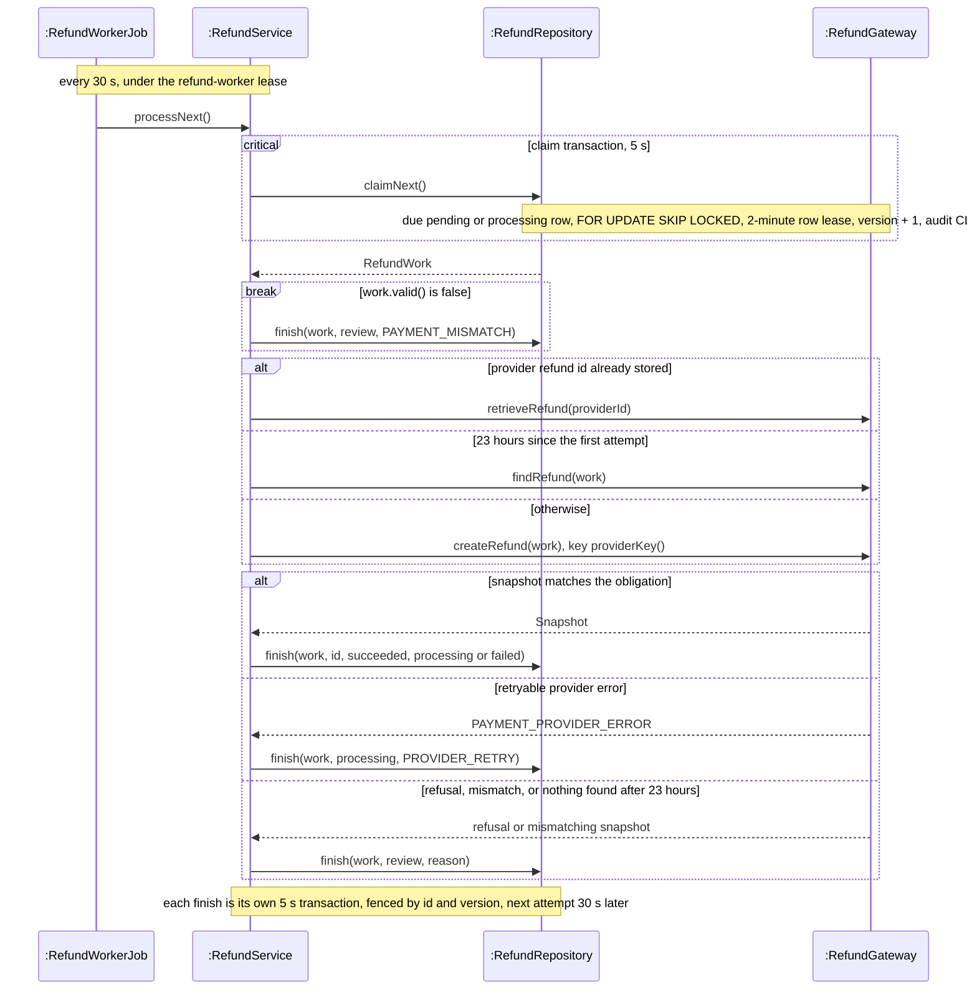
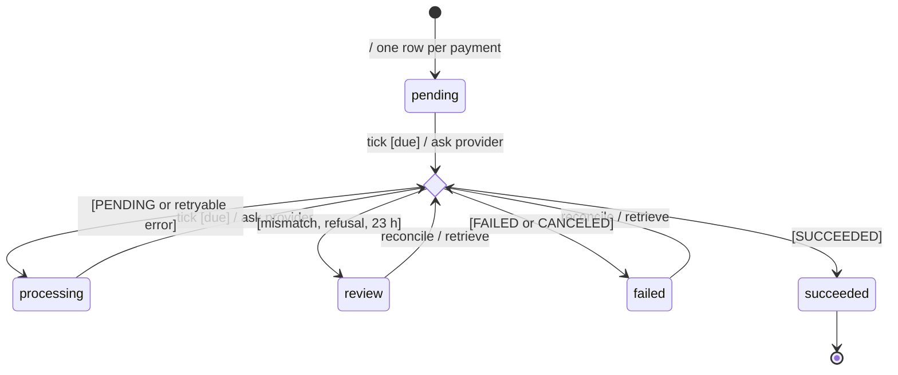

<!-- report
rubric: 3.4.2, 3.4-A..E, G4
owner: Yu Qianshuo (Yorik)
plan: #678
sources: ../report-drafts/yorick-yu-contribution.md (YY:5–212); ../report-drafts/statecharts.md (SC:83–110)
owns: R09, R28, FG04
status: draft
-->

### 3.4.2 UC6 Refund on Team Expiry by Yu Qianshuo (Yorik)

When a team's deadline passes before its last seat is taken, BlocBuy expires the team, cancels its orders and records one refund obligation for every paid member, all in one database transaction. A scheduled refund worker then pays each obligation back to the original card through Stripe. It retries a temporary provider failure with the same request identity, and it parks any case it cannot settle safely for an operator to review. A team is one group-buy of one product, shown as a "bloc" to buyers (section 3.4.1); the use case description is section 3.3.7.

This subsection gives the full set of models for UC6, the one use case its owner holds. The same refund worker also pays back a payment that UC3 or UC4 refused after the money was taken (section 3.4.1, Figure 3.46); only the way the obligation is created differs.

UC6 has three major flows:

1. **Expire a team and record its refunds.** The scheduler finds an overdue open team; the system expires it, cancels its orders and records the refund obligations.
2. **Pay one refund.** The scheduler wakes the refund worker, which claims one due obligation and asks the provider to refund it. A temporary provider failure (retry later) and a refund that stops part-way (repeat with the same request identity) are `alt` fragments and a note of this flow, because they use the same lifelines and differ only in the provider's answer.
3. **Reconcile a parked refund.** An operations reviewer checks a refund that the worker parked for review against the provider's records. This exceptional flow is a major flow of its own, because a different actor starts it and it never creates a refund.

The recovery mechanisms these flows rely on (Idempotency Key, Retry and operator review) are described once, as part of the external interface strategy in section 3.2.5. The way expiry reaches orders and payments through a domain event is the Observer pattern of section 3.5.2.

#### A Analysis class diagram

The model uses only «boundary», «control» and «entity» classes, with attributes on entities only. The scheduler, the payment provider, the operations reviewer and the buyer are actors; each talks to the system through one boundary. Refund is the refund obligation: a promise to return one succeeded payment. RefundAttempt is the audit record of each try.



Figure 3.51: UML analysis class diagram of UC6 Refund on team expiry. Two controls split the use case at the point where money moves: ResolveTeamControl only records what is owed, and RefundControl alone talks to the payment provider; each Payment owes at most one Refund.

#### B Analysis sequence diagrams

The payment provider talks only to the PaymentGateway boundary, so the sequence diagrams leave its lifeline out and show its part as a note.

Figure 3.52 is flow 1. Expiring the team, cancelling its orders and recording the refunds form one unit of work: either all of them happen or none does, so an expired team is never left without a record of the money it owes.



Figure 3.52: UML analysis sequence diagram of UC6 flow 1, expire a team and record its refunds. The `alt` fragment makes a repeated or late expiry harmless, and every paid member gets exactly one Refund in the same unit of work as the expiry.

Figure 3.53 is flow 2. The worker takes one due Refund at a time. It checks the payment's facts before it asks for money back and checks the provider's answer before it believes it.



Figure 3.53: UML analysis sequence diagram of UC6 flow 2, pay one refund. The `alt` fragment holds the exceptional flows: a temporary failure keeps the Refund due, and an unsafe answer parks it; the same request identity makes a repeat harmless.

Figure 3.54 is flow 3. It only looks up a refund that already exists at the provider; it never asks for a new one, so it cannot pay a buyer twice.



Figure 3.54: UML analysis sequence diagram of UC6 flow 3, reconcile a parked refund. The reviewer can only confirm an existing provider refund; any doubt leaves the Refund in review.

The buyer's last step, reading the refund status on the payment receipt, is a single query (`ReceiptUI` asks `RefundControl.refundStatus`) and is not drawn as a flow.

#### C Design class diagram

Expiry is a group-buy decision, while the obligation and the provider interaction belong to the payment module. The design class diagram is therefore drawn in two parts: the expiry side (Figure 3.55) and the refund worker (Figure 3.56). Each class carries the tag of the transition strategy of section 3.2 that produced it: Pres 3.2.2 presentation, Dist 3.2.3 distribution, Pers 3.2.4 persistence, Ext 3.2.5 external interface, Sec 3.2.6 security, Sched 3.2.7 scheduling, Conc 3.2.8 concurrency, Evt 3.2.9 domain events. `…` stands for parameters left out to keep a box narrow.



Figure 3.55: UML design class diagram of UC6, part 1, expiry. The group-buy module publishes the immutable `TeamExpired` event and never touches orders or payments; the order and payment subscribers react before the transaction commits, in the fixed order 10 then 20.

`GroupDealExpiryService.expireOne` resolves exactly one team per call, under its own 10-second transaction; the batch loop lives in `GroupDealExpirySweeper`, so the row lock covers one team at a time. A team whose expiry fails is retried five minutes later (`deferExpiryRetry`) and does not stop the others. `TeamExpiryRefundService` reaches the group-buy module only through `PaymentBusinessPort.lockExpiredTeam`, which takes the same team row lock that joins use and checks that the team really is EXPIRED. `CheckoutPaymentRepositoryImpl` then locks the team's refundable payments in a fixed order (`PaymentMapper.lockRefundableMemberIds`) and inserts one `biz_refund` row per payment with `PaymentMapper.refundExpiredTeam`, an upsert on `ON CONFLICT (payment_id)`. If the number of rows written differs from the number of payments locked, it throws, and the whole expiry rolls back.



Figure 3.56: UML design class diagram of UC6, part 2, the refund worker. `RefundService` holds no transaction across the provider call: it claims and finishes in two short transactions, and the stable `RefundWork.providerKey()` is the idempotency key sent to Stripe.

`RefundWork` is the immutable snapshot that a claim returns: the obligation joined with its payment's status, amount, currency and Stripe PaymentIntent. Its `valid()` checks that the payment succeeded and that amount and currency agree. Its `providerKey()` is `blocbuy-refund-` plus the obligation's identifier, so every attempt for one obligation sends Stripe the same idempotency key. `StripeRefundGateway.createRefund` re-reads the original PaymentIntent and refunds it, and tags the refund with the obligation's identifier as metadata; `findRefund` lists the PaymentIntent's refunds and accepts only a single one with that tag. The buyer's receipt reads the refund status through `PaymentBrowserService.receipt`, which serves only the payment's owner.

The analysis classes map onto these design classes as follows. SchedulerTrigger becomes the two Spring jobs `TeamExpirySweepJob` and `RefundWorkerJob`, each run under a database job lease by `LeasedJobRunner`. ResolveTeamControl is split across three modules: `GroupDealExpirySweeper` and `GroupDealExpiryService` in group-buy, `OrderLifecycleSubscriber` in order, and `TeamExpiryRefundSubscriber` with `TeamExpiryRefundService` in payment. RefundControl becomes `RefundService`. PaymentGateway becomes the port `RefundGateway` with the adapter `StripeRefundGateway`. Refund becomes a `biz_refund` row behind `RefundRepository`, and RefundAttempt a `log_refund_attempt` row written by `RefundMapper.audit`. ReceiptUI becomes the receipt page described in Table 3.15. ReviewUI has no design element yet: no endpoint or command calls `RefundService.reconcile` (part D).

#### D Design sequence diagrams

Each design sequence refines the analysis sequence of the same flow: Figure 3.57 refines Figure 3.52, Figure 3.58 refines Figure 3.53, and Figure 3.59 refines Figure 3.54. A `critical` fragment marks a database transaction, because UML has no transaction fragment.



Figure 3.57: UML design sequence diagram of UC6 flow 1, expire a team and record its refunds. The status-guarded update decides a race with a last-seat join, and both subscribers write inside the expiry transaction, so expiry, order cancellation and refund obligations commit together or not at all.

The lock order matches the paid join of section 3.4.1: both lock the team row first, so a sweep and a settling webhook cannot deadlock (backend ADR 0002). If the sweep wins, a payment that settles afterwards finds the team expired and is owed a refund in its own transaction. If the join wins, the guarded update changes zero rows, `PaidGroupDealRepository.expire` reports `DEAL_CLOSED`, and `expireOne` returns false.



Figure 3.58: UML design sequence diagram of UC6 flow 2, pay one refund. The provider call runs between two short transactions, never inside one; a crash after Stripe accepts the refund leaves the row claimable once its lease lapses, and the next attempt sends the same idempotency key.

The `alt` fragments are the exceptional flows of section 3.3.7. A retryable provider error (transport, rate limit, availability) moves the obligation to `processing`, due again 30 seconds later; the delay is fixed, not exponential. A permanent refusal (`PAYMENT_STATE_INVALID` or `PAYMENT_PROVIDER_REJECTED`) or a snapshot that does not match the obligation moves it to `review`, which the worker never claims again. Stripe may forget an idempotency key after about a day, so after 23 hours without a stored refund identifier the worker stops creating and only searches; if it finds nothing, the obligation goes to `review`. A worker that stops after Stripe accepted the refund but before `finish` leaves the row with an expired lease; the next claim increments the version, so a late `finish` from the old worker changes nothing, and the repeat request with the same key returns the same Stripe refund.

```mermaid
sequenceDiagram
    actor Op as Operator
    participant Svc as :RefundService
    participant Repo as :RefundRepository
    participant GW as :RefundGateway

    Note over Op,Svc: no endpoint or command; a separately reviewed invocation
    Op->>Svc: reconcile(paymentId, providerId)
    critical claim transaction, 5 s
        Svc->>Repo: claimReview(paymentId)
        Note over Repo,GW: review or failed row only, audit OPERATOR_RECONCILE
    end
    break work.valid() is false
        Svc->>Repo: finish(work, review, PAYMENT_MISMATCH)
    end
    Svc->>GW: retrieveRefund(providerId)
    alt snapshot matches the obligation
        GW-->>Svc: Snapshot
        Svc->>Repo: finish(work, id, succeeded, processing or failed)
    else provider error or mismatch
        Svc->>Repo: finish(work, review, reason)
    end
    Svc-->>Op: true
```

Figure 3.59: UML design sequence diagram of UC6 flow 3, reconcile a parked refund. `reconcile` only retrieves a refund the operator names and maps it with the same checks as the worker; it has no path that creates a refund.

`RefundService.reconcile` exists and is unit-tested, but no endpoint, command or job calls it: it has no HTTP endpoint, the operator command runner `stripe-ops` (`StripeOperationsConfiguration`) does not expose it, and the rollout runbook (`backend/docs/payment/stripe-rollout-runbook.md`) requires a separately reviewed invocation. Flow 3 is therefore designed and unit-tested but has never been run on dev.

#### Statechart of the refund obligation

A refund obligation is one row of `biz_refund`. It is created when a team expires (this subsection) or when a paid settlement is refused (section 3.4.1). A buyer's receipt shows its status.



Figure 3.60: UML statechart of the refund obligation (`biz_refund.status`). Every attempt passes through one choice on the provider's answer; only `pending` and `processing` are claimed by the worker, while `review` and `failed` wait for an operator's reconcile.

A tick takes an obligation only when it is *due*: its next attempt time has passed and no live lease holds it. The choice reads the provider's answer: an unknown status also goes to `review`, and *23 h* is the search after 23 hours that finds no refund. Every transition out of the choice stamps the next attempt time 30 seconds later (one `finish` statement for all outcomes), but only a `processing` obligation is claimed again by the worker: `succeeded` and `failed` are never retried automatically, and `review` waits for an operator. A provider error during a reconcile leaves the obligation in `review`, so a case in an operator's hands never returns to the automatic worker. The states are plain strings, the constants of `RefundService`, with no transition table in code: the statechart is enforced by the claim and finish SQL in `RefundMapper.xml`. Of the objects in this use case, only the team checks its own transitions (`DealStatus.canTransitionTo`, section 3.4.5).

**Evidence.** On 23 October on dev, with scheduling enabled, a two-seat team started with a real Stripe Sandbox payment and was left to expire. It closed 18.9 seconds after its unedited deadline, its order was cancelled, and its one S$22 refund succeeded 40.6 seconds after the deadline; Stripe listed exactly one refund for the payment, and the buyer's receipt showed "Refund sent" (`backend/docs/payment/stripe-dev-recovery-acceptance-20261023.md`). These times describe that run, not a guarantee: the design bound for expiry is one sweep interval plus the sweep's own time, and the run does not show that bound is met on dev in general. The same day, an operator recovered three paid payments that had been stranded by a webhook fault; each was recorded as refund required, because its purchase had expired, and the worker refunded each exactly once.

Tested locally (PostgreSQL 18, Stripe replaced by a test substitute), not on dev, on 3 October (`backend/docs/payment/stripe-refund-recovery-acceptance-20261003.md`). The rehearsal ran the eight `StripeRolloutAcceptanceIT` tests and the full Testcontainers integration suite. A refund whose result was lost before `finish` was reclaimed after its lease, retried with the same key and produced one refund; a signed refund notification delivered twice changed no payment, refund or audit row; and a permanent refusal was parked in `review` with no second provider call. {{CONFIRM: D18 Which evidence kind states crash recovery: tested locally, proven locally (Testcontainers and the 3 October rehearsal), or tested in CI (StripeRolloutAcceptanceIT)? — Yorik}} A deliberate crash, a replay and a permanent failure with operator review have not been exercised on dev. The unit tests `RefundServiceTest`, `TeamExpiryRefundSubscriberTest`, `TeamExpiryRefundServiceTest` and `GroupDealExpiryServiceTest` cover the worker's branches and the expiry service. The integration tests `StripeRolloutAcceptanceIT`, `TeamExpirySchedulingIT` and `V4ExpiryPipelineIT` run the real expiry, claim and persistence code against PostgreSQL; the last seeds two thousand teams and checks that each expires with exactly one effect.

#### E Compliance with the transition strategies

UC6 applies eight of the nine transition strategies of section 3.2. Language and framework (3.2.1) adds nothing specific to UC6 beyond the Spring scheduling and event annotations listed under 3.2.7 and 3.2.9.

Table 3.15: Transition strategies applied to UC6.

| Strategy | Analysis object | Design element |
| --- | --- | --- |
| 3.2.2 Presentation | «boundary» ReceiptUI | Receipt route `payments.$paymentId.tsx` with `receipt-view.ts` and `refund-status.ts`; the page polls while a refund is pending |
| 3.2.3 Distribution | «control» ResolveTeamControl; «boundary» ReceiptUI | Expiry split across the group-buy, order and payment modules, joined only by the `TeamExpired` event and the port `PaymentBusinessPort.lockExpiredTeam`; receipt served by `GET /api/v1/payments/{id}` on `StripeCheckoutController` |
| 3.2.4 Persistence | «entity» Refund, RefundAttempt, Team, Order | `biz_refund` behind `RefundRepository`, `RefundRepositoryImpl` and `RefundMapper`, created by `CheckoutPaymentRepository.requireRefundsForExpiredTeam` and `PaymentMapper.refundExpiredTeam`; `log_refund_attempt` written by `RefundMapper.audit`; team expiry by `GroupDeal.expire` and `PaidGroupDealRepository.expire` |
| 3.2.5 External interface | «boundary» PaymentGateway | Port `RefundGateway` with adapter `StripeRefundGateway`; idempotency key `RefundWork.providerKey()`; fixed 30-second retry of provider errors; `review` state for unsafe answers; search-only after 23 hours |
| 3.2.6 Security | «boundary» ReviewUI, ReceiptUI | No endpoint or command exposes `RefundService.reconcile`; `PaymentBrowserService.receipt` returns a receipt only to the payment's owner |
| 3.2.7 Scheduling | «boundary» SchedulerTrigger | `TeamExpirySweepJob` (fixed delay one minute) and `RefundWorkerJob` (fixed delay 30 seconds) under `LeasedJobRunner` job leases, active only when `blocbuy.scheduling.enabled` is true |
| 3.2.8 Concurrency | «control» ResolveTeamControl, RefundControl; «entity» Team, Refund | Team row lock and status-guarded `expireDeal`; refundable payments locked in a fixed order; `UNIQUE (payment_id)` with `ON CONFLICT`; claim with `FOR UPDATE SKIP LOCKED`, a 2-minute row lease and a version fence on `finish`; provider I/O outside transactions |
| 3.2.9 Domain events | «control» ResolveTeamControl (cancel orders, record refunds) | `GroupDealExpiryService` publishes `TeamExpired`; `OrderLifecycleSubscriber` (`@Order(10)`) and `TeamExpiryRefundSubscriber` (`@Order(20)`) react at `BEFORE_COMMIT` |
