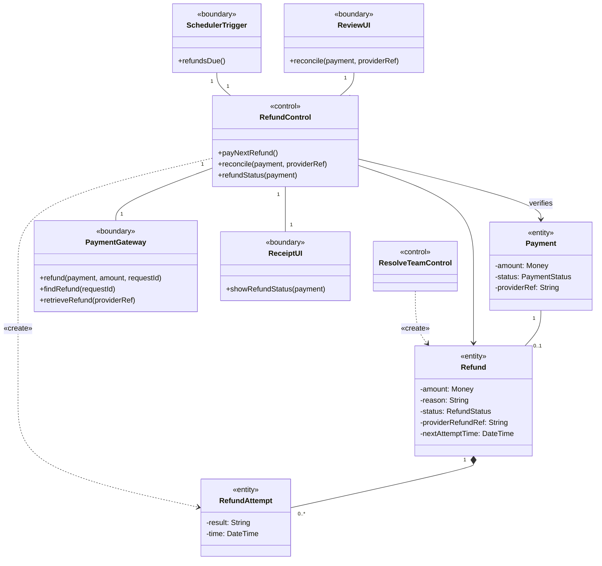
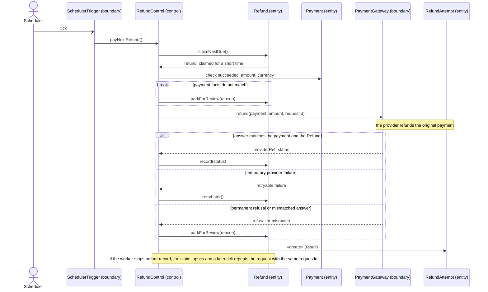
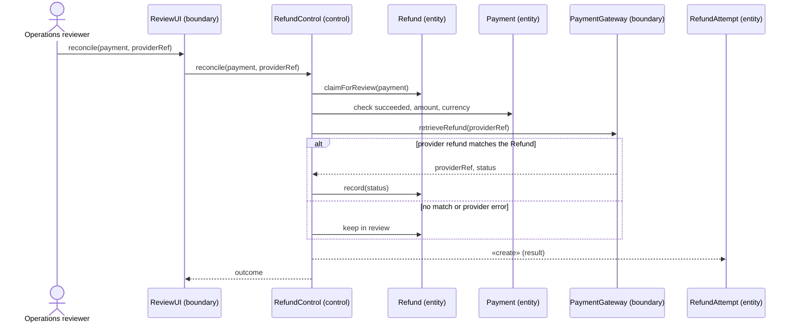
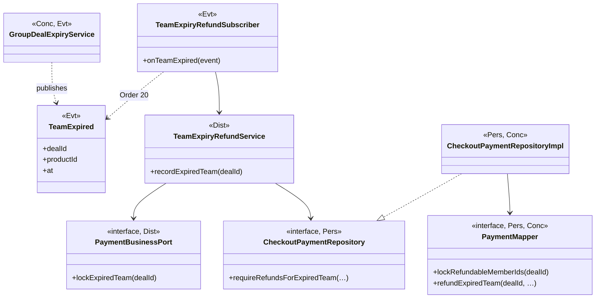
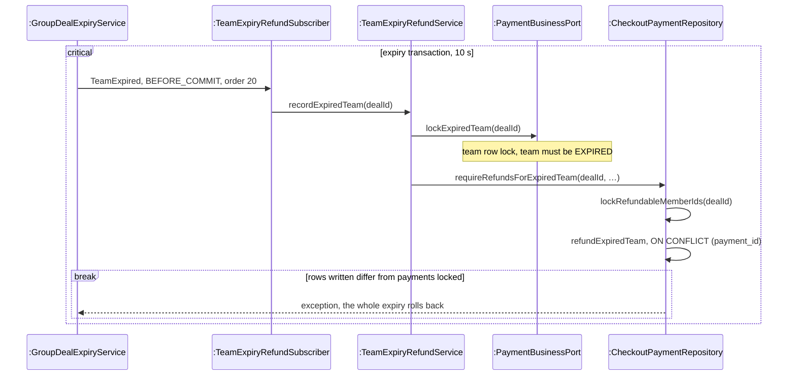
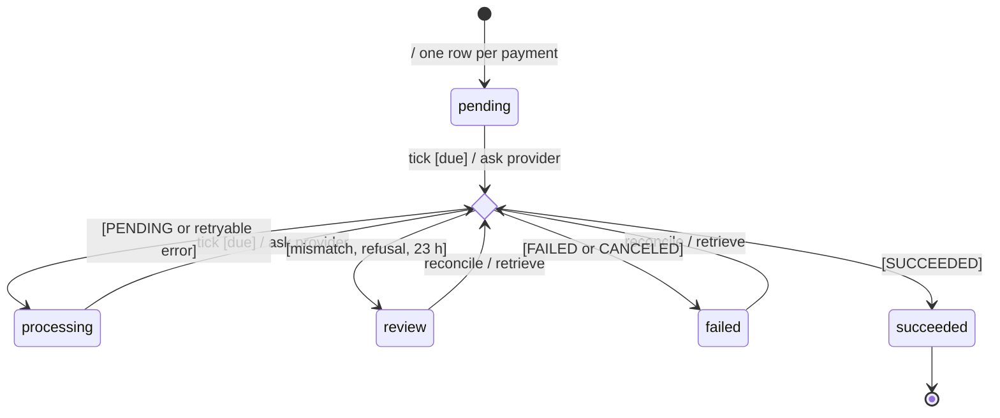

<!-- report
rubric: 3.4.2, 3.4-A..E, G4
owner: Yu Qianshuo (Yorik)
plan: #678
sources: ../report-drafts/yorick-yu-contribution.md (YY:5–212); ../report-drafts/statecharts.md (SC:83–110)
owns: R09, R28, FG04
status: draft
-->

### 3.4.2 UC6 Refund on Team Expiry by Yu Qianshuo (Yorik)

When a team's deadline passes before its last seat is taken, BlocBuy expires the team, cancels its orders and records one refund obligation for every paid member, all in one database transaction. A scheduled refund worker then pays each obligation back to the original card through Stripe. It retries a temporary provider failure with the same request identity, and it parks any case it cannot settle safely for an operator to review. The use case description is section 3.3.7.

This subsection gives the full set of models for UC6, the one use case its owner holds. The same refund worker also pays back a payment that UC3 or UC4 refused after the money was taken (section 3.4.1, Figure 3.44); only the way the obligation is created differs.

UC6 has three major flows:

1. **Expire a team and record its refunds.** The scheduler finds an overdue open team; the system expires it, cancels its orders and records the refund obligations.
2. **Pay one refund.** The scheduler wakes the refund worker, which claims one due obligation and asks the provider to refund it. A temporary provider failure (retry later) and a refund that stops part-way (repeat with the same request identity) are `alt` fragments and a note of this flow, because they use the same lifelines and differ only in the provider's answer.
3. **Reconcile a parked refund.** An operations reviewer checks a refund that the worker parked for review against the provider's records. This exceptional flow is a major flow of its own, because a different actor starts it and it never creates a refund.

The recovery mechanisms these flows rely on (Idempotency Key, Retry and operator review) belong to the external interface strategy (section 3.2.5). The way expiry reaches orders and payments through a domain event is the Observer pattern of section 3.5.2.

#### A Analysis class diagram

Figure 3.49 draws the refund side of UC6. The scheduler, the payment provider, the operations reviewer and the buyer are actors. Refund is the refund obligation: a promise to return one succeeded payment. RefundAttempt is the audit record of each try.



Figure 3.49: UML analysis class diagram of UC6, the refund side. ResolveTeamControl only records what is owed, RefundControl alone talks to the payment provider, and each Payment owes at most one Refund; the expiry objects, with ResolveTeamControl in full, are Figure 3.96.

#### B Analysis sequence diagrams

Flow 1 is the deadline-passes flow of UC5, Figure 3.102. For each open team past its deadline, the expiry, a loop that cancels each pending order of the team and a loop that creates one Refund for each succeeded payment of a member form one unit of work: either all of them happen or none does, so an expired team is never left without a record of the money it owes. A team already resolved by a last-seat join or another run is left unchanged and owes nothing.

Figure 3.50 is flow 2. The worker takes one due Refund at a time. It checks the payment's facts before it asks for money back and checks the provider's answer before it believes it.



Figure 3.50: UML analysis sequence diagram of UC6 flow 2, pay one refund. The `alt` fragment holds the exceptional flows: a temporary failure keeps the Refund due, and an unsafe answer parks it; the same request identity makes a repeat harmless.

Figure 3.51 is flow 3. It only looks up a refund that already exists at the provider; it never asks for a new one, so it cannot pay a buyer twice.



Figure 3.51: UML analysis sequence diagram of UC6 flow 3, reconcile a parked refund. The reviewer can only confirm an existing provider refund; any doubt leaves the Refund in review.

The buyer's last step, reading the refund status on the payment receipt, is a single query (`ReceiptUI` asks `RefundControl.refundStatus`) and is not drawn as a flow.

#### C Design class diagram

Expiry is a group-buy decision, while the obligation and the provider interaction belong to the payment module. The design class diagram is therefore drawn in two parts: the refund side of expiry (Figure 3.52) and the refund worker (Figure 3.53).



Figure 3.52: UML design class diagram of UC6, part 1, the refund side of expiry. The group-buy module publishes the immutable `TeamExpired` event and never touches payments, and the payment module's subscriber records the refunds before the transaction commits; the full expiry design, with the sweep and the order subscriber, is Figure 3.105.

`GroupDealExpiryService` expires one team per transaction (sweep design in section 3.2.7). `TeamExpiryRefundService` reaches the group-buy module only through `PaymentBusinessPort.lockExpiredTeam`, which takes the same team row lock that joins use and checks that the team really is EXPIRED. `CheckoutPaymentRepositoryImpl` then locks the team's refundable payments in a fixed order (`PaymentMapper.lockRefundableMemberIds`) and inserts one `biz_refund` row per payment with `PaymentMapper.refundExpiredTeam`, an upsert on `ON CONFLICT (payment_id)`. If the number of rows written differs from the number of payments locked, it throws, and the whole expiry rolls back.


Figure 3.53: UML design class diagram of UC6, part 2, the refund worker. `RefundService` holds no transaction across the provider call: it claims and finishes in two short transactions, and the stable `RefundWork.providerKey()` is the idempotency key sent to Stripe.

`RefundWork` is the immutable snapshot that a claim returns: the obligation joined with its payment's status, amount, currency and Stripe PaymentIntent. Its `valid()` checks that the payment succeeded and that amount and currency agree. Its `providerKey()` is the idempotency key, the same for every attempt on one obligation (section 3.2.5). `StripeRefundGateway.createRefund` re-reads the original PaymentIntent and refunds it, and tags the refund with the obligation's identifier as metadata; `findRefund` lists the PaymentIntent's refunds and accepts only a single one with that tag. The buyer's receipt reads the refund status through `PaymentBrowserService.receipt`, which serves only the payment's owner.

The analysis classes map onto these design classes as follows. SchedulerTrigger becomes the two Spring jobs `TeamExpirySweepJob` and `RefundWorkerJob`, each run under a database job lease by `LeasedJobRunner`. ResolveTeamControl is split across three modules (Figure 3.105): `GroupDealExpirySweeper` and `GroupDealExpiryService` in group-buy, `OrderLifecycleSubscriber` in order, and `TeamExpiryRefundSubscriber` with `TeamExpiryRefundService` in payment. RefundControl becomes `RefundService`. PaymentGateway becomes the port `RefundGateway` with the adapter `StripeRefundGateway`. Refund becomes a `biz_refund` row behind `RefundRepository`, and RefundAttempt a `log_refund_attempt` row written by `RefundMapper.audit`. ReceiptUI becomes the receipt page described in Table 3.15. ReviewUI has no design element yet: no endpoint or command calls `RefundService.reconcile` (part D).

#### D Design sequence diagrams

Each design sequence refines the analysis sequence of the same flow. Flow 1 (Figure 3.102) is refined by the UC5 expiry, Figure 3.111, up to the `TeamExpired` event, and by Figure 3.54 from the refund-obligation write onward. Figure 3.55 refines Figure 3.50, and Figure 3.56 refines Figure 3.51.



Figure 3.54: UML design sequence diagram of UC6 flow 1, from the refund-obligation write onward. The payment module writes one obligation per paid member inside the expiry transaction, and a count mismatch rolls the whole expiry back; the full expiry is Figure 3.111.

The expiry takes its locks in the order of Table 3.12 (section 3.2.8), and its status-guarded update settles a race with a last-seat join (Figure 3.111). If the sweep wins, a payment that settles afterwards finds the team expired and is owed a refund in its own transaction (section 3.4.1).

```mermaid
sequenceDiagram
    participant Job as :RefundWorkerJob
    participant Svc as :RefundService
    participant Repo as :RefundRepository
    participant GW as :RefundGateway

    Note over Job,Svc: scheduled tick under the refund-worker lease
    Job->>Svc: processNext()
    critical claim transaction, 5 s
        Svc->>Repo: claimNext()
        Note over Repo,GW: due pending or processing row; FOR UPDATE SKIP LOCKED; row lease, version + 1, audit CLAIMED
    end
    Repo-->>Svc: RefundWork
    break work.valid() is false
        Svc->>Repo: finish(work, review, PAYMENT_MISMATCH)
    end
    alt provider refund id already stored
        Svc->>GW: retrieveRefund(providerId)
    else 23 hours since the first attempt
        Svc->>GW: findRefund(work)
    else otherwise
        Svc->>GW: createRefund(work), key providerKey()
    end
    alt snapshot matches the obligation
        GW-->>Svc: Snapshot
        Svc->>Repo: finish(work, id, succeeded, processing or failed)
    else retryable provider error
        GW-->>Svc: PAYMENT_PROVIDER_ERROR
        Svc->>Repo: finish(work, processing, PROVIDER_RETRY)
    else refusal, mismatch, or nothing found after 23 hours
        GW-->>Svc: refusal or mismatching snapshot
        Svc->>Repo: finish(work, review, reason)
    end
    Note over Svc,Repo: each finish has its own transaction; fenced by id and version; schedules the next attempt
```

Figure 3.55: UML design sequence diagram of UC6 flow 2, pay one refund. The provider call runs between two short transactions, never inside one; a crash after Stripe accepts the refund leaves the row claimable once its lease lapses, and the next attempt sends the same idempotency key.

The `alt` fragments are the exceptional flows of section 3.3.7 (retry rules in section 3.2.5). A retryable provider error (transport, rate limit, availability) moves the obligation to `processing`, due again later. A permanent refusal (`PAYMENT_STATE_INVALID` or `PAYMENT_PROVIDER_REJECTED`) or a snapshot that does not match the obligation moves it to `review`, which the worker never claims again.

```mermaid
sequenceDiagram
    actor Op as Operator
    participant Svc as :RefundService
    participant Repo as :RefundRepository
    participant GW as :RefundGateway

    Note over Op,Svc: no endpoint or command; a separately reviewed invocation
    Op->>Svc: reconcile(paymentId, providerId)
    critical claim transaction, 5 s
        Svc->>Repo: claimReview(paymentId)
        Note over Repo,GW: review or failed row only, audit OPERATOR_RECONCILE
    end
    Repo-->>Svc: RefundWork
    break work.valid() is false
        Svc->>Repo: finish(work, review, PAYMENT_MISMATCH)
    end
    Svc->>GW: retrieveRefund(providerId)
    alt snapshot matches the obligation
        GW-->>Svc: Snapshot
        Svc->>Repo: finish(work, id, succeeded, processing or failed)
    else provider error or mismatch
        Svc->>Repo: finish(work, review, reason)
    end
    Svc-->>Op: true
```

Figure 3.56: UML design sequence diagram of UC6 flow 3, reconcile a parked refund. `reconcile` only retrieves a refund the operator names and maps it with the same checks as the worker; it has no path that creates a refund.

`RefundService.reconcile` exists and is unit-tested, but no endpoint, command or job calls it: it has no HTTP endpoint, the operator command runner `stripe-ops` (`StripeOperationsConfiguration`) does not expose it, and the rollout runbook (`backend/docs/payment/stripe-rollout-runbook.md`) requires a separately reviewed invocation. Flow 3 is therefore designed and unit-tested but has never been run on dev.

#### Statechart of the refund obligation

A refund obligation is one row of `biz_refund`. It is created when a team expires (this subsection) or when a paid settlement is refused (section 3.4.1). A buyer's receipt shows its status.



Figure 3.57: UML statechart of the refund obligation (`biz_refund.status`). Every attempt passes through one choice on the provider's answer; only `pending` and `processing` are claimed by the worker, while `review` and `failed` wait for an operator's reconcile.

A tick takes an obligation only when it is *due*: its next attempt time has passed and no live lease holds it. The choice reads the provider's answer: an unknown status also goes to `review`, and *23 h* is the search after 23 hours that finds no refund. Every transition out of the choice stamps the next attempt time (one `finish` statement for all outcomes; retry rules in section 3.2.5), but only a `processing` obligation is claimed again by the worker: `succeeded` and `failed` are never retried automatically, and `review` waits for an operator. A provider error during a reconcile leaves the obligation in `review`, so a case in an operator's hands never returns to the automatic worker. The states are plain strings, the constants of `RefundService`, with no transition table in code: the statechart is enforced by the claim and finish SQL of `RefundMapper`. Of the objects in this use case, only the team checks its own transitions (`DealStatus.canTransitionTo`, section 3.4.5).

**Evidence.** Flows 1 and 2 were shown on dev on 23 October (Table E.3); that one run does not show the expiry design bound (section 1.4.3) is met. The worker also refunded, once each, the payments an operator recovered that day (the 23 Oct webhook fault, Appendix E).

Simulated refund-worker recovery was tested locally on 3 October and in CI on 25 October, with PostgreSQL and a substitute for Stripe network calls (Table E.5). The local rehearsal ran `StripeRolloutAcceptanceIT` and the full Testcontainers integration suite. Both runs included `providerSucceededBeforeWorkerLossRetriesWithOneDurableRefundKey`: the provider substitute stored a refund under the durable key, then threw before the database finish. After the lease was made due, a second worker call reused the key and completed the one refund obligation without creating another provider refund. This simulates loss after provider acceptance; it does not stop a real worker process or test Stripe's live idempotency retention.

The local rehearsal also delivered a signed `refund.updated` notification twice without changing the payment, refund or audit row counts. The Checkout webhook ignores `refund.*` events, so this was a no-op rather than evidence of refund-webhook replay protection. A permanent provider-state refusal was parked in `review` with no second provider call. A deliberate process crash, a replay and a permanent failure with operator review have not been exercised on dev.

The unit tests `RefundServiceTest`, `TeamExpiryRefundSubscriberTest`, `TeamExpiryRefundServiceTest` and `GroupDealExpiryServiceTest` cover the worker's branches and the expiry service. The integration tests `StripeRolloutAcceptanceIT` and `TeamExpirySchedulingIT` run the real expiry, claim and persistence code against PostgreSQL.

#### E Compliance with the transition strategies

UC6 applies eight of the nine transition strategies of section 3.2. Language and framework (3.2.1) adds nothing specific to UC6 beyond the Spring scheduling and event annotations listed under 3.2.7 and 3.2.9.

<!-- table: split -->

Table 3.15: Transition strategies applied to UC6.

| Strategy | Analysis object | Design element |
| --- | --- | --- |
| 3.2.2 Presentation | «boundary» ReceiptUI | Receipt route `payments.$paymentId.tsx` with `receipt-view.ts` and `refund-status.ts`; the page polls while a refund is pending |
| 3.2.3 Distribution | «control» ResolveTeamControl; «boundary» ReceiptUI | Expiry split across the group-buy, order and payment modules, joined only by the `TeamExpired` event and the port `PaymentBusinessPort.lockExpiredTeam`; receipt served by `GET /api/v1/payments/{id}` on `StripeCheckoutController` |
| 3.2.4 Persistence | «entity» Refund, RefundAttempt, Team, Order | `biz_refund` behind `RefundRepository`, `RefundRepositoryImpl` and `RefundMapper`, created by `CheckoutPaymentRepository.requireRefundsForExpiredTeam` and `PaymentMapper.refundExpiredTeam`; `log_refund_attempt` written by `RefundMapper.audit`; team expiry by `GroupDeal.expire` and `PaidGroupDealRepository.expire` |
| 3.2.5 External interface | «boundary» PaymentGateway | Port `RefundGateway` with adapter `StripeRefundGateway`; idempotency key `RefundWork.providerKey()`; retry of provider errors (retry rules in section 3.2.5); `review` state for unsafe answers |
| 3.2.6 Security | «boundary» ReviewUI, ReceiptUI | No endpoint or command exposes `RefundService.reconcile`; `PaymentBrowserService.receipt` returns a receipt only to the payment's owner |
| 3.2.7 Scheduling | «boundary» SchedulerTrigger | `TeamExpirySweepJob` and `RefundWorkerJob` under `LeasedJobRunner` job leases (Table 3.11) |
| 3.2.8 Concurrency | «control» ResolveTeamControl, RefundControl; «entity» Team, Refund | Team row lock and status-guarded `expireDeal`; refundable payments locked in a fixed order; `UNIQUE (payment_id)` with `ON CONFLICT`; claim with `FOR UPDATE SKIP LOCKED` and a row lease; provider I/O outside transactions |
| 3.2.9 Domain events | «control» ResolveTeamControl (cancel orders, record refunds) | `GroupDealExpiryService` publishes `TeamExpired`; `OrderLifecycleSubscriber` (`@Order(10)`) and `TeamExpiryRefundSubscriber` (`@Order(20)`) react at `BEFORE_COMMIT` |
