<!-- report
rubric: 3.4.3, 3.4-A..E, G4
owner: Panpakorn Siripanich (Pan)
plan: #678
sources: backend/docs/design/backend-skeleton-plan.md §14, §15; code under backend/ and frontend/src at 46faacd7 (26 Oct)
owns: R54, R55, FG09
status: draft
-->

### 3.4.3 UC1 Browse Listings and UC2 Register and Sign In by Panpakorn Siripanich (Pan)

UC1 and UC2 are the buyer's way into BlocBuy. UC1 lets anyone, signed in or not, browse the listings on sale and open one listing to see its solo price, its team price and the progress of its best open team. UC2 lets a buyer sign in with Google: the first sign-in registers a local buyer account, later sign-ins reuse it, and every action that commits money needs that session. This section gives the full set of models for both use cases: an analysis class diagram and a design class diagram per use case, and an analysis and a design sequence diagram for each of the five major flows in Table 3.16. The use case descriptions are in sections 3.3.2 and 3.3.3.

Table 3.16: Major flows of UC1 and UC2 and their figures.

| Flow | What happens | Analysis sequence | Design sequence |
| --- | --- | --- | --- |
| UC1-1 Browse listings | A visitor lists on-sale listings, optionally by category or keyword, one page at a time | Figure 3.61 | Figures 3.70, 3.71 |
| UC1-2 View a listing | A visitor opens one listing; a missing or off-sale listing shows a not-found page | Figure 3.62 | Figure 3.72 |
| UC2-1 Sign in with Google | A buyer signs in; the first sign-in registers the account | Figure 3.63 | Figures 3.73, 3.74 |
| UC2-2 Sign out | A signed-in buyer ends the session | Figure 3.64 | Figure 3.75 |
| UC2-3 Anonymous access refused | A visitor without a session asks for a member-only screen or action and is sent to sign in | Figure 3.65 | Figure 3.76 |

Exceptional flows are drawn as `break` or `alt` fragments inside these five flows, not as separate major flows: an empty result page in UC1-1, a missing listing in UC1-2, and a refused or failed sign-in in UC2-1. "Register" in UC2 means the first Google sign-in; Google is the only sign-in channel, as the proposal planned.

Pan owns the analysis and design models of both use cases (code credits: chapter 5).

#### A Analysis class diagram

The UC1 analysis model (Figure 3.59) has one screen, one control and two entities. `CatalogUI` is the browse grid and the listing page. `BrowseListingsControl` gets the listings and asks each listing for its displayed prices. `Listing` holds the solo price and decides which team price applies, and `Team` holds the progress the buyer sees. The price pair belongs to the listing because the rule that picks it can vary by listing; the design keeps that rule behind an interface (Figure 3.66, section 3.5.4).

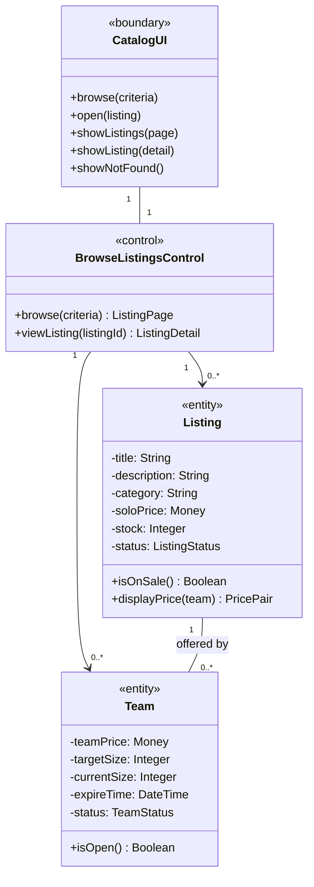

Figure 3.59: Analysis class diagram of UC1 Browse listings (UML). The listing, not the control, owns the rule that turns a solo price and an open team into the displayed price pair.

The UC2 analysis model (Figure 3.60) separates the two screens from the identity provider. `SignInUI` is the sign-in screen. `MemberAreaUI` stands for any screen or action that needs a member, such as the account page or *Start a bloc*. `IdentityProvider` is the boundary to Google. `AuthControl` runs the sign-in, the sign-out and the check on every member request. `SignInState` is the one-time value that ties Google's answer to the browser that asked for it. `User` and `OAuthBinding` are the local account and its link to a Google subject (Google's stable user ID). `Role` is what the account may do, and `Session` is the signed-in state the browser holds.

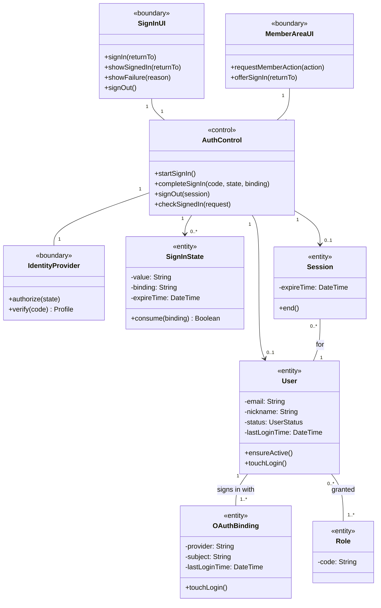

Figure 3.60: Analysis class diagram of UC2 Register and sign in (UML). A user is found by its Google subject, not by its email, and a first sign-in grants exactly one role, buyer.

#### B Analysis sequence diagrams

**UC1-1 Browse listings.** The control reads one page of on-sale listings and the best open team of each, then asks each listing for its price pair (Figure 3.61). An empty page is a normal answer, not an error.

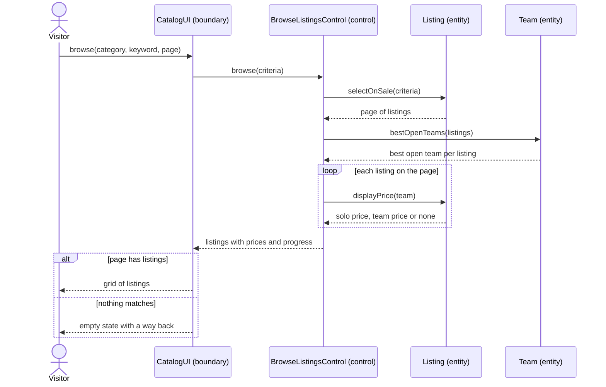

Figure 3.61: Analysis sequence diagram of UC1-1 Browse listings (UML). The best open teams are fetched once for the whole page, before the price loop.

**UC1-2 View a listing.** The control finds the listing and stops if it is missing or not on sale. Otherwise it adds the best open team and the price pair (Figure 3.62). A missing listing and an off-sale listing get the same answer, so a visitor cannot learn that an off-sale listing exists.

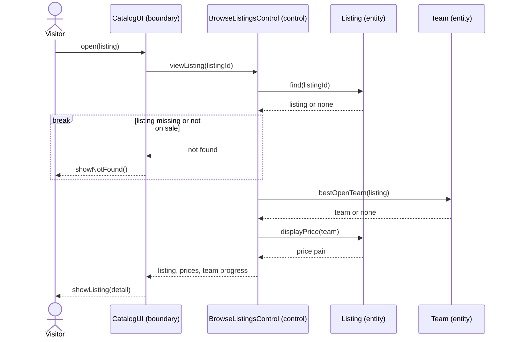

Figure 3.62: Analysis sequence diagram of UC1-2 View a listing (UML). The not-found check comes before any team lookup.

**UC2-1 Sign in with Google.** The control issues a one-time state, sends the buyer to Google, and on the way back checks the state before it trusts anything Google returned (Figure 3.63). It then finds the account by its Google binding or registers a new buyer, and only then opens a session.

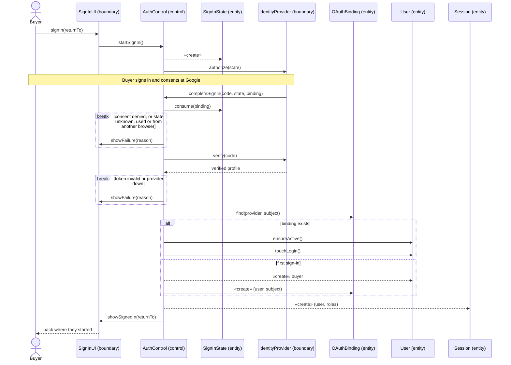

Figure 3.63: Analysis sequence diagram of UC2-1 Sign in with Google (UML). No session exists until the state, the provider's answer and the account have all been checked.

Two more refusals happen inside the `alt`: a disabled account fails `ensureActive()`, and a first sign-in whose email already belongs to an account from another channel is refused, never merged. Both end in `showFailure(reason)` like the two `break` fragments.

**UC2-2 Sign out.** The control ends the session and the screen returns to the signed-out state (Figure 3.64). A failed sign-out keeps the session and says so; it never pretends to have signed out.

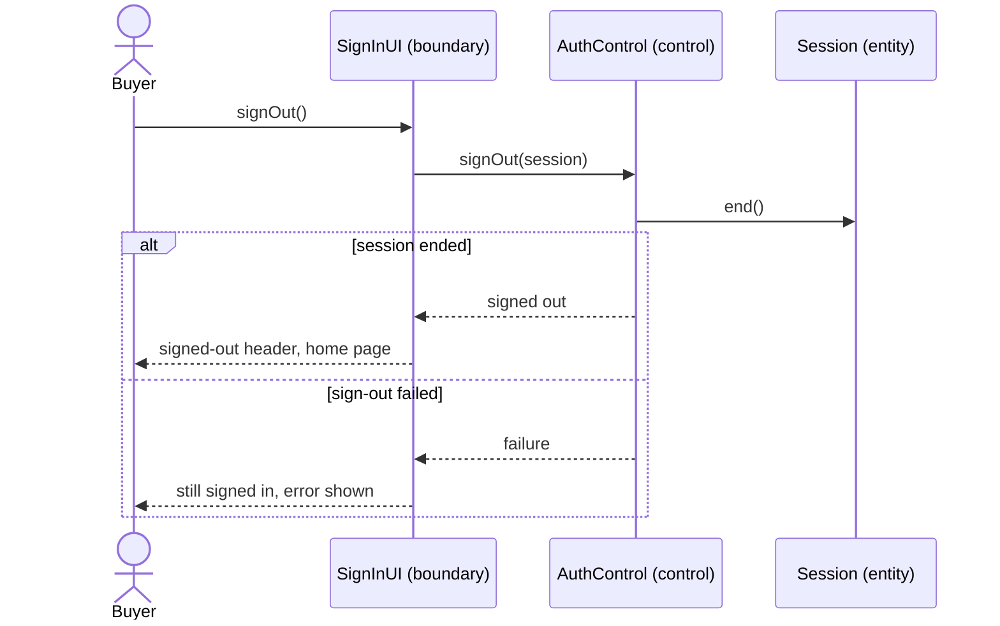

Figure 3.64: Analysis sequence diagram of UC2-2 Sign out (UML). Only the current session ends; the buyer's sessions on other devices stay open.

**UC2-3 Anonymous access refused.** Every member request passes the control's check first. Without a session the request is refused and the visitor is offered sign-in with the place they wanted to go (Figure 3.65).

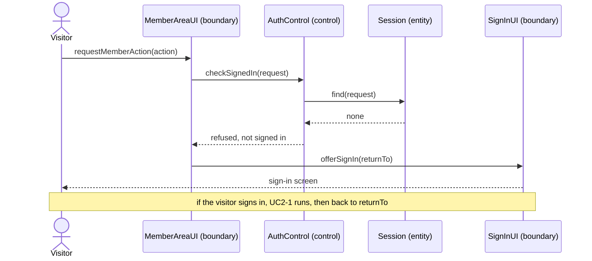

Figure 3.65: Analysis sequence diagram of UC2-3 Anonymous access refused (UML). The refusal changes nothing, and the return path survives the sign-in.

#### C Design class diagram

**UC1.** Figure 3.66 shows the browse design. The screen boundary becomes two TanStack Router routes. Each route loads its data through a query built from the generated OpenAPI client, so the frontend never computes a price. The control becomes `ProductController` (HTTP) in front of `ProductAppServiceImpl` (the use case), which implements `ProductAppService`. The `Listing` entity becomes the `Product` aggregate behind the `ProductRepository` port. Its implementation, `ProductRepositoryImpl`, reads `biz_product` through `BizProductMapper`. The `Team` entity stays in the groupbuy context: the catalog reaches it only through the read service `GroupDealQueryService`, which returns plain `OpenDealOffer` views from a short-lived Redis cache (`RedisOpenDealOfferCache`). The analysis operation `Listing.displayPrice` becomes the `PricingStrategy` interface. `PricingStrategyResolver` picks the strategy by the product's `pricingMode`, and `DualPricingStrategy` is the only strategy today. Section 3.5.4 treats the design problem behind this choice.

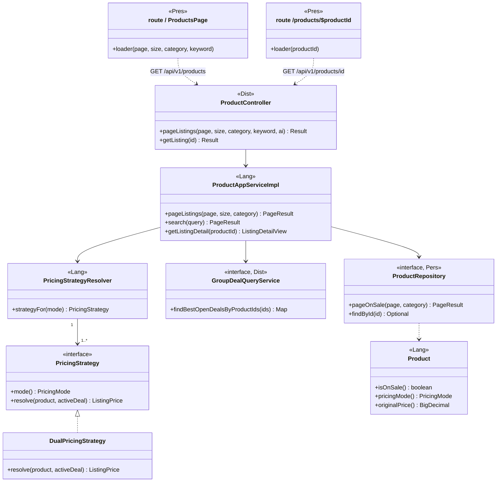

Figure 3.66: Design class diagram of UC1 Browse listings (UML; tags name the transition strategy). The routes reach the server only over HTTP, and the catalog reaches the group-buy context only through its read service `GroupDealQueryService`.

**UC2, web and session layer.** Figure 3.67 shows how the sign-in reaches the browser. On the frontend, `LoginPage` holds `GoogleSignInButton`, whose `startGoogleLogin` parks the return path in session storage and navigates to the backend. `useSession` reads the current user through the generated client, and every route asks it before it renders. `AuthController` has four endpoints: the redirect to Google, the Google callback, the current user (`me`) and `logout`. `SaTokenConfig` registers the Sa-Token interceptor on every `/api/v1/**` path. Only the OAuth endpoints, the webhooks and anonymous `GET` on `/api/v1/products/**` and `/api/v1/invites/*` pass without a session. `LoginSessionPublisher` opens the Sa-Token session and stores its roles in Redis before it sets the `blocbuy-token` cookie, so a browser never holds a token whose roles were not saved. `UserAppService` gives the session's profile to `me` without exposing the `User` aggregate. `UserController` exists only as a placeholder and has no endpoints.

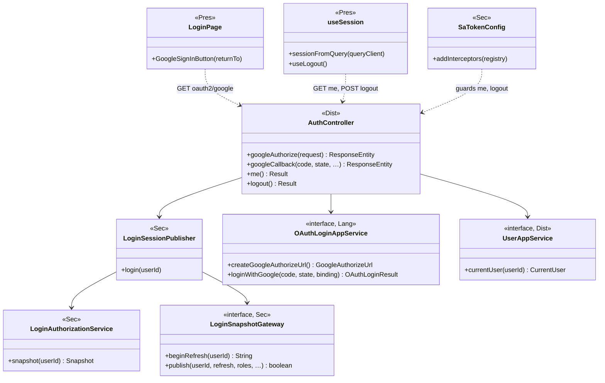

Figure 3.67: Design class diagram of UC2, web and session layer (UML; tags name the transition strategy). The browser receives its cookie only from `LoginSessionPublisher`, after the roles are saved.

**UC2, identity and persistence.** Figure 3.68 shows the classes behind `OAuthLoginAppService`. Its implementation, `OAuthLoginAppServiceImpl`, is deliberately not transactional, because the state check and the Google exchange are network calls. It uses two ports defined in the identity domain. `OAuthStateStore` (implemented by `RedisOAuthStateStore`) issues a state with a five-minute expiry and consumes it atomically. `OAuthIdentityGateway` (implemented by `GoogleOAuthGateway`) exchanges the code and verifies the ID token's signature, issuer, audience and expiry, and it rejects an unverified email; no Google class appears outside this adapter. Account writes run in `OAuthUserTxService`, one short transaction per sign-in.

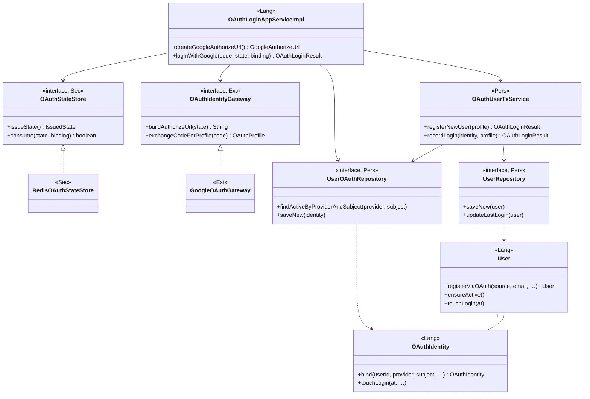

Figure 3.68: Design class diagram of UC2, identity and persistence (UML; tags name the transition strategy). Google and Redis sit behind two domain ports, and only `OAuthUserTxService` opens a database transaction.

The two entities map to two tables of the Flyway migration `V3__identity.sql` (Figure 3.69). `User` is stored in `sys_user` and `OAuthIdentity` in `sys_user_oauth`; the buyer role grant is a row of `rel_user_role`. Converters (`UserConverter`, `UserOAuthConverter`) map the data objects `SysUserDO` and `SysUserOAuthDO`, read by `SysUserMapper` and `SysUserOAuthMapper`. The unique index `uq_sys_user_oauth_provider_subject` allows one binding per Google subject, and `uq_sys_user_email` allows one live account per email. By team convention there are no foreign keys (section 3.6). The table keeps a `password_hash` column from the original design, but no sign-in path uses a password.

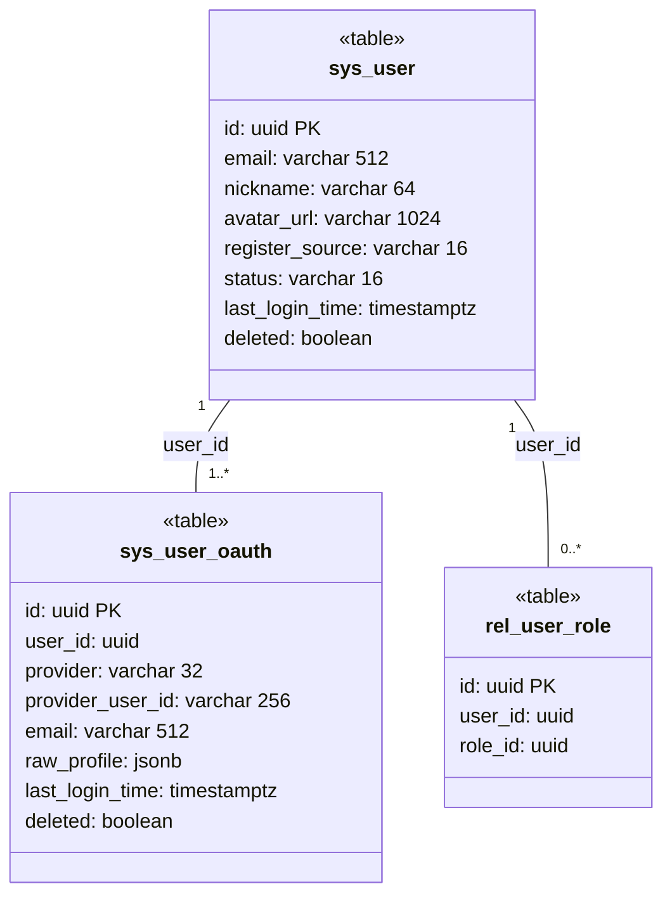

Figure 3.69: Persistence of the UC2 entities (UML class notation for tables, audit columns omitted). The links are plain `user_id` columns, not foreign keys, and `provider` with `provider_user_id` is unique.

#### D Design sequence diagrams

The design sequences start at the frontend route that the visitor opens, because the route is the designed form of the screen boundary. Two flows are long enough to need two linked figures (UC1-1 and UC2-1); each pair is one design sequence split at a call.

**UC1-1 Browse listings.** Figures 3.70 and 3.71 together match Figure 3.61. The route loader calls `GET /api/v1/products` through the generated `pageListingsOptions`, and the Sa-Token interceptor lets an anonymous `GET` through. Inside `pageListings`, the product page and its count run in one read-only transaction that commits before the deal lookup, so a slow cache never holds a database connection. One batch call then returns the best open deal of every product on the page, and prices are resolved in memory, with no query per product. A nonblank keyword takes `search(ListingQuery)` instead of `pageListings`, and the wildcard characters `%`, `_` and `\` in its terms are matched literally. It uses the same batch lookup and strategy, plus an optional AI re-ranking of the page that falls back to database order. A page number or size out of range (size at most 100) is rejected by the server with a validation error and returns no listings.

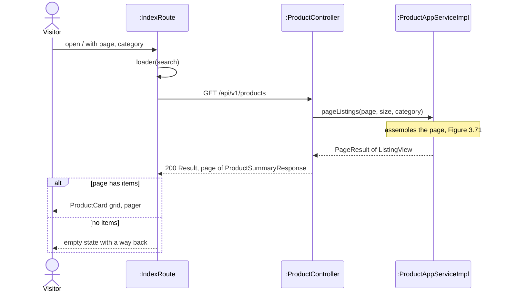

Figure 3.70: Design sequence diagram of UC1-1 Browse listings, request path (UML). The frontend asks for data only through the generated client and never computes a price.

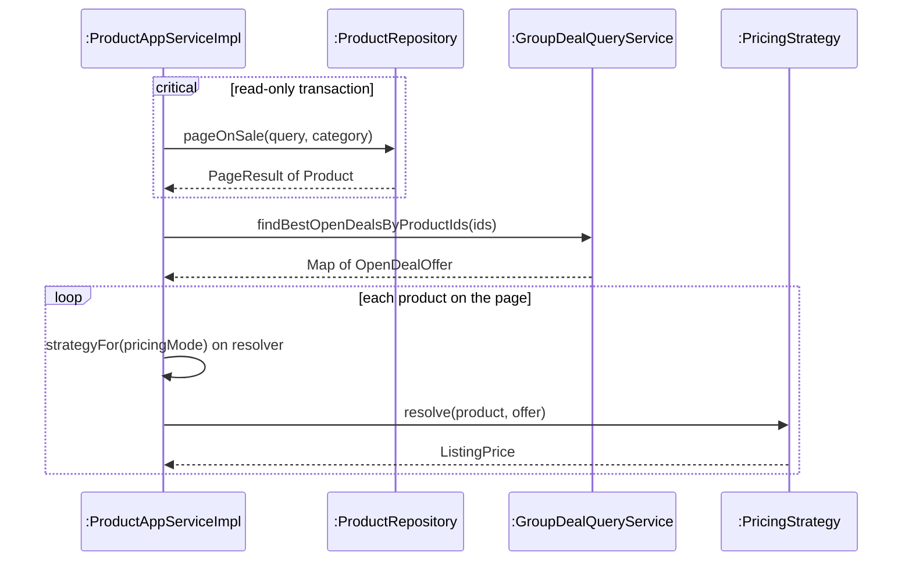

Figure 3.71: Design sequence diagram of UC1-1 Browse listings, inside `pageListings` (UML; `PricingStrategyResolver` is drawn as a self-call, the strategy instance is `DualPricingStrategy`). The transaction closes before the deal lookup, and the loop makes no database call; Figure 3.132 excerpts the Strategy collaboration of this loop.

**UC1-2 View a listing.** Figure 3.72 matches Figure 3.62. `getListingDetail` reads the product in its own read-only transaction. A missing, deleted or off-sale product raises `BizException(PRODUCT_NOT_FOUND)`, which `GlobalExceptionHandler` turns into HTTP 404 with code `CATALOG_404_001`; the route then shows `NotFoundCard`. Otherwise the private `resolvePrice` step runs the same resolver and strategy as Figure 3.71. The response carries one deal, the best open team, not a list of all open teams.

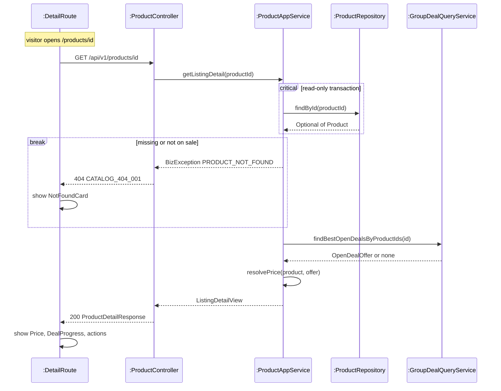

Figure 3.72: Design sequence diagram of UC1-2 View a listing (UML; the service is `ProductAppServiceImpl`). An off-sale listing returns the same 404 as a missing one, and the deal lookup happens only for a listing on sale.

**UC2-1 Sign in with Google.** Figures 3.73 and 3.74 together match Figure 3.63. Both OAuth endpoints always answer with a redirect, never with JSON. On failure the browser lands on `/login?error=<code>`, for example `IDENTITY_401_001` for a bad state. If Google is unreachable, or the code or token cannot be verified, no session is opened (`OAUTH_PROVIDER_ERROR` or `OAUTH_TOKEN_INVALID`). The state lives in Redis under a five-minute expiry, and the matching random binding travels in the HttpOnly, SameSite=Lax cookie `blocbuy-oauth-state`. `consume` uses Redis `GETDEL`, so a state works once. No database transaction is open during the Google exchange; `recordLogin` and `registerNewUser` each run in their own short transaction. If two first sign-ins of the same Google subject race, the loser's insert breaks `uq_sys_user_oauth_provider_subject`; it rolls back and retries as a login. An email that already belongs to an account from another channel is refused with `EMAIL_ALREADY_REGISTERED` (HTTP 409), and a disabled account with `ACCOUNT_DISABLED` (HTTP 403). After the redirect to `/auth/callback`, the frontend route re-reads `me` and returns to the parked path.

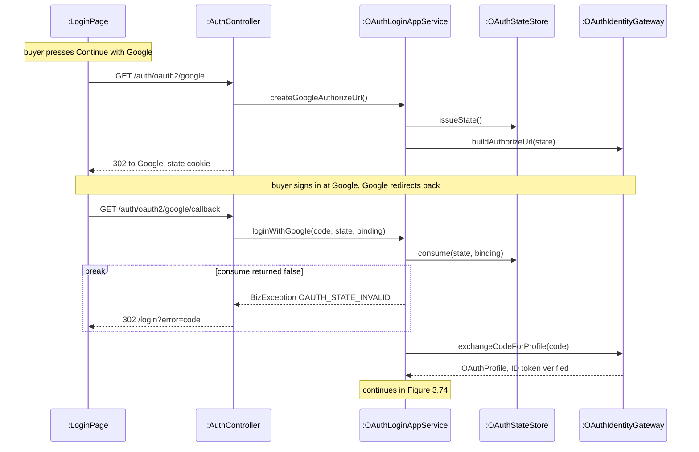

Figure 3.73: Design sequence diagram of UC2-1 Sign in with Google, redirect and verification (UML; the implementations are `RedisOAuthStateStore` and `GoogleOAuthGateway`). The state is consumed before Google is called.

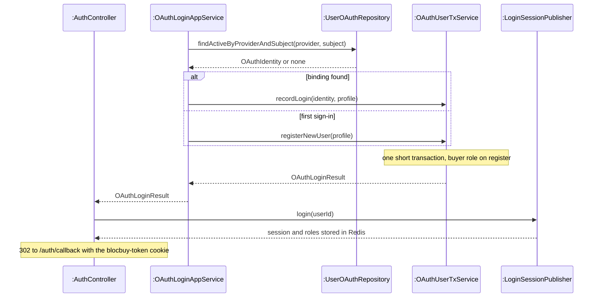

Figure 3.74: Design sequence diagram of UC2-1 Sign in with Google, account and session (UML). The account is written in a short transaction of its own, and the session cookie is set last.

**UC2-2 Sign out.** Figure 3.75 matches Figure 3.64. The header's *Sign out* button runs `useLogout`, which calls the generated logout mutation. The interceptor checks the session, and `StpUtil.logout()` removes the token from Redis and clears the cookie. On success the frontend sets the cached `me` answer to anonymous rather than deleting it, which saves one refused request, and goes home. On failure the session stays and the header shows the error.

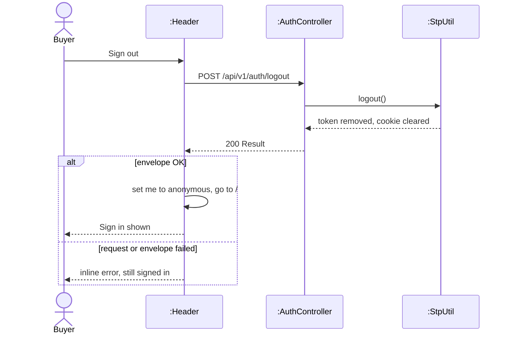

Figure 3.75: Design sequence diagram of UC2-2 Sign out (UML). Only the current token ends, because each sign-in gets its own token (`is-share: false`).

**UC2-3 Anonymous access refused.** Figure 3.76 matches Figure 3.65 for the account page. The refusal comes from the server. Before any route renders, the root route asks `GET /api/v1/auth/me` through `sessionFromQuery`. The Sa-Token interceptor's `StpUtil.checkLogin()` throws `NotLoginException`, and `GlobalExceptionHandler` maps it to HTTP 401 with code `COMMON_401_001` (`UNAUTHENTICATED`), which the frontend reads as "anonymous". The `_authenticated` route guard then redirects to `/login` with the wanted path. The frontend guard only improves the experience; every protected endpoint refuses an anonymous call on its own. On a listing, *Start a bloc* and *Join* open the sign-in sheet `GatedActionSheet` instead of calling the server (`useSignInGate`).

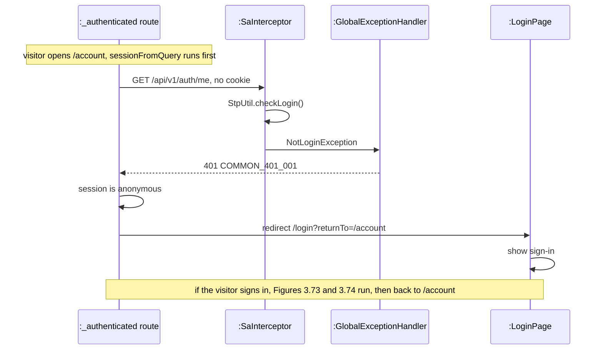

Figure 3.76: Design sequence diagram of UC2-3 Anonymous access refused (UML). The server refuses the request with 401; the frontend redirect only reacts to it.

**Evidence.** On dev, `GET /api/v1/products?page=1` answered 200 with JSON on 22 September, and the catalog returned ten listings on 8 October (sprint logs of those days). On 8 October on dev, a Google sign-in through CloudFront left the `blocbuy-token` cookie marked Secure and HttpOnly in Chrome DevTools; SameSite was not read in the browser (sprint 3 log, 8 October). The flows are also covered by automated tests run in CI, not on dev:

- `ProductControllerTest`, `ProductAppServiceImplTest`, `PricingStrategyResolverTest`, `DualPricingStrategyTest`, and `ProductSearchRepositoryIT` against PostgreSQL in a container;
- `OAuthLoginAppServiceImplTest`, `OAuthUserTxServiceTest`, `GoogleOAuthGatewayTest`, `RedisOAuthStateStoreTest`, `LoginSessionPublisherTest` and `AuthControllerTest`;
- `EndpointAuthSurfaceTest`, which checks that every `/api/v1` endpoint refuses an anonymous caller unless it is on the allow-list;
- the Playwright suite `login.spec.ts`, run against API stubs, which covers the redirect to `/login`, the sign-in sheet on a listing and sign-out.

Tests use stubs for Google, so they are not proof of a real Google sign-in; the 8 October dev check is.

#### E Compliance with the transition strategies

Table 3.17 maps each strategy that applies to UC1 or UC2 to the analysis object it transformed and the design element that resulted. Scheduling (3.2.7) and domain events (3.2.9) do not apply: neither use case runs on a timer or publishes an event.

Table 3.17: Transition strategies applied to UC1 and UC2.

| Strategy | Analysis object | Design element |
| --- | --- | --- |
| 3.2.1 Language and framework | «control» `BrowseListingsControl`, `AuthControl`; «entity» `Listing`, `User`, `OAuthBinding` | Spring services `ProductAppServiceImpl`, `OAuthLoginAppServiceImpl`, `UserAppServiceImpl`; plain Java aggregates `Product`, `User`, `OAuthIdentity` in the domain module |
| 3.2.2 Presentation | «boundary» `CatalogUI` | Routes `/` (`ProductsPage`) and `/products/$productId` (`ProductDetailPage`) with `ProductCard`, `Price`, `DealProgress`, `NotFoundCard`; data from TanStack Query loaders |
| 3.2.2 Presentation | «boundary» `SignInUI`, `MemberAreaUI` | `LoginPage`, `GoogleSignInButton`, `Header` with `useLogout`, `/auth/callback` route, `_authenticated` guard, `GatedActionSheet` with `useSignInGate`; session state from `useSession` |
| 3.2.3 Distribution | «control» `BrowseListingsControl` | `ProductController` (`GET /api/v1/products`, `GET /api/v1/products/{id}`), response records such as `ProductSummaryResponse` in `Result`; generated client `pageListingsOptions`, `getListingOptions` |
| 3.2.3 Distribution | «control» `AuthControl` | `AuthController` (`/auth/oauth2/google`, its callback, `/auth/me`, `/auth/logout`); errors as `BizException` mapped by `GlobalExceptionHandler` |
| 3.2.3 Distribution | «entity» `Team` seen from the catalog | Read service `GroupDealQueryService` with `findBestOpenDealsByProductIds`, returning `OpenDealOffer` views, cached by `RedisOpenDealOfferCache` |
| 3.2.4 Persistence | «entity» `Listing` | `ProductRepository` port, `ProductRepositoryImpl`, `BizProductMapper`, `BizProductDO`, table `biz_product` |
| 3.2.4 Persistence | «entity» `User`, `OAuthBinding`, `Role` | `UserRepository`, `UserOAuthRepository`, `RoleRepository`; `SysUserMapper`, `SysUserOAuthMapper`; tables `sys_user`, `sys_user_oauth`, `rel_user_role`; short transactions in `OAuthUserTxService` |
| 3.2.5 External interface | «boundary» `IdentityProvider` | Port `OAuthIdentityGateway`, adapter `GoogleOAuthGateway` (code exchange with bounded timeouts, ID token verification) |
| 3.2.6 Security | «entity» `SignInState` | Port `OAuthStateStore`, `RedisOAuthStateStore` (five-minute expiry, `GETDEL`), cookie `blocbuy-oauth-state` |
| 3.2.6 Security | «entity» `Session`, `Role` | Sa-Token session in Redis, HttpOnly Secure SameSite=Lax cookie `blocbuy-token`; `LoginSessionPublisher` with `LoginAuthorizationService` and `LoginSnapshotGateway` |
| 3.2.6 Security | «control» `AuthControl.checkSignedIn` | `SaTokenConfig` interceptor (`StpUtil.checkLogin()`, public and anonymous-GET allow-lists), `NotLoginException` mapped to 401 |
| 3.2.8 Concurrency | «entity» `OAuthBinding` (two first sign-ins at once) | Unique index `uq_sys_user_oauth_provider_subject`; `DuplicateKeyException` re-read as a login in `OAuthLoginAppServiceImpl` |
