<!-- report
rubric: 3.4.4, 3.4-A..E, G4
owner: Lim Jiechao
plan: #678
sources: backend/docs/design/backend-skeleton-plan.md §18, §19; backend ADR 0003; docs/sprint2-progress-report.typ; docs/agile/sprint-04/log/2026-10-24.md; code at 46faacd7 (26 Oct)
owns: none
status: draft
-->

### 3.4.4 UC8 View My Orders and Teams and UC7 Share Attribution by Lim Jiechao

This subsection takes two buyer use cases from analysis to design. In UC8 View my orders and teams, a signed-in buyer opens one screen, *My blocs*, and sees every team they started or joined and every order they paid for, each with its current status. In UC7 Share attribution, a team member shares an invite link. When another buyer joins through that link, the server records who shared it and writes one referral credit. Both use cases are described in sections 3.3.9 and 3.3.8. Both have the full set of models: an analysis class diagram, an analysis sequence diagram for each major flow, a design class diagram, a design sequence diagram for each analysis sequence, and a compliance table.

Lim identified the five major flows of the two use cases and made their analysis decisions. Each list of UC8 has its own control, and a team's status is read as stored, never computed from the clock. In UC7, attribution and crediting are separate controls linked only by the "member joined" fact, so crediting can never refuse a join, and the invite reference grants nothing on its own. In design, Lim chose to keep the invite reference in the browser across the Google sign-in redirect and out of copied addresses (code credits: chapter 5).

A second buyer's paid join through a member's invite link was shown on dev on 24 October in a recording (Appendix E). The recording shows screens only, so the referral credit row was not checked on dev. Tested locally (Testcontainers), not on dev: in `StripeLocalIntegrationTest`, an invited paid join leaves exactly one credit row after the commit, and a replayed settlement keeps it single. The backend rules are also covered by unit tests. Their names are given under each design diagram, and the counts are in Appendix D.

#### A Analysis class diagram

**UC8.** Figure 3.76 has one screen boundary, one control for each list, and four entities. The buyer is never passed as data. Each control receives the buyer from the session and reads only that buyer's memberships and orders. A team's status is read as stored. It is never computed from the clock. This keeps a team row and its order in agreement until the scheduled sweep moves both.

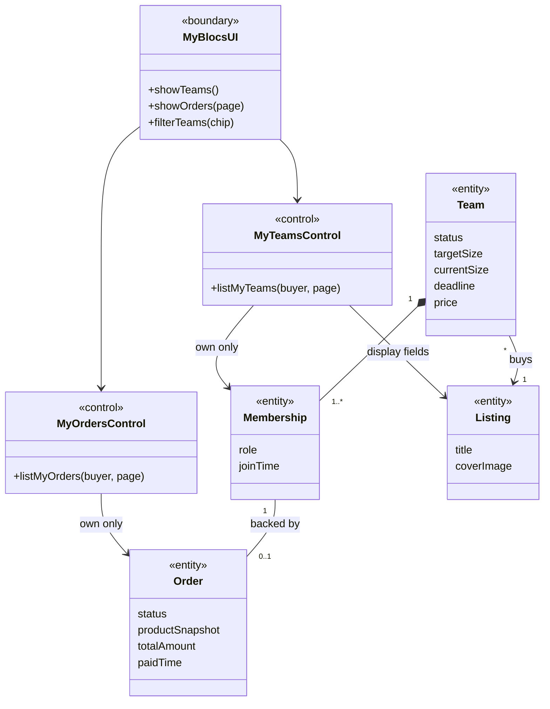

Figure 3.76: Analysis class diagram of UC8 View my orders and teams. Each list has its own control, and both controls read only the signed-in buyer's own records.

**UC7.** Figure 3.77 uses the *Join a team* boundary of UC4 (section 3.4.1), because UC7 extends that join. `InviteControl` handles both invite requests: a member creating an invite, and a visitor looking one up. `ReferralControl` turns an invite reference on a join into a sharer and records that sharer on the new membership. `CreditControl` reacts to "member joined" and records a credit. The invite reference grants nothing. Joining still needs a session and a payment.

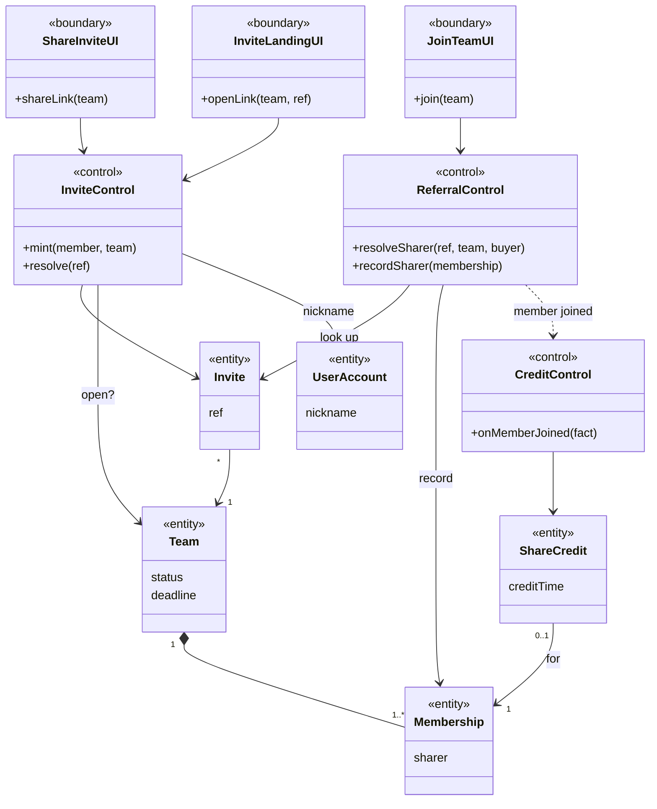

Figure 3.77: Analysis class diagram of UC7 Share attribution. Attribution and crediting are separate controls, linked only by the "member joined" fact.

#### B Analysis sequence diagrams

UC8 has two major flows: **view my teams** (Figure 3.78) and **view my order history** (Figure 3.79). They are separate flows because each reads a different entity and pages on its own. The screen starts both when it opens. UC7 has three major flows: **share an invite link** (Figure 3.80), **open an invite link** (Figure 3.81), and **join through an invite and credit the sharer** (Figure 3.82). The exceptional flows of 3.3.8 and 3.3.9 appear as `alt` and `opt` fragments, not as separate flows. None of them changes which entities are read or written.

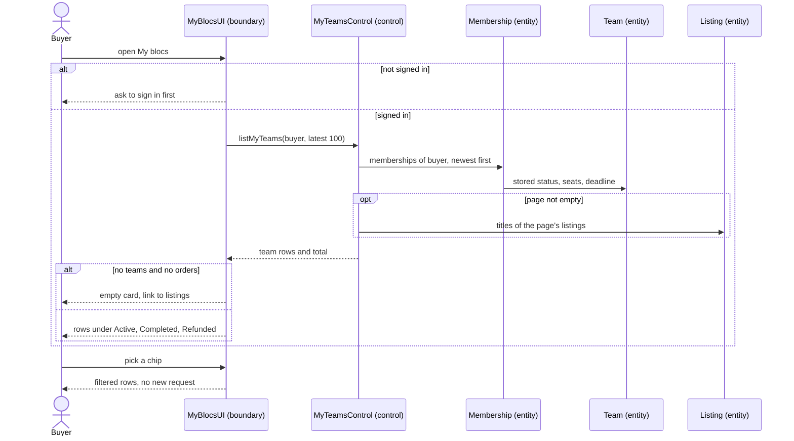

Figure 3.78: Analysis sequence diagram of UC8, view my teams. The control reads one page of memberships and fetches listing titles in a single batch. Status chips filter rows already loaded.

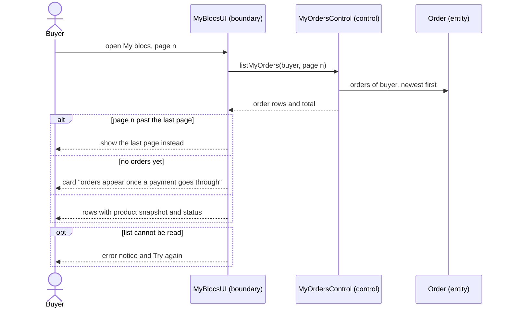

Figure 3.79: Analysis sequence diagram of UC8, view my order history. Each row shows the product details as they were when the order was placed, not the listing's current details.

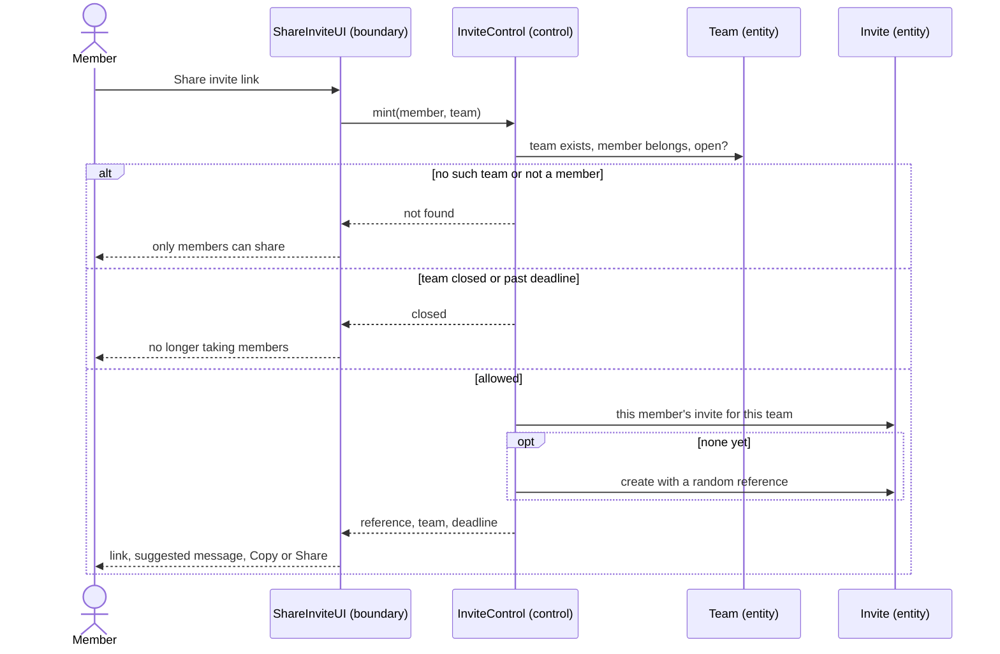

Figure 3.80: Analysis sequence diagram of UC7, share an invite link. Each member gets one invite per team, so sharing again returns the same link.

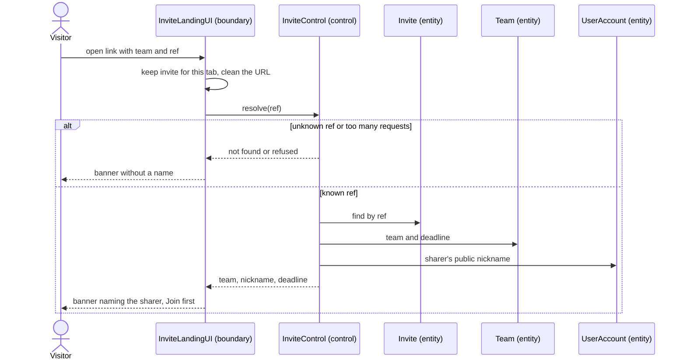

Figure 3.81: Analysis sequence diagram of UC7, open an invite link. Anyone can open the link before signing in. The lookup shows a display name only and never identifies the sharer's account.

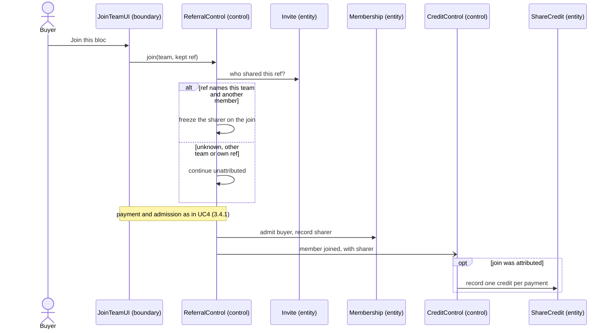

Figure 3.82: Analysis sequence diagram of UC7, join through an invite and credit the sharer. The sharer is fixed before payment. Crediting starts only after admission and can never refuse the join.

#### C Design class diagram

**UC8 frontend.** Figure 3.83 shows the `/account` route. Its loader fetches both lists in parallel through query options built on the generated client. `MyBlocs` filters the teams for each chip without fetching again. `bloc-status.ts` and `order-status.ts` map stored status codes to labels. The route sits under the `_authenticated` guard, which sends an anonymous visitor to sign in. The backend enforces the same rule separately.

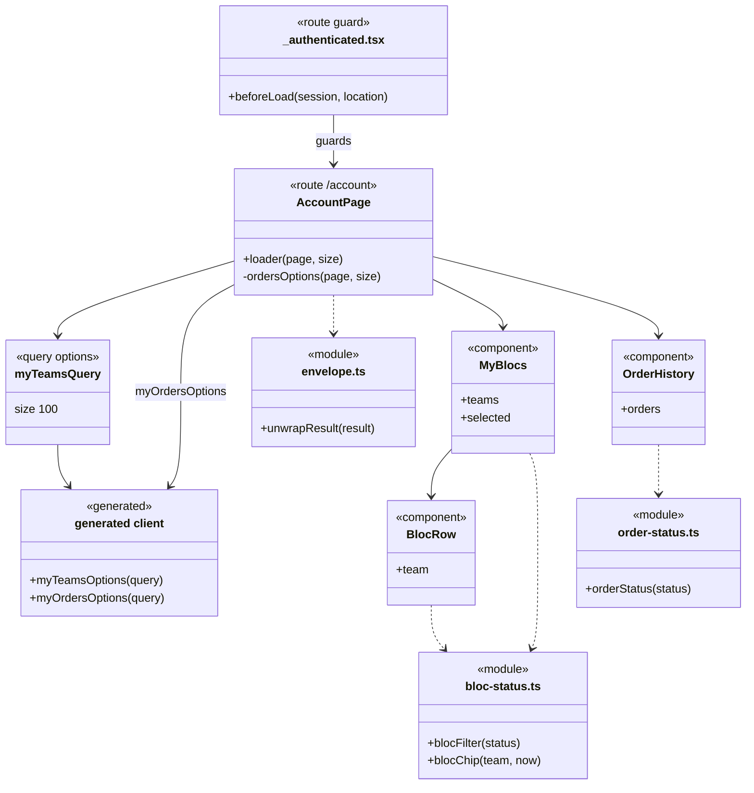

Figure 3.83: Design class diagram of the UC8 frontend. The route fetches both lists through the generated client, and status mapping lives in two small pure modules.

**UC8 backend, my teams.** Figure 3.84 places the read in the groupbuy context. `GroupDealController.myTeams` takes the buyer from the Sa-Token session, never from the request. `GroupDealAppServiceImpl.pageMyTeams` reads one page of `TeamMembership` projections through `GroupDealRepository.pageMembershipsByUserId`. This repository joins `biz_group_member` to `biz_group_deal`, both inside groupbuy. Listing titles and cover images belong to the catalog context. Groupbuy reads them through `ListingDisplayGateway`, a port that groupbuy itself declares and that catalog implements as `GroupbuyListingDisplayAdapter`. The dependency therefore still points from catalog to groupbuy, and no cycle forms. A page costs three queries whatever its size: rows, count and one batch product read. An empty page skips the product read.

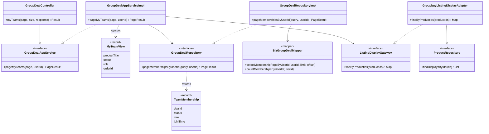

Figure 3.84: Design class diagram of UC8 my teams (backend). Groupbuy reads catalog display fields through a port it owns, so only the title and cover image cross the context boundary.

**UC8 backend, my orders.** Figure 3.85 is the same shape in the order context. Rows come from the `Order` aggregate and carry the product title, image and price frozen when the order was placed. `OrderSummaryView` leaves out the payment reference, so the aggregate never reaches the web layer. Both endpoints answer with `Cache-Control: no-store` and offset paging, newest first. Keyset paging was deferred, because one buyer has only a few teams and orders.

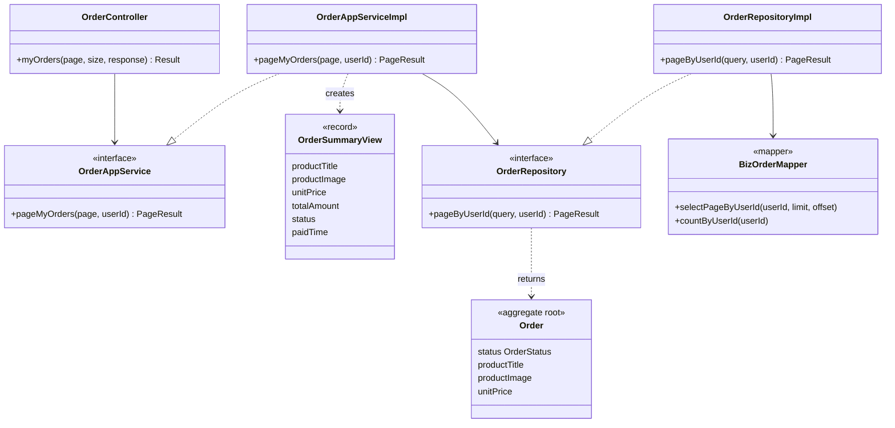

Figure 3.85: Design class diagram of UC8 my orders (backend). The application service turns each aggregate into a view without payment data before it leaves the layer.

**UC7 frontend.** Figure 3.86 shows the share and landing parts. A member shares from the listing page (`ShareBlock`) or from an open row on My blocs (`RowShare`). Both use `ShareInvitePanel`, which mints the invite through `useShareInvite` and builds the link with `inviteUrl`. On My blocs, a row mints its invite only when its panel opens, never for every row on page load. The link points to the listing with `?deal=…&ref=…`. The listing route's `beforeLoad` keeps the pair in `sessionStorage` (`parkInvite`) and removes it from the address bar. This lets the invite survive the Google sign-in redirect, and a copied address never passes someone's reference on. `useCheckout` adds the kept reference to every JOIN intent for that team (`parkedRefFor`), and never to a START.

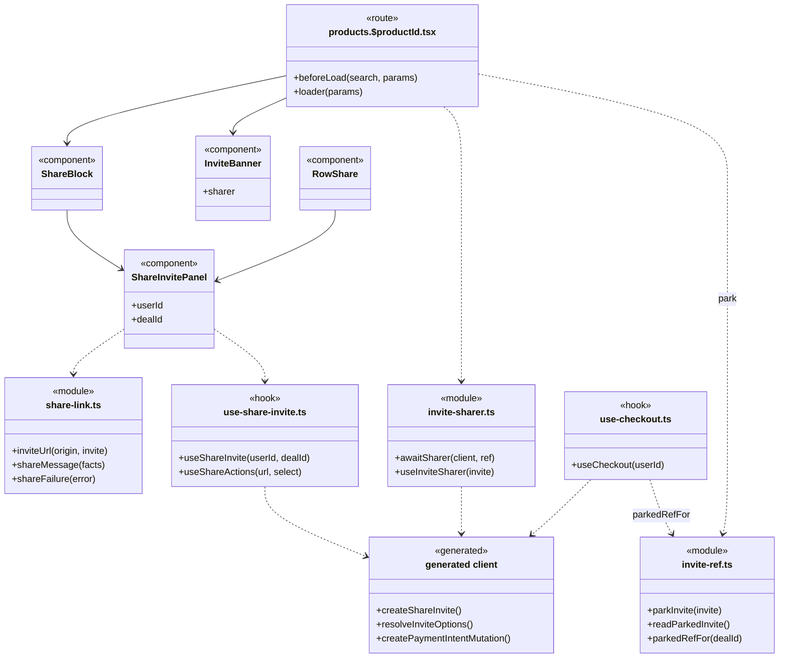

Figure 3.86: Design class diagram of the UC7 frontend. The browser only stores and passes on an opaque reference. It never names a sharer itself.

**UC7 backend, invites.** Figure 3.87 shows minting and resolving. `ShareInviteAppService.mint` checks three things before it returns an invite: the rate limit, active membership through `PaidGroupDealRepository.hasActiveMember`, and an open team before its deadline. A missing team and a non-member get the same 404, so a non-member learns nothing. `ShareInvite.mint` creates 128 random bits, encoded as base64url without padding. `insertIfAbsent` and a partial unique index on (team, sharer) make minting idempotent, and a concurrent first mint reads back the winner. `InviteController.resolve` needs no sign-in. It allows 60 requests per minute for each client address and returns the sharer's public nickname from the identity port `UserAppService`. `RedisCachedShareInviteRepository` is the `@Primary` implementation: it reads Redis first and falls back to `ShareInviteRepositoryImpl`, and PostgreSQL stays the authority.

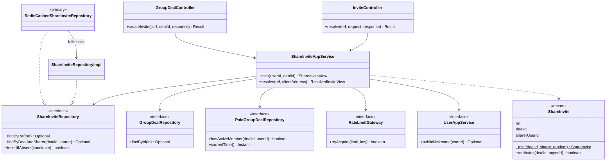

Figure 3.87: Design class diagram of UC7 invites (backend). One application service owns both invite requests, and the cached repository falls back to PostgreSQL, which stays the authority.

**UC7 backend, attribution and credit.** Figure 3.88 splits `ReferralControl` along the payment path of 3.4.1. When the JOIN intent is issued, `PurchaseIntentAppService` calls `GroupDealPurchaseSupport.resolveSharer`. A reference that names this team and another member freezes that member on the intent (`PurchaseIntent.attributedTo`). Every other reference is ignored, so attribution never fails a purchase. After payment, `OrderFulfilmentAdapter` passes the frozen sharer to `PaidGroupDealService.joinConfirmed`. That method writes it on `biz_group_member.sharer_user_id` in the admission transaction and publishes `MemberJoined`. `CreditControl` became `ShareCreditSubscriber`, an after-commit Observer (section 3.5.2) of `MemberJoined`. The unique index on `biz_share_credit.payment_id` absorbs duplicate events. A credit stores no status: pending, earned or void follows from its team's status when it is read. Credits are written, but no endpoint or screen shows them.

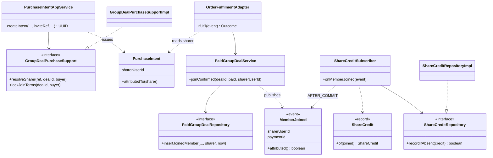

Figure 3.88: Design class diagram of UC7 attribution and credit (backend). The admission service publishes a fact and knows nothing about crediting. The subscriber reacts only after the commit.

Unit tests for these classes: `GroupDealAppServiceImplTest`, `GroupbuyListingDisplayAdapterTest` and `OrderAppServiceImplTest` (UC8 backend); `ShareInviteTest`, `ShareCreditTest`, `ShareInviteAppServiceTest`, `GroupDealPurchaseSupportImplTest` and `ShareCreditSubscriberTest` (UC7 backend). On the frontend, Vitest covers `bloc-status.test.ts`, `BlocRow.test.tsx`, `order-status.test.ts`, `OrderHistory.test.tsx` and `routes/account.test.tsx` (UC8), and `share-link.test.ts`, `invite-ref.test.ts` and `ShareBlock.test.tsx` (UC7).

#### D Design sequence diagrams

Each figure here matches one analysis sequence in part B. Figures 3.93 and 3.94 together refine Figure 3.82: the first covers issuing the JOIN intent, the second admission and crediting.

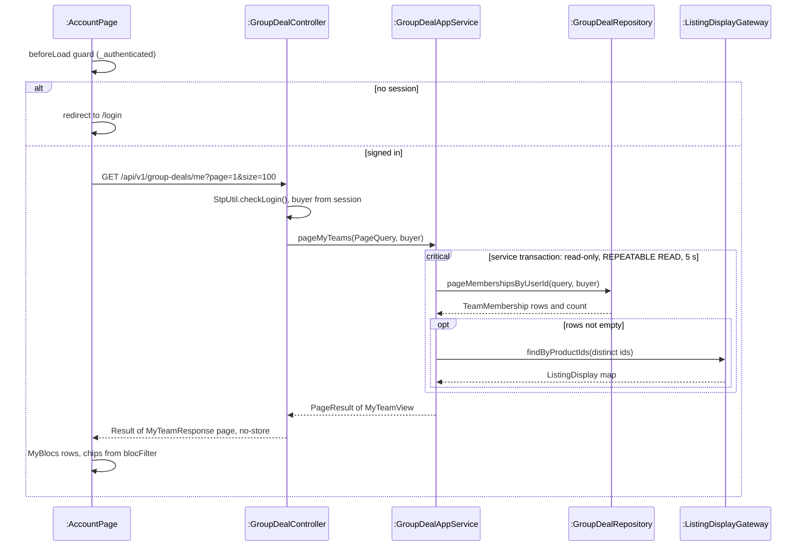

Figure 3.89: Design sequence diagram of UC8, view my teams. The service method opens the transaction; one REPEATABLE READ snapshot covers the rows, the count and the product read, so the total always matches the rows.

At run time the service is `GroupDealAppServiceImpl`, the repository is `GroupDealRepositoryImpl` over `BizGroupDealMapper`, and the gateway is catalog's `GroupbuyListingDisplayAdapter` (Figure 3.84).

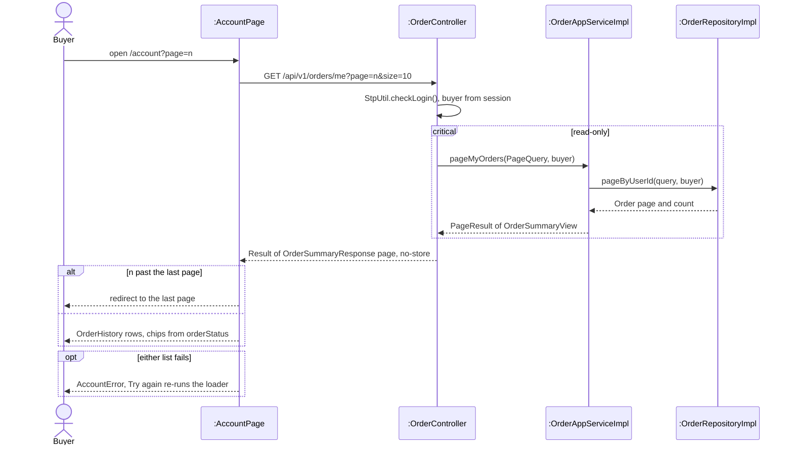

Figure 3.90: Design sequence diagram of UC8, view my order history. The route loader checks the page number against the total and moves a page past the end to the last page.

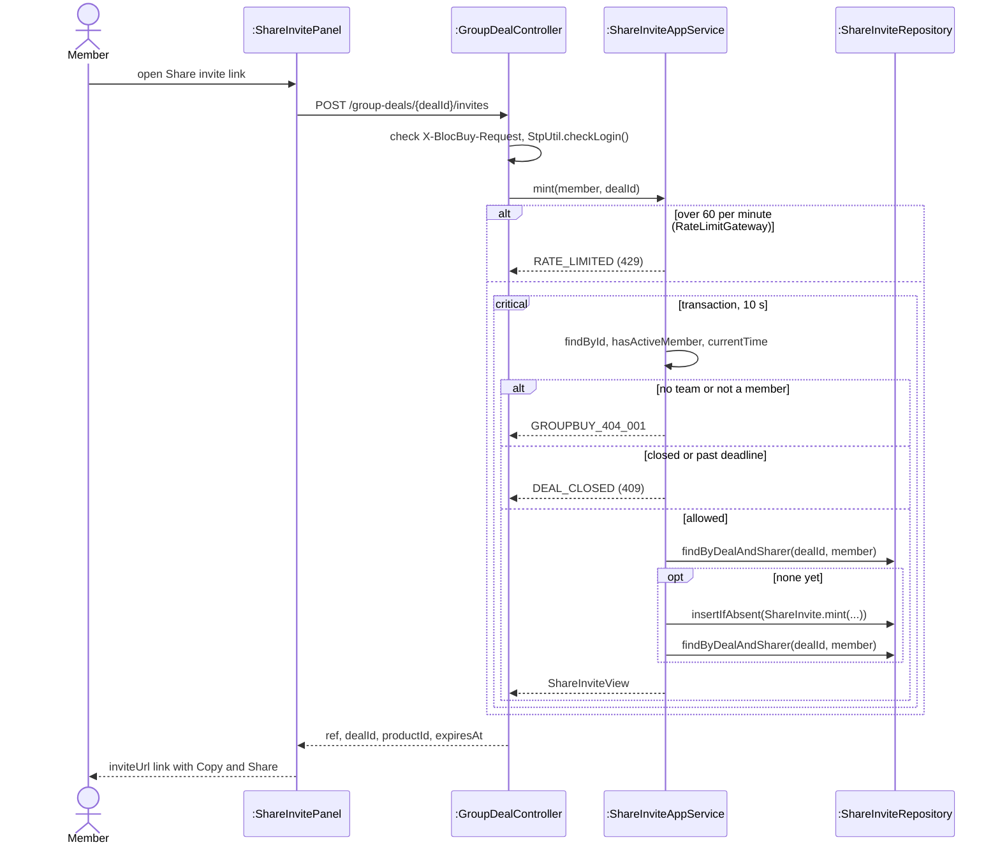

Figure 3.91: Design sequence diagram of UC7, share an invite link. Minting takes no team lock, and a repeated or concurrent mint returns the same reference.

The self-call on `ShareInviteAppService` stands for its reads through `GroupDealRepository.findById` and `PaidGroupDealRepository.hasActiveMember` and `currentTime` (Figure 3.87). A refusal reaches the member as the text from `shareFailure`.

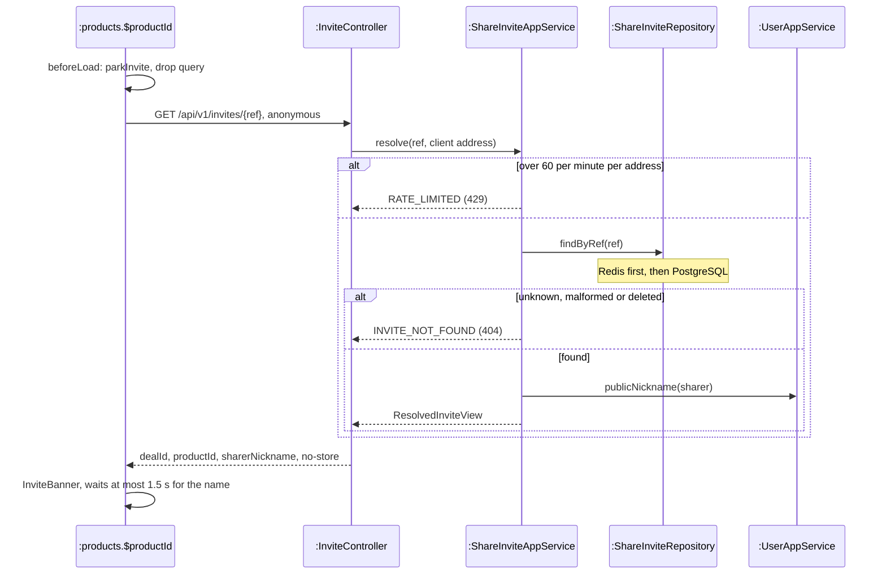

Figure 3.92: Design sequence diagram of UC7, open an invite link. The lookup needs no transaction. If it fails or is slow, the visitor sees the banner without a name, and the listing still loads.

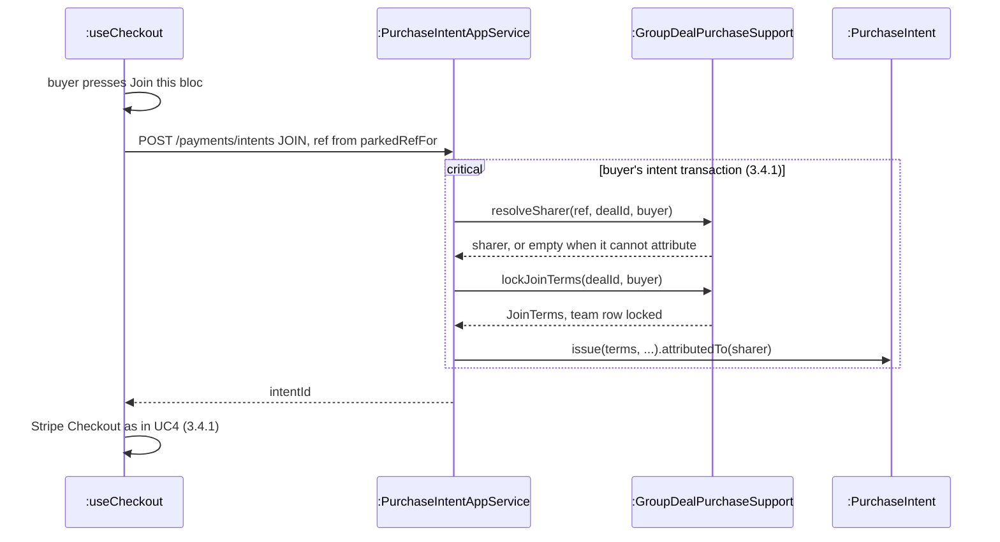

Figure 3.93: Design sequence diagram of UC7, join through an invite, part 1: issuing the JOIN intent. The sharer is resolved before the team lock is taken and is frozen on the intent beside the price.

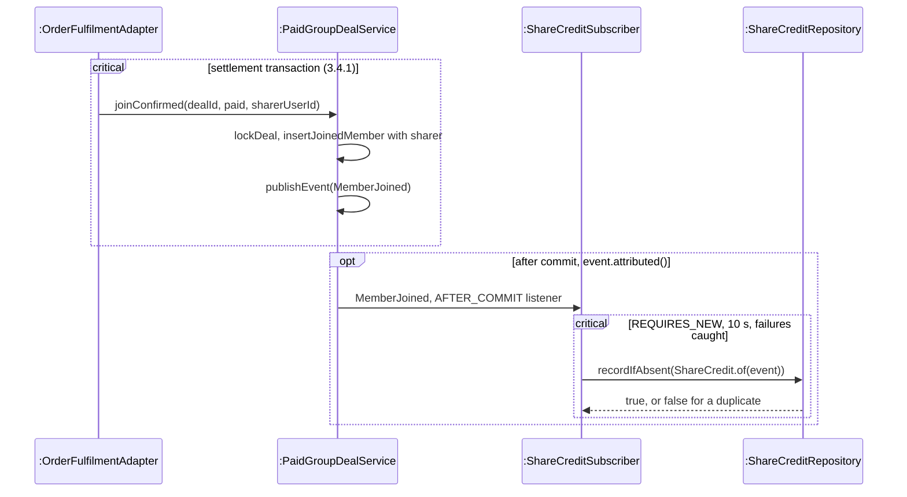

Figure 3.94: Design sequence diagram of UC7, join through an invite, part 2: admission and credit. The sharer is recorded inside the admission transaction, and the credit is written in a separate transaction after the commit.

The sharer is resolved *before* `lockJoinTerms` takes the team row lock. The lookup reads only the immutable invite row and never rejects, so this order keeps its I/O out of the window in which concurrent joins queue on the team row (section 3.2.8). In Figure 3.94, `lockDeal` and `insertJoinedMember` are calls on `PaidGroupDealRepository`. The credit has no outbox. If the process crashes between the commit and the subscriber, the credit is lost but the attribution is not: `biz_group_member.sharer_user_id` is committed with the admission. ADR 0003 records a repeatable backfill query, which an operator runs by hand when the subscriber's warning line appears. Scheduling it is out of scope.

#### E Compliance with the transition strategies

Table 3.18 maps each analysis object of Figures 3.76 and 3.77 to the strategies of 3.2 that transformed it. Scheduling (3.2.7) does not apply: neither use case runs on a timer. External interface (3.2.5) applies only through the UC4 payment path, which 3.4.1 covers.

Table 3.18: Transition strategies applied to UC8 and UC7.

| Strategy | Analysis object | Design element |
| --- | --- | --- |
| 3.2.1 Language and framework | `MyTeamsControl`, `MyOrdersControl`, `InviteControl` | Spring `@Service` classes in the application module: `GroupDealAppServiceImpl`, `OrderAppServiceImpl`, `ShareInviteAppService`; read transactions as `@Transactional(readOnly = true)` |
| 3.2.2 Presentation | `MyBlocsUI` | Route `/_authenticated/account` (`AccountPage`), components `MyBlocs`, `BlocRow`, `OrderHistory`; query options `myTeamsQuery`; status labels in `bloc-status.ts`, `order-status.ts` |
| 3.2.2 Presentation | `ShareInviteUI`, `InviteLandingUI` | `ShareBlock`, `RowShare`, `ShareInvitePanel`, hook `useShareInvite`; listing route `beforeLoad` with `parkInvite`; `InviteBanner` with `useInviteSharer` |
| 3.2.3 Distribution | `MyTeamsControl`, `MyOrdersControl` | `GET /api/v1/group-deals/me` (`GroupDealController.myTeams`, `MyTeamResponse`) and `GET /api/v1/orders/me` (`OrderController.myOrders`, `OrderSummaryResponse`) in `Result<T>`; generated `myTeamsOptions`, `myOrdersOptions` |
| 3.2.3 Distribution | `InviteControl`, `ReferralControl` | `POST /api/v1/group-deals/{dealId}/invites`, `GET /api/v1/invites/{ref}`; the optional `ref` on `POST /api/v1/payments/intents` |
| 3.2.3 Distribution (cross-context seams) | `MyTeamsControl` → `Listing`; `ReferralControl`; `InviteControl` → `UserAccount` | Consumer-owned port `ListingDisplayGateway` implemented by `GroupbuyListingDisplayAdapter`; `resolveSharer` on the supplier facade `GroupDealPurchaseSupport`; identity port `UserAppService.publicNickname` |
| 3.2.4 Persistence | `Membership`, `Team` | Read-only projection `TeamMembership`, read by `pageMembershipsByUserId` of `GroupDealRepository` over `biz_group_member` joined to `biz_group_deal`; sharer in `biz_group_member.sharer_user_id` |
| 3.2.4 Persistence | `Order` | `OrderRepository.pageByUserId` → `OrderRepositoryImpl` → `BizOrderMapper`; product snapshot columns on the order row |
| 3.2.4 Persistence | `Invite`, `ShareCredit` | `ShareInviteRepository` (table `biz_share_invite`, cached by `RedisCachedShareInviteRepository`); `ShareCreditRepository` (table `biz_share_credit`); migrations V18 and V19 (sharer on `biz_purchase_intent`) |
| 3.2.6 Security | all controls | Buyer from the Sa-Token session (`StpUtil.getLoginIdAsString`), never from the request; `_authenticated` route guard; `no-store` on every response; 404 for non-members; `X-BlocBuy-Request` marker on minting; 128-bit references; `RateLimitGateway` limits on minting and resolving |
| 3.2.8 Concurrency | `MyTeamsControl`; `InviteControl`; `CreditControl` | `REPEATABLE_READ` snapshot for rows and count; `insertIfAbsent` with unique index `uq_biz_share_invite_deal_sharer`; sharer resolved before the team lock; one credit per payment (`uq_biz_share_credit_payment`) |
| 3.2.9 Domain events | `CreditControl`, "member joined" | Event `MemberJoined` published by `PaidGroupDealService.joinConfirmed`; `ShareCreditSubscriber`, an after-commit Observer (section 3.5.2) |
