<!-- report
rubric: 3.4.5, 3.4-A..E, G4
owner: Liu Jin
plan: #678
sources: backend/docs/design/admin-listings.md
status: draft
-->

### 3.4.5 UC9 Admin Listing Management and UC5 Team Lifecycle Resolution by Liu Jin

This section models two use cases. In UC9 Admin listing management, an administrator prepares, publishes, revises, withdraws and deletes catalog listings and sets their team terms. In UC5 Team lifecycle resolution, an open team (shown to buyers as a "bloc") is resolved exactly once: it succeeds when its last seat is paid for, or it expires when its deadline passes first. Both use cases have the full set of models, parts A to E; no model is left out. Their flows of events are in 3.3.10 (UC9) and 3.3.6 (UC5).

A *listing* is one product offered in the catalog (the `Product` aggregate, table `biz_product`). Its *team terms* are the team size and the team lifetime that every team started on the listing copies. A *team* is one group-buy of one listing at a fixed team price (the `GroupDeal` aggregate, table `biz_group_deal`). The listing statechart belongs with the State pattern in 3.5.5. The team statechart (OPEN, SUCCEEDED, EXPIRED) is drawn in this section, after part D.

Several members wrote the code these models describe. Table 3.19 credits each part.

Table 3.19: Who built the parts of UC9 and UC5.

| Part | Built by | Date | Record |
| --- | --- | --- | --- |
| UC9 first version: versioned drafts, publish, delist, revise, soft delete of drafts, the 412 stale-version rule | Wang Ziang (Eric) | 11 Sep 2026 | PR #72, issue #32 |
| UC9 team terms and first-team price in one command (US25), with audit log | Liu Jin | 29 Sep 2026 | PR #242, issue #221 |
| Deletion eligibility and history counts on the admin read | Panpakorn Siripanich (Pan) | 1 Oct 2026 | PR #300 |
| Admin console screens (listing editor, lifecycle dialogs, conflict banner, team-terms panel) | Lim Jiechao | from 30 Sep 2026 | frontend ADR 0015, PRs #294–#307 |
| UC5 `GroupDeal.expire`, `GroupDealExpiryService`, `TeamExpired` and `TeamSucceeded` | Liu Jin | 23 Sep 2026 | PR #148, issue #28 |
| UC5 expiry sweep and scheduler job | Liu Jin; hardened by Pan | 24 Sep 2026 | PRs #162, #173 |
| UC5 last-seat admission (`joinPaid` in `GroupDeal`, `joinConfirmed` in `PaidGroupDealService`), shared with UC4 | Wang Ziang (Eric); `TeamSucceeded` publication added by Liu Jin | 9 Sep 2026; 23 Sep 2026 | see 3.4.1; PR #148 |

#### A Analysis class diagram

The analysis models use only the stereotypes «boundary», «control» and «entity». Actors talk only to boundaries, and the models name no framework, table or lock.

**UC9.** One control, `ManageListingControl`, carries every administrator command (Figure 3.98). The `Listing` entity holds a `version`, so the model can state the rule that a command made on an old copy of the listing is refused. A listing that has any team, price policy or quote in its history keeps that history. For this reason the control reads `Team` and `PriceQuote` before it deletes anything. `AdminAccount` is the administrator's own account: signing in with Google is not enough, the account must also hold the admin role and be active.

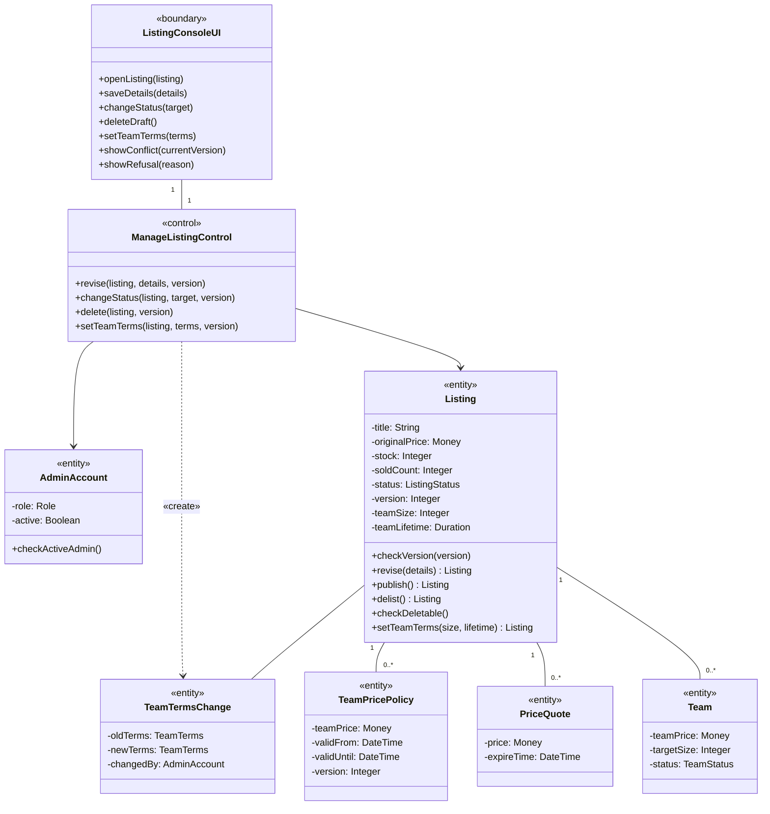

Figure 3.98: Analysis class diagram of UC9 Admin listing management (UML). One control serves every command; the version on `Listing` carries the stale-copy rule, and teams, policies and quotes are the history that blocks deletion.

**UC5.** The team resolves itself on one of two triggers (Figure 3.99). The time-driven Scheduler actor reaches the system through the `SchedulerTrigger` boundary. The last seat arrives through UC4's `PaymentGateway` and `JoinTeamControl` (3.4.1), shown here only as the entry point. `ResolveTeamControl` applies the outcome: it confirms the team's orders on success; on expiry it cancels them and creates one refund obligation per paid member, which UC6 then pays out (3.4.2). The `Team` entity owns the transition rule `canMoveTo`, so no control decides alone whether a team may change state.

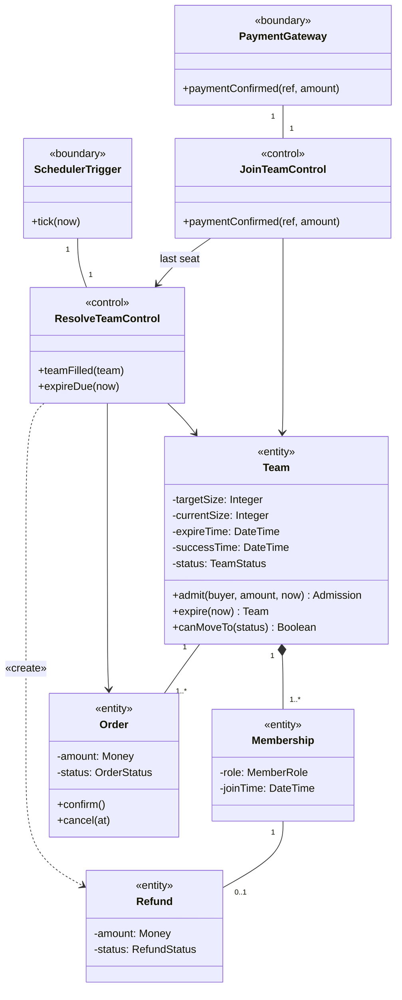

Figure 3.99: Analysis class diagram of UC5 Team lifecycle resolution (UML). Two boundaries feed one resolution control, and `Team` alone decides whether it may move; `PaymentGateway` and `JoinTeamControl` come from UC4.

#### B Analysis sequence diagrams

There are six major flows: four for UC9 and two for UC5. Exceptional flows are `alt` fragments inside their major flow, except the stale-version case: it gets its own flow (B2) because the administrator has to act to recover from it.

| Flow | Use case | Analysis | Design |
| --- | --- | --- | --- |
| B1/D1 Publish a listing | UC9 | Figure 3.100 | Figure 3.109 |
| B2/D2 Revise with a stale version, reload and retry | UC9 | Figure 3.101 | Figure 3.110 |
| B3/D3 Delete a draft | UC9 | Figure 3.102 | Figure 3.111 |
| B4/D4 Set team terms and an optional team price | UC9 | Figure 3.103 | Figure 3.112 |
| B5/D5 The last seat fills the team: OPEN to SUCCEEDED | UC5 | Figure 3.104 | Figure 3.113 |
| B6/D6 The deadline passes: OPEN to EXPIRED | UC5 | Figure 3.105 | Figure 3.114 |

**B1 Publish a listing.** Publishing a draft or an off-sale listing puts it on sale. The listing itself refuses the move when it is already on sale or has no stock or price.

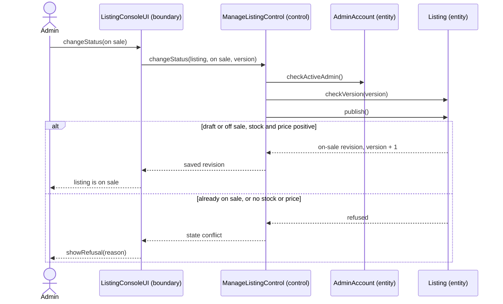

Figure 3.100: Analysis sequence diagram of UC9 flow B1, publish a listing (UML). The listing decides whether it may go on sale; the control only checks the account and the version first.

**B2 Revise with a stale version, then reload and retry.** Two administrators can open the same listing. The one who saves second holds an old version, and the listing refuses the save without changing anything. Nothing merges or retries on its own: the administrator reloads the listing, which drops the unsaved edits, and saves again at the new version.

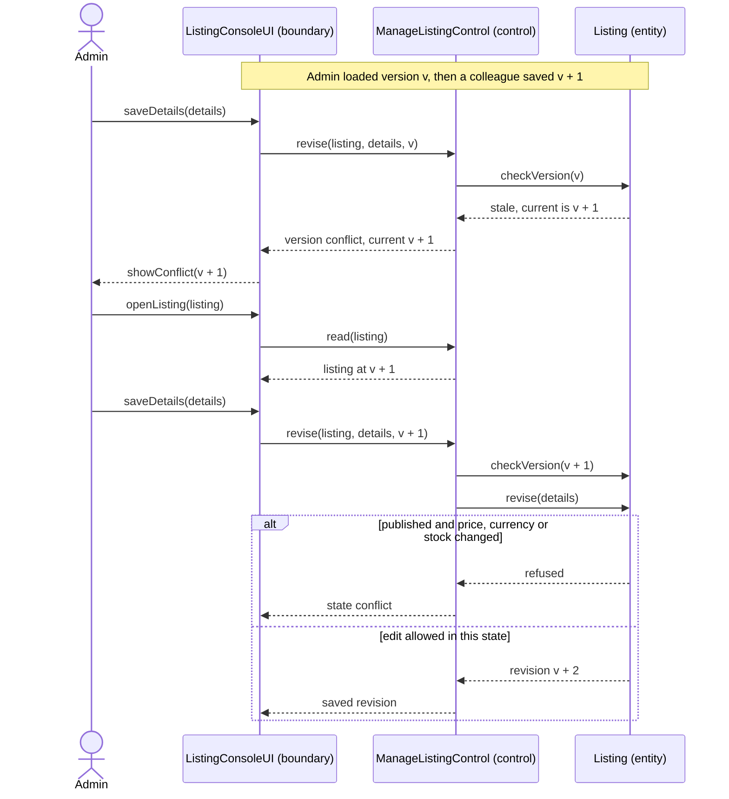

Figure 3.101: Analysis sequence diagram of UC9 flow B2, revise with a stale version (UML). The stale save changes nothing; recovery is the administrator's own reload and second save. The account check of Figure 3.100 is omitted.

**B3 Delete a draft.** Only a draft that was never published and has no history may be deleted, and even then the record is only marked deleted, so the audit trail stays.

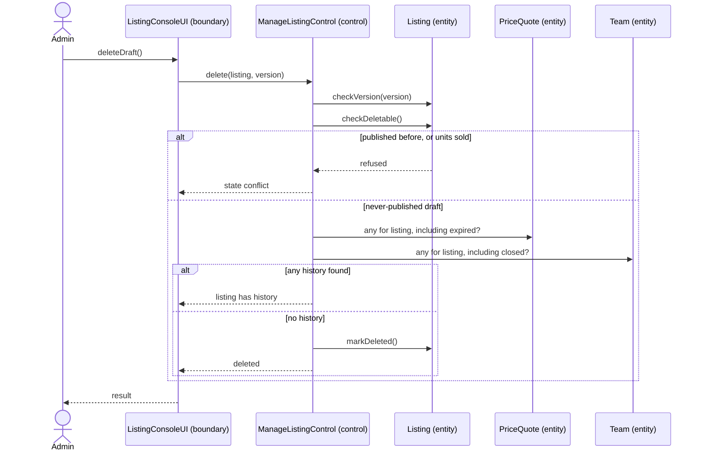

Figure 3.102: Analysis sequence diagram of UC9 flow B3, delete a draft (UML). The listing checks its own state, and the control checks the other entities' history; a price policy is checked the same way as a quote (omitted).

**B4 Set team terms and an optional team price.** The administrator sets how many paid members a team needs and how long it stays open, and may add a team price in the same command. A rejected price leaves the terms unchanged. Every accepted change is recorded.

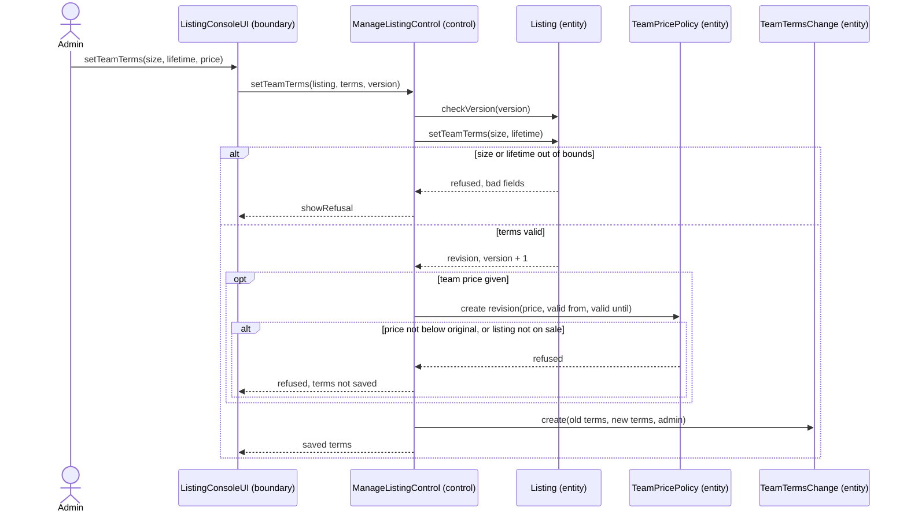

Figure 3.103: Analysis sequence diagram of UC9 flow B4, set team terms (UML). Terms and price succeed or fail together, and every accepted change leaves an audit record.

**B5 The last seat fills the team.** The paid join that takes the last seat moves the team from OPEN to SUCCEEDED. The join itself is UC4 (3.4.1); UC5 begins where `Team` reports that it is full.

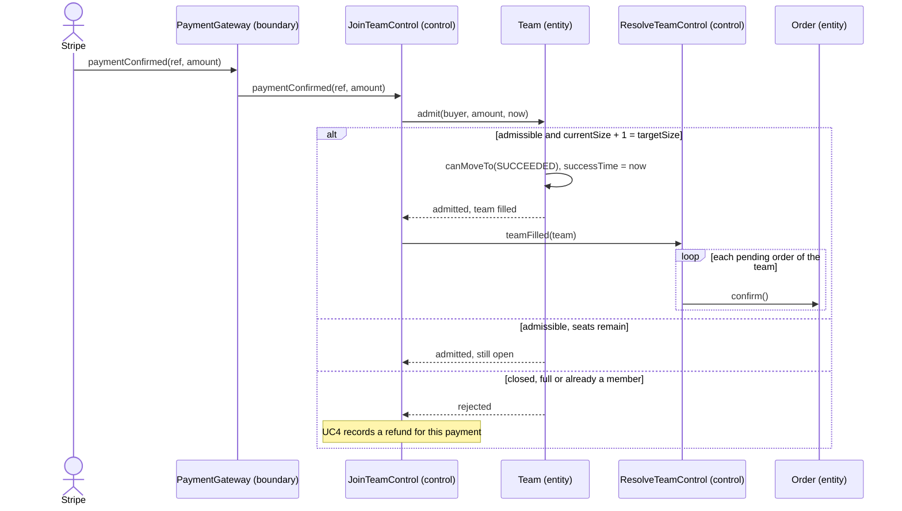

Figure 3.104: Analysis sequence diagram of UC5 flow B5, the last seat fills the team (UML). Only the admission that reaches the target size resolves the team, and only then are its orders confirmed.

**B6 The deadline passes.** The Scheduler ticks every minute. Each open team whose deadline has passed is expired once: its orders are cancelled and one refund obligation is created per paid member. A team that a last-seat join resolved first is skipped.

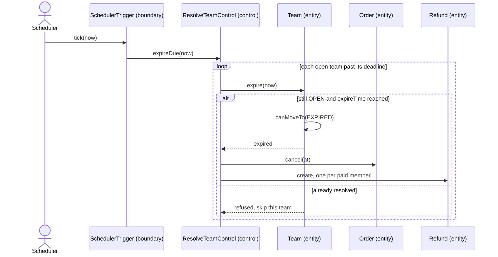

Figure 3.105: Analysis sequence diagram of UC5 flow B6, the deadline passes (UML). Expiry and its consequences happen together, and a team that is already resolved is skipped, not treated as an error.

#### C Design class diagram

The design classes are the real classes in the repository at this draft's commit (Figures 3.106 to 3.108). They follow the four COLA layers of 3.1: adapter (web), application, domain and infrastructure. UC9 is split into two figures, so that each stays legible on A4. A parameter list with more than one parameter is shown as `(…)`; part D gives the full calls.

**UC9, web and application layers.** The analysis boundary becomes React components that call the REST API under `/api/v1/admin/products` through the generated client (3.2.2, 3.2.3). The control becomes `AdminListingController`, which checks the session, role and permission, and two application services: `AdminListingAppServiceImpl` for revise, status change and delete, and `TeamTermsAppServiceImpl` for team terms. Each service method is one bounded transaction. History owned by another bounded context is read only through that context's facade, `GroupDealQueryService`, never through its tables.

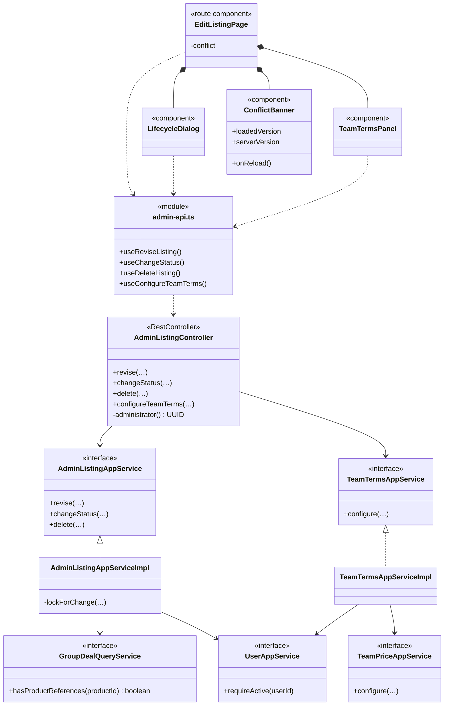

Figure 3.106: Design class diagram of UC9, web and application layers (UML). The analysis control is split into a controller that checks the role and two transactional services; another context's history is reached only through its facade, `GroupDealQueryService`.

**UC9, domain and infrastructure layers.** The `Listing` entity becomes the `Product` aggregate. Its lifecycle rules sit in the per-state behaviour of the `ProductStatus` enum, which is the State pattern of 3.5.5. `Product` has no public status setter: every change returns a new revision with `version + 1`. `ProductRepository` is the domain port. Its implementation, `ProductRepositoryImpl`, runs MyBatis statements whose `WHERE version = expectedVersion` condition makes a stale write change zero rows, and it then raises `PRODUCT_VERSION_CONFLICT` (HTTP 412, code `CATALOG_412_002`).

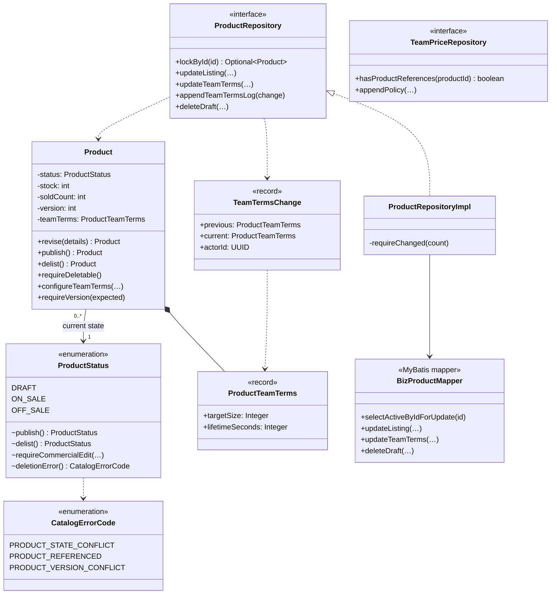

Figure 3.107: Design class diagram of UC9, domain and infrastructure layers (UML). `Product` delegates its rules to its current `ProductStatus`; the version guard lives in the mapper's SQL, and a zero-row update becomes the 412.

**UC5.** The two analysis triggers become two entry points, which meet at the same row of `biz_group_deal` (Figure 3.108). `SchedulerTrigger` becomes `TeamExpirySweepJob`, a Spring `@Scheduled` job. It runs at a fixed delay of one minute (`blocbuy.scheduling.team-expiry.interval`, default `PT1M`) under a database lease (`LeasedJobRunner`), so only one instance sweeps at a time. The job is off unless `blocbuy.scheduling.enabled` is set (3.2.7). `ResolveTeamControl` is split into three classes. `GroupDealExpirySweeper` selects the due teams in one bounded query. `GroupDealExpiryService.expireOne` resolves one team in its own short transaction. `PaidGroupDealService.joinConfirmed`, shared with UC4, publishes `TeamSucceeded` when an admission completes the team. The consequences are domain-event subscribers that run before the transaction commits (3.2.9): `OrderLifecycleSubscriber` confirms or cancels the orders, and `TeamExpiryRefundSubscriber` records the refunds.

The analysis rule `canMoveTo` becomes `DealStatus.canTransitionTo`: only OPEN may move, and never to itself. `GroupDeal.joinPaid` and `GroupDeal.expire` check it on every move. `DealStatus` is a transition table on a plain enum, not the State pattern; the proposal named State for the team, and the team adopted State for listings only (3.5.5, 2.2). `DealStatus` also declares FAILED and CANCELED, but no production code writes either value.

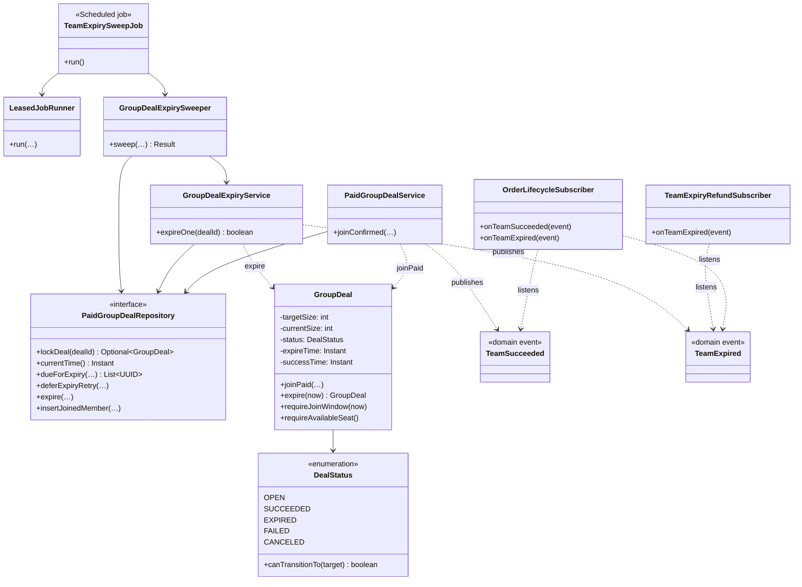

Figure 3.108: Design class diagram of UC5 Team lifecycle resolution (UML). Two entry points (the sweep and the paid join) reach one aggregate whose `DealStatus` table decides every move; the consequences are event subscribers, not calls.

#### D Design sequence diagrams

Each design flow matches the analysis flow with the same number. A `critical` fragment marks each database transaction. Every UC9 write takes the product row lock first (`SELECT … FOR UPDATE`), then checks the account and the version, in one transaction with a 10-second timeout. No network call and no retry loop runs inside a transaction.

**D1 Publish a listing.**

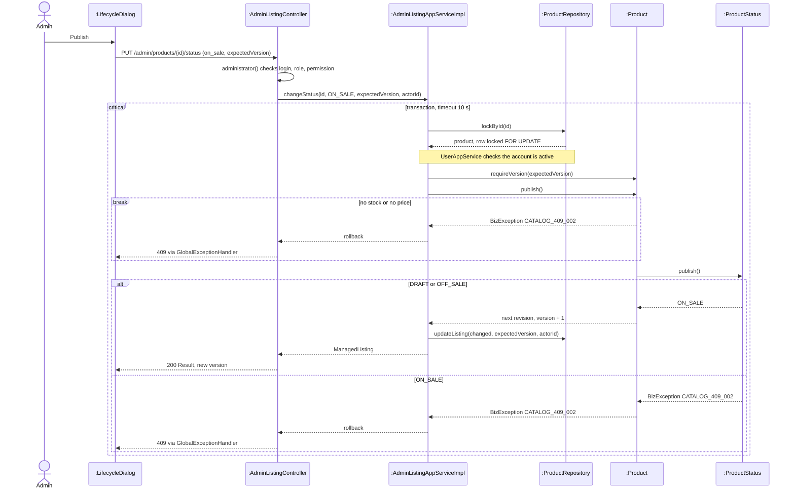

Figure 3.109: Design sequence diagram of UC9 flow D1, publish a listing (UML). `Product` refuses a listing without stock or price; for the rest, the current `ProductStatus` decides the move inside one locked transaction; a refused move rolls back and returns 409.

**D2 Revise with a stale version, then reload and retry.** The 412 response carries the server's current version, which the conflict banner shows. While the banner is up, every write on the page is disabled.

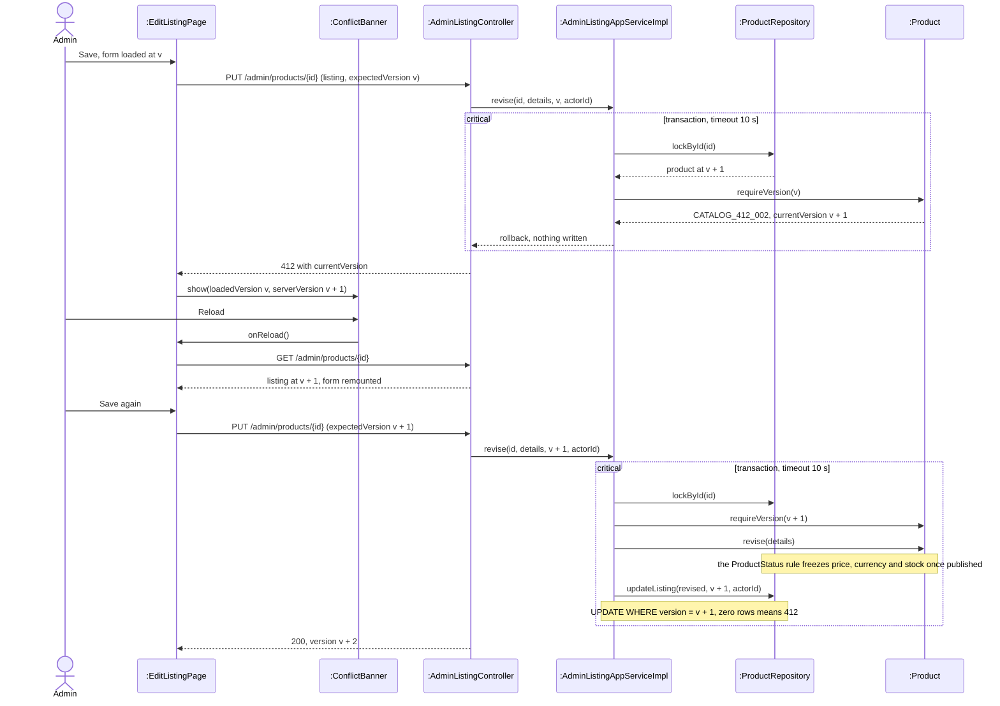

Figure 3.110: Design sequence diagram of UC9 flow D2, stale revise and retry (UML). A stale version fails twice over, at `requireVersion` under the row lock and again in the SQL condition; the retry is the administrator's Reload, never automatic.

**D3 Delete a draft.** The flow starts when the administrator confirms Delete in the lifecycle dialog.

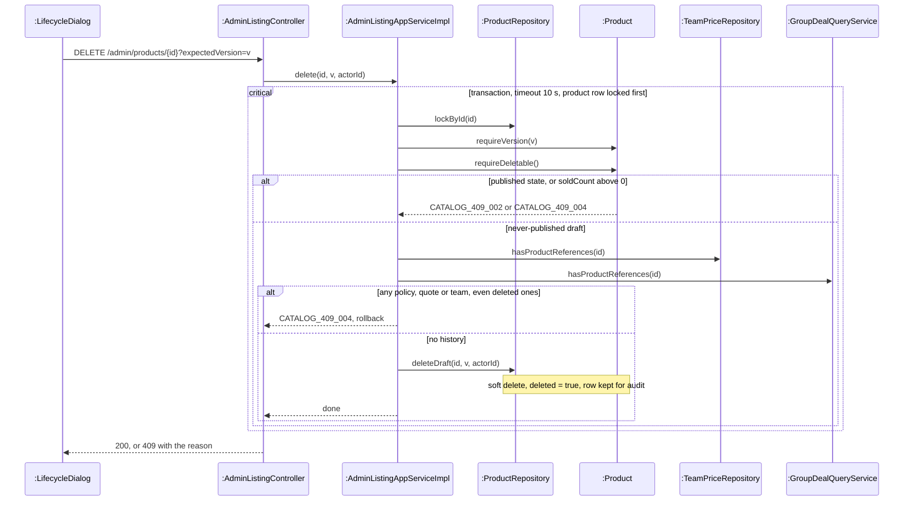

Figure 3.111: Design sequence diagram of UC9 flow D3, delete a draft (UML). Policies and quotes are checked in the catalog's own repository and teams through the group-buy facade, all under the product lock; deletion is soft. The account check of Figure 3.109 is omitted.

**D4 Set team terms and an optional team price.** The product version and the policy version are two separate concurrency tokens: a stale product version returns `CATALOG_412_002`, a stale policy version `CATALOG_412_001`.

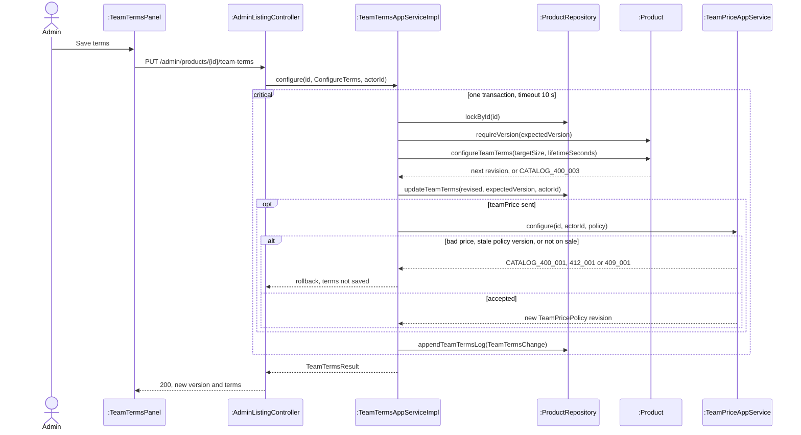

Figure 3.112: Design sequence diagram of UC9 flow D4, set team terms (UML). The price joins the terms' transaction, so a rejected price rolls the terms back; each accepted write appends a `log_product_team_terms` row.

**D5 The last seat fills the team.** This flow runs inside the payment settlement transaction of UC4 (3.4.1, part D), which also locks the payment and the purchase intent. Only the part that resolves the team is shown. `TeamSucceeded` is a published event: Spring runs its `BEFORE_COMMIT` listener synchronously, on the same thread and inside the same transaction, just before the commit, so it is drawn as an ordinary call. The settlement path has already locked the team row in `lockForSettlement` (3.4.1, part D), so the `lockDeal` here re-reads the row under a lock the transaction already holds and the documented order (team, then purchase intent, then payment, then receipt) is kept.

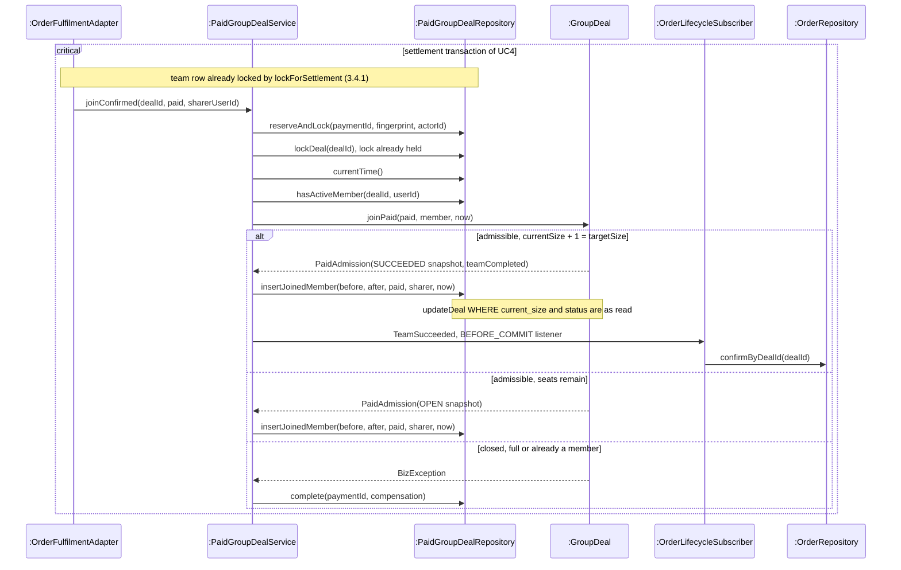

Figure 3.113: Design sequence diagram of UC5 flow D5, the last seat (UML). `joinPaid` checks `canTransitionTo(SUCCEEDED)` and the seat under the deal lock, and the guarded update makes a race loser change zero rows; the orders are confirmed before the same transaction commits. `MemberJoined`, published for every accepted join, is omitted.

**D6 The deadline passes.** The sweep itself is not transactional: each team is resolved in its own transaction. A failing team therefore cannot roll back the others, and each row lock stays short, because webhook settlement locks the same rows. A team whose expiry throws is counted as failed and deferred for five minutes (`deferExpiryRetry`).

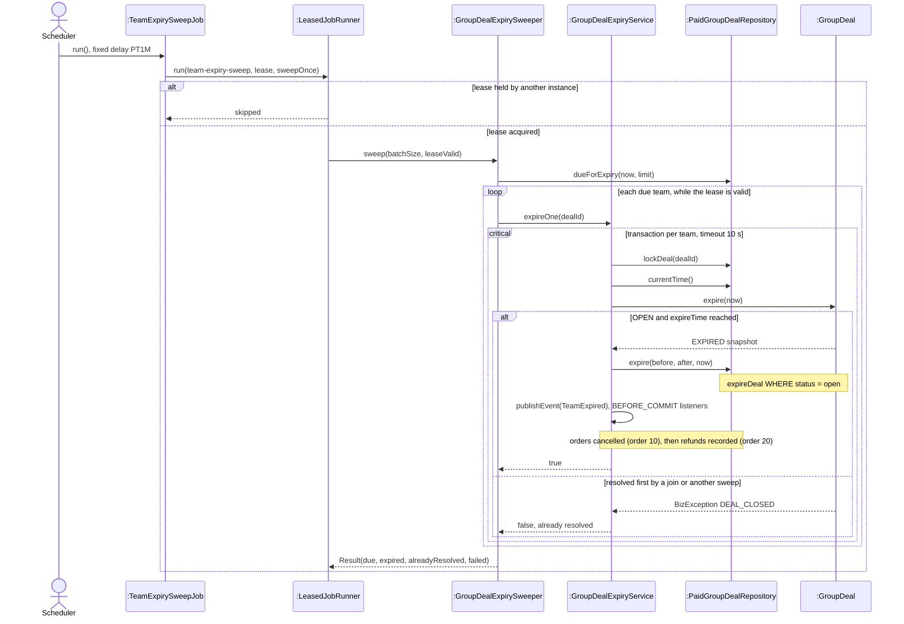

Figure 3.114: Design sequence diagram of UC5 flow D6, the deadline passes (UML). Each team gets its own locked transaction, the status-guarded update settles a race with a last-seat join, and the `TeamExpired` subscribers commit with the expiry.

#### Statechart of the team

The team has significant, dynamic states, so it has a statechart. A transition reads *trigger [guard] / effect*, and a self-transition is drawn as an internal transition inside its state.

The team (`GroupDeal`) is created OPEN by a confirmed paid start (UC3) and filled by confirmed paid joins (UC4). It resolves once (UC5): it succeeds when the last seat is taken, or expires when its window closes first, which owes refunds (UC6).

*Admissible* means that the paid amount equals the team price, the buyer is neither the leader nor a member, `startTime ≤ now < expireTime`, and a seat is free. The chart matches `DealStatus.canTransitionTo`: only OPEN may move, and never to itself. The figure draws the events that keep the status (a join that leaves seats, a refused join, a late join after resolution) as internal transitions inside the state, because they run an action without changing the status. `DealStatus` also declares FAILED and CANCELED, and the transition table allows them, but no production code writes either, so the figure draws them dashed and unconnected. `GroupDeal.joinPaid` enforces the OPEN transitions; `TeamExpirySweepJob`, on its configured fixed delay (default `PT1M`) when scheduling is enabled, reaches `GroupDealExpiryService`, which calls `GroupDeal.expire` and writes through a status-guarded update (section 3.4.2).

#### E Compliance with the transition strategies

UC9 applies six of the nine strategies of 3.2, and UC5 applies five. Table 3.20 maps each strategy to the analysis object it transformed and the design element that resulted.

Table 3.20: Transition strategies applied to UC9 and UC5.

| Strategy | Analysis object | Design element |
| --- | --- | --- |
| 3.2.1 Language and Framework | «control» `ManageListingControl` (UC9) | Spring `@Service` classes `AdminListingAppServiceImpl` and `TeamTermsAppServiceImpl` behind the interfaces `AdminListingAppService` and `TeamTermsAppService`, each method a `@Transactional(timeout = 10)` unit |
| 3.2.1 Language and Framework | «control» `ResolveTeamControl` (UC5) | split into `GroupDealExpirySweeper` (selection), `GroupDealExpiryService` (one team, one transaction) and `PaidGroupDealService` (last seat, shared with UC4) |
| 3.2.2 Presentation | «boundary» `ListingConsoleUI` (UC9) | route component `EditListingPage` with `LifecycleDialog`, `TeamTermsPanel` and `ConflictBanner`; data hooks in `admin-api.ts` (frontend ADR 0015) |
| 3.2.3 Distribution | «boundary» `ListingConsoleUI` and «entity» `Team`, `PriceQuote` as read by the control (UC9) | REST endpoints under `/api/v1/admin/products` called through the client generated from the OpenAPI contract; cross-context history through the facade `GroupDealQueryService` |
| 3.2.4 Persistence | «entity» `Listing`, `TeamPricePolicy`, `TeamTermsChange` (UC9) | aggregate `Product` with `ProductStatus` and `ProductTeamTerms`; port `ProductRepository`, adapter `ProductRepositoryImpl`, `BizProductMapper`; tables `biz_product`, `log_product_team_terms`; soft delete via `deleted` |
| 3.2.4 Persistence | «entity» `Team`, `Membership` (UC5) | aggregate `GroupDeal` with `DealStatus`; port `PaidGroupDealRepository`, adapter `PaidGroupDealRepositoryImpl`, `PaidGroupDealMapper`; tables `biz_group_deal`, `biz_group_member` |
| 3.2.6 Security | «entity» `AdminAccount` (UC9) | `administrator()` in `AdminListingController`: Sa-Token `checkLogin`, `checkRole` for the admin role and `checkPermission` for `catalog:product:write`; actor taken from the session; `requireActive` in `UserAppService` rechecks the account inside the transaction |
| 3.2.7 Scheduling | «boundary» `SchedulerTrigger` (UC5) | `TeamExpirySweepJob` (`@Scheduled`, fixed delay `PT1M`, switch `blocbuy.scheduling.enabled`), `LeasedJobRunner` (database lease, one sweeper at a time), retry backoff in `sys_scheduled_item_retry` |
| 3.2.8 Concurrency | `version` of «entity» `Listing` (UC9) | `selectActiveByIdForUpdate` row lock first, `Product.requireVersion`, `WHERE version = expectedVersion` in `updateListing`, `updateTeamTerms` and `deleteDraft`; zero rows → `PRODUCT_VERSION_CONFLICT`, HTTP 412 |
| 3.2.8 Concurrency | `status` and `currentSize` of «entity» `Team` (UC5) | `lockDeal` row lock, database clock read under the lock (`currentTime`), guarded updates `updateDeal` (`current_size` and `status` as read) and `expireDeal` (`status = 'open'`) |
| 3.2.9 Domain Events | links from «control» `ResolveTeamControl` to «entity» `Order` and `Refund` (UC5) | events `TeamSucceeded` and `TeamExpired`; `@TransactionalEventListener` subscribers in phase `BEFORE_COMMIT`: `OrderLifecycleSubscriber` (`@Order(10)`) and `TeamExpiryRefundSubscriber` (`@Order(20)`) |

UC9 does not use 3.2.5 External Interface, 3.2.7 Scheduling or 3.2.9 Domain Events: it calls no provider, runs on no timer and publishes no event. UC5 does not use 3.2.2 Presentation, 3.2.3 Distribution or 3.2.6 Security: it has no screen of its own, and its only actor is the Scheduler inside the server. 3.2.5 External Interface reaches UC5 only through UC4's payment boundary (3.4.1).

**How the design was checked.** Most of the design was checked by automated tests; parts of it were also run on dev.

- UC9 rules are covered by domain unit tests (`ProductStatusTest`, `ProductLifecycleTest`), application unit tests (`AdminListingAppServiceImplTest`, `TeamTermsAppServiceImplTest`) and PostgreSQL integration tests (`AdminListingFlowIT`, `TeamTermsFlowIT`). These run locally and in CI on Testcontainers, not on dev. `AdminListingFlowIT` covers stale writes returning the stored version without a change, the history vetoes on deletion, and the role-only and permission-only denials.
- On 8 October on dev, the demo-listing seed script made 12 writes through this API in 4.0 seconds: it created, published and set team terms for four listings (Sprint 3 day log, 8 October). The stale-version and deletion flows were not exercised on dev.
- UC5 rules are covered by `DealStatusTest`, `PaidGroupDealTest`, `GroupDealExpiryServiceTest` (including a concurrent resolution treated as a replay), `GroupDealExpirySweeperTest` (one failing team does not stop the others), `TeamExpirySweepJobTest` and `V4ExpiryPipelineIT`, which expires 2,000 seeded teams with exactly one effect each. All run locally and in CI, not on dev.
- On 23 October on dev, a two-seat bloc expired 18.9 seconds after its deadline, and its refund succeeded 40.6 seconds after the deadline (recovery acceptance record, 23 October). On 24 October on dev, a second buyer's paid join filled a team of two (system demo backup recording; a UI observation, with no database or log audit).
- The expiry design bound is one sweep interval plus the sweep time, not a one-minute guarantee. The worst lag measured locally was 58.18 seconds over 30 teams; the target is not claimed as met on dev (1.4.3).
