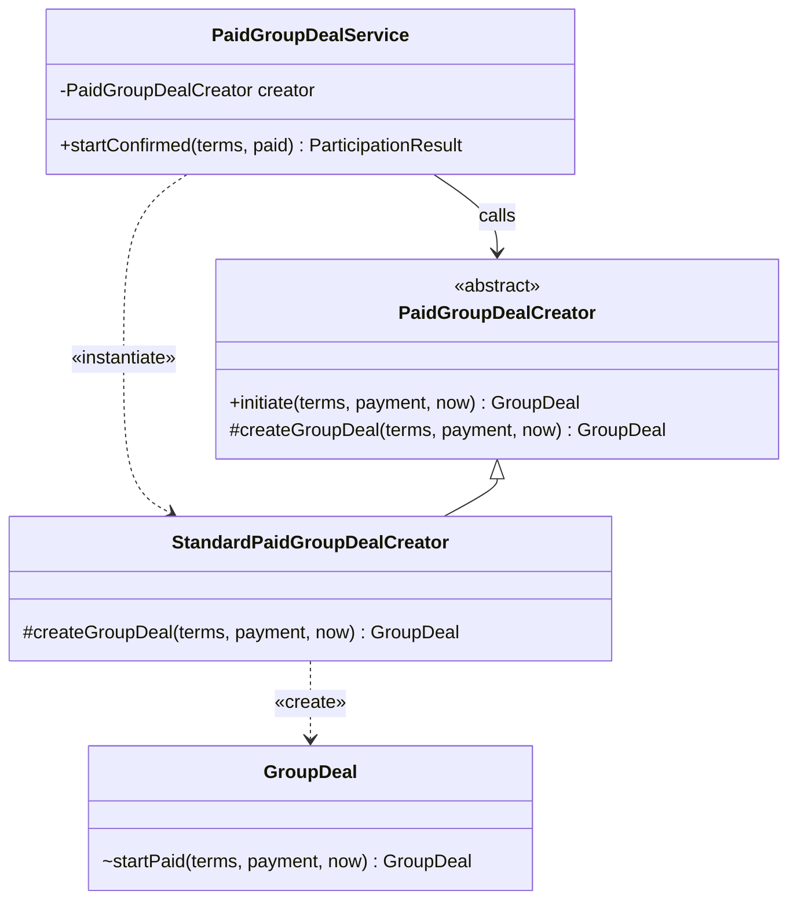
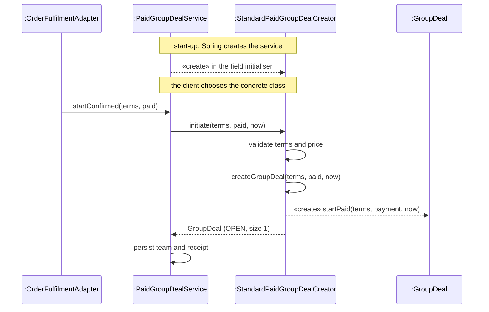
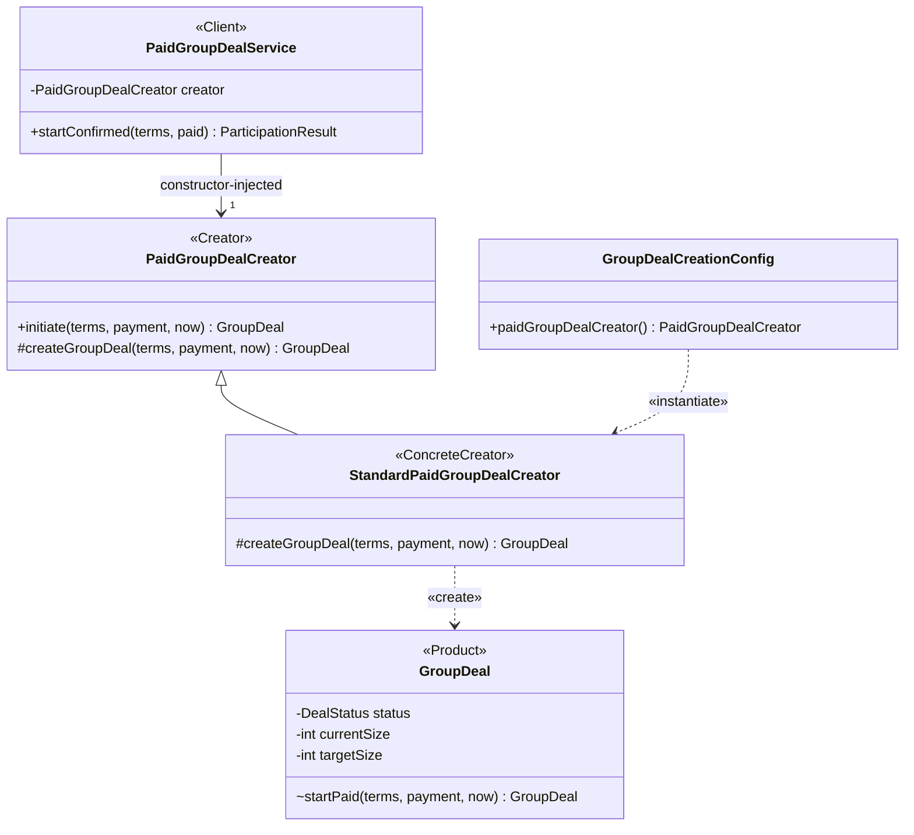
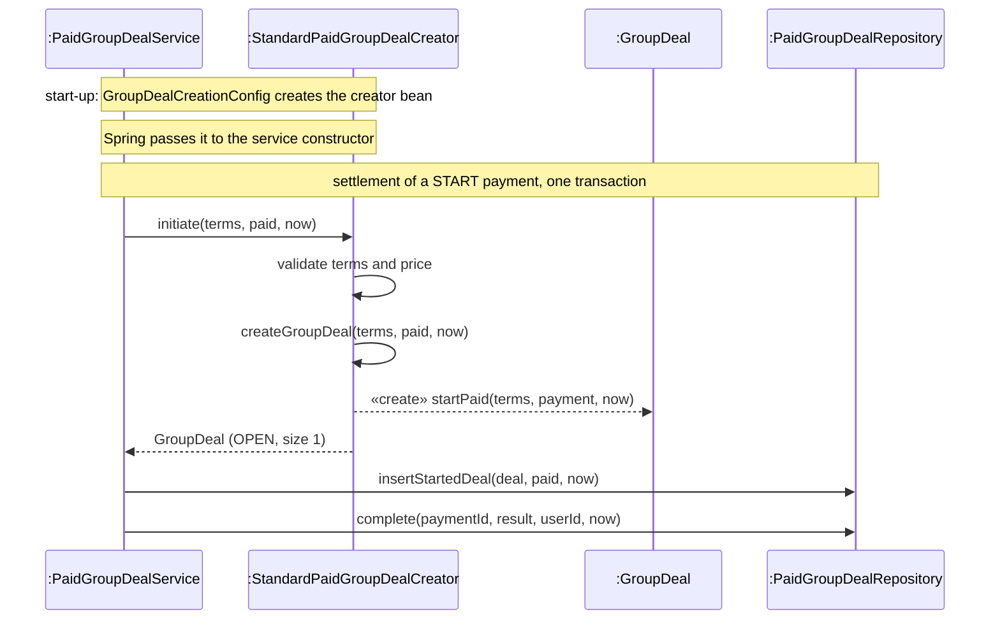

<!-- report
rubric: 3.5.1, 3.5-1..6, G4
owner: Wang Ziang (Eric)
plan: #679
sources: ../report-drafts/eric-wang-contribution.md (ER:601–749); deck B21
status: draft
-->

### 3.5.1 Creating the Team Without Naming Its Class: Factory Method by Wang Ziang (Eric)

A paid start of a team (UC3) must always apply the same start rules, but the class of team it creates may change. We applied GoF Factory Method so that the service that settles a start depends only on an abstract creator, and the composition root, not the service, chooses the concrete creator. The creator hierarchy has existed since 9 September 2026; the refactoring merged on 13 October 2026 (commit `081047f5`) removed the last place where the client named the concrete class.

#### 1 Design problem

**Where it shows.** In the UC3 design sequence diagram (3.4.1), the settlement of a paid START reaches `PaidGroupDealService.startConfirmed`, which asks a creator for the new team (a *team*, or *bloc*, is the group of buyers who pay into one deal). The start rules are fixed: the accepted terms must be present and unexpired, and the payment must match the frozen price and currency. Until commit `081047f5`, the client of the creator, `PaidGroupDealService`, named the concrete creator in a field initialiser (`git show 081047f5^`, `PaidGroupDealService.java`):

```java
private final PaidGroupDealCreator creator = new StandardPaidGroupDealCreator();
```

Figure 3.116 shows this committed design. The client depends on the abstract creator for the call, but it also depends on the concrete class, because it constructs it.



Figure 3.116: UML class diagram of the UC3 start before the refactoring (committed design at `081047f5^`). The dashed «instantiate» dependency from the client to the concrete creator is the problem: changing the team class means editing the service.

Figure 3.117 shows the same design at run time. The client creates its creator in a field initialiser when Spring constructs the client, so neither the container nor a test can supply another one.



Figure 3.117: UML sequence diagram of a paid start before the refactoring (committed design at `081047f5^`). The creator is created inside the client, before any request arrives, so the choice of team class is fixed in the client's code.

**Cause for redesign.** The cause is "creating an object by specifying a class explicitly" (SDP 05a p15). The service committed itself to `StandardPaidGroupDealCreator`, so supplying another creator, in production or in a test, meant editing the service. Without any creator at all the service would build the team itself, and the start rules would sit in whichever caller did so.

**What varies.** The class of the object that is instantiated, here the class of team (SDP 05a p13). The rules of a paid start do not vary.

#### 2 Candidate design patterns

We compared seven options (Table 3.21). Only Factory Method keeps the start rules in one place and lets the team class change without editing the client.

Table 3.21: Candidates for creating the team, with the reason each was kept or rejected.

| Candidate | Decision | Why it fits or does not |
|---|---|---|
| Construct the team in the service (direct `GroupDeal.startPaid` call) | Rejected | `startPaid` is package-private and static (`GroupDeal.java:122`), so the service in another package cannot call it without widening the visibility of team construction. It would also fix the team class in the client and leave the start rules to each caller. |
| Keep naming the concrete creator in the client (the committed design before `081047f5`) | Rejected | It is the cause above: the client depends on the concrete class. |
| Simple static factory, `create(type)` with a switch | Rejected | Static methods cannot be overridden, so a static factory "forbids subclassing of the base factory class" (SDP 01a p34), and every new team class edits the switch. It is a simple factory, not GoF Factory Method. |
| Abstract Factory | Rejected | It creates families of related products. A start creates one product, the team; the member and the receipt are rows written by the repository, not products of a factory. |
| Builder, or a static factory method on `GroupDeal` | Rejected | The accepted terms (`NewDealTerms`) are already complete, so stepwise assembly adds nothing, and a static method has no override point for a different team class. |
| Registry of creators chosen at run time by a key | Rejected for now | There is one team class and no run-time choice to make; the issue that scoped the change excluded extra creator registries (#421). A registry would add a lookup and a key with a single entry. |
| **Factory Method** | **Selected** | The Creator's `initiate` keeps the start rules in one place and calls the factory method `createGroupDeal`; a ConcreteCreator decides the team class. The client depends only on the abstract Creator, and the composition root chooses the ConcreteCreator. |

#### 3 Motivation

We chose Factory Method because it separates the two things the problem mixes: the start rules, which must never vary, and the team class, which may. The abstract `PaidGroupDealCreator.initiate` is a `final` template method that validates and then calls the factory method `createGroupDeal` (GoF p136), so a second ConcreteCreator could change the team class but could not skip the start rules. The flexibility is needed because the project proposal (section 6.3) makes extensibility the primary design driver: new team-resolution behaviour should be addable without editing existing domain logic. The injected Creator already pays off in tests, which supply their own creator without touching the service (part 6 below).

The design is GoF Factory Method, not a simple factory: the creation step is an overridable instance method of an abstract Creator, and a subclass decides what it creates. Two points depart from the textbook structure, and we state them openly. There is no Product interface: the only Product is the concrete class `GroupDeal`. And the ConcreteCreator delegates the construction itself to the package-private static `GroupDeal.startPaid`, which is a creation method of the product, not part of the pattern.

**Liability.** Factory Method costs one ConcreteCreator per team class: a new kind of team needs a new creator subclass as well as a new product. Today the flexibility is not exercised. `StandardPaidGroupDealCreator` is the only ConcreteCreator, and `GroupDeal` is `public final` (`GroupDeal.java:19`), so a second team type would also need `GroupDeal` opened for extension or a new product class. We accept the one extra class because the final `initiate` keeps the start rules in one place for any future creator.

#### 4 Solution class diagram

Figure 3.118 maps the code to the GoF participants: Creator `PaidGroupDealCreator`, ConcreteCreator `StandardPaidGroupDealCreator` (a `final` class), Product `GroupDeal`, and Client `PaidGroupDealService`, which receives the Creator through its constructor. `GroupDealCreationConfig` is the composition root; its `@Bean` method instantiates the ConcreteCreator.



Figure 3.118: UML class diagram of the UC3 start after applying Factory Method (code since `081047f5`). The client now depends only on the abstract Creator; only the composition root names the ConcreteCreator. `PaidGroupDealCreator` is abstract, `initiate` is final ({leaf}) and `createGroupDeal` is abstract.

The template method `initiate` rejects null input or a start at or after `terms.expireTime()`, calls `payment.requirePrice(price, currency)`, and then returns `createGroupDeal(terms, payment, now)`.

#### 5 Solution sequence diagrams

Figure 3.119 shows a paid start after the refactoring. The Creator is wired once at start-up by the composition root; each paid start then calls the template method, which calls the factory method. The service is reached from `OrderFulfilmentAdapter`, as before.



Figure 3.119: UML sequence diagram of a paid start after applying Factory Method. The service calls the Creator it was given; the start rules run in the final `initiate` before the factory method, and the service writes the team and the receipt in its own transaction.

#### 6 Implementation decisions

The implementation follows the solution design. The decisions are:

1. **Inject the Creator through the constructor.** `PaidGroupDealService` declares `private final PaidGroupDealCreator creator`, and Lombok's `@RequiredArgsConstructor` generates the constructor. `GroupDealCreationConfig` (`@Configuration(proxyBeanMethods = false)`) registers `StandardPaidGroupDealCreator` as the single `PaidGroupDealCreator` bean. The configuration lives in the application module, so the domain module, which holds the Creator hierarchy, stays free of Spring.
2. **Keep construction inside the domain package.** `GroupDeal.startPaid` stays package-private and static, so only code in `com.blocbuy.groupbuy.model`, such as the creator, can build a paid start. `createGroupDeal` performs no persistence; the service writes the team and the receipt in its own transaction (`insertStartedDeal`, then `complete`).
3. **Choose the ConcreteCreator at build time.** There is one ConcreteCreator, and choosing another means changing the wiring. We do not claim run-time selection of creators.
4. **Two refactorings in the same change, which are not the pattern.** The same pull request moved the join admission rules that quoting and paid admission both need into shared `GroupDeal` guards (`requireJoinWindow`, `requireAvailableSeat`, `requireNewMember`), so a quote now rejects a stored team with fewer than one paid member before payment instead of after it. It also replaced one generic receipt-fingerprint helper with typed START and JOIN encoders in `ParticipationFingerprint`, pinned by golden hashes so that every stored fingerprint stays byte-for-byte the same. Both are refactorings, not design patterns.
5. **Refactor under red tests.** Two failing tests reproduced the below-one-count quote defect before the fix (`GroupDealPurchaseSupportImplTest.aTeamWithoutItsPaidLeaderCannotBeQuoted`, sprint log of 7 October 2026), and the guard-order and golden-hash tests then pinned the behaviour while the code moved.

Table 3.22 names the implementing classes and the unit tests that cover them.

Table 3.22: Implementing classes and their unit tests for Factory Method (UC3).

| Role | Class | Unit tests |
|---|---|---|
| Creator | `PaidGroupDealCreator` (abstract; `public final initiate`, `protected abstract createGroupDeal`) | `PaidGroupDealTest.initiationRejectsExpiredTermsInvalidSizeAndMissingClock` checks the start rules in `initiate` |
| ConcreteCreator | `StandardPaidGroupDealCreator` (final) | `PaidGroupDealTest.createsOpenDealWithExactlyOnePaidLeader` checks the Product: OPEN, size 1, payer as leader |
| Product | `GroupDeal` (`public final`; package-private static `startPaid`) | `PaidGroupDealTest.admissionGuardsRejectMissingFactsAndPreservePaidRejectionPriority` pins the shared guards |
| Client | `PaidGroupDealService` | `PaidGroupDealServiceTest.startUsesTheInjectedCreator` gives the service a mocked Creator and shows that the Creator decides initiation without editing the service; `PaidGroupDealServiceTest.historicalStartAndJoinFingerprintsRemainByteCompatible` pins the stored hashes |
| Composition root | `GroupDealCreationConfig` | No unit test; the Spring context of the integration test `PaidGroupDealServiceIT` (Testcontainers) wires it into the real service |
| Refactoring evidence | `GroupDealPurchaseSupportImpl` | `GroupDealPurchaseSupportImplTest.aTeamWithoutItsPaidLeaderCannotBeQuoted`, `closedAndFullTeamsAreRejectedBeforeDuplicateMembership` (change: #421, #422, #423, PR #424) |

Verified locally, not on dev: before the merge, the full backend build (`mvnw verify`, Docker-backed) ran 1,615 test cases with no failures or errors, and the five touched production files had no missed lines or branches (194 lines, 92 branches), as recorded in the sprint log of 7 October 2026 (`docs/agile/sprint-03/log/2026-10-07.md`). The same tests run in the required `build-quality` CI job on every pull request that changes backend code (chapter 4.2). This evidence does not cover a deployment or a Stripe end-to-end run.
