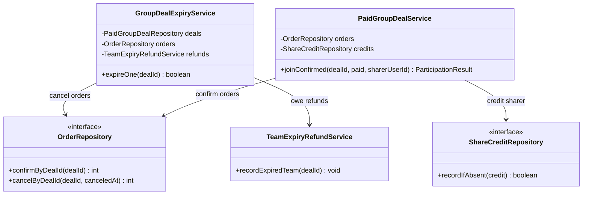
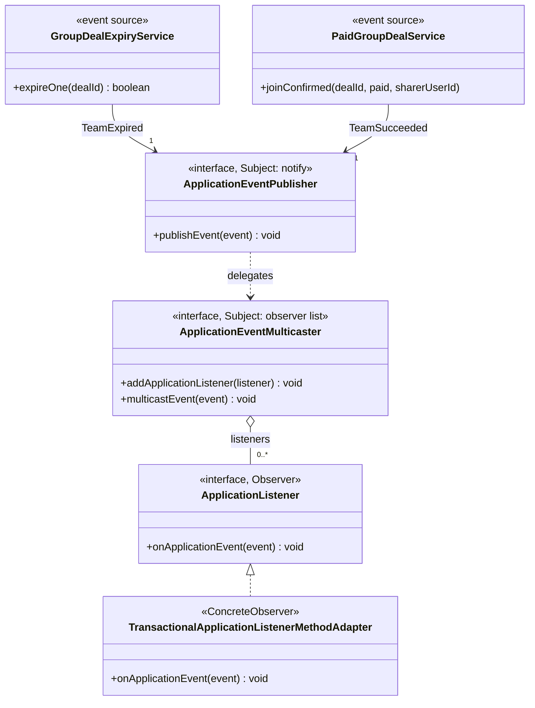
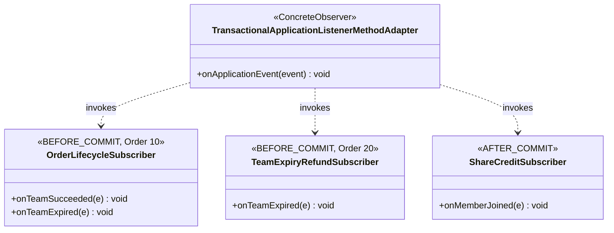
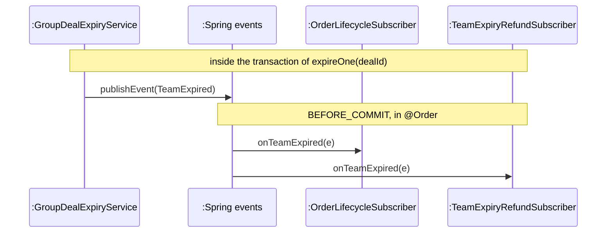
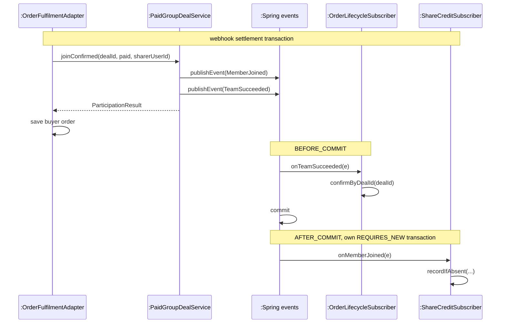

<!-- report
rubric: 3.5.2, 3.5-1..6, G4
owner: Yu Qianshuo (Yorik)
plan: #679
sources: deck s16, observer-expiry.svg; backend ADR 0002, ADR 0003; docs/agile/sprint-02/lifecycle-completion-plan-20260922.md
owns: R31, FG11
status: draft
-->

### 3.5.2 Team Outcome Consequences: Observer by Yu Qianshuo (Yorik)

When a team expires (UC5), its pending orders must be cancelled and every buyer who paid must be owed a refund (UC6); when a team fills, its orders must be confirmed. We applied GoF Observer, using Spring's in-process application events, so that the group-buy code only announces the team's outcome and each consequence lives in its own subscriber in its own bounded context. The subscribers that carry money run before the transaction commits, so a team can never be closed while nobody is owed a refund (backend ADR 0002).

#### 1 Design problem

**Where it shows.** In the UC5 expiry design sequence (section 3.4.5) and the UC6 refund design sequence (section 3.4.2), one decision of the group-buy context, "this team has expired", must change state in two other contexts: the order context (cancel the team's pending orders) and the payment context (record a refund obligation for each paid member).

**The design before the pattern is a brute-force design (never committed).** No committed version of the expiry code called the order or refund code inline. `GroupDealExpiryService` published `TeamExpired` from its first commit, on 23 September 2026. Before that commit nothing expired a team at all: `OrderRepository.confirmByDealId` and `cancelByDealId` and the refund-obligation method had been implemented with no callers (ADR 0002, Context). When we planned this change, we rejected the inline call. Figures 3.117 and 3.118 therefore draw the design we would have written by calling each consequence directly.



Figure 3.117: UML class diagram of the team-outcome consequences, brute-force design (never committed). The group-buy services depend directly on order and payment classes; every new consequence adds another arrow out of them.

```mermaid
sequenceDiagram
    participant Exp as :GroupDealExpiryService
    participant Deals as :PaidGroupDealRepository
    participant Orders as :OrderRepository
    participant Refunds as :TeamExpiryRefundService
    Note over Exp,Refunds: expireOne(dealId) called by the sweeper; one transaction
    Exp->>Deals: lockDeal(dealId)
    Exp->>Exp: deal.expire(now)
    Exp->>Deals: expire(before, after, now)
    Exp->>Orders: cancelByDealId(dealId, now)
    Exp->>Refunds: recordExpiredTeam(dealId)
    Note over Exp,Refunds: commit
```

Figure 3.118: UML sequence diagram of one team's expiry, brute-force design (never committed). The expiry service knows every consequence and their order; adding one more means editing `expireOne`. The expiry as built is Figure 3.111.

**Cause for redesign.** Tight coupling (SDP 05a p15). In the brute-force design the group-buy context depends on the order and payment contexts, against the team's backend rule that one context reaches another only through a published interface (ADR 0002 calls the inline call "a boundary violation"). The number of objects that depend on a team's outcome also grew during the project, as Table 3.22 shows; each one would have been another edit to the group-buy services.

**What varies.** The objects that depend on a team's outcome, and how many of them there are (SDP 05a p13). The outcome itself, and the rule for when a team expires, do not vary.

Table 3.22: Observers added to the team-outcome events over time (first commit of each class). `IntegrationOutboxWriter` also writes the `PaymentSucceeded` event, which is not a team outcome.

| Date | Observer | Event | Phase |
|---|---|---|---|
| 23 Sep 2026 | `OrderLifecycleSubscriber` | `TeamSucceeded`, `TeamExpired` | before commit |
| 23 Sep 2026 | `TeamExpiryRefundSubscriber` | `TeamExpired` | before commit |
| 26 Sep 2026 | `ShareCreditSubscriber` | `MemberJoined` | after commit |
| 3 Oct 2026 | `OpenDealOfferCacheSubscriber` (evicts the cached best offer of the product) | `MemberJoined`, `TeamSucceeded`, `TeamExpired` | after commit |
| 13 Oct 2026 | `IntegrationOutboxWriter` (writes cross-service events; off on dev, section 1.4) | `TeamSucceeded`, `TeamExpired`, `PaymentSucceeded` | before commit |

`GroupDealExpiryService` has not changed since its first commit, although two more observers of `TeamExpired` were added after it (Table 3.22).

#### 2 Candidate design patterns

We considered four options. Observer is the only one that removes the group-buy context's knowledge of its dependents and still lets the money-carrying consequences commit with the expiry.

<!-- table: split -->

Table 3.23: Candidates for carrying a team's outcome to the contexts that depend on it.

| Candidate | Decision | Why it fits or does not |
|---|---|---|
| Direct calls (the brute-force design) | Rejected | Simplest, explicit and in one transaction, but it couples group-buy to order and payment, breaks the context rule, and every new consequence edits `expireOne` and `joinConfirmed`. |
| Mediator, an application-level coordinator that calls order and payment | Rejected | It moves the coupling out of the expiry service, but the coordinator must still change for every new consequence and must know every context. Mediator suits many-to-many interaction among colleagues; here the interaction is a one-way broadcast from one source. |
| Message broker between the contexts | Rejected | It decouples across processes, but delivery happens after the commit, so a team could be expired while no refund is owed, which ADR 0002 forbids. A broker is also outside the agreed stack (section 1.4.2). Cross-service events in the SWE5001 deployment travel through a transactional outbox (section 3.2.9). |
| **Observer** with Spring application events | **Selected** | Group-buy publishes an immutable fact; each dependent subscribes on its own. Spring's transaction-bound listeners can run inside the publisher's transaction, so the consequences commit or roll back with the team's outcome. |

#### 3 Motivation

We chose Observer because what varies is exactly what Observer isolates: the set of dependents of one object's change. It also meets the project proposal's extensibility driver (proposal section 6.3; see section 1.2), that a new consequence of a team's resolution can be added without editing existing domain logic: adding one is one new subscriber class. Table 3.22 shows the flexibility was needed in practice, not only in theory.

Spring's implementation lets each subscriber, not the publisher, choose when it runs relative to the commit, so the group-buy code never decides which consequences commit with the outcome (listener phases, section 3.2.9).

**Liability.** Control flow becomes implicit. Reading `expireOne` no longer shows that orders are cancelled or refunds are owed; a reader must search for listeners of `TeamExpired`. The phase annotation carries correctness: a plain `@EventListener` on `TeamSucceeded` would run before the last buyer's own order row is saved and leave it pending forever, and ADR 0002 calls this "the easiest thing here to get wrong". `@TransactionalEventListener` also silently discards an event published outside a transaction. The order between subscribers depends on `@Order` values spread across two contexts, and no test yet asserts that order directly (part 6 below).

#### 4 Solution class diagram

Figures 3.119 and 3.120 map the code to the GoF participants. Spring plays the Subject: `ApplicationEventPublisher` notifies, and the `ApplicationEventMulticaster` behind it holds the observer list (like GoF's ChangeManager). The Observer is Spring's `ApplicationListener`. The ConcreteObserver is Spring's `TransactionalApplicationListenerMethodAdapter` (spring-tx 7.0.9), which Spring creates for each method annotated with `@TransactionalEventListener` and which invokes that method. Our subscriber classes implement no interface. `GroupDealExpiryService` and `PaidGroupDealService` are event sources: clients of the Subject, not ConcreteSubjects, because they hold no observer list.



Figure 3.119: UML class diagram of the Observer participants after applying the pattern. The event sources depend only on Spring's publisher (the Subject); the multicaster holds the list of observers, and Spring's adapter is the ConcreteObserver. `PaidGroupDealService` also publishes `MemberJoined`.

Figure 3.120 continues the structure: one adapter instance exists per annotated subscriber method, and it invokes that method.



Figure 3.120: UML class diagram of the subscribers after applying Observer. No arrow leads from the event sources to order or payment code; the stereotype on each subscriber shows its transaction phase and its `@Order` value.

The events are immutable JDK records in the domain package `com.blocbuy.groupbuy.event`, free of framework annotations: `TeamExpired(dealId, productId, at)`, `TeamSucceeded(dealId, productId, size, at)` and `MemberJoined`. Two further observers, `OpenDealOfferCacheSubscriber` and `IntegrationOutboxWriter` (Table 3.22), follow the same structure and are left out of the figure.

#### 5 Solution sequence diagrams

Figure 3.121 shows the Observer collaboration in the main flow, UC5 expiry leading to the UC6 refund obligation. Spring holds the published event until the transaction is about to commit, then calls the two subscribers in `@Order` sequence inside that transaction.



Figure 3.121: UML sequence diagram of the Observer collaboration in a team's expiry. The expiry service only publishes `TeamExpired`, and Spring notifies the order subscriber (10) before the refund subscriber (20); the full expiry is Figure 3.111.

The before-commit callbacks run when Spring's transactional proxy around `expireOne` commits, after the method body has returned and before the sweeper receives the result. `cancelByDealId` is a method of the order context's `OrderRepository` and `recordExpiredTeam` of the payment context's `TeamExpiryRefundService`, each called by its own subscriber. The refund itself is sent later by a separate refund worker, outside this transaction (section 3.4.2).

Figure 3.122 shows why each subscriber has its own phase, using the join that fills a team (UC4). The buyer's own order is saved by `OrderFulfilmentAdapter` only after `joinConfirmed` returns, which is why order confirmation must wait for the commit point.



Figure 3.122: UML sequence diagram of a join that fills a team after applying Observer. Order confirmation runs before the commit, after the last buyer's order is saved; the sharer's credit runs after the commit, so its failure cannot undo a paid admission.

#### 6 Implementation decisions

The implementation follows the solution design. The decisions are:

1. **One phase per subscriber, chosen by what the consequence is** (listener phases, section 3.2.9). `OrderLifecycleSubscriber` and `TeamExpiryRefundSubscriber` use `@TransactionalEventListener(phase = BEFORE_COMMIT)` (ADR 0002). `ShareCreditSubscriber` uses `AFTER_COMMIT`: it credits only an attributed join, writes in its own `REQUIRES_NEW` transaction, opened as an explicit `TransactionTemplate` inside a `try`, and catches every failure, a failed commit included, logging it as a warning. A credit problem therefore never undoes a paid admission, and an exception thrown after the commit cannot turn a settled payment into an error. The unique index `uq_biz_share_credit_payment` (migration V18) absorbs a duplicate event (ADR 0003).
2. **Order the subscribers by the global lock order.** `@Order(10)` on the order subscriber and `@Order(20)` on the refund subscriber make the two take their locks in the order of Table 3.12 (section 3.2.8), never in opposite directions.
3. **Let a failure escape.** `TeamExpiryRefundSubscriber` does not catch exceptions, so a failure to record the obligations rolls the expiry back with it rather than leaving a closed team that owes nobody.
4. **Subscribers see only the immutable fact.** A subscriber receives the event record, never the `GroupDeal` aggregate, a mapper or a repository of another context; it touches only its own repository port. Both order handlers are status-guarded SQL updates, so a replayed event affects zero rows.
5. **Register the refund subscriber independently of Checkout.** `TeamExpiryRefundSubscriber` is not a component; `PaymentIntegrationConfiguration` registers it as a bean unconditionally, because successful payments already stored can still need compensation while Checkout is switched off.
6. **One team per transaction.** `GroupDealExpiryService.expireOne` resolves exactly one team and holds no loop; `GroupDealExpirySweeper` calls it once per due team, so one team's failure rolls back alone.

Table 3.24: Implementing classes and their tests for Observer (UC5 and UC6).

| Role | Class | Tests |
|---|---|---|
| Event source | `GroupDealExpiryService` | `GroupDealExpiryServiceTest.resolvesAnOverdueTeamAndAnnouncesIt`, `concurrentResolutionIsAnIdempotentReplayNotAFailure`, `anAlreadyResolvedTeamIsNeverWrittenAgain` |
| Adapted subscriber (order) | `OrderLifecycleSubscriber` | `OrderLifecycleSubscriberTest.expiryCancelsPendingOrdersStampedWithTheTeamsResolutionTime`, `successConfirmsEveryPendingOrderOfThatTeamAndNothingElse`, `replayedEventsAffectNoRowsAndStillSucceed` |
| Adapted subscriber (payment) | `TeamExpiryRefundSubscriber` | `TeamExpiryRefundSubscriberTest.expiryRecordsRefundObligationsForThatTeam`, `aFailureToRecordObligationsEscapesAndRollsTheExpiryBack` |
| Adapted subscriber (after commit) | `ShareCreditSubscriber` | `ShareCreditSubscriberTest.anAttributedJoinCreditsItsSharerInItsOwnTransaction`, `aFailedWriteIsSwallowedAfterTheJoinCommitted` |
| Whole chain | Spring context with PostgreSQL | `TeamExpirySchedulingIT.oneRunExpiresOverdueTeamsWithTheirConsequencesAndASecondRunChangesNothing`, `aTeamWhoseExpiryFailsRollsBackAloneAndIsRetriedByTheNextRun` (Testcontainers) |

The unit tests call the subscriber methods directly with mocked ports; the integration tests run the real Spring event dispatch against PostgreSQL in Testcontainers, locally and in CI (`build-quality` on pull requests, `SonarCloud Backend` on a push to `dev`). No test yet asserts the 10 → 20 dispatch order or the phase directly.

The whole chain, from a paid team's expiry to its refund, was shown on dev on 23 October (Table E.3); the expiry design bound (section 1.4.3) governs its timing.
