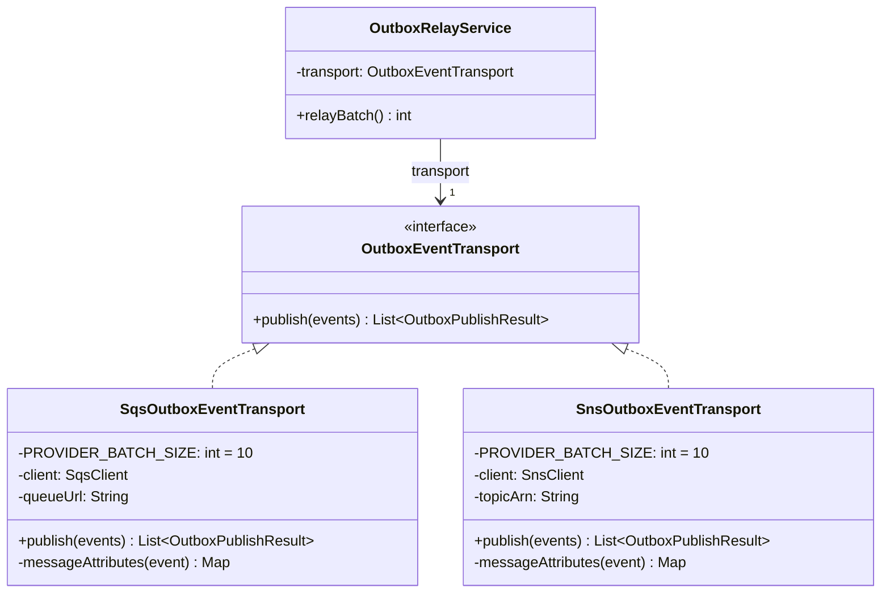
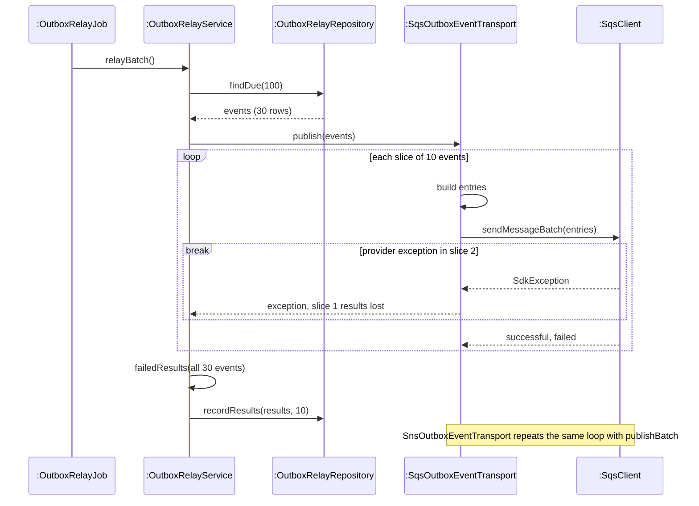
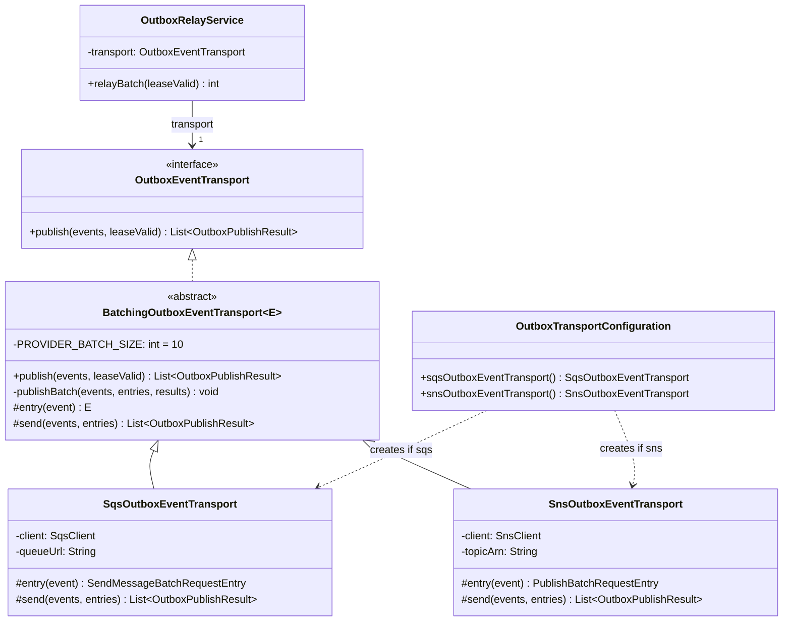
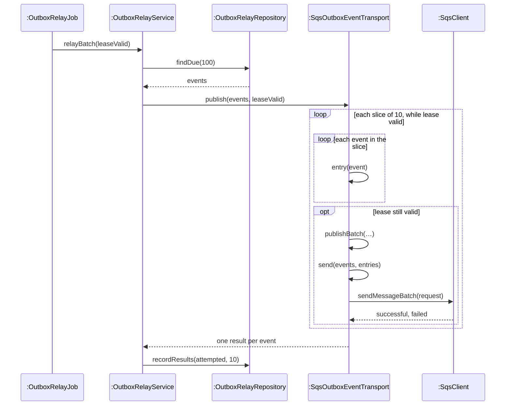
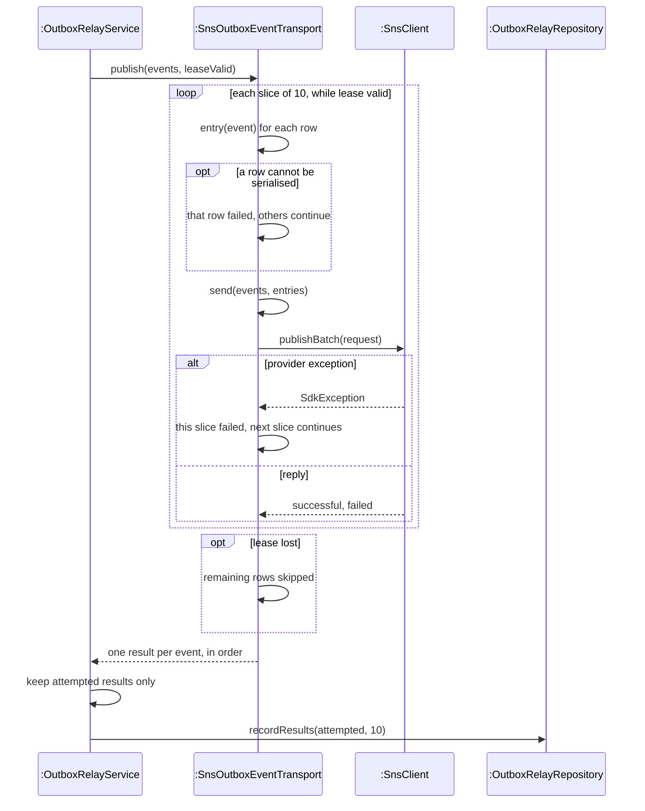

<!-- report
rubric: 3.5.3, 3.5-1..6, G4
owner: Panpakorn Siripanich (Pan)
plan: #679
sources: deck B19, template-method-outbox.svg; ADR 0007 amendment
owns: none
status: draft
-->

### 3.5.3 Outbox Transports: Template Method by Panpakorn Siripanich (Pan)

The outbox relay sends committed integration events to one of two message services, Amazon SQS or Amazon SNS, and both must fail, retry and stop in exactly the same way. Template Method puts that shared delivery algorithm in one final method of an abstract class and leaves only the two provider-specific steps, building a request entry and sending a batch, to the SQS and SNS subclasses.

Committed integration events reach the relay through a transactional outbox (section 3.2.9). A transport is the class that hands a list of outbox event rows to a message service and reports one result per row. The property `blocbuy.events.transport` selects `sqs` (local development and CI, against the ElasticMQ emulator) or `sns` (the SWE5001 ECS environment). The outbox writer and relay are off on dev (section 1.4), so nothing in this section was exercised on dev; the evidence is unit tests and a local integration test.

#### 1 Design problem

**Where it shows.** In the class diagram of the relay as first written (Figure 3.124), `SqsOutboxEventTransport` and `SnsOutboxEventTransport` each implement `publish` with their own copy of the same loop: split the events into slices of ten (the batch limit of both services), build one entry per event, call the provider, and map the reply to results. Only the entry class and the call differ. This design was committed: it is the state of the outbox relay pull request on 13 October 2026, before the review fix.

**Cause for redesign.** Algorithmic dependency: two classes depend on one algorithm that each holds its own copy of. It became a concrete problem in the code review of the relay on 13 October. The review reproduced two faults in that loop. First, an exception from the provider in the second of three batches made `OutboxRelayService` record all 30 rows as failed, including the ten that had been delivered and the ten that were never sent (Figure 3.125). Second, the transports did not know about the scheduler lease, so a relay instance that had lost its lease to another instance still started new sends. The fix (per-row and per-batch failure isolation, a lease check before each batch and again before each send, and explicit "skipped" results) had to behave identically for both providers. With the loop copied, the fix would have been written twice and tested twice, and the two copies could drift apart. The same pull request had also failed the SonarCloud duplication condition, at 3.1% against a 3% limit; the day log does not record which files caused it.

**What varies.** The steps of an algorithm: how one event becomes a provider request entry (`SendMessageBatchRequestEntry` for SQS, `PublishBatchRequestEntry` for SNS) and which batch call sends the entries (`sendMessageBatch` to a queue URL, `publishBatch` to a topic ARN). The order of the steps, the slice size, the failure handling and the lease checks do not vary.

Figure 3.124: UML class diagram, design before the pattern (committed on 13 Oct 2026). Both transports implement the port directly, and each `publish` holds its own copy of the slicing, entry-building and result-mapping loop.

Figure 3.125: UML sequence diagram, one relay tick before the pattern (committed design). An exception in the middle slice escapes the copied loop, so the relay records every row as failed, and no step checks the scheduler lease.

#### 2 Candidate design patterns

Three patterns were considered against the problem "one fixed delivery algorithm, two providers that differ in two steps".

- **Template Method (chosen).** Its intent is to define the skeleton of an algorithm in one operation and defer some steps to subclasses. That matches the problem exactly: the loop, failure isolation and lease checks are the invariant skeleton; building an entry and sending a batch are the primitive operations. Declaring the template method `final` also guarantees that no provider can weaken the failure handling.
- **Strategy.** One concrete publisher class could hold a "provider client" strategy object with `entry` and `send` operations. It would work, and it would favour composition over inheritance. It does not fit as well here: Strategy is for varying a whole algorithm that a client chooses, while here the algorithm is fixed and only two of its steps vary. The two steps must also agree on the provider's entry type, which a generic base class states once (`E`), whereas a strategy would need a second generic interface. The provider is chosen once at startup by a property, so the run-time interchangeability that Strategy offers adds nothing.
- **Adapter.** Each transport already adapts an AWS SDK client to the provider-neutral port `OutboxEventTransport`, and an extra adapter could give `SqsClient` and `SnsClient` one common batch interface. That solves an interface mismatch, not the duplication: the loop would still be needed, and without a further pattern it would still be copied. Adapter is therefore not a solution to this problem.

Keeping the two copies and applying every fix twice was the brute-force alternative; it is what Figure 3.124 shows and what the review rejected.

#### 3 Motivation

Template Method was chosen because the problem is "the same steps, two providers": exactly one place should decide how a batch of outbox rows is delivered, and the providers should only translate. The flexibility is needed, not speculative. Backend ADR 0007 requires the transport switch: local development and CI run `sqs` against ElasticMQ, while the SWE5001 ECS environment runs `sns` (configured for the commerce service in the SWE5001 Terraform). Both paths must give identical delivery guarantees, because the consumer only deduplicates by event ID and depends on the relay never marking an undelivered row as published. A third provider, should one be added, would also only supply `entry` and `send`.

The liability is the inheritance coupling that Template Method brings. A subclass cannot change the loop: `publish` is final, and the slice size of ten is a private constant of the base class. A provider with a different batch limit, or one that needs a different retry or lease rule, would force a change to the base class or a new hook, which then affects every transport. The subclasses also depend on the protected helper `results`, so the base class cannot change that helper freely. Both limits were accepted because SQS and SNS share the ten-entry limit and the failure semantics are meant to be the same for every provider.

#### 4 Solution class diagram

Figure 3.126 maps the GoF roles onto the code. `BatchingOutboxEventTransport<E>` is the AbstractClass; its `public final publish` is the template method, and `entry` and `send` are the primitive operations. `SqsOutboxEventTransport` and `SnsOutboxEventTransport` are the ConcreteClasses; each binds `E` to its SDK entry type. `OutboxRelayService`, in the application layer, is the client and knows only the domain port `OutboxEventTransport`. `OutboxTransportConfiguration` creates the one transport bean that the property selects.

Figure 3.126: UML class diagram, solution with Template Method. The final `publish` in `BatchingOutboxEventTransport<E>` owns the loop; each ConcreteClass supplies only `entry` and `send`, and the relay sees only the port.

#### 5 Solution sequence diagrams

Figure 3.127 shows one relay tick on the SQS path, which is the path that runs locally and in CI. The template method calls the two primitive operations in a fixed order inside the loop, and checks the lease before each slice and again before sending it. No database transaction spans the provider calls: `findDue` and `recordResults` are separate statements, as ADR 0007 requires.

Figure 3.127: UML sequence diagram, one relay tick with the SQS transport (local and CI). `publish` is inherited from the base class and calls the subclass's `entry` and `send`; the lease is checked before each slice and before each send.

Figure 3.128 shows the failure handling that the review fix added, on the SNS path. The same template method runs; only `entry` and `send` are the SNS versions. A row that cannot be serialised fails alone, a provider exception fails only its own slice, and rows that were never attempted after a lease loss come back as "skipped" and are left out of the results update, so their attempt counts and retry times do not change.

Figure 3.128: UML sequence diagram, failure handling in the same template with the SNS transport. Serialisation and provider failures are isolated per row and per slice, and skipped rows keep their retry state; compare Figure 3.125, where one exception failed all rows.

#### 6 Implementation decisions

The implementation follows the solution design. The decisions are:

- **Package-private abstract class.** `BatchingOutboxEventTransport<E>` is package-private in `com.blocbuy.integration.outbox` (infrastructure layer), so only the two transports in that package can extend it and no other module depends on it. The port `OutboxEventTransport` stays in the domain layer and does not mention the base class.
- **Final template method, protected steps.** `publish` is `public final`; `entry` and `send` are `protected abstract`; `publishBatch` is private, so the per-slice exception handling cannot be bypassed. The static helper `results` turns a provider reply into ordered results, with a provider-specific reason for missing entries ("SQS batch failure", "SNS batch failure").
- **Lease signal through the port.** `OutboxRelayJob` passes the scheduler's live lease check (`leaseValid`) to `OutboxRelayService.relayBatch`, which passes it to `publish`. Cancellation is cooperative, not fencing: a call already in flight can still finish after the lease is lost, so the consumer still deduplicates by event ID (ADR 0007 review amendment). The SDK clients have a 5 s attempt timeout and a 15 s total call timeout, well inside the two-minute lease.
- **Client-side checks stay in the relay.** `OutboxRelayService` still rejects a result list of the wrong size or order and owns the single retry budget of ten attempts; the transports never write to the database.
- **Transport chosen by configuration.** `OutboxTransportConfiguration` creates `SqsOutboxEventTransport` or `SnsOutboxEventTransport` with `@ConditionalOnProperty` on `blocbuy.events.transport`. Startup fails if the relay is enabled and the transport is neither `sqs` nor `sns`, or the queue URL or topic ARN is blank, so a misconfiguration cannot move committed events to the failed state. The configuration is active only when both `blocbuy.events.enabled` and `blocbuy.events.relay.enabled` are true.

<!-- table: split -->

Table 3.25: Unit and integration tests of the pattern (counts are test methods in the source; executed counts are in Appendix D).

| Test class | Kind | What it proves |
|---|---|---|
| `OutboxBatchFailureTest` | Unit, 6 parameterised methods run for both SQS and SNS | The template's behaviour is the same for both ConcreteClasses: a middle-slice exception keeps earlier and later results (`middleBatchExceptionPreservesSuccessesAndStillSendsLaterRows`), a bad row fails alone, an all-invalid slice makes no call, and lease loss before a tick, during a send or after preparing entries skips the remaining rows |
| `SqsOutboxEventTransportTest` | Unit, 2 methods | The SQS steps: slices of ten with the envelope and message attributes, and per-entry partial failure |
| `SnsOutboxEventTransportTest` | Unit, 2 methods | The SNS steps: slices of ten with message attributes, and partial and missing-entry failure |
| `OutboxRelayServiceTest` | Unit, 8 methods | The client: incomplete, null or mismatched results retry the whole batch, and skipped rows are left out of the update (`leaseLossLeavesUnattemptedRowsOutOfTheUpdate`) |
| `OutboxTransportConfigurationTest` | Unit, 8 methods | The property creates only the configured transport (`createsOnlyTheConfiguredSqsTransportWhenRelayIsEnabled`, and the SNS twin), no provider client exists while the relay is off, and an unknown transport or a missing queue URL or topic ARN refuses to start |
| `OutboxRelayElasticMqIT` | Integration (Testcontainers ElasticMQ), 1 method | Events reach a real SQS-compatible queue with their attributes and are recovered after a transport outage; runs locally and in CI |

Pan traced both review faults to the copied loop, compared Template Method with Strategy and Adapter, and decided to move the loop into a final template method of a package-private base class, so that the failure isolation and the lease checks hold for every provider. The ADR 0007 amendment "Failure isolation and lease loss" records the decision (code credits: chapter 5).
