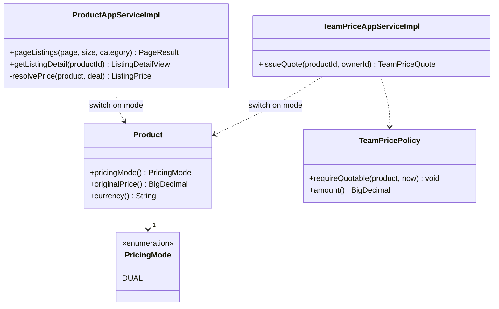
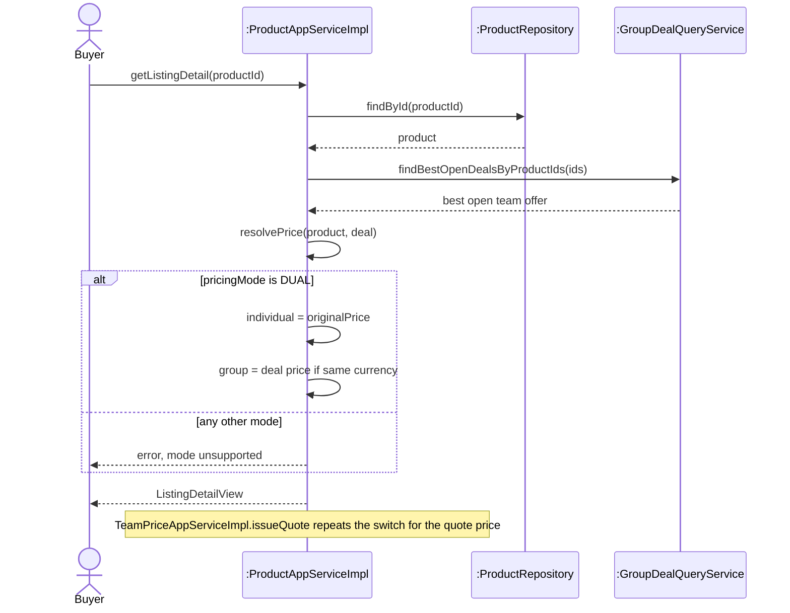
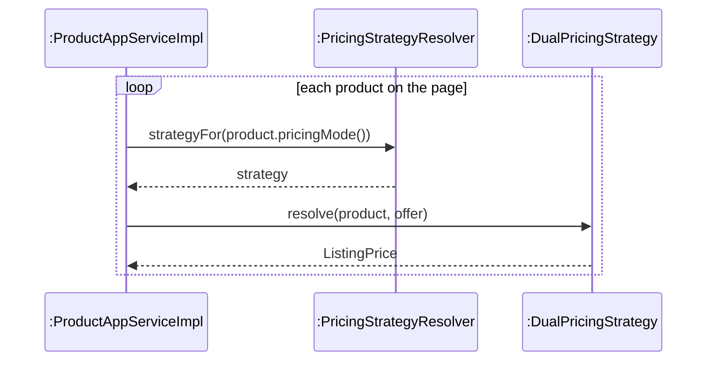
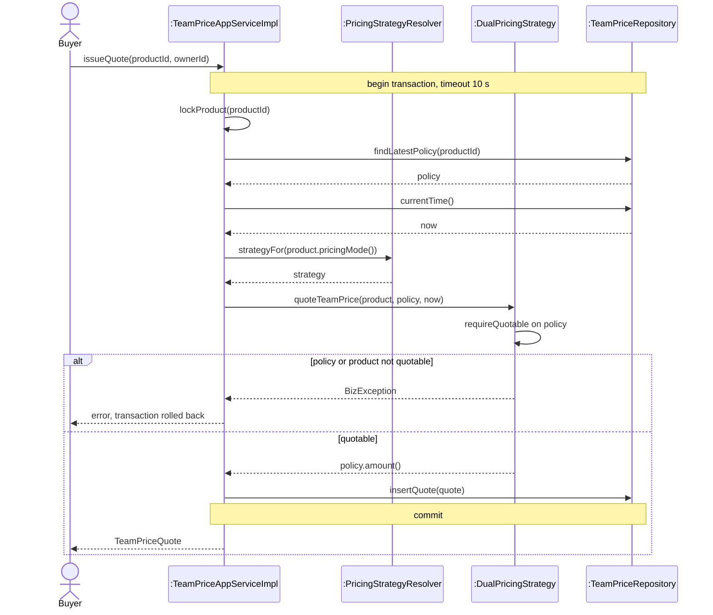

<!-- report
rubric: 3.5.4, 3.5-1..6, G4
owner: Lim Jiechao
plan: #679
sources: deck B20, strategy-pricing.svg; backend/docs/design/team-price-quotes.md
owns: none
status: draft
-->

### 3.5.4 Pricing Modes: Strategy by Lim Jiechao

How BlocBuy prices a listing depends on the listing's pricing mode, and two services need that decision: product browsing (UC1) and the first-team price quote that a buyer accepts before starting a team (UC3). Strategy puts each pricing mode's calculation behind one interface, `PricingStrategy`, and lets both services ask a resolver for the strategy that matches the product's mode, so neither service contains pricing arithmetic or a switch on the mode.

Today there is one mode, `DUAL`. A dual-priced listing shows two prices: the individual price, which is the product's list price, and the group-buy price, which is the price of the best open team for that product. The first-team quote is a third, separate price: the amount of the administrator's latest team price policy for the product, so that the first buyer can start a team before any team exists (`backend/docs/design/team-price-quotes.md`).

Lim identified that two services need the same pricing decision and that the pricing calculation is what varies, compared Strategy with Template Method and Decorator, and modelled the design before and after the pattern (code credits: chapter 5).

#### 1 Design problem

**Where it shows.** In the design class diagram of UC1 and UC3, two application services must turn a product into a price: `ProductAppServiceImpl` for the listing grid and detail page, and `TeamPriceAppServiceImpl` for the first-team quote. Without a pattern, each service would read `product.pricingMode()`, switch on it, and do the arithmetic inline (Figures 3.128 and 3.129). This design was never committed: the Strategy was part of the first commit of the pricing code, on 8 September 2026, and the backend history contains no switch on the pricing mode. The before diagrams are therefore a brute-force design (never committed).

**Cause for redesign.** Algorithmic dependency: the services would depend on the pricing algorithms themselves. Every new pricing mode would edit both services, and the same rules (for example, ignore an open team whose currency differs from the product's, so a data error can never misprice a listing) would be written twice and could drift. It would also contradict the project proposal's primary design driver for maintainability (section 6.3), which names new pricing schemes as something to be addable "without modifying existing domain logic".

**What varies.** An algorithm: how a pricing mode turns a product, its best open team and its price policy into the displayed price pair and the first-team price. The browse and quote workflows around the calculation (reading products in one batch, locking the product, checking the buyer, storing the quote) do not vary with the mode.

Figure 3.128: UML class diagram, brute-force design (never committed). Each service switches on `Product.pricingMode()` and holds the pricing arithmetic itself, so a new mode edits both services.

Figure 3.129: UML sequence diagram, browsing one listing in the brute-force design (never committed). The pricing decision is an `alt` on the mode inside the service, and the quote service would carry a second copy.

#### 2 Candidate design patterns

- **Strategy (chosen).** Its intent is to define a family of algorithms, encapsulate each one and make them interchangeable for the clients that use them. Each pricing mode is one algorithm; the two services are clients that should not care which one runs. The mode is data (`biz_product.pricing_mode`), so the algorithm must be chosen per product at run time, which composition supports and inheritance does not.
- **Template Method.** It fits when several algorithms share a fixed skeleton and differ in some steps. Pricing modes share no skeleton: a dual price is "list price plus best team price", while a future mode such as a tiered or time-limited price would compute something else entirely. Template Method would also tie each mode to a base class of the service, so the browse and quote services could not share one pricing class. It does not fit.
- **Decorator.** It fits independently stackable adjustments, for example a voucher on top of a promotion on top of a base price. No such stacked discounts are approved for BlocBuy, and Decorator would still need a base algorithm for each mode. The design document rejects it for now (`team-price-quotes.md`, Strategy selection).

A plain switch inside each service, the brute-force design above, was the alternative to any pattern.

#### 3 Motivation

Strategy was chosen because the thing that varies is a calculation, two different services need the same calculation, and the choice of calculation is made per product from stored data. Putting the calculation behind `PricingStrategy` keeps the browse and quote workflows unchanged when a mode is added, and lets the domain strategies stay free of Spring and I/O.

The flexibility is needed because of a stated driver, not only a guess about the future: the project proposal (section 6.3) makes adding new pricing schemes without editing existing logic a primary design driver, and the database already stores a pricing mode per product for that reason.

**Liability.** There is one ConcreteStrategy today, and it prices two fixed amounts: the dual display pair and the first-team quote. For that alone, Strategy is more structure than a few lines of arithmetic: an interface, a resolver, a configuration class and an enum constant, and one more indirection to follow when reading the code. If no second pricing mode is ever added, that cost buys nothing. The extension is also not fully closed: a new mode still needs a new `PricingMode` constant, which is a domain edit, plus a new strategy class, a bean and tests, even though the services stay untouched. Finally, the interface groups two operations, `resolve` and `quoteTeamPrice`, so every future strategy must support both; the design document records that the interface should be split if a future mode cannot. We accepted these costs because the seam is small and was cheap to build at the start, whereas adding it later would have meant editing both services and their tests.

#### 4 Solution class diagram

Figure 3.130 maps the GoF roles onto the code. `PricingStrategy` (domain layer) is the Strategy; `DualPricingStrategy` is the only ConcreteStrategy. `ProductAppServiceImpl` and `TeamPriceAppServiceImpl` (application layer) are the Contexts. `PricingStrategyResolver` is a registry that maps each `PricingMode` to its strategy; it is not a GoF participant but the way the Context finds its strategy. `PricingConfig` registers the domain strategy as a Spring bean, so the domain layer needs no Spring annotation.

#### 5 Solution sequence diagrams

Figure 3.131 shows the Strategy collaboration inside UC1 browse: for each product on the page, the service asks the resolver for the strategy of the product's pricing mode and lets that strategy compute the price pair. The transaction and the batch lookup around it are in Figure 3.70.

Figure 3.131: UML sequence diagram, the Strategy collaboration in UC1 browse. The service delegates each price to the strategy that the resolver returns for the product's pricing mode; the full browse flow is Figure 3.70.

Figure 3.132 shows the first-team quote that supports UC3. The whole command runs in one transaction with a 10-second timeout; the product row is locked first (`lockProduct`, through `ProductRepository.lockById`), as Table 3.12 records for the team-price quotation path, and the database clock is read after the lock, so the quote is priced at authoritative time. The strategy validates the policy and returns its amount; it never looks at existing teams.

Figure 3.132: UML sequence diagram, first-team quote with Strategy. The quote service delegates the price to the same strategy as browsing; the transaction boundary covers the lock, the strategy call and the insert.

#### 6 Implementation decisions

The implementation follows the solution design. The decisions are:

- **Strategies are pure domain classes.** `PricingStrategy` and `DualPricingStrategy` live in `com.blocbuy.catalog.pricing` with no Spring dependency, I/O or state. `PricingConfig` in the application layer creates the bean, so adding a mode means one new class and one bean method.
- **The resolver fails fast.** `PricingStrategyResolver` collects all `PricingStrategy` beans at startup into an immutable map keyed by `PricingMode` (`EnumMap` copied with `Map.copyOf`). Two strategies for the same mode stop the application from starting. A product whose mode has no strategy fails its request with `CATALOG_500_001` (`PRICING_MODE_UNSUPPORTED`); there is no silent fallback to another price. An unknown code in the `pricing_mode` column already fails earlier, in `PricingMode.fromCode`.
- **The mode is data.** `biz_product.pricing_mode` (`varchar(16)`, default `dual`, Flyway V4) selects the strategy per product; the allowed values are enforced by the application, as the schema has no CHECK constraints (section 3.6).
- **Currency guard in the strategy.** `DualPricingStrategy.resolve` drops the group-buy price when the best open team's currency differs from the product's, so the listing falls back to its individual price instead of showing a wrong one. The grid and detail views still show that team's progress, so they never disagree.
- **Quote price independent of teams.** `quoteTeamPrice` takes the latest `TeamPricePolicy`, checks it with `requireQuotable` and returns its amount. It never copies a displayed group-buy price, which breaks the circular dependency "no team, no price; no price, no team".

Table 3.26: Unit tests of the pattern (counts are test methods in the source; executed counts are in Appendix D).

| Test class | Methods | What it proves |
|---|---|---|
| `PricingStrategyResolverTest` | 3 | `resolvesRegisteredStrategyByMode`; `duplicateModeFailsFastAtStartup`; `unknownModeIsBusinessErrorNotSilentFallback` |
| `DualPricingStrategyTest` | 9 | The ConcreteStrategy: dual price with an open team, individual price only without one, a mismatched currency ignored, null rejected, and the first-team quote taken from the policy without any team, rejecting an expired policy, an off-sale product and a policy of another product |
| `ProductAppServiceImplTest` | 19 | The browse Context with the strategy: dual prices for a whole page from one batch offer lookup (`pageEnrichesDualPricesViaSingleBatchDealLookup`), and progress kept when the currency guard drops the group price |
| `TeamPriceAppServiceImplTest` | 21 | The quote Context with the real resolver and strategy: `firstTeamQuoteUsesStrategyAndClockAfterProductLock`, and no quote without a policy |
| `PricingModeTest` | 2 | Every stored code maps back to its mode, and an unknown code fails |

All five are unit tests that run in the `build-quality` CI job; no pricing result was measured on dev.
