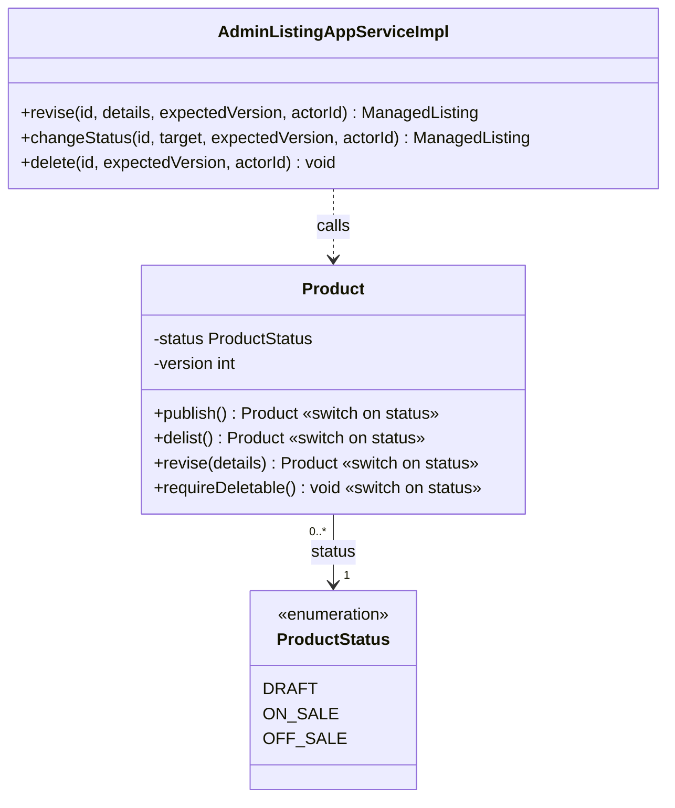
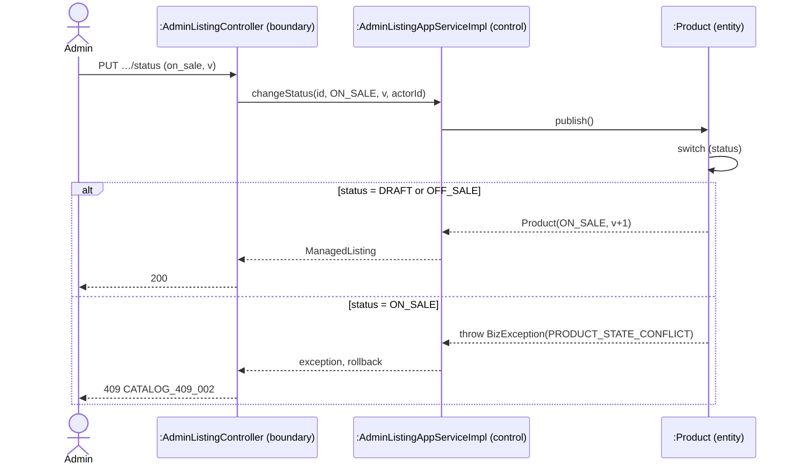
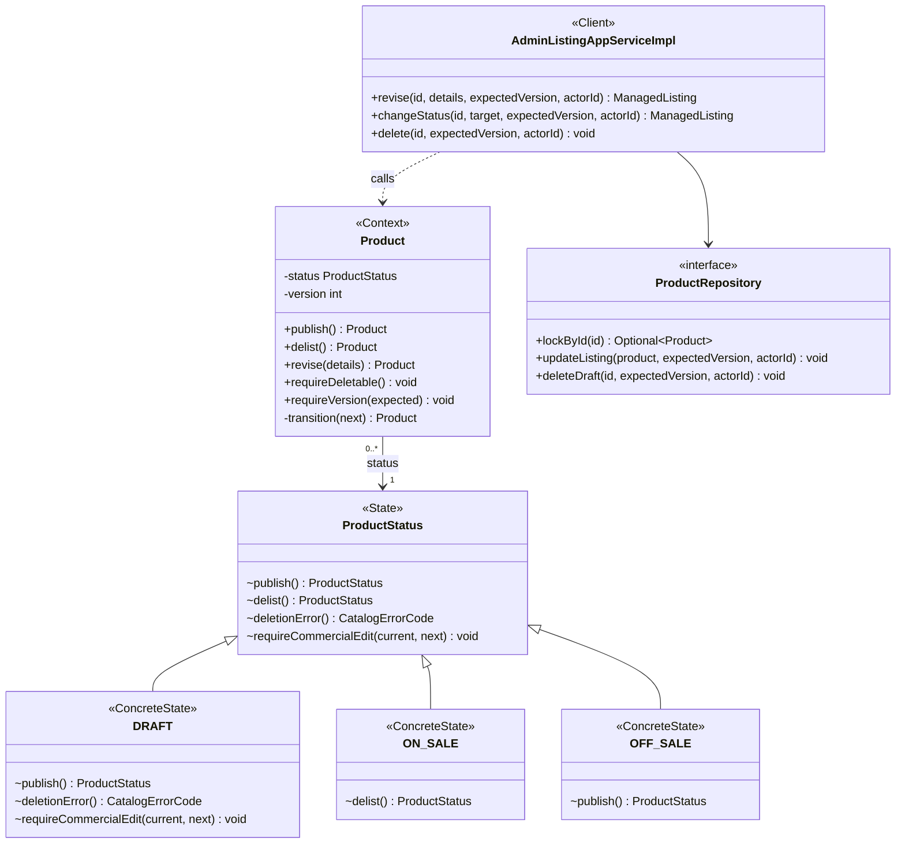
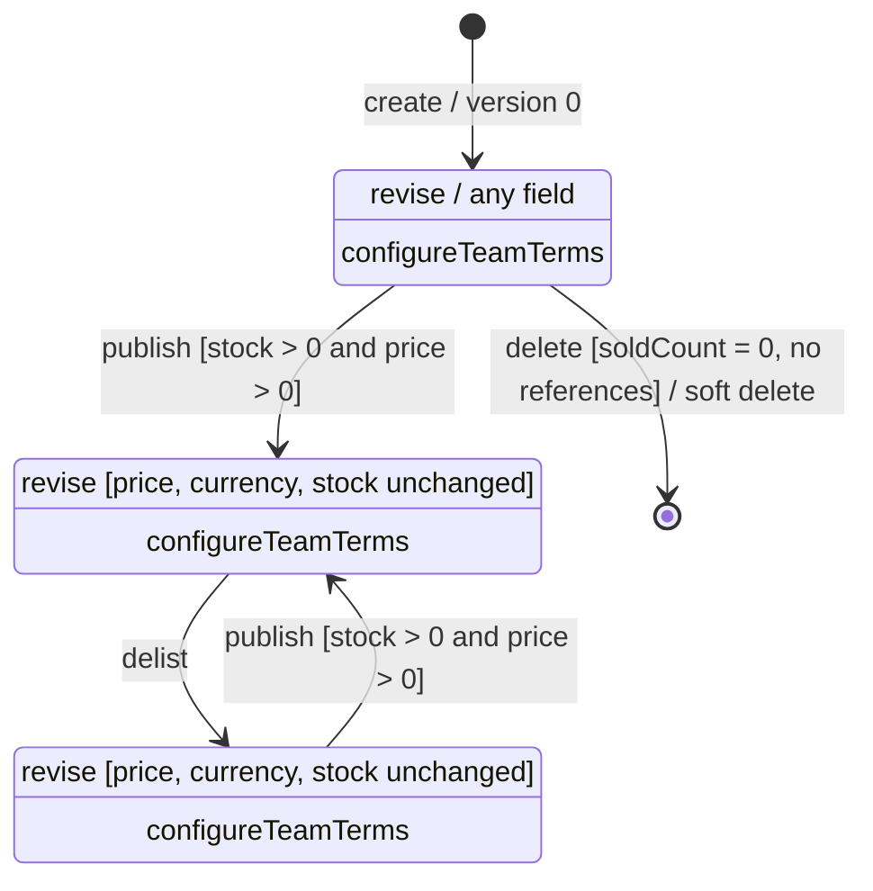
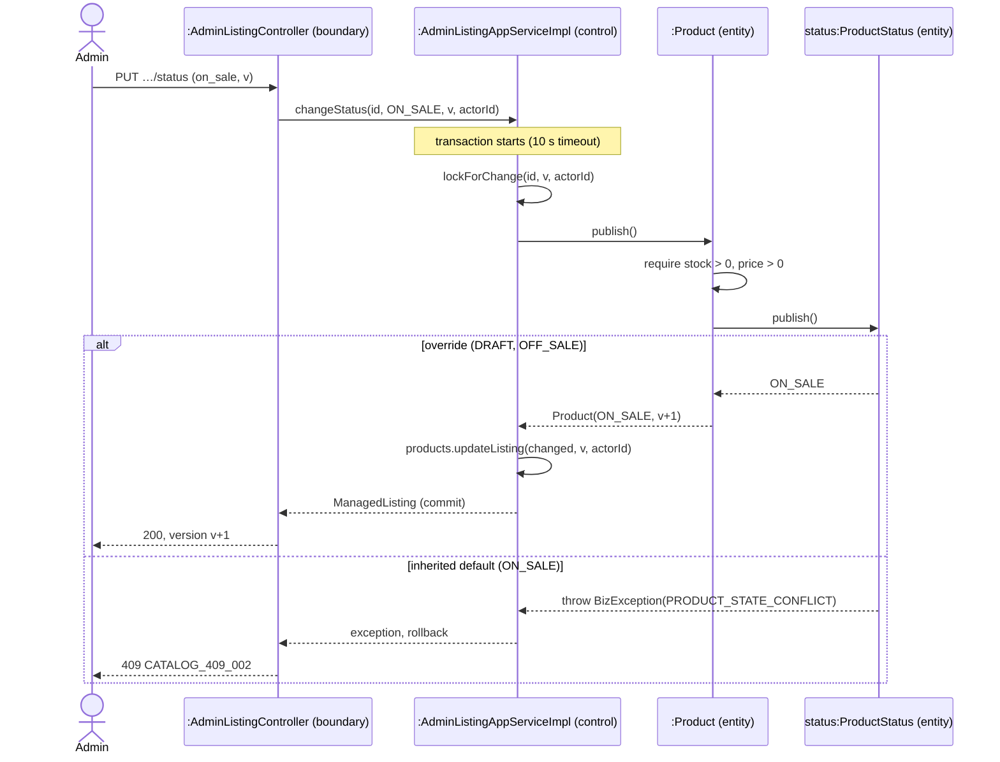
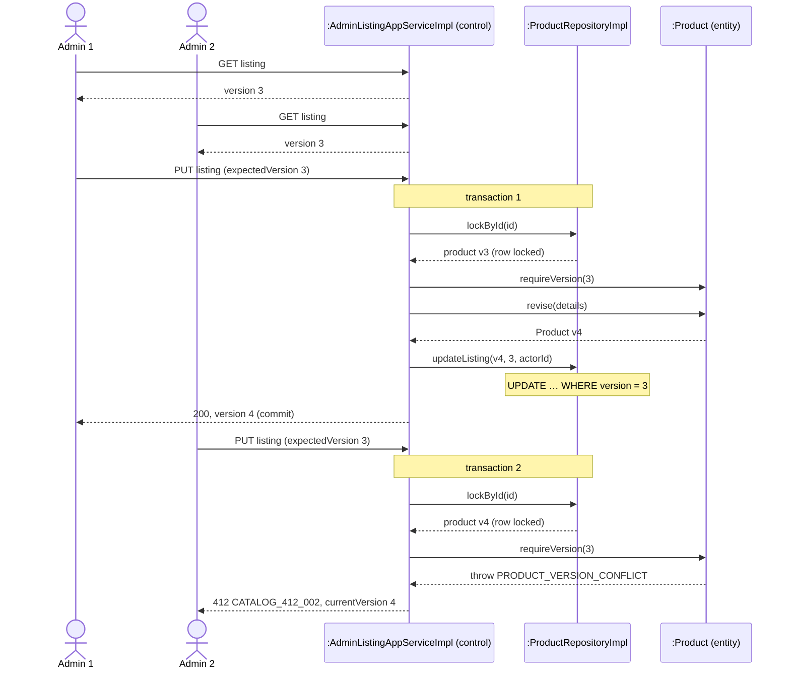

<!-- report
rubric: 3.5.5, 3.5-1..6, G4
owner: Liu Jin
plan: #679
sources: deck s17–s18, state-before.svg, state-after.svg, listing-statechart.svg; backend/docs/design/admin-listings.md
status: draft
-->

### 3.5.5 Listing Rules by State: State with Optimistic Offline Lock by Liu Jin

An administrator can publish, delist, revise and delete a listing, but each of these actions is allowed, and behaves differently, only in some lifecycle states of the listing. We solved this with the GoF State pattern: the `Product` aggregate hands every lifecycle action to its current `ProductStatus`, and each of the three states (`DRAFT`, `ON_SALE`, `OFF_SALE`) answers in its own way or refuses with one default. State does not solve a second problem in the same use case, two administrators editing the same listing at once. For that we use a complementary concurrency mechanism, Fowler's Optimistic Offline Lock (Patterns of Enterprise Application Architecture), which is not a GoF pattern: every write carries the version the administrator read, and a stale version is refused with HTTP 412 Precondition Failed.

A *listing* is a product that BlocBuy offers for team purchase, stored as one row of `biz_product`. Only an on-sale listing is visible to buyers and can be bought by a team (a bloc of buyers who each pay up front). The administrator manages listings in the admin console (UC9, described in 3.3.10).

#### 1 Design problem

**Where the problem shows.** Table 3.28 lists the real lifecycle rules, taken from `ProductStatus` and `Product` in the code. Four operations of `Product` (`publish()`, `delist()`, `revise(details)` and `requireDeletable()`) each depend on the state. Written directly, each operation needs the same `switch (status)`. Figure 3.136 shows that design and Figure 3.137 its publish sequence: the switch appears in all four operations of the class, and the `publish()` message in the sequence branches on the listing's status.

Table 3.28: Listing lifecycle rules per state (from `ProductStatus.java` and `Product.java`). 409 means `PRODUCT_STATE_CONFLICT` (`CATALOG_409_002`).

| Operation | DRAFT | ON_SALE | OFF_SALE |
|---|---|---|---|
| `publish()` (needs stock > 0 and price > 0 in every state) | becomes ON_SALE | 409 | becomes ON_SALE |
| `delist()` | 409 | becomes OFF_SALE | 409 |
| `revise(details)` | any field may change | 409 if price, currency or stock changes | 409 if price, currency or stock changes |
| `requireDeletable()` (the use case also checks references) | allowed if nothing was sold | 409 | 409 |
| `configureTeamTerms(…)` | allowed | allowed | allowed |

The design in Figures 3.136 and 3.137 is a **brute-force design (never committed)**. The first version of the listing code, committed on 11 September, already used State; the backend design note for UC9 (`backend/docs/design/admin-listings.md`) records that "repeated status switches in every caller" were considered and rejected. The rules inside the switches are the real ones.

Figure 3.136: Design class diagram, brute-force design (never committed). `ProductStatus` is a plain enumeration with no behaviour, so each of the four lifecycle operations of `Product` repeats the same switch on the status.

Figure 3.137: Design sequence diagram of publishing a listing, brute-force design (never committed). The listing itself tests its status, and the same test is repeated inside `delist()`, `revise()` and `requireDeletable()`.

**Cause for redesign.** The brute-force design matches the applicability of the GoF State pattern: "operations have large, multipart conditional statements that depend on the object's state". None of the causes of redesign listed in the module's design-pattern notes (SDP 05a p15) names State, so we do not claim one of them. The design is hard to *maintain*, because one rule lives in four places; hard to *extend*, because a new state means editing every switch, and one missed case lets a forbidden move through; and hard to *reuse*, because the rules of one state cannot be read or tested apart from the others.

**What varies.** The state of an object (SDP 05a p13): what a listing allows, and how, changes with its lifecycle state.

**The concurrency force.** An administrator's edit spans two HTTP requests: the editor reads the listing, the administrator changes it for some minutes, and the editor then writes it back. If two administrators edit the same listing, the later write silently overwrites the earlier one (last write wins). A published listing's price and stock are also referenced by quotes and teams, so a lost or out-of-order update can break a rule such as "the price of a published listing never changes". The state rules alone cannot prevent this, because each request sees a consistent listing on its own.

#### 2 Candidate design patterns

Table 3.29 lists the candidates we considered for the lifecycle rules, and Table 3.30 the candidates for the concurrent edits. The first table holds GoF patterns plus one plain alternative; the second holds Fowler's offline concurrency patterns, which are persistence mechanisms, not GoF patterns.

Table 3.29: Candidates for the lifecycle rules.

| Candidate | Fit or misfit | Decision |
|---|---|---|
| State (GoF, behavioural) | The behaviour of four operations follows the current state, and illegal calls can share one default answer | Chosen |
| Strategy (GoF, behavioural) | Same class structure, but a client chooses a strategy from interchangeable algorithms. Here nobody chooses; the state decides, and each state's answer also names the next state | Rejected |
| Transition table (not a pattern), as the team lifecycle uses in `DealStatus.canTransitionTo` | Fits when only the legality of a move varies. For listings the behaviour varies too: `revise` freezes price, currency and stock after publication, and only a draft can be deleted | Rejected |
| Command (GoF, behavioural) | Packages each request as an object, but the state rules would still have to live somewhere | Rejected |

Table 3.30: Candidates for concurrent edits of one listing.

| Candidate | Fit or misfit | Decision |
|---|---|---|
| Optimistic Offline Lock (Fowler) | Conflicts between administrators are rare; a version column checked on every write detects them without holding a lock while the administrator types | Chosen |
| Pessimistic Offline Lock (Fowler) | Would keep a listing locked across the administrator's think time and needs lock expiry for abandoned editors; over stateless HTTP this costs more than the rare conflict | Rejected |
| No lock (last write wins) | Loses an administrator's edit without telling anyone | Rejected |

#### 3 Motivation

We chose State because each state changes *how* the actions behave, not only *which* moves are legal. A draft allows price, currency and stock edits and deletion; an on-sale or off-sale listing locks them; publish and delist differ per state. With State, each state's rules sit in one place, every move a state does not allow is refused by one inherited default with HTTP 409, and `Product` no longer tests its own status in those four operations.

The flexibility is needed because the rules protect money. A published listing's price is the basis of quotes that buyers accept and teams that buyers pay into, so "after publication, price, currency and stock stay fixed" must hold on every path. Keeping that rule in the states, rather than in callers, means a new caller cannot forget it. The UC9 design note also expects new lifecycle states and requires each one to define its allowed operations and tests.

The liabilities are real, and we state them:

- One class per state. Three states give three constant bodies, and the lifecycle as a whole is no longer visible in one place; the statechart in Figure 3.139 restores that overview.
- Extension is not change-free. A new state still needs a stored code, an entry in the application's target switch and new tests; the design note warns against claiming zero-change extension.
- Two status tests remain outside the states (section 6).

We did not use State for the team lifecycle, although the proposal named it there. A team has one move, from OPEN to a final state, and its consequences are events (3.5.2), so State would add five classes, one per `DealStatus` constant, and four of them (SUCCEEDED, FAILED, EXPIRED, CANCELED) would only refuse every move, a cost the module notes warn about (SDP 05a p35). `DealStatus.canTransitionTo`, a transition table, is enough there.

We chose Optimistic Offline Lock because the business transaction, read then write, spans two requests, and a database lock cannot be held between them. Its liability is that the losing administrator must reload and enter the change again; there is no merge. The admin console turns a 412 into a conflict banner that names the server's current version and disables every write until the administrator reloads.

#### 4 Solution class diagram

Figure 3.138 shows the solution. `Product` is the GoF Context, `ProductStatus` the State and its three enum constants the ConcreteStates. Each constant has a body, which the Java compiler turns into its own anonymous subclass (`ProductStatus$1` to `$3`). The states are shared and stateless, the GoF "state objects can be shared" implementation choice, so many listings refer to the same state object. Table 3.31 maps the pattern's roles to the code.

Figure 3.138: Design class diagram of the State solution. `Product` keeps no switch in its four lifecycle operations; each ConcreteState overrides only the moves it allows, and the defaults in `ProductStatus` refuse the rest.

Table 3.31: GoF State roles in the code.

| GoF role | BlocBuy element | Responsibility |
|---|---|---|
| Context | `Product` (domain aggregate) | Holds the current state and the version; `publish()`, `delist()`, `revise()` and `requireDeletable()` delegate to the state; `transition(next)` builds the next revision |
| State | `ProductStatus` (Java enum) | Declares `publish()`, `delist()`, `deletionError()` and `requireCommercialEdit()`; the defaults throw `BizException(PRODUCT_STATE_CONFLICT)` or return that error |
| ConcreteState | `DRAFT`, `ON_SALE`, `OFF_SALE` constant bodies | Override only what the state allows; each returns its successor state |
| Client | `AdminListingAppServiceImpl` | Opens the transaction, locks the row, checks the version, calls the Context and persists the new revision |

Figure 3.139 is the listing statechart that these classes implement. It is the only statechart for the listing in this report.

Figure 3.139: UML state machine of a listing (`Product.status`). Nothing returns to DRAFT, only a draft can be deleted, any other event is refused with 409 and leaves the state unchanged, and every accepted event raises the version by one.

#### 5 Solution sequence diagrams

Figure 3.140 shows publishing after the redesign. Inside one transaction the application service first runs its private `lockForChange`, which locks the listing row through `ProductRepository.lockById`, checks that the administrator's account is active and calls `Product.requireVersion`; it then calls `publish()`. `Product` checks stock and price, then asks its state. The `alt` fragment has one operand per kind of ConcreteState, chosen by dynamic dispatch rather than by a switch: DRAFT and OFF_SALE override `publish()`, while ON_SALE inherits the refusing default.

Figure 3.140: Design sequence diagram of publishing a listing with State. The status is asked, not tested: the state object answers with the next state or refuses, and the transaction rolls back on a refusal.

Figure 3.141 shows the Optimistic Offline Lock. Two administrators read the same listing at version 3. The first save commits version 4. The second save carries version 3: its `lockById` waits for the first transaction's row lock, then reads version 4, so `requireVersion(3)` refuses it with 412 and nothing is written. The controller is left out of this figure to keep it legible; it passes each request on as in Figure 3.140.

Figure 3.141: Design sequence diagram of a stale save (Optimistic Offline Lock). The version check refuses the second save before any change; the guarded UPDATE is the backstop for any writer that skips the check.

#### 6 Implementation decisions

The implementation follows Figures 3.138 to 3.141. Names were checked in the code on 26 October at commit `6d14e449`; the decisions are:

1. **Enum constant bodies as ConcreteStates.** The three states are constants of `ProductStatus` with bodies, not three named classes. They are shared and stateless, and the stored code (`draft`, `on_sale`, `off_sale` in `biz_product.status`) maps back through `ProductStatus.fromCode`, which fails on an unknown code.
2. **The state returns its successor; `Product` applies it.** `ProductStatus.publish()` and `delist()` return the next state, and `Product.transition(next)` builds the next revision. There is no public status setter.
3. **`Product` is immutable.** Every accepted change returns a new revision with version + 1, so the version used by the lock is also the revision number of the listing.
4. **One default answer.** The State defaults throw `BizException(PRODUCT_STATE_CONFLICT)`, which the global exception handler returns as HTTP 409 with code `CATALOG_409_002`.
5. **Optimistic Offline Lock on every write.** `revise`, `changeStatus` and `delete` in `AdminListingAppServiceImpl` take an `expectedVersion`. The endpoints are `PUT /api/v1/admin/products/{productId}`, `PUT /api/v1/admin/products/{productId}/status` and `DELETE /api/v1/admin/products/{productId}?expectedVersion=N` in `AdminListingController`. `Product.requireVersion` refuses a stale version with `PRODUCT_VERSION_CONFLICT`, HTTP 412, code `CATALOG_412_002`, and returns the current version in the error body.
6. **Version check under a short row lock, plus a guarded UPDATE.** The service first locks the row (`lockById`, `SELECT … FOR UPDATE` in `BizProductMapper.xml`), in the same product-first order that the team-price quotation writers use, and only then checks the version. The UPDATE statements `updateListing` and `deleteDraft` also compare `version = #{expectedVersion}`, and `ProductRepositoryImpl` turns an affected-row count other than one into the same 412. The row lock lasts only the 10-second system transaction; the offline lock across the two requests is the version alone.
7. **References are a use-case concern.** The state decides only whether a draft may be deleted; `AdminListingAppServiceImpl.delete` then checks price, quote and team history and refuses with `PRODUCT_REFERENCED` (409, `CATALOG_409_004`). Deletion is a soft delete.

Two status tests remain outside the states, and we accept both. `AdminListingAppServiceImpl.changeStatus` still switches on the *requested* target to choose `publish()` or `delist()`; the current state still decides whether that move is legal. `Product.isOnSale()` compares the status for the purchase and team-price checks (`CatalogPurchaseSupportImpl`, `TeamPricePolicy`).

Table 3.32 lists the implementing classes and the tests that pin them. Unit tests run in the backend CI build (`build-quality`) on every pull request that changes the backend; `AdminListingFlowIT` runs the real HTTP chain against PostgreSQL 18 in Testcontainers, locally and in the same CI build. The 409 and 412 paths are verified by these automated tests; they were not separately exercised on dev.

Table 3.32: Implementing classes and their tests (read at commit `6d14e449`, 26 October).

| Class (module) and role | Tests |
|---|---|
| `ProductStatus` (domain): State and ConcreteStates | `ProductStatusTest` (5 methods): `onSalePublishThrowsStateConflict`, `offSaleDelistThrowsStateConflict`, `currencyOnlyChangeIsRejectedAfterPublication`, `fromCodeRejectsUnknownCode`, `fromCodeResolvesAllCodes` |
| `Product` (domain): Context and version | `ProductLifecycleTest` (7 methods), among them `publicationIsIrreversibleButDelistingIsReversible`, `commercialTermsAreEditableOnlyBeforePublication`, `invalidTransitionsAndEmptyStockCannotPublish`, `exhaustedVersionRefusesTheTermsCommand` |
| `AdminListingAppServiceImpl` (application): Client, transaction, lock order | `AdminListingAppServiceImplTest`: `changeStatusPublishesDraftToOnSale`, `changeStatusDelistsOnSaleToOffSale`, `changeStatusToDraftIsRejected`, `staleAndReferencedDraftsAreRejected`, `deletionUsesSharedProductFirstLockOrder` |
| `ProductRepositoryImpl` and `BizProductMapper.xml` (infrastructure): row lock, guarded UPDATE | `ProductRepositoryImplTest`: `updateListingRejectsVersionConflict`, `deleteDraftRejectsVersionConflict`, `lockByIdConvertsPresentAndMissingRows` |
| `AdminListingController` (adapter) and the whole chain: HTTP 409 and 412 | `AdminListingFlowIT`: `duplicateNumbersAndStaleWritesAreSafeConflicts`, `publishedListingCanBeDelistedButNotDeleted`, `concurrentEditsCommitOneRevision` (two threads revise the same version: exactly one succeeds, the other gets `CATALOG_412_002`, and the stored version is 1) |
| Admin console (frontend): conflict banner on 412 | `admin-listing-edit.test.tsx`: "turns a stale save into the conflict banner…", "closes a stale publish into the same banner", "closes a stale delete into the same banner"; `envelope.test.ts`: `conflictVersion` |

Credit: Wang Ziang (Eric) built the first version of the listing State and its versioned writes, merged on 11 September, with Liu Jin as reviewer; Panpakorn Siripanich (Pan) added the deletion-eligibility rule, which replaced `requireDeletable` in the states with `deletionError` on 1 October. Liu Jin owns this design problem and this section.
