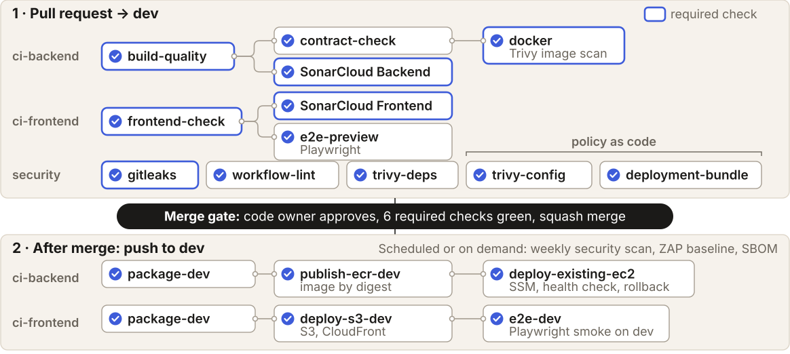
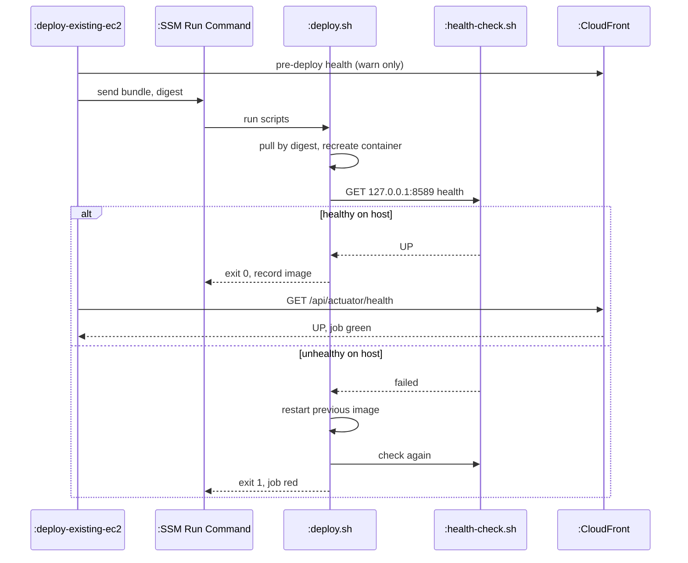

<!-- report
rubric: 4.1, 4.2, 4.3
owner: Panpakorn Siripanich (Pan); testing from Liu Jin
plan: #680
sources: docs/ci/; docs/quality/quality-gates.md; docs/ci/devsecops-maturity-assessment.md; deck s20–s27; #694
status: draft
-->

# 4 DevSecOps and Development Lifecycle

BlocBuy is built, checked and delivered from one GitHub repository by GitHub Actions. Every change reaches the shared `dev` branch through a reviewed pull request that must pass six required checks, and a merge that changes the backend or the frontend then deploys that side automatically to the SWE5006 dev environment, which checks its own health after each deploy. Both workflows are path-filtered, and each delivery job also depends on a repository switch that turns automatic deployment on; both have been on since September (repository variables read on 26 October; last changed on 5 and 23 September). Production is the shared SWE5001 release on Amazon ECS, which only a code-owner-approved promotion pull request can change. Section 4.1 covers the repository, branching, authentication and artefacts; section 4.2 the continuous integration jobs, security controls and tests; section 4.3 the environments, approvals and deployment verification. Unless a sentence says otherwise, facts were read from the repository, GitHub and SonarCloud on 26 October 2026 at `dev` commit `61486f0e`; every count is re-read at the freeze commit before submission.

## 4.1 Source Control Strategy

All code, the API contract, the deployment scripts and the infrastructure code live in one private monorepo, `PPsyrius/iss-groupbuy-team8`, whose default branch is `dev`. The team works by Branch by Feature: one short-lived branch per story, a pull request into `dev` and a squash merge. People reach AWS through IAM Identity Center with one-hour sessions, and CI reaches AWS only through short-lived GitHub OIDC roles.

#### Project structure and repository strategy

One repository keeps a backend change, the contract it changes and the frontend that consumes it in the same pull request, so a single set of checks sees all three. On 26 October `dev` held 515 commits since 24 August 2026, and 425 pull requests had been merged into it, 92 of them opened by bots (91 by Dependabot). Table 4.1 lists the top-level layout.

Table 4.1: Top-level layout of the monorepo on `dev`.

| Directory or file | Holds |
|---|---|
| `backend/` | Spring Boot 4 modular monolith as Maven COLA modules (`blocbuy-domain`, `blocbuy-application`, `blocbuy-infrastructure`, `blocbuy-adapter`, `blocbuy-bootstrap`, `blocbuy-platform`, `blocbuy-client`); `services/` holds the three SWE5001 service assemblies |
| `frontend/` | React single-page application (Vite, TanStack Router and Query) with Vitest and Playwright tests |
| `contracts/` | `openapi.json`, the committed API contract |
| `deployment/` | Docker Compose file, the four host lifecycle scripts sent by SSM, ECR lifecycle policy, CloudFront files |
| `infra/` | Terraform: `infra/terraform/` (SWE5006 frontend and backend stacks) and `infra/swe5001/` |
| `perf/` | k6 load-test scripts and smoke scripts |
| `docs/` | ADRs, agile evidence (sprint plans, day logs, board snapshots), CI, quality, deployment and report sources |
| `.github/` | 17 workflows, composite actions, CI tooling tests, CODEOWNERS, Dependabot, issue and PR templates |
| `fullstack-localhost/`, `scripts/` | Local full-stack setup and helper scripts |
| `lefthook.yml`, `.gitleaks.toml`, `.gitleaksignore` | Pre-commit hooks, secret-scan rules and the exact historical false-positive fingerprints |

#### Branching strategy

The branching strategy is Branch by Feature in the module's terms (EPAT 07 Continuous Integration, pp. 41–44). Each story or task gets its own branch, opened as a pull request into `dev` and merged by squash, so `dev` has a linear history: its last merge commits date from 12 September 2026, before the squash-only rule. The module's prerequisite of merging the trunk into each branch daily is replaced by the strict up-to-date rule: a branch cannot merge until it contains the current `dev`, so the required checks always run on what `dev` will become. The Definition of Done keeps branches short by limiting a pull request to about 1,500 changed lines unless it is one layer of a stacked series (Appendix A).

The `dev` ruleset `dev-require-review` enforces this (Table 4.2). The ruleset requires six status checks: `build-quality`, `SonarCloud Backend`, `docker`, `gitleaks`, `frontend-check` and `SonarCloud Frontend`. A seventh, `contract-check`, is required by policy only: `CONTRIBUTING.md` asks for it to be green before approval, but the ruleset does not enforce it, because a path-filtered job that is absent on some pull requests cannot be a required check. A merge queue was tried in September but is not part of the ruleset on 26 October; when it was removed is not recorded.

Table 4.2: Rules of the `dev` ruleset `dev-require-review`, read from the GitHub API on 26 October 2026.

| Rule | Setting |
|---|---|
| Merge method | Squash only |
| Reviews | 1 approval, including the code owner of every changed area; stale approvals dismissed on a new push; every review thread resolved |
| Status checks | Six required checks (above), strict: the branch must be up to date with `dev` |
| History protection | No force push, no branch deletion |
| Automated review | GitHub Copilot code review on every push; GitHub code-quality findings of severity "error" block |
| Bypass | No bypass actors |

Commits and pull requests follow `CONTRIBUTING.md`: Conventional Commits with an imperative summary of at most 72 characters; formatting-only changes as their own `style:` commit; every pull request links its issue and adds a dated entry to the sprint day log in the same pull request; all committed text in English.

Each sprint ends with an annotated release tag on `dev` (Table 4.3). The tags mark sprint increments; no tag has been released to an environment by the tag-triggered production path, because that SWE5006 production stack was never built (section 4.3).

Table 4.3: Sprint release tags, by tagger date (Singapore time).

| Tag | Commit | Tagger date | Signed |
|---|---|---|---|
| `v0.1.0-sprint1` | `61c8806c` | 14 Sep 2026 | SSH signature |
| `v0.1.0-sprint2` | `c30ed5a1` | 27 Sep 2026 | SSH signature |
| `v0.1.0-sprint3` | `414ee79a` | 11 Oct 2026 | Not signed |
| `v0.1.0-sprint4` | `fba3cfbd` | 24 Oct 2026 | SSH signature |

SWE5001 adds one long-lived branch: `prod`, which only promotion pull requests from `dev` change. Its ruleset `prod-release` allows merge commits only, requires one code-owner approval and three checks (`promotion-source`, `service-images`, `infra-plan`), and forbids force pushes and deletion. Ten promotion pull requests were merged between 6 and 20 October 2026. Section 4.3 explains why this branch is also the production gate of the SWE5006 system.

#### Code ownership

`.github/CODEOWNERS` routes every review to the member who owns the area, and the ruleset makes that member's approval mandatory. Since 23 October the payment and group-buying packages also need their use-case owner, beside the backend owner (Table 4.4).

Table 4.4: Code owners by area (`.github/CODEOWNERS`).

| Area | Code owner |
|---|---|
| `/.github/` (workflows, actions), `.gitignore`, `.gitattributes` | Pan |
| `/backend/`, `*.java`, `pom.xml` | Liu Jin |
| `/frontend/`, `*.js`, `*.ts`, `*.tsx`, `*.css`, package manifests, `lefthook.yml` | Lim |
| Payment packages, payment mappers, `backend/docs/payment/` | Yorik and Liu Jin |
| Group-buying packages and mappers (UC3, UC4) | Eric and Liu Jin |
| `deployment/frontend/`, `infra/terraform/frontend-stack/` | Pan and Lim |

#### Authentication of developers and machines

People sign in to AWS through IAM Identity Center. Lim created the AWS Organization and its Identity Center instance on 25 August 2026; the project account sits in a Sandbox organisational unit. Members sign in at the access portal or with `aws sso login` and receive one-hour sessions from a permission set: Lim, Pan and Liu Jin in group `team8-admin` (AdministratorAccess), Yorik and Eric in `team8-developers` (PowerUserAccess). Three service control policies bind every session in the project account, administrators included: `Org-Baseline` (the account cannot leave the organisation or tamper with Identity Center), `Region-Pin` (ap-southeast-1 plus listed global services) and `Sandbox-Guardrails` (costly services denied, small instance classes only). MFA is enforced on Identity Center sign-in according to Pan, who stated it on 23 October; the setting cannot be read back through the AWS API, so this is the owner's statement, not an audited fact.

One exception is disclosed in the account governance record. Two IAM users exist in the project account for SSM port forwarding to the dev host: `blocbuy-dev-losgai` with one active access key, and `blocbuy-dev-ppsyrius` with a console password and no key. The key is limited by the `BlocBuySsmPortForwarding` policy and by every service control policy above. The statement "no long-lived AWS keys" is therefore true for CI and the management account, not for the project account. The second user also carries an unexplained `AmazonEKSFargatePodExecutionRolePolicy`.

On GitHub, the repository belongs to a personal account (Pan's), with the other four members as collaborators with write access. A personal account cannot enforce two-factor sign-in on collaborators, and whether each member uses it is not recorded.

Machines hold no AWS keys. GitHub Actions trusts one OIDC provider in the account and assumes one role per job, each trusting an exact subject claim (Table 4.5). The three Actions secrets in the repository are a SonarCloud token, the TypeSafe API key and the board-snapshot token; none is an AWS credential. All 145 `uses:` references to actions outside the repository are pinned to 40-character commit SHAs.

Table 4.5: GitHub OIDC roles in the project account.

| Role | Trusted subject | Used by | System |
|---|---|---|---|
| `BlocBuyGitHubEcrPush` | `ref:refs/heads/dev` | `publish-ecr-dev` | SWE5006 dev |
| `BlocBuyGitHubBackendDeploy` | `environment:backend-dev` | `deploy-existing-ec2` (SSM to one instance) | SWE5006 dev |
| `BlocBuyGitHubFrontendDeployDev` | `environment:frontend-dev` | `deploy-s3-dev` (one bucket, one distribution) | SWE5006 dev |
| `blocbuy-swe5001-gh-plan`, `-gh-deploy`, `-gh-apply` | `swe5001-plan`, `swe5001-demo` environments | Promotion and environment workflows | SWE5001 |

#### Artefacts under configuration management

Every artefact traces to a commit (Table 4.6). The API contract is the one artefact committed in two forms: `contracts/openapi.json` is generated from the code and committed, and CI fails if the committed file differs from a fresh export; the TypeScript client is generated from it at build time and never committed (frontend ADR 0003).

Table 4.6: Artefacts, how each is identified, and where it is kept.

| Artefact | Identity | Where and how kept |
|---|---|---|
| API contract | Committed `contracts/openapi.json`, regenerated by `./mvnw verify -Popenapi-export` | Git; drift and compatibility checked by `contract-check` |
| Frontend API client | Generated from the contract (`gen:api`) | Not committed; rebuilt in every frontend build |
| Backend image (dev) | Tag `git-<sha>-run-<attempt>`; deployed only by `@sha256` digest | ECR repository `dev/blocbuy`, tags immutable, scan on push, lifecycle policy keeps 30 images; the deploy action rejects any image URI without a digest |
| Runtime base image | `eclipse-temurin:21-jre-noble` pinned by digest | Both Dockerfiles; Dependabot proposes digest updates |
| Frontend bundle | Content-hashed file names | S3 with `max-age=31536000, immutable`; `index.html` with `no-cache`, invalidated in CloudFront on each deploy |
| Database schema | Flyway migrations V1–V28, forward-only | `blocbuy-bootstrap` resources (section 3.6) |
| Infrastructure | Terraform stacks `frontend-stack`, `backend-app-stack`, `infra/swe5001/*` | State in S3 bucket `blocbuy-tfstate-402178232802` (encrypted) with a DynamoDB lock; account holders apply it, CI never does. `frontend-stack` imported the existing dev edge (9 imports, no changes); the dev EC2 host and load balancer are outside Terraform |
| SBOM and licence inventory | CycloneDX 1.7 from pinned Trivy 0.74.0, with a hash manifest naming the tested revision | Actions artefact, kept 90 days; produced on `v*` tags, weekly and on demand; it lists source dependencies, not the exact deployed image |
| Dependencies | Lockfiles; Dependabot daily for Maven, npm, Actions and Docker, 7-day cooldown, grouped updates, major versions of Spring, React, TypeScript and Temurin ignored | Git |

## 4.2 Continuous Integration

CI runs in two phases. On every pull request into `dev`, the jobs relevant to the changed paths build the code, run the automated tests of the changed side (backend, frontend or both), check the API contract when the backend or the contract changes, scan for secrets, vulnerable dependencies and misconfiguration, boot the container image and run end-to-end tests; six of these jobs are required. After the merge, the push to `dev` refreshes the SonarCloud baselines, scans for secrets and delivers the changed side of the merged commit to dev (section 4.3). Security scans of the running system, the SBOM and the full-history secret scan run on a weekly schedule.

#### Workflows and triggers

The repository has 17 workflows. Table 4.7 groups them by purpose and gives the trigger of each.

Table 4.7: Workflows, their triggers and jobs, from the `on:` blocks of `.github/workflows/*.yml`.

| Workflow | Triggers | Jobs |
|---|---|---|
| `ci-backend.yml` | Pull request into `dev` (also on label change); push to `dev` (backend, contract and deployment paths); `v*` tag | `detect-changes`, `build-quality`, `contract-check`, `sonar-backend`, `docker`; on push `package-dev`, `publish-ecr-dev`, `deploy-existing-ec2`; on tag the unused `-prod` variants |
| `ci-frontend.yml` | Pull request into `dev`; push to `dev` (frontend, contract paths) | `detect-changes`, `frontend-check`, `sonar-frontend`, `intent-stale`, `e2e-preview`; on push `package-dev`, `deploy-s3-dev`, `e2e-dev` |
| `security.yml` | Pull request; push to `dev`; `v*` tag; weekly, Monday 02:17 UTC; on demand | `gitleaks`, `trivy-deps`, `trivy-config`, `workflow-lint`, `deployment-bundle`, `codeql` (disabled) |
| `dast-baseline.yml` | Weekly, Monday 03:41 UTC; on demand; pull requests that change the scan itself | `zap-baseline` (passive OWASP ZAP of dev) |
| `sbom.yml` | `v*` tag; weekly, Monday 03:53 UTC; on demand; `run-sbom` label | `sbom` |
| `typesafe-smoke.yml` | Backend pull requests; `v*` tag; on demand | `live-api` (contract smoke of the optional AI search re-ranker) |
| `perf-tooling.yml` | Pull requests that change k6 scripts or load seeds | `generator-contract` |
| `infra-swe5006.yml` | Pull requests that change `infra/terraform/**`; on demand (added 25 Oct) | `static` per stack: `terraform fmt`, `validate`, advisory Checkov |
| `rollback-backend.yml` | Manual only | `rollback-existing-ec2` |
| `infra-swe5001.yml`, `swe5001-release-gate.yml`, `swe5001-service-images.yml`, `swe5001-deploy.yml`, `swe5001-env.yml` | SWE5001 paths, promotion pull requests into `prod`, push to `prod`, schedule | SWE5001 plan, image, gate and environment jobs |
| `pr-labeler.yml`, `board-snapshot.yml`, `cleanup-pr-caches.yml` | Pull request events; daily schedules | Housekeeping: labels, board snapshot, cache cleanup |

Every application workflow starts with a `detect-changes` job. A job whose paths a pull request does not touch is skipped before a runner starts, and a skipped required job counts as passed. A documentation-only change therefore skips the build and test jobs but still meets the six required checks.

#### Pull-request jobs

Figure 4.1 shows the jobs that run for one change, from pull request to dev, and Table 4.8 what each pull-request job verifies.

Table 4.8: Pull-request jobs and what each verifies.

| Job | Required | What it verifies |
|---|---|---|
| `build-quality` | Yes | Build-policy tests; Spotless and Checkstyle (fail fast); `./mvnw verify -Pci`: unit tests, the 17 ArchUnit rules, Testcontainers integration tests, SpotBugs, JaCoCo; asserts the executable boot JAR; exports the OpenAPI candidate from the verified JAR |
| `contract-check` | By policy only | Regenerates the contract and fails on `git diff`; `openapi-diff 2.1.7 --fail-on-incompatible` against the base branch unless the pull request carries the `contract-change-approved` label |
| `SonarCloud Backend` | Yes | Quality gate on new code: coverage at least 80 %, reliability, security and maintainability rating A, duplication at most 3 %, every security hotspot reviewed |
| `docker` | Yes | Builds the image from the verified JAR, boots it against PostgreSQL 18 and Redis 8.10, requires `/api/actuator/health` UP within 60 s, then Trivy image scan failing on fixable HIGH or CRITICAL vulnerabilities |
| `frontend-check` | Yes | Frozen install; ban on direct `import.meta.env` use; `pnpm check` (client generation, `tsc`, oxlint, oxfmt, Vitest with coverage, knip); production build |
| `SonarCloud Frontend` | Yes | The same quality gate on the frontend, reusing the pull request's coverage report |
| `e2e-preview`, `intent-stale` | No | Playwright end-to-end tests on the preview build; drift of the TanStack agent-skill manifest |
| `gitleaks` | Yes | Secrets in the pull request's commits |
| `trivy-deps`, `trivy-config` | No | Vulnerable Maven and pnpm dependencies (HIGH, CRITICAL); misconfiguration in Dockerfiles, Compose, Terraform and workflows |
| `workflow-lint`, `deployment-bundle` | No | actionlint and ShellCheck on workflows; the SSM bundle holds exactly the Compose file and four scripts, and Compose holds only the backend service |

Policy as code on SWE5006 consists of `trivy-config` and `deployment-bundle` on every relevant pull request and, since 25 October, `infra-swe5006.yml`, which formats, validates and runs Checkov on both SWE5006 Terraform stacks. Checkov findings are advisory while the policy is adopted, and the workflow holds no AWS credentials. CodeQL is configured but disabled: GitHub Code Scanning is not available on this repository and its API returns HTTP 403.

#### Post-merge jobs

The lower band of Figure 4.1 shows the jobs that run after the merge. After a merge, `sonar-backend` and `sonar-frontend` re-analyse the merged commit to refresh the SonarCloud dashboards, `security.yml` runs `gitleaks`, and the delivery jobs of the changed side run. Backend delivery rebuilds the JAR with `-DskipTests` and builds a new image from it; it does not promote the image that the pull request booted and scanned, and it does not repeat the Trivy image scan. The source tree is the same, because the branch was up to date and squashed, but the deployed image is not byte-for-byte the scanned one. This is a recorded provenance limit (Appendix E); the on-host and public health checks and the frontend smoke still run after each deploy. Frontend ADR 0004 and the EC2 operator guide still describe promotion of the tested artefact; they are to be corrected to match the workflow.

#### Security controls by pipeline stage

Table 4.9 places each control at the stage of the secure pipeline where it acts (DSOEA 07, Secure CI/CD Pipeline, slide 3) and states what it catches.

Table 4.9: Security controls by pipeline stage.

| Stage | Control | Catches | Gate |
|---|---|---|---|
| Pre-commit | lefthook: oxfmt, oxlint (type-aware), `tsc --noEmit` on staged frontend files | Format, lint and type errors | Local only; no backend hook |
| Commit and pull request | gitleaks; code-owner review; Copilot and CodeRabbit reviews; actionlint | Secrets; logic and design problems; workflow errors | gitleaks and code-owner review required; bot reviews advisory |
| Build | SonarCloud and SpotBugs (static analysis); Trivy dependency scan and Dependabot (composition analysis) | Likely bugs, code smells, vulnerable libraries | SonarCloud gates required |
| Test | Trivy image scan; Trivy configuration scan; `deployment-bundle` | Vulnerable image layers; insecure Docker, Compose and Terraform settings | Image scan required (inside `docker`) |
| Deploy | One OIDC role per job; deploy by digest; Compose `read_only`, `cap_drop: ALL`, `no-new-privileges`; secrets in a root-only host file | Over-broad credentials, mutable images, container escape paths | Enforced by configuration |
| Running system | Passive OWASP ZAP 2.17.0 scan of dev, weekly and on demand | Missing security headers, CSP weaknesses, information disclosure | Advisory; incomplete scans fail |

Some checks are deliberate non-gates, recorded with their reasons in `docs/quality/quality-gates.md`: no Maven `jacoco:check` (coverage is gated on new code in SonarCloud), no OWASP Dependency-Check (Trivy covers Maven vulnerabilities without an NVD key), no `HEALTHCHECK` in the image (the JRE base has no curl; probes use the actuator) and no licence gate (no licence policy is agreed). A false positive gets the narrowest exclusion with a written reason; an unfixable vulnerability gets a documented acceptance with a revisit date.

The team assessed the pipeline against the DevSecOps Maturity Model on 23 October. This is a self-assessment, not a course grade: Application tests reach level 3, Consolidation level 2, eight sub-dimensions level 1, and Design, Education and guidance, Process, Infrastructure hardening, Logging and Monitoring level 0. The spread is the finding: automated tests, gates and scans are strong; threat modelling, security training, backup and restore, and dev monitoring are not evidenced.

#### Dynamic scan of dev: OWASP ZAP before and after

The running dev site is scanned by a passive, anonymous OWASP ZAP session. It requests ten fixed read-only URLs (the SPA, catalogue pages, a product detail page, one invalid request and two anonymous denials) and crawls the SPA with form submission disabled; it does not log in, pay or attack. A run counts as complete only when all ten responses were observed and all 67 enabled passive rules ran; an incomplete run fails. Findings are advisory and never block a merge.

On 22 October 2026 the first complete scan of dev found 0 High, 2 Medium, 4 Low and 6 Informational findings, all caused by the CloudFront response-headers policy. HSTS, `X-Frame-Options: DENY`, `X-Content-Type-Options: nosniff`, `Referrer-Policy` and a CSP with `frame-ancestors 'none'` and `object-src 'none'` were already present. The first dispatch on dev on 24 October failed as incomplete because a ZAP add-on download failed; the add-on is now pinned and checksum-verified, and the dispatch that evening and the scheduled run of 26 October both completed with the same findings (Table 4.10). No remediation has been made yet: the header changes are open, so the "after" column records the latest complete run, not a fixed state.

Table 4.10: OWASP ZAP findings on dev, before and after. Before: run 39733450177 (22 Oct). Latest complete run: 40298983391 (scheduled, 26 Oct; 10/10 responses, 67/67 rules).

| ZAP rule | Risk | Finding | Issue | Before | Latest | Outcome |
|---|---|---|---|---|---|---|
| 10055 | Medium | CSP `img-src` allows any HTTPS host | #636 | Present | Present | Pending (#610) |
| 10055 | Medium | CSP allows `style-src 'unsafe-inline'` | #637 | Present | Present | Pending (#610) |
| 90004 | Low | Cross-Origin-Embedder-Policy missing | #638 | Present | Present | Pending (#610) |
| 90004 | Low | Cross-Origin-Opener-Policy missing | #639 | Present | Present | Pending (#610) |
| 90004 | Low | Cross-Origin-Resource-Policy missing | #640 | Present | Present | Pending (#610) |
| 10063 | Low | Permissions-Policy not set | #641 | Present | Present | Pending (#610) |
| 10109 | Informational | Modern web application (crawl coverage) | #642 | Present | Present | Pending review |
| 10049 | Informational | Non-storable `robots.txt` and sitemap responses | #643 | Present | Present | Pending review |
| 10015 | Informational | Cache-Control directives | #644 | Present | Present | Pending review |
| 10050 | Informational | Shared-cache hits | #645 | Present | Present | Pending review |
| 10049 | Informational | Cacheable assets and unversioned files | #646 | Present | Present | Pending review |
| 10049 | Informational | SPA HTML revalidation policy | #647 | Present | Present | Pending review |

{{FILL: after-remediation ZAP run on dev once the response-headers fix (#610) merges, with run ID, date and the outcome column as fixed or accepted with a reason; if it is not done by 29 Oct, replace this marker with the accepted-risk reasons per finding (#694 fallback) — Pan}}

#### Tests by level and quadrant

The tests are organised by the Agile Testing Quadrants (EPAT 03 Test-Driven Development, p. 7) and tagged with the level (unit, integration, system; p. 5); the level tags are the team's classification. Quadrant 1 tests run in `build-quality` on every pull request that changes the backend and in `frontend-check` on every pull request that changes the frontend (on other pull requests these required checks report "not applicable" and pass); quadrant 2 story tests run the same way and, for Playwright, again on dev after every frontend deploy; quadrant 3 checks were manual; in quadrant 4, SonarCloud, SpotBugs (inside `build-quality`), gitleaks and the Trivy image scan (inside `docker`) are required checks, `trivy-deps` and `trivy-config` run on pull requests but are not required, the OWASP ZAP scan of dev is advisory and runs weekly or on demand, and the load test runs by hand (Table 4.11).

Table 4.11: Tests by quadrant and level. Static counts from `git ls-tree` of `dev` at `61486f0e` on 26 October 2026.

| Quadrant | Kind and level | Tools | Count | Where it runs |
|---|---|---|---|---|
| Q1 technology-facing, supports the team | Unit (backend) | JUnit 5, Mockito | 186 `*Test.java` classes, including `ArchitectureTest` | `build-quality`, every PR changing the backend |
| Q1 | Integration | Testcontainers: PostgreSQL 18, Redis 8.10, ElasticMQ | 49 `*IT.java` classes | `build-quality`, every PR changing the backend |
| Q1 | Architecture (unit) | ArchUnit | 17 rules in `ArchitectureTest` | `build-quality`, every PR changing the backend |
| Q1 | API contract (integration) | springdoc export, `git diff`, openapi-diff | 1 contract file | `contract-check` |
| Q1 | Component (frontend unit) | Vitest, Testing Library, MSW | 78 test files | `frontend-check`, every PR changing the frontend |
| Q2 business-facing, supports the team | Story acceptance (system) | Spring Boot with real HTTP endpoints, scheduler, Flyway schema and webhook signatures; only Google and Stripe network calls substituted | `StripeRolloutAcceptanceIT`, 8 test methods | `build-quality`, every PR changing the backend |
| Q2 | End-to-end (system) | Playwright, Chromium | 8 specs | `e2e-preview` on PRs; `e2e-dev` after each frontend deploy |
| Q3 business-facing, critiques the product | Manual exploratory checks | Browser | Stripe Sandbox START and JOIN through Hosted Checkout (local, 20 Sep); Secure and HttpOnly session cookie inspected on dev (8 Oct); paid START, expiry and refund on dev (23 Oct) | By hand; no testing with outside users |
| Q4 technology-facing, critiques the product | Performance and security | k6; SonarCloud, SpotBugs, Trivy, gitleaks, OWASP ZAP | One k6 browse scenario; the scans of Table 4.9 | SonarCloud, SpotBugs, gitleaks and the Trivy image scan required on PRs; `trivy-deps`, `trivy-config` on PRs, not required; ZAP weekly on dev, advisory; k6 by hand |

Executed counts come from CI logs. The latest backend run read, `build-quality` of a pull request on 25 October 2026 (run 40198946732, head `67f1c474`), ran 2,066 tests with 0 failures, 0 errors and 1 skipped opt-in performance test. The latest frontend run read (run 40206547524, 25 October, head `1cb12249`) passed 872 Vitest tests in 78 files, and its Playwright preview job passed 19 tests with 5 skipped. SonarCloud's own `tests` figure is not used. {{CONFIRM: D6 recount the static and executed test counts at the freeze SHA from git ls-tree and that commit's build-quality and frontend-check logs — Liu Jin}}

The classes with complex behaviour have their own unit tests, as the proposal promised (Table 4.12).

Table 4.12: Unit and integration tests of the complex classes.

| Behaviour | Test | What it proves |
|---|---|---|
| Team state machine | `DealStatusTest`, `PaidGroupDealTest` (for example `terminalStatesRejectJoins`) | Every allowed and forbidden status transition; a closed team refuses joins |
| Last-seat capacity under concurrency | `StripeLocalIntegrationTest.twentyBuyersRaceForLastSeatAndNineteenRefundObligationsPersist` | Twenty paid JOINs released together against PostgreSQL in Testcontainers: exactly one joiner wins and nineteen refund obligations persist. A `*Test` by name, an integration test by level |
| Refund idempotency | `RefundServiceTest.lostResponseRetriesSameDurableKey` | A refund whose provider response was lost is retried with the same durable idempotency key, so Stripe never refunds twice |
| Quote correctness | `GroupDealPurchaseSupportImplTest.aTeamWithoutItsPaidLeaderCannotBeQuoted` | Written red first: two failing tests reproduced the quote defect before the fix |

The tests caught real defects. Two red quote tests reproduced a defect in the join quote before it was fixed (7 October); the ArchUnit rule `controllers_are_validated` failed the build on a controller that lacked `@Validated` (13 October); and the full-history secret scan found 24 matches (see Table 4.14). One failure is deliberately not counted as a catch: the end-to-end smoke on dev returned HTTP 502 on 3 and 4 October while the same commit's backend deploy was restarting the only API container, so the test may have raced its own deploy. Test-first development is recorded in the day logs: for example, on 3 October the rate-limit tests failed with 200 instead of 429 before the limits were implemented. The CI tooling itself has 193 Python tests (189 passed, 4 opt-in ZAP tests skipped) and 22 Node tests, recorded on 22 October.

Coverage, as SonarCloud measures it on 26 October 2026: backend 100.0 % overall and 99.97 % on new code (analysis of `ad2a73e6`, 25 Oct); frontend 99.3 % overall and 99.25 % on new code (analysis of `9135ad8b`, 26 Oct). Both projects have 0 bugs, 0 vulnerabilities and 0 open security hotspots, with A ratings. The frontend figure excludes test files, the generated API client, the generated route tree and the entry files. {{VERIFY: whether SonarCloud applies server-side coverage exclusions to the backend before calling 100.0 % whole-codebase coverage — Liu Jin}}

#### Scripted performance test

The performance test is a k6 script, and it ran on the SWE5001 ECS environment and on a local stack, never on the SWE5006 dev host. The tool is k6 1.6.1 (`grafana/k6` pinned by digest) running `perf/k6/browse.js`: a ramping-arrival executor steps from 10 to 200 iterations a second in ten one-minute plateaus (10, 20, 40, 60, 80, 100, 125, 150, 175, 200), each iteration one anonymous request, seven catalogue list requests to three detail requests, with no think time, 100 preallocated and 400 maximum virtual users and a 10 s request timeout. Each plateau must meet three gates: p95 below 500 ms, error rate below 1 % and zero dropped iterations. Authenticated load is not covered, because it would need real Google sessions.

The top plateau covers the proposal's load. Calculated with Little's law, N = X (R + Z): with N = 100 concurrent users, an assumed think time Z = 0.5 s and a response time R of about 0.03 s, the offered load X is about 189 requests a second, below the 200 a second tested. The proposal's target (2 s at 100 users) is in section 1.4.3; the results are in section 2.2 and Appendix E. In short, on the SWE5001 ECS environment on 16 October 2026 (one monolith task, an image built from `dev` commit `6c7a99ab`) every plateau passed with p95 of 23 to 53 ms, 0 errors and 0 dropped iterations, and saturation was not reached. Performance has never been measured on SWE5006 dev (NFR-15).

#### CI health and technical findings

The pipelines run often and mostly green. Table 4.13 gives the run totals since the repository began; cancelled runs are mostly runs superseded by a newer push to the same pull request. On 19 October the median successful backend pull-request run took 16.1 minutes to the end of `docker`, and the frontend 4.8 minutes to the end of `e2e-preview`; Appendix D has the per-job timings.

Table 4.13: Workflow run totals since 24 August 2026, read from the GitHub API on 26 October 2026.

| Workflow | Success | Failure | Cancelled |
|---|---|---|---|
| `ci-backend.yml` | 1,453 | 111 | 547 |
| `ci-frontend.yml` | 1,427 | 63 | 76 |
| `security.yml` | 1,822 | 55 | 45 |

Building the pipeline produced two CI findings worth recording (Table 4.14); the deployment finding is in section 4.3.

Table 4.14: CI technical findings, their root causes and fixes.

| Finding | Root cause | Fix and status | Evidence |
|---|---|---|---|
| `build-quality` red for two days, 19–20 October | Dependabot upgraded the SpotBugs engine to 4.10.5, which needs BCEL 6.13.0, while the Maven plugin 4.10.4.1 supplied BCEL 6.12.0 (`NoClassDefFoundError: PermittedSubclasses`) | Plugin 4.10.5.0 and engine 4.10.5 pinned together, Dependabot groups the SpotBugs artefacts, and a POM policy test (`.github/tests/backend_quality_test.py`) keeps them aligned. Resolved | Run 39463373272; PR #580 (`0baf2052`) |
| Weekly full-history secret scan red every week since 21 September | 24 `generic-api-key` matches: 20 were SHA-256 file digests in a contract baseline; 4 are old SonarCloud badge tokens in a README | The 20 digests were re-hashed from their source files and listed by exact fingerprint in `.gitleaksignore`; the 4 badge tokens are neither ignored nor declared safe, so the weekly scan still fails (NFR-02 partially met). Open | Runs 37287243039, 38228025996, 39217910471, 40287812848 (26 Oct); PR #580 |
| A SWE5001 environment run did not start on 20 October | An Actions spending budget stopped the job before a runner started | No YAML change; spending is an owner decision. SWE5001 workflow, recorded for completeness | Run 39442654274 |

## 4.3 Continuous Delivery

BlocBuy has two environments. Dev is always on, and every merge to `dev` that changes the backend or the frontend deploys that side to it automatically, with no environment approval; the pull-request approval is the human gate. Production is the shared SWE5001 release on ECS, which changes only when a code owner approves a promotion pull request into `prod`. Because the step to production needs that approval, the pipeline practises Continuous Delivery, not Continuous Deployment (EPAT 07 Continuous Integration, pp. 34–35). Every dev deploy verifies itself with an on-host health check, a public health check through CloudFront and, for the frontend, a Playwright smoke test.

#### Environments and approvals

Table 4.15 lists the GitHub environments. None has required reviewers, so no deploy waits for a click; each allows only its branch or tag.

Table 4.15: GitHub environments, read from the GitHub API on 26 October 2026.

| Environment | Allowed refs | Required reviewers | Used by |
|---|---|---|---|
| `backend-dev` | branch `dev` | None | `deploy-existing-ec2`; `rollback-existing-ec2` in `rollback-backend.yml` |
| `frontend-dev` | branch `dev` | None | `deploy-s3-dev` (`e2e-dev` runs without an environment) |
| `backend-prod-publish`, `backend-prod` | tags `v*` | None | SWE5006 production design; never run |
| `swe5001-demo` | branch `prod` | None | SWE5001 deploy and environment workflows |
| `swe5001-plan` | any | None | SWE5001 Terraform plan |

Who approves each promotion:

- To dev: the code owner of every changed area approves the pull request, the six required checks pass on an up-to-date branch, and the squash merge triggers delivery. No one approves the deploy itself.
- To production: a code owner approves the promotion pull request from `dev` into `prod`, which must pass `promotion-source`, `service-images` and `infra-plan`. The merge deploys the three SWE5001 services to ECS.

A separate SWE5006 production stack on EC2 was designed (`backend-app-stack`: a reviewed plan of 21 resources to create) but never applied: its story was closed as not planned on 11 October, when the Sprint 4 plan cut work neither course grades, and on 25 October the team ruled that the shared SWE5001 release is the production environment of both courses. Its tag-triggered jobs and environments exist but have never run, and no OIDC role exists for them.

#### Delivery flows

Backend delivery runs when a push to `dev` touches backend, contract or deployment paths and the repository variable `ENABLE_EC2_DEPLOY` is `true`:

1. `package-dev` rebuilds the boot JAR from the merged commit (tests already ran on the pull request).
2. `publish-ecr-dev` assumes the ECR role through OIDC, builds the image, pushes it with tag `git-<sha>-run-<attempt>` and checks that ECR reports the digest Docker produced.
3. `deploy-existing-ec2` runs in the `backend-dev` environment in a concurrency group that is never cancelled, so two deploys cannot overlap. Its composite action assumes the SSM role and checks the current health first (a warning only).
4. SSM Run Command sends the allowlisted bundle (the Compose file and four scripts) and the image digest to the one EC2 instance. The host runs `preflight.sh`, then `deploy.sh`, which pulls the image by digest and recreates the container, then `health-check.sh` against `127.0.0.1:8589`.
5. If the on-host check fails, `deploy.sh` restarts the previous image, checks it again and exits non-zero, so the job stays red. If the host step succeeds, the action checks `/api/actuator/health` through CloudFront; if that fails, the action rolls back through SSM.

Frontend delivery runs on a push touching frontend or contract paths: `package-dev` builds the bundle, `deploy-s3-dev` assumes the frontend role, syncs the hashed files to the private S3 bucket, uploads `index.html` with `no-cache` and invalidates it in CloudFront, and `e2e-dev` runs the Playwright smoke suite (home page, a deep link and the API health) through CloudFront.

Figure 4.2 shows the backend deploy and its verification.

Figure 4.2: UML sequence diagram of one backend deploy to dev. The deploy is verified on the host before it is verified through CloudFront, and a failed host check restores the previous image while the job still fails.

#### Deployment verification evidence

On dev, all 103 backend deploy jobs from 18 September to 22 October 2026 succeeded, and every backend delivery run after that, to 26 October, was green. The latest deliveries before this draft verified themselves end to end (Table 4.16). Measured on 19 October, the median time from a push to `dev` to a deployed backend was 3.1 minutes, and to a green frontend smoke 2.7 minutes. The dev delivery proxies of the DORA metrics, observed to 22 October, were 16.96 successful backend and 21.85 frontend deploy jobs a week, a median lead time from first commit to dev of 7.63 h and 6.23 h, and a deploy-job success rate of 83.33 % and 100 %; Appendix D gives the full table and section 2.3 discusses them. They describe dev deploy jobs, not production incidents.

Table 4.16: Latest dev deliveries, read from GitHub on 26 October 2026 (times UTC).

| Run | Commit | Jobs and times | Result |
|---|---|---|---|
| Backend 40200028697, 25 Oct | `ad2a73e6` | `publish-ecr-dev` 13:59:17–14:00:25; `deploy-existing-ec2` 14:00:29–14:01:16 | Success, health UP on host and through CloudFront |
| Frontend 40294726775, 26 Oct | `9135ad8b` | `deploy-s3-dev` 08:48:27–08:48:49; `e2e-dev` 08:48:52–08:50:22 | Success, smoke suite green |

Over the DORA window the frontend smoke after each deploy passed 157 times and failed 4 times; two of the failures are the 3–4 October 502 responses during a concurrent backend restart (section 4.2).

At the presentation on 26 October the team planned to show one small frontend change (the home page heading) going from pull request through review and deployment to dev. {{FILL: the live demo pull request, its ci-frontend run ID and the dev check, or a statement that it was not run; the heading still reads "Buy better together" on dev at 61486f0e — Pan}}

#### Rollback

Rollback is configured at two levels, and neither has ever run on dev:

- Automatic: `deploy.sh` restarts the previous image when the on-host health check fails, and the deploy action rolls back through SSM when the public health check fails after a successful host step. No automatic rollback has been recorded; the DORA collection to 22 October found none.
- Manual: `rollback-backend.yml`, dispatched with a target (dev or prod), an optional digest, a mandatory reason and a confirmation checkbox. It shares the deploy concurrency group, so it cannot overlap a deploy. It has never been dispatched (0 runs on 26 October); the planned rollback drill on dev is still open.

Rollback restores the application image only. Flyway migrations are forward-only, so every migration must stay backward-compatible with the previous image. During a release freeze, setting `ENABLE_EC2_DEPLOY=false` stops backend delivery without touching the running host.

#### Dev topology

Figure 3.3 in section 3.1 is the UML deployment diagram of dev. The browser reaches only CloudFront distribution `E3U5W7UWDL8LRV`: static files come from a private S3 bucket through origin access control, and `/api` goes to an Application Load Balancer that accepts only CloudFront's address range and forwards only requests carrying the origin secret header. One EC2 host (`t3.large`, IMDSv2 required, instance role `BlocBuyEc2Runtime`) runs the backend container beside PostgreSQL 18 and Redis 8 on its loopback interface; its security group admits port 8589 only from the load balancer. {{VERIFY: whether SSH port 22 on the dev host security group is still open to 0.0.0.0/0 (open on 24 Oct; the team decided that day to close it) — Pan}} Application secrets live in `/etc/blocbuy/backend.env` on the host (root, mode 0600), not in GitHub or SSM Parameter Store. Container logs go to CloudWatch group `/blocbuy/backend/dev`, kept 14 days. A second CloudFront distribution with AWS WAF serves product images from S3 bucket `blocbuy-media-dev-402178232802`; it is not drawn in Figure 3.3.

The design trades availability for cost. The database shares the application host and there is one API container, so a deploy briefly takes the API down: the 502 responses of 3–4 October came from such a restart. The CloudFront-to-load-balancer leg still uses HTTP (NFR-37), an accepted risk on dev until 16 November 2026. Appendix E lists these limits.

Production, the shared SWE5001 release, is described here for contrast only (section 3.1 notes its topology). The same code runs on ECS Fargate as three services behind CloudFront and a load balancer, with RDS PostgreSQL, ElastiCache and SNS and SQS messaging in private subnets. Each promotion creates the runtime from the released image digests and destroys it after the session, and the ECS deployment circuit breaker rolls back a failed service deploy.

#### CD findings

Early dev deployments failed until the hand-built environment was brought in line with its design. From 5 to 17 September 2026, 22 of 47 backend deploy jobs succeeded. The causes were an outdated OIDC subject format in the role trust, a placeholder instance ID (`i-0123456789abcdef0`) in the SSM policy, a host without the AWS CLI, port 8589 open to the internet, and repository variables edited by hand. The first fix, the OIDC subject format, landed on 5 September (`121a0733`), but failures continued until 17 September while the other causes were removed; from 18 September to 22 October, 103 of 103 deploy jobs succeeded. The same lesson shaped the production design, which is written in Terraform rather than built by hand. A second finding came late: the Stripe webhook on dev never confirmed a payment until 23 October, because the dev webhook endpoint used an older Stripe API version than the deployed SDK expected. Replacing the endpoint and its signing secret, and turning scheduling on, fixed it on the unchanged image (section 2.2, Appendix E).
