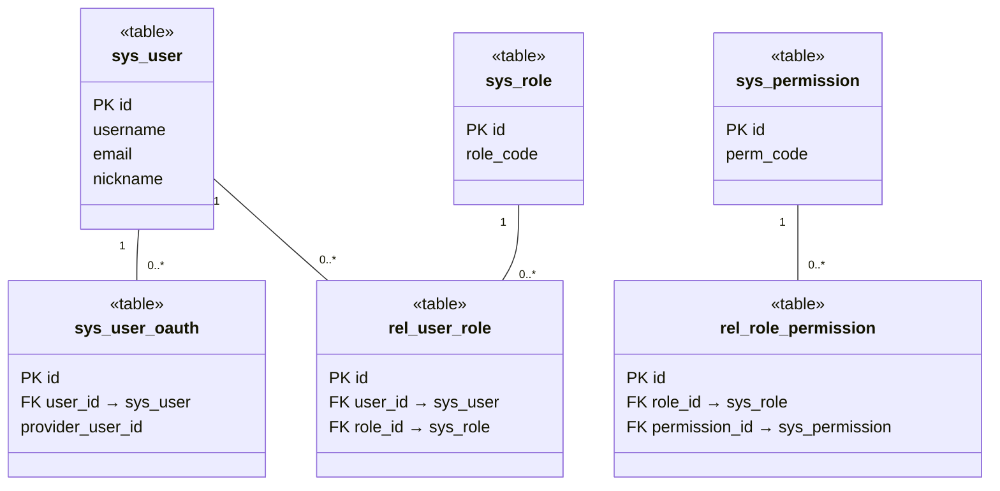
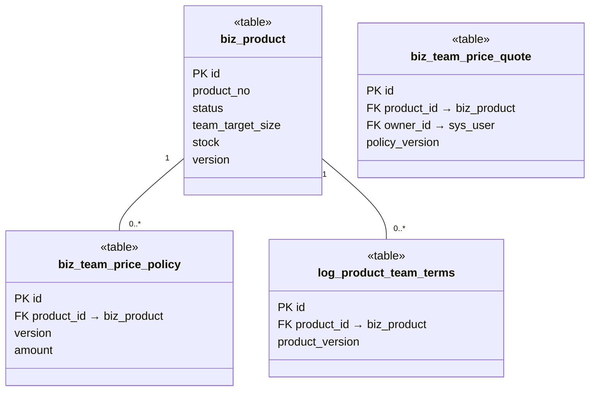
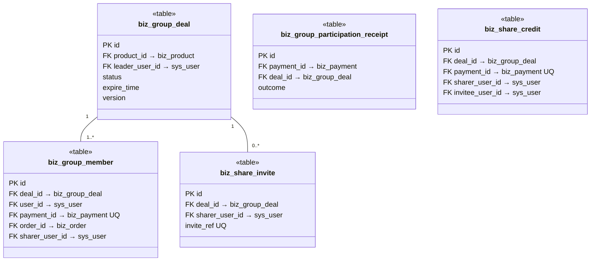
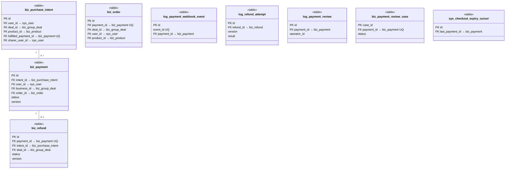
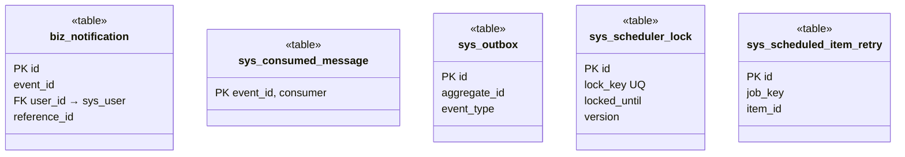

<!-- report
rubric: C
owner: Liu Jin
plan: #681
sources: ../presentation/src/diagrams/full-erd.svg
status: draft
-->

# Appendix C Full ERD and Table List {.appendix}

This appendix completes section 3.6. Figures C.1 to C.5 show all 29 tables of the SWE5006 monolith, one figure per owning context or pair of contexts, and Table C.1 lists each table with its purpose, its owning context, the SWE5001 service that owns it, and the migration that created it. The conventions behind the schema (UUIDv7 keys, table prefixes, no foreign keys or CHECK constraints, soft delete, version columns) are explained in section 3.6 and are not repeated here.

The figures are UML class diagrams used as a data model, one «table» class per table, with the primary key (PK) and every logical foreign key (FK) column. Each FK column names the table it references after an arrow, whether or not a line is drawn; lines with multiplicities are drawn between tables that sit side by side. The deck's single-page crow's foot diagram of the same schema (`docs/swe5006/presentation/src/diagrams/full-erd.svg`) is too tall to print legibly on A4, so it is not reproduced here.

Figure C.1: Identity tables (SWE5001 owner identity-svc), UML class diagram used as a data model. Roles and permissions are many-to-many links through the two `rel_` tables, which are soft-deleted on revoke.

Figure C.2: Catalog tables (SWE5001 owner commerce-svc), UML class diagram used as a data model. A product's price is a series of revisions, and every administrator change to its team terms leaves an audit row.

Figure C.3: Groupbuy tables, including share invites and referral credits (SWE5001 owner commerce-svc), UML class diagram used as a data model. A team links to its product, members and payments only through identifier columns, and a referral credit exists at most once per payment.

Figure C.4: Order (purchase intents and orders) and payment tables (SWE5001 owner commerce-svc), UML class diagram used as a data model. Every payment-side table points back to `biz_payment`, and UQ marks the columns that allow at most one row per payment.

Figure C.5: Notification tables (top row, SWE5001 owner notification-svc) and the shared job and outbox tables (commerce-svc), UML class diagram used as a data model. These tables reference business rows only by opaque identifiers, so no logical foreign key is drawn.

Table C.1: All 29 tables, by owning context. "SWE5001 owner" is the service whose database role may write the table on the SWE5001 environment (backend ADR 0008); on the SWE5006 `dev` host all tables live in one database.

| Table | Purpose | Context | SWE5001 owner | Created in |
| --- | --- | --- | --- | --- |
| `sys_user` | User accounts: login identity and profile | identity | identity-svc | V3 |
| `sys_user_oauth` | Links a user to a Google account (one row per provider account) | identity | identity-svc | V3 |
| `sys_role` | RBAC roles, loaded into Sa-Token at sign-in | identity | identity-svc | V3 |
| `sys_permission` | RBAC permission points, such as reading payments in the admin console | identity | identity-svc | V3 |
| `rel_user_role` | Which user has which role; revoked rows are soft-deleted | identity | identity-svc | V3 |
| `rel_role_permission` | Which role grants which permission; revoked rows are soft-deleted | identity | identity-svc | V3 |
| `biz_product` | Sellable products (listings) with their team terms: target size and team lifetime | catalog | commerce-svc | V4 (team terms V14) |
| `biz_team_price_policy` | Append-only price revisions for a product's first team; the latest version is the current price | catalog | commerce-svc | V6 |
| `biz_team_price_quote` | Immutable price quotations shown to buyers | catalog | commerce-svc | V6 |
| `log_product_team_terms` | Audit of every administrator change to a product's team terms | catalog | commerce-svc | V20 |
| `biz_group_deal` | Teams (blocs): product, leader, target and current size, status and deadline | groupbuy | commerce-svc | V5 |
| `biz_group_member` | Members of a team, one active row per buyer per team, linked to the payment and order | groupbuy | commerce-svc | V5 (payment link V7) |
| `biz_group_participation_receipt` | Immutable result of applying one payment to a team, kept even if the team is deleted; marks payments that need compensation | groupbuy | commerce-svc | V7 |
| `biz_share_invite` | Invite references a member shares, one active invite per sharer per team | groupbuy | commerce-svc | V18 |
| `biz_share_credit` | Immutable referral credits, one per paid participation that came through an invite | groupbuy | commerce-svc | V18 |
| `biz_purchase_intent` | Server-owned price and terms for one START or JOIN checkout attempt; Stripe Checkout is built only from this row | order | commerce-svc | V15 |
| `biz_order` | Buyer orders; the database, not Redis, is the source of truth for order state | order | commerce-svc | V12 |
| `biz_payment` | Payment attempts and their Stripe Checkout sessions; provider state is mirrored here | payment | commerce-svc | V2 (Checkout columns V9) |
| `log_payment_webhook_event` | Every Stripe webhook event received, inserted before processing so a replay is ignored | payment | commerce-svc | V2 |
| `biz_refund` | Refund obligations for expired teams or provider-mandated refunds, with lease and retry state | payment | commerce-svc | V9 (execution columns V11) |
| `log_refund_attempt` | Immutable audit of each refund attempt; holds no customer or card details | payment | commerce-svc | V11 |
| `log_payment_review` | Audit of operator decisions on payments under review | payment | commerce-svc | V9 |
| `biz_payment_review_case` | Work queue of payments that need human inspection | payment | commerce-svc | V10 |
| `sys_checkout_expiry_cursor` | Saved position of the operator-run sweep that expires stale Checkout sessions | payment | commerce-svc | V25 |
| `biz_notification` | Immutable in-app notifications (off on `dev`) | notification | notification-svc | V27 |
| `sys_consumed_message` | Integration events already applied by a consumer, so a duplicate is ignored | notification | notification-svc | V28 |
| `sys_scheduler_lock` | Lease rows that let only one instance run each scheduled job | common (jobs) | commerce-svc | V13 |
| `sys_scheduled_item_retry` | Back-off state for items that failed inside a scheduled job | common (jobs) | commerce-svc | V17 |
| `sys_outbox` | Transactional queue of integration events waiting for the relay (off on `dev`) | common (integration) | commerce-svc | V26 |

The remaining migrations create no table: V1 is a placeholder that states the naming rules, V8, V16 and V23 add or narrow indexes, V14, V19 and V22 add columns (product team terms, the purchase intent's sharer and its expiry), V21 adds the product-number sequence, and V24 grants the admin payment-read permission.
